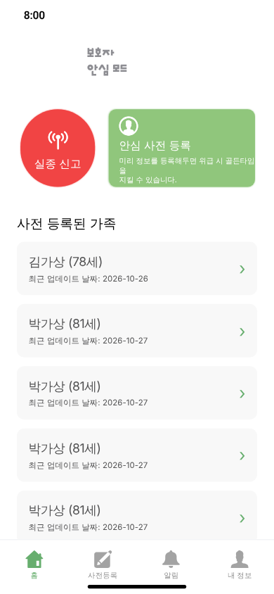
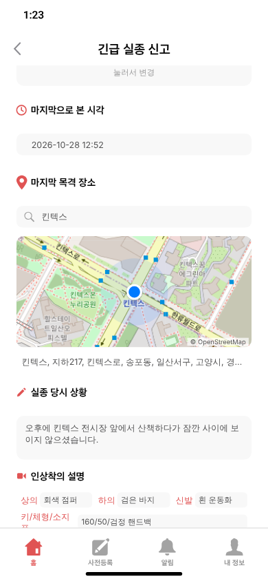
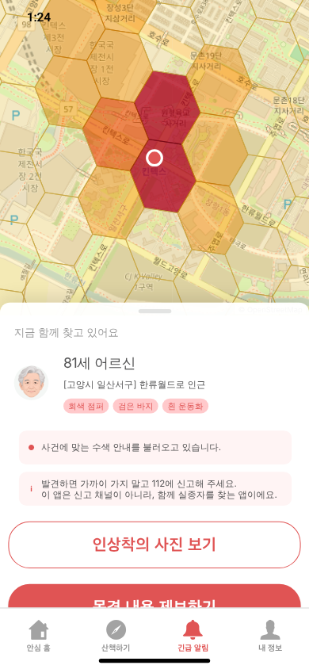
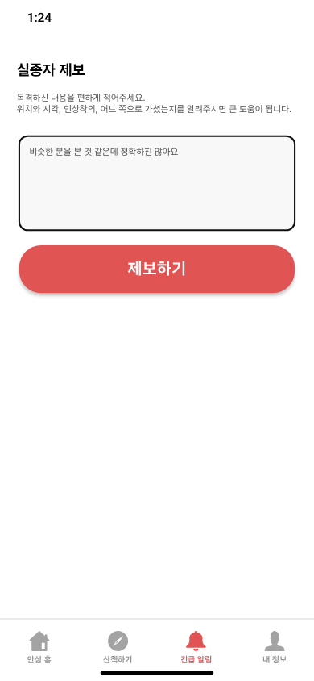
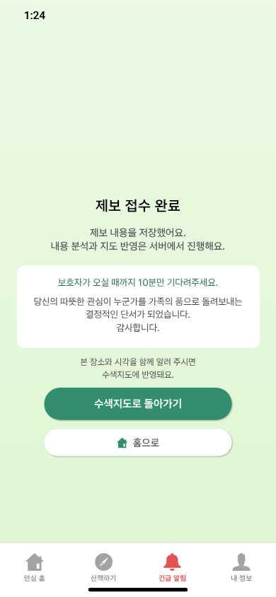
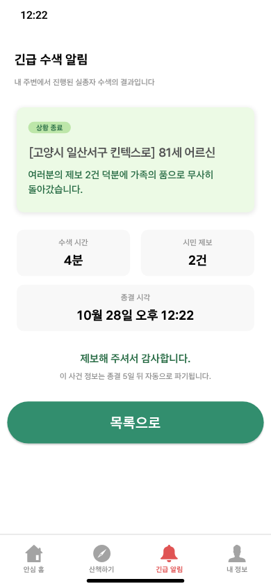
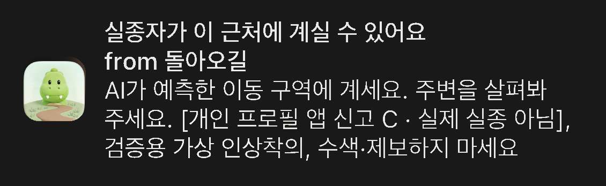
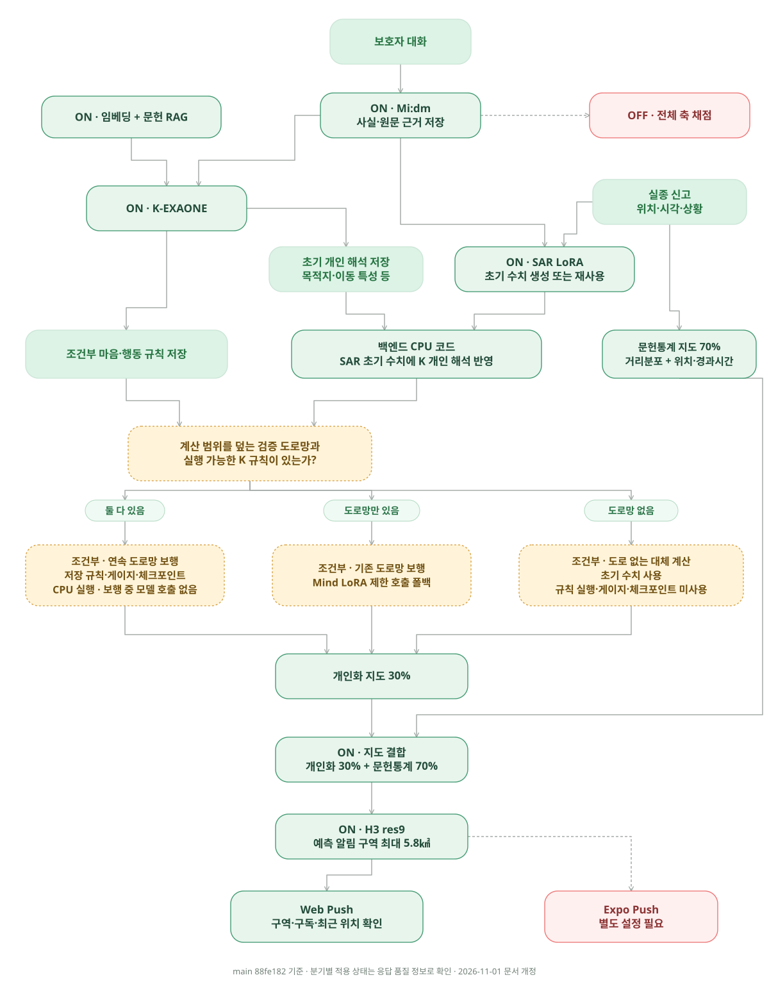
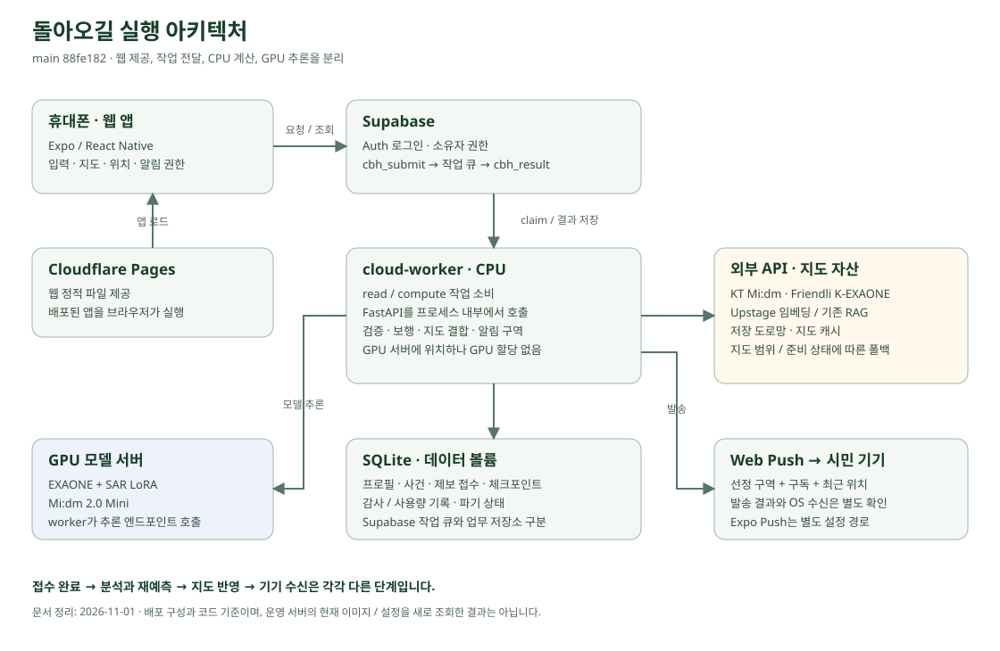
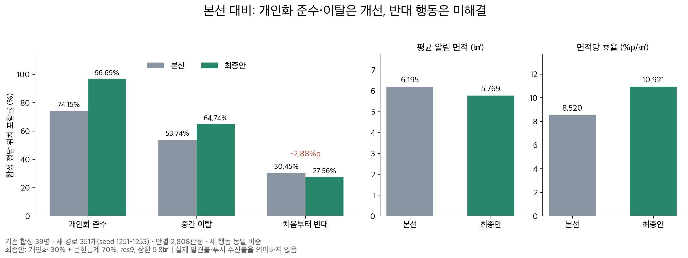

<p align="center">
  
</p>

<h1 align="center">돌아오길</h1>

<p align="center">
  <strong>알림을 피로가 아니라, 내가 해결할 수 있는 일로 바꿉니다.</strong><br>
  AI 기반 동선 예측과 맞춤 알림으로 실종자 수색을 효율화하는 서비스
</p>

<p align="center">
  <a href="https://doraogil.pages.dev/"><strong>🌿 돌아오길 서비스 바로가기</strong></a><br>
  <a href="https://doraogil.pages.dev/">https://doraogil.pages.dev/</a>
</p>

<p align="center">
  <a href="https://doraogil.pages.dev/"></a>
</p>

**돌아오길은 치매 실종자의 평소 생활 정보를 바탕으로 이동 가능 지역을 예측하고, 시민의 일상적인 참여를 수색 활동으로 연결하는 서비스입니다.**

서강대학교 팀 동행의 2026 인공지능 루키 국내 AI 트랙 결선 프로젝트입니다.

[문서 안내](docs/README.md) · [아키텍처와 처리 흐름](docs/ARCHITECTURE_20261101.md) · [최종 정책과 근거](docs/experiments/final-alert-policy-20261012.md) · [API 계약](API_CONTRACT.md)

## 왜 돌아오길인가요?

실종 알림을 받아도 **어디를 우선적으로 살펴보고, 무엇을 제보해야 할지** 알기 어려울 수 있습니다. 실종이 발생한 뒤에야 보호자로부터 평소 행동 습관과 자주 방문하는 장소를 수집하면 초기 대응에도 시간이 걸립니다.

돌아오길은 다음 질문에서 시작했습니다.

> <strong>실종자의 정보는 미리 준비하고, 수색이 필요한 구역의 시민에게 구체적인 참여 방법을 안내할 수 없을까?</strong>

## 세 단계로 연결하는 수색

### 1. 평상시 — 보호자의 생활 정보 준비

보호자가 AI 챗봇과 대화하며 가족의 생활 습관, 이동 특성, 자주 방문하는 장소를 사전 등록합니다. “어머니가 평소 동네 공원을 자주 찾으세요” 같은 정보를 미리 준비합니다.

### 2. 실종 발생 — 예측 지도와 맞춤 알림

마지막 목격 장소·시각과 당시 상황을 입력하면, 사전 등록 정보와 사건 정보를 연결해 이동 가능 지역을 확률 지도로 제시합니다. 선정 구역에서 알림 수신 조건을 충족한 참여 시민에게 선별적으로 알림을 보냅니다.

### 3. 시민 참여 — 목격 제보와 수색 구역 갱신

시민이 수색 지도와 인상착의를 확인하고 목격 내용을 제보합니다. 서버가 제보를 분석해 반영 가능한 정보에 따라 위치 확률과 수색 우선 구역을 갱신합니다. 가족을 찾아 사건이 종결되면 참여 시민에게 상황 종료와 감사 안내를 보여줍니다.

평상시에는 산책 기록과 주변 산책 장소 추천으로 앱을 이용하고, 실종 경보를 받으면 같은 앱에서 수색 지도와 제보로 이동할 수 있습니다. 돌아오길은 **보호자의 일상 정보와 시민의 일상 활동을 하나의 수색 과정으로 연결**합니다.

## 서비스 화면

보호자 등록부터 시민의 수색 참여와 제보, 상황 종료까지 이어지는 **실제 앱 화면**입니다. 제공된 화면 보드의 원본 PNG를 사용했습니다. 2026-10-28–29 배포 웹앱에서 합성 인물·사건으로 촬영했으며, 사진을 누르면 크게 볼 수 있습니다.

<table align="center">
<tr><th align="center">보호자 홈</th><th align="center">실종 신고</th><th align="center">시민 수색 지도</th></tr>
<tr>
<td align="center"><a href="docs/assets/service-flow-20261101/guardian-home.png"></a></td>
<td align="center"><a href="docs/assets/service-flow-20261101/missing-report.png"></a></td>
<td align="center"><a href="docs/assets/service-flow-20261101/search-map.png"></a></td>
</tr>
<tr><th align="center">목격 내용 제보</th><th align="center">제보 접수 완료</th><th align="center">상황 종료 · 감사 안내</th></tr>
<tr>
<td align="center"><a href="docs/assets/service-flow-20261101/tip-input.png"></a></td>
<td align="center"><a href="docs/assets/service-flow-20261101/tip-receipt.png"></a></td>
<td align="center"><a href="docs/assets/service-flow-20261101/resolved-detail.png"></a></td>
</tr>
</table>

상황 종료 화면의 ‘4분·제보 2건’은 합성 시연 사건의 표시값입니다. 실제 구조 실적이나 발견율을 뜻하지 않습니다. 접수 완료는 제보 저장을 뜻하며 지도 반영 완료와 구분합니다. [등록 대화·경보 상세 등 전체 12장과 촬영 출처](docs/SERVICE_SCREENS_20261101.md).

<details>
<summary>실제 iPhone OS 알림 확인 기록 (2026-10-26)</summary>

<p align="center"></p>

10월 26일 같은 합성 사건의 추가 발송 기록과 휴대폰 수신을 확인했습니다. 위 웹앱 캡처와 별도의 검증입니다. [사진·촬영 시각·검증 범위](docs/SERVICE_SCREENS_20261026.md).

</details>

## 최종 구현

| 항목 | 선택한 구성 |
|---|---|
| 개인화 지도 | SAR LoRA 초기 수치 + K-EXAONE 개인 해석 + 저장된 조건별 마음, 행동 규칙 |
| 독립 통계 지도 | 마지막 목격 위치, 경과시간, SAR 문헌의 이동거리 분포 |
| 지도 결합 | 개인화 30% + 문헌통계 70% |
| 알림 구역 | H3 res9, 대상 구역 합집합 최대 5.8㎢ |
| 전체 성향 축 채점 | OFF. SAR 초기 prior 생성과 K 개인 해석 반영은 유지 |
| 서비스 연결 | Cloudflare Pages → Supabase Auth·작업 큐 → CPU worker ↔ GPU 모델 서버 |

보호자 정보와 마음, 행동 규칙을 반영한 개인화 지도에 30%, 문헌의 이동거리 분포로 계산한 통계 지도에 70%의 가중치를 적용해 최종 위치 확률을 산출합니다. 개인의 습관과 행동 특성을 반영하면서, 평소와 다른 이동 가능성까지 함께 고려하도록 설계했습니다.

문헌통계 지도는 개인별 SAR 전략이나 K의 마음 규칙을 읽지 않고 독립적으로 계산합니다. 두 지도는 정규화 후 결합하며, 이후 면적 예산 안에서 알림 구역을 선택합니다. [두 채널 구현과 마지막 비교](docs/experiments/final-sar-literature-comparison-20261012/README.md).

## 등록부터 수색까지

1. **보호자 등록:** Mi:dm과 대화하며 생활 습관, 이동 능력, 자주 가는 장소를 저장합니다. K-EXAONE이 개인 해석과 조건별 행동 규칙을 미리 준비합니다.
2. **실종 신고:** 등록 프로필과 마지막 목격 위치, 시각, 인상착의를 연결합니다. 신고 완료 화면이 예측 요청을 자동 시작하고 계산은 서버에서 진행합니다. 서버의 주기 갱신도 미예측 사건을 확인합니다.
3. **예측과 알림:** 도로망 보행으로 개인화 지도를 만들고 독립 문헌통계 지도와 결합합니다. 선정 구역의 위치, 구독, 참여 상태 등 수신 조건을 충족한 시민에게 앱, 웹 푸시를 보냅니다.
4. **시민 제보:** Mi:dm 2.0 Mini가 제보를 구조화하고 코드는 정보 충실도와 시공간 개연성을 평가합니다. 앱의 비동기 접수 경로는 제보를 저장해 먼저 응답하고, 구조화·지도 갱신·재예측과 추가 알림을 뒤에서 처리합니다. 재계산 중에는 저장된 지도를 조회합니다.
5. **시간 갱신과 종결:** 보행 체크포인트를 이어 계산합니다. 사건 종결 후 예측과 추가 제보를 차단하고, 설정된 보관 기간과 파기 절차를 적용합니다.

평상시에는 산책 기록과 주변 산책 장소 추천을 제공합니다. 실종 경보를 받으면 같은 앱에서 수색 지도와 제보로 이동합니다. 신고, 알림, 예측은 공적 실종 신고 및 수색을 보조합니다.

## 아키텍처와 처리 흐름

등록 때 K-EXAONE의 개인 해석과 행동 규칙을 준비하고, 신고 때 SAR 초기 수치와 연결합니다. 도로망·규칙 준비 상태에 따라 보행을 계산한 뒤 개인화 30%와 독립 문헌통계 70%를 결합해 알림 구역을 고릅니다.

<p align="center"><a href="docs/assets/architecture-20261101/prediction-flow.svg"></a></p>

10월 30일 처리 흐름을 첨부한 초록색 도식 구성에 맞춰 정리하고, main `88fe182` 코드와 대조했습니다. 그림의 ON은 사용 경로를 뜻하며 모든 사건에서 규칙 보행이 실행됐다는 의미는 아닙니다. 신고 직후의 1차 주변 경보는 예측 기반 경보와 별도입니다. 시민 제보는 저장 후 먼저 응답하고, Mini 구조화·코드 평가·지도 갱신과 재예측을 뒤에서 처리합니다.

<details>
<summary>실행 아키텍처 — Cloudflare·Supabase·CPU·GPU 연결</summary>

웹 파일은 Cloudflare Pages가 제공하고, Supabase는 인증과 작업 전달을 담당합니다. GPU 서버에 있는 **worker의 CPU**가 검증·보행·지도 결합을 수행하며, 필요한 순간 GPU 모델 서버나 외부 API를 호출합니다. 프로필·사건·제보·체크포인트는 worker의 SQLite 데이터 볼륨에 저장합니다.



</details>

[제보·시간 갱신까지 포함한 상세 처리 흐름](docs/assets/architecture-20261101/processing-flow.svg) · [실행 구조·폴백과 코드 근거](docs/ARCHITECTURE_20261101.md) · [부스 전용 템플릿·준비 결과 재사용](docs/DEMO_ONBOARDING.md)

### 모델별 역할

| 구성 | 역할 |
|---|---|
| KT Mi:dm API | 보호자 대화, 사실 추출, 답변 맥락과 장소 정보 보존 |
| Upstage embedding | 질문 및 기존 연구 문헌 검색 |
| EXAONE + SAR LoRA (`exaone-sar`) | 사건 초기 이동 전략 비율, 장소 끌림 등급, 이동 반경 등급 |
| K-EXAONE | 보호자 원문과 검색 근거를 해석해 개인화 보정 및 조건별 마음, 행동 규칙 생성 |
| 보행 코드 | 수치 검증, 도로 이동, 저장 규칙 실행, 체크포인트 재사용 |
| Mi:dm 2.0 Mini | 시민 제보 구조화, 별도 문구 모델 미설정 시 수색 안내 문구 |
| EXAONE Base / 예전 Mind LoRA | 전체 축 채점은 OFF. 예전 마음 재해석은 legacy/fallback 경로로 보존 |

정상 준비된 보행 경로에서는 저장 규칙을 코드로 실행합니다. 새 Mind LoRA 후보는 최종 채택하지 않았습니다. 모델의 의미 해석과 코드의 좌표, 확률, 발송 판단을 구분합니다. 온보딩 API 식별자 `midm-pro-fp8-kaic`와 제보용 `midm-2.0-mini`는 서로 다른 경로입니다.

## 본선 대비 성능

KINTEX 합성 인물 39명의 새 이동 경로 351개를 두 예측 시드와 1, 2, 4, 6시간에서 평가했습니다. 방식별 2,808판정이며 같은 인물의 반복 판정을 포함합니다. 본선 당시 res7 정책과 최종 res9 면적 상한 정책을 포함한 시스템 비교입니다.

| 평가 항목 | 본선 | 최종안 |
|---|---:|---:|
| 평소 습관과 보호자 설명대로 이동 | 74.15% | 96.69% |
| 평소대로 이동하다가 중간에 다른 경로로 이동 | 53.74% | 64.74% |
| 처음부터 예상 방향과 반대로 이동 | 30.45% | 27.56% |
| 전체 정답 위치 포함률 | 52.78% | 63.00% |
| 평균 알림 면적 | 6.195㎢ | 5.769㎢ |
| 면적당 효율: 포함률(%) / 평균 면적(㎢) | 8.520 | 10.921 |

전체 면적당 효율은 **28.18% 개선**됐습니다. 평소 행동과 중간 경로 변경에서는 포함률이 높아졌지만, 처음부터 반대로 이동하는 경우에는 **2.88%p 낮아졌습니다**.



[평가 조건과 원본 집계](docs/experiments/directional-alert-safety-20261012/README.md) · [최종 선택 이유](docs/experiments/final-alert-policy-20261012.md) · [시간 오류 영향 및 수치 재확인](docs/verification/final-evidence-audit-20261023/README.md)

### 평가 범위와 한계

- 치매 관련 논문을 참고한 행동 모델을 가상 보호자 답변과 이동 시나리오로 평가했습니다. 최종 39명은 목적지, 휴식, 대기, 장소 회피 조건을 조합한 합성 인물이며, 논문의 실제 환자 39명을 그대로 추출한 자료가 아닙니다.
- 정답 경로 생성은 예측 지도를 읽지 않지만, 입력과 정답이 작성된 행동 가정 및 도로망을 공유합니다. 세 이동 상황의 비중은 평가용 설정입니다.
- 새로운 실제 환자, 실제 실종 경로, 발견율, 단말 전달률, 원화 비용 절감은 이 성능표의 평가 대상이 아닙니다.
- 개인화 준비가 실패하거나 일부 규칙이 격리되면 적용 범위가 줄어듭니다. 준비 상태와 폴백을 확인해야 합니다.
- 앱 설치, 위치 및 알림 권한, 기기 위치 갱신, 수신자 밀도는 현장 효과에 영향을 줍니다.

## 코드, 실험, 배포 기록

2026-11-01 문서 개정은 main `88fe182`(#358) 기준입니다. 표지와 10월 28–29일 앱 캡처를 추가하고, 10월 30일 처리 흐름도를 최신 코드와 대조했습니다. 부스 템플릿·준비 결과 재사용(#352–#356), 대표 보행 궤적 저장(#357), 제보 목격 시각의 한국 시간 해석(#358)을 문서에 연결했습니다. 기존 성능표는 해당 실험 기록을 유지합니다.

- [문서 안내](docs/README.md): 최종 구조, 평가, 과거 실험, 검증 기록을 목적별로 찾기
- [최신 아키텍처와 처리 흐름](docs/ARCHITECTURE_20261101.md): CPU/GPU 분리, 접수·분석 분리, 폴백과 코드 근거
- [10월 12일 E2E 구조](docs/SERVICE_E2E_20261012.md): 당시 축 OFF, SAR prior, 마음 규칙, Mini 역할
- [클라우드 실행 구조](deploy/supabase/README.md): 인증, 대기열, worker, 배포 설정
- [지역 도로망 사전 저장](docs/verification/regional-road-cache-20261026/README.md): Supabase 지도 캐시와 망원 적용 검증
- [10월 12일 서비스 검증](docs/verification/service-full-audit-20261012/README.md): 해당 시점의 범위와 잔여 한계
- [발표 참고 자료](docs/PRESENTATION_FINAL_20261012.md): 비교표, 설명, 질문 답변

날짜가 붙은 배포 및 검증 문서는 해당 실행 시점의 기록입니다. GitHub main 반영과 현재 운영 서버의 이미지 일치를 별도로 확인해야 합니다.

## 저장소 구조

```text
backend/       FastAPI, 온보딩, SAR prior, 도로망 보행, 제보, 알림, 파기
frontend/      Expo / React Native 앱과 웹, Supabase 인증 및 작업 전송
dashboard/    내부 시연과 관제용 Vite / React 화면
deploy/       Supabase 대기열 SQL, CPU worker와 GPU 모델 연결 구성
docs/         최종 구조, 평가 근거, 날짜별 검증과 과거 실험
API_CONTRACT.md  전송 경계와 업무 API 계약
```

## 로컬 개발

Python 3.13 환경과 Node.js/npm을 준비합니다. 로컬 HTTP 실행과 운영 Supabase 연결은 별도 모드입니다.

### 백엔드

```bash
cd backend
python3 -m venv .venv
source .venv/bin/activate
pip install -r requirements.txt
cp .env.example .env
uvicorn app.main:app --reload --host 127.0.0.1
```

로컬 API는 `http://localhost:8000`, OpenAPI는 `/docs`입니다. 모델 연결이 없으면 해당 경로가 스텁 또는 폴백으로 동작하므로 최종 모델 품질 검증과 구분합니다. 데모 사건 자동 생성은 기본 OFF입니다. 실제 모델, 지도, 푸시 연결은 환경 설정과 별도 검증이 필요합니다.

### 프런트엔드

`frontend/.env`에 로컬 개발 설정을 넣습니다.

```dotenv
EXPO_PUBLIC_TRANSPORT=http
EXPO_PUBLIC_API_BASE=http://localhost:8000
EXPO_PUBLIC_USE_MOCK=false
```

```bash
cd frontend
npm ci
npm run web
```

실기기는 `localhost` 대신 접근 가능한 개발 서버 주소가 필요합니다. 운영 웹은 `EXPO_PUBLIC_TRANSPORT=supabase`와 해당 프로젝트의 공개 URL, publishable/anon 키를 사용합니다. `npm run build:web:cloud`가 빌드에 반영된 연결 설정을 검사합니다. [클라우드 설정](deploy/supabase/README.md).

### 내부 대시보드와 검사

```bash
cd dashboard
npm ci
npm run dev
```

```bash
cd backend
python -m pytest -q
```

백엔드 단위검사는 외부 연결을 차단하고 모델을 스텁 처리합니다. 일부 과거 회귀검사는 과거 정책을 명시적으로 사용하며, [최종 기본값 검사](backend/tests/test_target_resolution_contract.py)는 개인화 30%, 문헌통계 70%, res9, 5.8㎢를 별도로 확인합니다. [최근 문서 검증 범위](docs/verification/final-evidence-audit-20261023/README.md).

## 외부 공개 자료

- [EXAONE-Dementia-SAR](https://huggingface.co/Damisoda/EXAONE-Dementia-SAR): SAR LoRA 어댑터와 사용 안내
- [Dementia-Personalized-Search](https://huggingface.co/Damisoda/Dementia-Personalized-Search): 개인화 수색 코드와 입출력 예시

공개 패키지별 이용 조건과 데이터 공개 범위는 각 모델 카드 및 라이선스를 확인합니다. 외부 패키지의 라이선스를 이 저장소 전체에 자동 적용하지 않습니다.

## 팀

서강대학교 팀 동행 — 2026 인공지능 루키 국내 AI 트랙

| 역할 | 구성원 |
|---|---|
| 팀장 | 한민영 |
| 개발 | 김민아 · 방서영 · 조대흠 |
| 기획·디자인 | 이수빈 · 이지영 |
