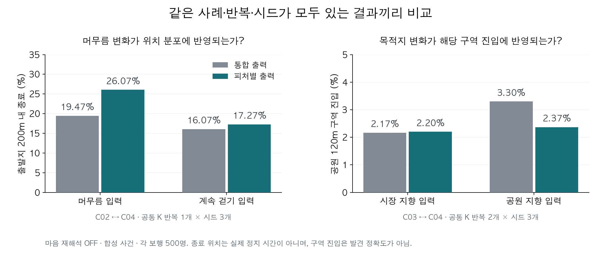
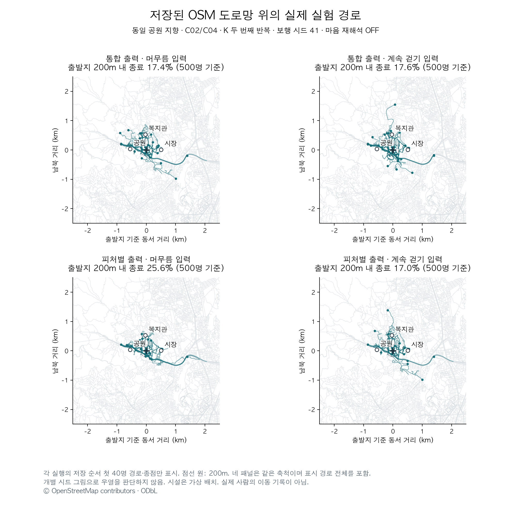

# 실제 출력과 그림으로 읽는 실험

이 문서의 보호자 진술은 **합성 사례의 입력**, 모델 문장은 **저장된 실제 API 응답의 발췌**다. 이해를 위해 세 응답을 선택했으며 전체 오류율을 대신하는 대표 표본은 아니다. 전수 원문·검토 메모는 [24개 저장 응답](saved_outputs.json)에 있고, 발췌의 위치는 [출처 목록](example_quotes.json)으로 확인할 수 있다. 모델 문장과 아래 작성자의 해설을 구분해 읽는다.

## 1. 같은 응답 안에서 ‘방향 미확인’이 ‘직진 관찰’로 바뀜

사례 `C03_FEATURES_1`: 시장으로 향하고 계속 걷는 사람. 방향 전환은 미확인. K 두 번째 응답.

**입력 N2 원문**

> 최근 헤맬 때 방향을 바꾸는지, 익숙한 길을 이용하는지는 가족이 직접 관찰하지 못했다.

**모델의 이동 지속성 결론 원문**

> 개인 관찰에 따르면 헤매는 상황에서도 멈추지 않고 계속 걸어가는 이동 지속성이 나타났으나, 방향 전환 여부는 미확인이다.

**같은 모델 응답의 경로 형태 결론 원문**

> 개인의 경로 형태는 직접 관찰되지 않았으나, 헤매는 상황에서도 직진하는 경향이 관찰되어 route_following 또는 direction_keeping 가설이 부분적으로 지지된다.

**해설:** 첫 결론에서는 방향 전환이 미확인임을 보존했지만, 다음 결론에서는 직진을 관찰한 것으로 바뀌었다. 치매 행동 지식으로 직진 가능성을 가설로 남기는 것은 허용된다. 문제는 가설을 이번 개인의 관찰 사실로 승격한 것이다. 피처별 칸을 나누는 것만으로 피처 사이의 의미 혼동이 사라지지는 않았다.

## 2. ‘높인다’는 설명과 실제 숫자가 반대

사례 `C05_FEATURES_1`: 시장 방향 지향과 갈림길 직진을 관찰한 사람. K 두 번째 응답.

아래 JSON은 실제 응답에서 관련 필드만 발췌해 묶었다. 값과 설명은 원문 그대로이며 전체 응답은 아래에서 펼쳐 볼 수 있다.

```json
{
  "integration_item": {
    "target": "strategy_probs.landmark_seeking",
    "feature_refs": [
      "destination_pull"
    ],
    "action": "increase",
    "reason": "시장 방향에 대한 반복적 지향이 관찰되어 특정 장소(시장)에 대한 끌림이 존재할 가능성이 높다."
  },
  "prior.strategy_probs.landmark_seeking": 0.0
}
```

| 단계 | landmark_seeking |
|---|---:|
| 고정 SAR 참조 | 0.10 |
| K의 원출력 | 0.00 |
| 기존 코드의 바닥값·정규화 적용 후 | 약 0.0196 |

**해설:** `increase`라고 선언했지만 원출력은 0.10에서 0.00으로 줄었다. 이후 약 0.0196이 된 것은 기존 코드의 0.02 바닥값과 정규화 때문이다. 이 코드 변환을 K의 판단으로 해석하지 않는다. 어떤 확률이 정답인지를 몰라도, 변경 선언과 실제 값의 모순은 확인할 수 있다.

## 3. 관찰을 반영한 부분도 있음 — 다만 반복 일관성은 별도

사례 `C06_FEATURES_1`: 갈림길에서 좌우로 자주 방향을 바꾼다는 관찰이 있는 사람. K 두 번째 응답.

**모델의 경로 형태 결론 원문**

> 개인 관찰에 따르면 방향 전환이 빈번하며, 이는 경로 혼란 또는 익숙 경로 이탈 가능성을 시사한다. 그러나 경로 이용 여부는 미확인이다.

**원출력의 전략 비교**

| 항목 | 고정 SAR 참조 | 이 K 응답 |
|---|---:|---:|
| direction_keeping | 0.20 | 0.15 |
| random_walk | 0.15 | 0.35 |

**해설:** 이 부분은 잦은 방향 전환이라는 관찰에 맞춰 방향 유지 설정을 낮췄다. 하지만 같은 입력의 첫 응답 `C06_FEATURES_0`은 direction_keeping을 0.30으로 높였다. 한 응답이 납득 가능해 보이는 것과 반복해서 안정적으로 해석하는 것은 다른 평가다. 이 응답에도 과거 이력 N0의 근거 목록 누락이 있어 전체적으로 검증 완료한 출력은 아니다.

## 4. 집계 그림: 좋아진 부분과 남은 문제를 함께 보기



왼쪽은 공원 지향 사례에서 머무름/계속 걷기를 바꾼 비교다. 피처별 출력에서 출발지 주변 종료 비율 차이가 더 컸다. 오른쪽은 계속 걷는 조건에서 목적지만 시장/공원으로 바꾼 비교이며, 피처별 방식의 공원 구역 진입 변화는 작았다. 서로 다른 지표라 두 패널의 세로축 범위도 다르며 각각 0에서 시작한다.

막대는 보행 시드별 비율의 평균이다. 왼쪽은 공통 K 반복 1개×시드 3개, 오른쪽은 K 반복 2개×시드 3개다. 시드나 500명을 독립 K 응답으로 취급한 신뢰구간·유의성 주장은 하지 않는다. 자세한 분모는 [비교 원자료](matched_comparison.json)에 있다.

## 5. 실제 보행 경로: 같은 조건의 네 실행



- 행: 통합 출력 / 피처별 출력. 열: 머무름 / 계속 걷기. 네 패널은 모두 공원 지향이다.
- C02/C04에서 비교 가능한 K 두 번째 반복을 사용했고, 사전에 정한 시드 중 가장 작은 41을 표시했다.
- 각 실행의 **저장 순서 첫 40명** 경로와 종점만 표시했다. 보기 좋은 경로를 고르지 않았다. 제목의 비율은 해당 실행 **500명 전체**로 계산했다.
- 도로의 실제 굴곡을 사용한다. 네 패널의 축척이 같고 표시한 160개 경로 전체가 범위 안에 들어간다. 점선 원은 출발지 200m 범위다.
- 개별 시드의 그림이므로 바로 위 3개 시드 평균 막대와 수치가 다를 수 있다. 그림만으로 구성의 우열을 판정하지 않는다.
- 지도는 실제 저장 OSM 도로망이지만 사람과 후보 시설은 가상이다. 실제 실종 경로나 1시간의 이동·휴식 타임라인을 관찰한 자료가 아니다.

출처: © OpenStreetMap contributors · [ODbL](https://www.openstreetmap.org/copyright).

## 6. 실제 모델 응답 전체

아래에는 코드블록을 포함한 저장 응답 문자열을 그대로 넣었다. 형식 교정이나 내용 수정은 하지 않았다. N0/N1/N2도 해당 합성 사례의 전체 문장을 함께 제공한다.

<details>
<summary>C03_FEATURES_1 — 입력과 모델 응답 전체 펼치기</summary>

**N0**

> 등록된 세 장소 모두 예전에 여러 차례 향하는 모습을 가족이 관찰했다. 최근의 방향이나 의도는 아래 추가 관찰을 따른다.

**N1**

> 최근 한 달 동안 혼자 외출하면 시장 쪽으로 걷는 모습을 가족이 여러 번 봤다. 최근 길을 몰라 헤매는 상황에서는 멈추지 않고 계속 걸어가는 모습을 가족이 여러 번 봤다.

**N2**

> 최근 헤맬 때 방향을 바꾸는지, 익숙한 길을 이용하는지는 가족이 직접 관찰하지 못했다.

**모델 응답 원문**

````text
```json
{
  "features": {
    "destination_pull": {
      "personal_evidence": [
        {"note_id": "N1", "quote": "최근 한 달 동안 혼자 외출하면 시장 쪽으로 걷는 모습을 가족이 여러 번 봤다."}
      ],
      "domain_hypotheses": [
        {
          "basis": ["R1"],
          "claim": "치매 노인은 익숙한 장소(시장, 복지관 등)를 반복적으로 방문하는 경향이 있으며, 이는 정상적이고 감독받지 않는 활동의 일환으로 나타난다.",
          "limitation": "이번 개인의 최근 방문 장소가 시장으로 제한되어 관찰되었으나, 복지관이나 공원에 대한 최근 방문 여부는 확인되지 않았다."
        }
      ],
      "unknowns": [
        "최근 복지관 또는 공원 방문 여부",
        "시장 외 다른 장소에 대한 지향성 변화 여부"
      ],
      "conclusion": "개인 관찰에 따르면 시장에 대한 지향성이 최근 확인되었으나, 다른 익숙한 장소에 대한 최근 지향성은 미확인이다."
    },
    "movement_persistence": {
      "personal_evidence": [
        {"note_id": "N1", "quote": "최근 길을 몰라 헤매는 상황에서는 멈추지 않고 계속 걸어가는 모습을 가족이 여러 번 봤다."}
      ],
      "domain_hypotheses": [
        {
          "basis": ["R0"],
          "claim": "치매 노인은 방향 전환이 어려우며, 한 방향으로 직진하는 경향이 있어 이동 지속성이 높게 나타난다.",
          "limitation": "이번 개인의 방향 전환 여부는 직접 관찰되지 않았으므로, 직진 경향은 가설적 추정이다."
        }
      ],
      "unknowns": [
        "방향 전환 여부",
        "이동 중 휴식 또는 정지 빈도"
      ],
      "conclusion": "개인 관찰에 따르면 헤매는 상황에서도 멈추지 않고 계속 걸어가는 이동 지속성이 나타났으나, 방향 전환 여부는 미확인이다."
    },
    "route_shape": {
      "personal_evidence": [
        {"note_id": "N1", "quote": "최근 길을 몰라 헤매는 상황에서는 멈추지 않고 계속 걸어가는 모습을 가족이 여러 번 봤다."},
        {"note_id": "N2", "quote": "헤맬 때 방향을 바꾸는지, 익숙한 길을 이용하는지는 가족이 직접 관찰하지 못했다."}
      ],
      "domain_hypotheses": [
        {
          "basis": ["R3"],
          "claim": "치매 노인은 익숙한 경로를 따르는 경향이 있으며, 이탈 시에도 원래 경로 주변에서 재진입을 시도할 가능성이 있다.",
          "limitation": "이번 개인의 경로 이용 여부는 직접 관찰되지 않았으며, 이탈 여부도 확인되지 않았다."
        },
        {
          "basis": ["R0"],
          "claim": "방향 전환이 어려우며, 한 방향으로 직진하는 경향이 있어 route_following 또는 direction_keeping 전략이 우세할 수 있다.",
          "limitation": "이번 개인의 경로 이용이나 방향 유지 여부는 직접 관찰되지 않았다."
        }
      ],
      "unknowns": [
        "익숙한 경로 이용 여부",
        "방향 전환 또는 되돌아가는 행동 여부"
      ],
      "conclusion": "개인의 경로 형태는 직접 관찰되지 않았으나, 헤매는 상황에서도 직진하는 경향이 관찰되어 route_following 또는 direction_keeping 가설이 부분적으로 지지된다."
    },
    "mobility_range": {
      "personal_evidence": [],
      "domain_hypotheses": [
        {
          "basis": ["R1"],
          "claim": "치매 노인의 배회는 주로 익숙한 장소(시장, 복지관 등) 사이의 이동으로 제한되며, 생활 반경은 제한적일 가능성이 높다.",
          "limitation": "이번 개인의 이동 범위는 직접 관찰되지 않았으며, 과거 이력 외 최근 이동 거리는 미확인이다."
        }
      ],
      "unknowns": [
        "최근 이동 거리",
        "이동 속도 또는 지속 시간",
        "신체적 이동 능력 변화 여부"
      ],
      "conclusion": "개인의 mobility_range는 직접 관찰되지 않았으나, 익숙한 장소 지향성과 이동 지속성 관찰을 바탕으로 제한적 범위 내 이동 가능성이 있다."
    }
  },
  "integration": [
    {
      "target": "strategy_probs.route_following",
      "feature_refs": ["route_shape"],
      "action": "increase",
      "reason": "개인 관찰에서 헤매는 상황에서도 멈추지 않고 직진하는 경향이 나타났으며, 이는 익숙한 경로를 따르는 행동과 일관된다."
    },
    {
      "target": "strategy_probs.direction_keeping",
      "feature_refs": ["route_shape", "movement_persistence"],
      "action": "increase",
      "reason": "방향 전환이 관찰되지 않았고, 직진 경향이 반복되어 방향 유지 전략이 강화될 가능성이 있다."
    },
    {
      "target": "strategy_probs.landmark_seeking",
      "feature_refs": ["destination_pull"],
      "action": "increase",
      "reason": "시장에 대한 최근 지향성이 관찰되어 특정 장소(시장)에 대한 끌림이 강화되었음을 시사한다."
    },
    {
      "target": "strategy_probs.random_walk",
      "feature_refs": ["route_shape"],
      "action": "decrease",
      "reason": "목적 없는 다방향 이동보다는 특정 방향(시장 쪽)으로의 직진 경향이 관찰되어 무작위 보행 가능성은 낮아진다."
    }
  ],
  "prior": {
    "strategy_probs": {
      "route_following": 0.5,
      "direction_keeping": 0.3,
      "random_walk": 0.05,
      "backtracking": 0.05,
      "staying_put": 0.05,
      "landmark_seeking": 0.05
    },
    "attraction_levels": {
      "시장": "상",
      "공원": "중",
      "복지관": "중"
    },
    "radius_level": "중",
    "reasoning": "개인 관찰에서 시장에 대한 최근 지향성과 이동 지속성이 확인되어 landmark_seeking 및 route_following 전략이 강화되었다. 방향 전환 및 경로 이용 여부는 미확인이나, 헤매는 상황에서도 직진하는 경향이 관찰되어 direction_keeping 전략도 상향 조정되었다. 생활 반경은 익숙한 장소 중심으로 제한적일 것으로 추정된다."
  }
}
```
````

</details>

<details>
<summary>C05_FEATURES_1 — 입력과 모델 응답 전체 펼치기</summary>

**N0**

> 등록된 세 장소 모두 예전에 여러 차례 향하는 모습을 가족이 관찰했다. 최근의 방향이나 의도는 아래 추가 관찰을 따른다.

**N1**

> 최근 한 달 동안 혼자 외출하면 시장 쪽으로 걷는 모습을 가족이 여러 번 봤다. 최근 길을 몰라 헤매는 상황에서는 멈추지 않고 계속 걸어가는 모습을 가족이 여러 번 봤다.

**N2**

> 최근 헤맬 때 갈림길에서도 방향을 거의 바꾸지 않고 앞쪽으로 계속 걷는 모습을 가족이 여러 번 봤다. 익숙한 길을 이용하는지는 가족이 직접 관찰하지 못했다.

**모델 응답 원문**

````text
{
  "features": {
    "destination_pull": {
      "personal_evidence": [
        {"note_id": "N1", "quote": "최근 한 달 동안 혼자 외출하면 시장 쪽으로 걷는 모습을 가족이 여러 번 봤다."}
      ],
      "domain_hypotheses": [
        {
          "basis": ["R1"],
          "claim": "치매 노인이 익숙한 장소(시장)로 향하는 경향이 있으며, 이는 반복 방문 이력이 있는 장소에 대한 끌림으로 나타날 수 있다.",
          "limitation": "이번 개인의 최근 행동 관찰은 시장 방향성만 확인되었고, 공원이나 복지관에 대한 최근 지향은 확인되지 않았다."
        }
      ],
      "unknowns": [
        "최근 공원 또는 복지관 방문 여부",
        "시장 외 다른 장소에 대한 끌림 존재 여부"
      ],
      "conclusion": "개인 관찰에 따르면 시장 방향에 대한 지향이 확인되었으며, 이는 일반 가설상 익숙한 장소로의 끌림 가능성을 지지한다."
    },
    "movement_persistence": {
      "personal_evidence": [
        {"note_id": "N1", "quote": "최근 길을 몰라 헤매는 상황에서는 멈추지 않고 계속 걸어가는 모습을 가족이 여러 번 봤다."}
      ],
      "domain_hypotheses": [
        {
          "basis": ["R0"],
          "claim": "치매 노인이 불안하거나 방향 감각을 잃었을 때 지속적으로 움직이는 경향이 있으며, 이는 '앞만 보고 걸어감' 또는 '불안한 듯 지속적으로 왔다 갔다 함'과 같은 형태로 나타날 수 있다.",
          "limitation": "이번 개인의 지속적 이동은 방향 유지 여부와 함께 관찰되어야 하며, 단순한 지속성만으로는 불안 여부를 단정할 수 없다."
        }
      ],
      "unknowns": [
        "이동 중 휴식 여부",
        "지속적 이동이 불안에서 비롯된 것인지, 아니면 다른 동기(예: 익숙한 경로 탐색)에서 비롯된 것인지"
      ],
      "conclusion": "개인 관찰상 지속적 이동이 확인되었으며, 이는 일반 가설상 방향 감각 상실 시 지속적 움직임 가능성을 지지하지만 동기는 불확실하다."
    },
    "route_shape": {
      "personal_evidence": [
        {"note_id": "N2", "quote": "헤맬 때 갈림길에서도 방향을 거의 바꾸지 않고 앞쪽으로 계속 걷는 모습을 가족이 여러 번 봤다."}
      ],
      "domain_hypotheses": [
        {
          "basis": ["R3"],
          "claim": "익숙한 경로를 벗어난 후에도 원래 방향을 유지하려는 경향이 있으며, 이는 '익숙 경로 이탈 직후형'으로 해석될 수 있다.",
          "limitation": "이번 개인의 경로 이탈 여부는 확인되지 않았으며, 방향 유지가 익숙 경로 내에서의 행동인지, 이탈 후인지 구분되지 않는다."
        }
      ],
      "unknowns": [
        "익숙한 경로를 이용하고 있는지 여부",
        "방향 유지가 경로 이탈 후인지, 아니면 정상 경로 내에서의 행동인지"
      ],
      "conclusion": "개인 관찰상 방향 유지 경향이 확인되었으며, 이는 일반 가설상 익숙 경로 이탈 후 재진입 시도 가능성을 시사하지만 경로 이탈 여부는 불확실하다."
    },
    "mobility_range": {
      "personal_evidence": [],
      "domain_hypotheses": [
        {
          "basis": ["SAR_REF"],
          "claim": "80세 치매 노인의 일반적 이동 범위는 중간 수준(radius_level: 중)으로, 익숙한 장소(시장, 공원, 복지관) 간 왕복이 가능할 것으로 추정된다.",
          "limitation": "이번 개인의 실제 이동 범위나 속도에 대한 직접 관찰은 없으므로, SAR_REF의 일반적 기준을 참고하되 개인차 가능성을 고려해야 한다."
        }
      ],
      "unknowns": [
        "실제 이동 거리 또는 반경",
        "이동 속도 또는 지속 시간",
        "신체적 제약 여부"
      ],
      "conclusion": "개인 관찰상 이동 범위에 대한 직접 정보는 없으므로, 일반적 기준(SAR_REF)을 참고하되 추정임을 명시한다."
    }
  },
  "integration": [
    {
      "target": "strategy_probs.route_following",
      "feature_refs": ["destination_pull", "route_shape"],
      "action": "increase",
      "reason": "개인 관찰상 시장 방향 지향과 방향 유지 경향이 확인되었으며, 이는 익숙한 경로 또는 방향 유지 전략의 가능성을 높인다."
    },
    {
      "target": "strategy_probs.direction_keeping",
      "feature_refs": ["route_shape"],
      "action": "increase",
      "reason": "갈림길에서 방향을 거의 바꾸지 않는 행동이 관찰되어 방향 유지 전략의 가능성이 높아졌다."
    },
    {
      "target": "strategy_probs.landmark_seeking",
      "feature_refs": ["destination_pull"],
      "action": "increase",
      "reason": "시장 방향에 대한 반복적 지향이 관찰되어 특정 장소(시장)에 대한 끌림이 존재할 가능성이 높다."
    },
    {
      "target": "strategy_probs.staying_put",
      "feature_refs": ["movement_persistence"],
      "action": "decrease",
      "reason": "지속적 이동 관찰로 인해 머무름보다는 이동 지속 전략이 더 우세할 가능성이 있다."
    }
  ],
  "prior": {
    "strategy_probs": {
      "route_following": 0.5,
      "direction_keeping": 0.3,
      "random_walk": 0.1,
      "backtracking": 0.05,
      "staying_put": 0.05,
      "landmark_seeking": 0.0
    },
    "attraction_levels": {
      "시장": "상",
      "공원": "중",
      "복지관": "중"
    },
    "radius_level": "중",
    "reasoning": "개인 관찰상 시장 방향 지향과 방향 유지 경향이 확인되어 route_following과 direction_keeping 전략의 확률을 상향 조정하였다. 지속적 이동 관찰로 인해 staying_put 전략은 하향 조정되었다. 끌림점은 시장에 대해 '상'으로 유지하되, 공원과 복지관은 최근 관찰 부재로 '중'으로 조정하였다. 이동 범위는 직접 관찰 없으므로 일반적 기준을 유지하되 개인차 가능성을 고려한다."
  }
}
````

</details>

<details>
<summary>C06_FEATURES_1 — 입력과 모델 응답 전체 펼치기</summary>

**N0**

> 등록된 세 장소 모두 예전에 여러 차례 향하는 모습을 가족이 관찰했다. 최근의 방향이나 의도는 아래 추가 관찰을 따른다.

**N1**

> 최근 한 달 동안 혼자 외출하면 시장 쪽으로 걷는 모습을 가족이 여러 번 봤다. 최근 길을 몰라 헤매는 상황에서는 멈추지 않고 계속 걸어가는 모습을 가족이 여러 번 봤다.

**N2**

> 최근 헤맬 때 갈림길에서 좌우로 방향을 자주 바꾸며 계속 걷는 모습을 가족이 여러 번 봤다. 익숙한 길을 이용하는지는 가족이 직접 관찰하지 못했다.

**모델 응답 원문**

````text
```json
{
  "features": {
    "destination_pull": {
      "personal_evidence": [
        {"note_id": "N1", "quote": "최근 한 달 동안 혼자 외출하면 시장 쪽으로 걷는 모습을 가족이 여러 번 봤다."}
      ],
      "domain_hypotheses": [
        {
          "basis": ["R0"],
          "claim": "치매 노인은 익숙한 장소(시장 등)로 향하는 경향이 있으며, 이는 반복 지향에 기반한 끌림점 형성과 관련된다.",
          "limitation": "이번 개인의 최근 관찰은 시장 방향성만 확인되었고, 공원이나 복지관에 대한 최근 지향은 확인되지 않았다."
        }
      ],
      "unknowns": [
        "공원이나 복지관에 대한 최근 외출 시 방향성 여부",
        "시장 외 다른 장소에 대한 최근 지향 여부"
      ],
      "conclusion": "개인 관찰에 따르면 시장 방향성이 확인되었으며, 이는 익숙한 장소에 대한 끌림점 유지 가능성을 시사한다. 그러나 다른 장소에 대한 최근 지향은 미확인이다."
    },
    "movement_persistence": {
      "personal_evidence": [
        {"note_id": "N1", "quote": "최근 길을 몰라 헤매는 상황에서는 멈추지 않고 계속 걸어가는 모습을 가족이 여러 번 봤다."}
      ],
      "domain_hypotheses": [
        {
          "basis": ["R0"],
          "claim": "치매 노인은 방향 상실 시에도 이동을 지속하는 경향이 있으며, 이는 불안이나 혼란 상태에서의 지속적 움직임과 관련된다.",
          "limitation": "이번 개인의 지속적 이동이 불안 때문인지, 목적 있는 이동인지, 혹은 단순한 습관인지에 대한 직접적 판단은 불가능하다."
        }
      ],
      "unknowns": [
        "이동 중 휴식 여부",
        "이동 지속의 동기(불안, 습관, 목적 등)"
      ],
      "conclusion": "개인 관찰에 따르면 이동 지속성이 확인되었으며, 이는 방향 상실 상황에서도 움직임이 멈추지 않는 경향을 시사한다. 그러나 동기와 휴식 여부는 미확인이다."
    },
    "route_shape": {
      "personal_evidence": [
        {"note_id": "N2", "quote": "최근 헤맬 때 갈림길에서 좌우로 방향을 자주 바꾸며 계속 걷는 모습을 가족이 여러 번 봤다."}
      ],
      "domain_hypotheses": [
        {
          "basis": ["R0", "R3"],
          "claim": "치매 노인은 익숙한 경로를 따라 이동하려는 경향이 있으나, 방향 전환이 어려우거나 갈림길에서 혼란을 겪을 수 있다.",
          "limitation": "이번 개인의 경로 이용 여부는 직접 관찰되지 않았으며, 방향 전환 빈도는 익숙 경로 이탈 또는 혼란 상태를 시사할 수 있다."
        }
      ],
      "unknowns": [
        "익숙한 경로를 이용하고 있는지 여부",
        "갈림길에서의 선택이 무작위인지, 특정 장소에 대한 끌림 때문인지"
      ],
      "conclusion": "개인 관찰에 따르면 방향 전환이 빈번하며, 이는 경로 혼란 또는 익숙 경로 이탈 가능성을 시사한다. 그러나 경로 이용 여부는 미확인이다."
    },
    "mobility_range": {
      "personal_evidence": [],
      "domain_hypotheses": [
        {
          "basis": ["R2"],
          "claim": "치매 노인은 익숙한 장소(시장 등)로의 이동이 가능하며, 이는 과거 반복 방문 이력에 기반한 생활 반경 내에서 이루어진다.",
          "limitation": "이번 개인의 이동 범위나 신체 능력은 직접 관찰되지 않았으며, 과거 이력만으로 추정 가능하다."
        }
      ],
      "unknowns": [
        "실제 이동 가능한 거리 또는 반경",
        "신체적 제약 여부"
      ],
      "conclusion": "개인 관찰은 이동 범위를 직접 제공하지 않으나, 익숙한 장소로의 이동 시도는 과거 이력과 일관된 생활 반경 내 행동 가능성을 시사한다."
    }
  },
  "integration": [
    {
      "target": "strategy_probs.route_following",
      "feature_refs": ["route_shape"],
      "action": "decrease",
      "reason": "개인 관찰(N2)에 따르면 방향 전환이 빈번하며, 익숙 경로 이용 여부는 미확인이므로 route_following 확률을 낮춤."
    },
    {
      "target": "strategy_probs.direction_keeping",
      "feature_refs": ["route_shape", "movement_persistence"],
      "action": "decrease",
      "reason": "방향 전환이 빈번하고(N2), 지속적 이동(N1)이 관찰되었으나 방향 유지보다는 혼란 상태를 시사하므로 direction_keeping 감소."
    },
    {
      "target": "strategy_probs.random_walk",
      "feature_refs": ["route_shape"],
      "action": "increase",
      "reason": "갈림길에서 방향을 자주 바꾸는 행동(N2)은 무작위적 방향 전환 가능성을 시사하므로 random_walk 확률 증가."
    },
    {
      "target": "strategy_probs.landmark_seeking",
      "feature_refs": ["destination_pull"],
      "action": "increase",
      "reason": "시장 방향성(N1)이 반복적으로 관찰되었으므로 landmark_seeking 확률 증가."
    }
  ],
  "prior": {
    "strategy_probs": {
      "route_following": 0.25,
      "direction_keeping": 0.15,
      "random_walk": 0.35,
      "backtracking": 0.05,
      "staying_put": 0.05,
      "landmark_seeking": 0.15
    },
    "attraction_levels": {
      "시장": "상",
      "공원": "중",
      "복지관": "중"
    },
    "radius_level": "중",
    "reasoning": "개인 관찰에 따르면 시장 방향성과 방향 전환이 빈번하며, 이는 landmark_seeking과 random_walk 가능성을 높인다. 그러나 익숙 경로 이용 여부는 미확인이므로 route_following과 direction_keeping은 낮추고, 이동 범위는 과거 이력에 기반해 중간 수준으로 설정한다."
  }
}
```
````

</details>

## 그림 재생성

그림은 새 모델/API/보행 실행 없이 PR에 포함된 저장 집계와 표시용 도로·경로 발췌로 만든다. 전체 원본 그래프와 전체 경로를 다시 계산하는 작업은 아니다.

```bash
python3 backend/experiments/kexaone_featurewise_v1_20260923/render_figures.py
```

Matplotlib과 한국어 폰트가 필요하다. 폰트를 찾지 못하면 `FIGURE_FONT_PATH`로 지정한다. 집계 그림은 `matched_comparison.json`, 지도 그림은 `assets/map_data.json.gz`를 읽는다. 지도 발췌에는 선택 규칙과 원본 경로 파일 해시가 들어 있다.
