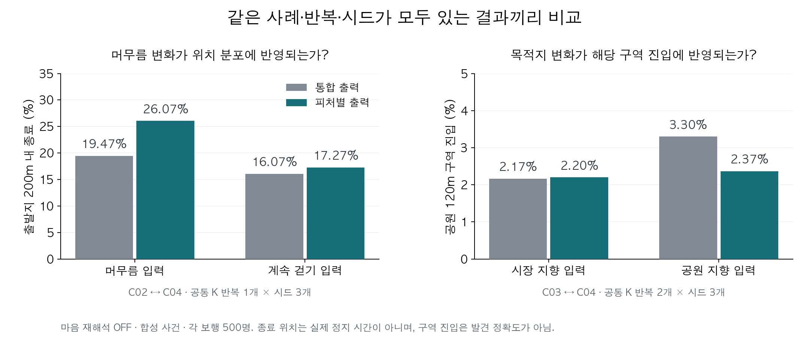

# K-EXAONE으로 개인 특성을 나누어 해석하면 보행도 달라지는가?

**결론: 피처별 해석은 유용한 후보지만, 설명을 최종 보행 수치로 합치는 과정은 아직 불안정하다.** 이 PR은 2026-09-23에 완료한 비교 실험과 후속 설계를 정리한다. 운영 모델·보행 코드 변경은 포함하지 않는다.

**먼저 볼 자료:** [실제 입력 → 모델 해석 → 숫자 → 경로 예시](EXAMPLES.md). 오류 두 사례와 관찰을 반영한 한 사례의 원문, 집계 그림, OSM 경로를 함께 볼 수 있다.

## 왜 했나

돌아오길은 보호자 정보와 치매 행동 지식을 바탕으로 초기 이동 성향을 정한다. 이때 중요한 것은 설명이 자세한지보다, **그 사람의 특성이 해석과 보행에 모순 없이 전달되는지**다. 예를 들어 “시장으로 계속 걸어간다”는 정보만으로 “갈림길에서도 직진한다”고 판단하면 안 된다.

이번에는 K-EXAONE에 같은 개인 정보·SAR 참조·RAG를 주고, 아래 두 출력 방식을 비교했다.

| 구성 | 출력 방식 |
|---|---|
| CONTROL — 통합 출력 | 관찰·가설·미확인 사항을 종합하여 최종 성향 출력 |
| FEATURES — 피처별 출력 | 목적지·이동 지속성·경로 형태·이동 능력을 각각 해석한 뒤 최종 성향으로 통합 |

SAR는 도메인 학습을 거친 모델의 **기존 해석 한 개**를 고정하여 참조했다. 각 새 사례를 SAR에 다시 넣은 실험은 아니며, 순수 통계와 개인화를 비교한 것도 아니다. RAG도 동일한 기존 검색 결과를 재사용했다.

## 무엇을 실행했나

- 6개 합성 사례 × 2구성 × K 반복 2회 = API **24회**.
- 수치 입력으로 사용 가능한 21개 출력 × 보행 시드 3개 = OSMnx **63회**, 회당 500명.
- 같은 저장 도로망·가상 장소·1시간 조건, **마음 재해석 OFF**.
- SAR·임베딩·지도 신규 호출과 자동 재시도는 0회.
- 실제 실종 경로 데이터는 확보하지 못했다. 실제 발견 정확도가 아니라 **입력 변화에 대한 해석·보행의 일관성**을 살핀 실험이다.

[6개 사례](case_factors.json)는 목적지(시장/공원), 지속성(머무름/계속 걷기), 방향(미확인/직진/잦은 전환)을 바꿨다. 신체 능력은 고정했으므로 거리·이동 능력 차이의 효과를 검증했다고 볼 수 없다.

## 무엇을 알게 됐나

| 질문 | 관찰 결과 | 해석 |
|---|---|---|
| 머무름과 계속 걷기를 구분하는가? | 공원 사례의 공통 반복에서 출발지 200m 내 종료 비율 차이: 통합 **3.40%p**, 피처별 **8.80%p** | 피처별 출력이 더 크게 반응한 사례. 비교 가능한 K 반복은 한 개이며 실제 정지 시간은 아님 |
| 목적지만 바꾸면 해당 차이가 전달되는가? | 시장→공원 변경 시 공원 구역 진입: 통합 **2.17→3.30%**, 피처별 **2.20→2.37%** | 이번 조건에서 피처별 방식의 개선 확인 안 됨. 피처별 출력은 방향·무작위 보행 확률까지 크게 변경 |
| 직진과 잦은 방향 전환을 구분하는가? | 피처별 출력의 갈림길 좌우 전환 보조 비율 **49.48→50.76%** | 평균은 기대 방향이지만 K 반복별 반영이 달랐음. 안정적으로 해결됐다고 판단하기 어려움 |
| 설명대로 숫자를 바꾸는가? | 사용 가능한 피처별 출력 **10개 중 7개**에서 증감 선언과 수치 불일치 | 핵심 개선 과제는 해석을 숫자로 통합하는 단계 |

조건 간 표는 **같은 사례·K 반복·보행 시드가 모두 있는 결과**만 비교했다. 실패 때문에 공통 반복이 없는 두 비교는 우열을 판정하지 않았다. 500명과 보행 시드는 실제 사람 표본이나 독립 K 응답 수가 아니다.

자세한 수치와 분모는 [결과 보고서](RESULTS.md), [비교 원자료](matched_comparison.json), [갈림길 지표 정의](TURN_METRIC.md)를 참조한다.



그림의 분모·개별 경로 및 원문 해설은 [예시 문서](EXAMPLES.md)에 있다.

## 형식 오류는 어떻게 처리했나

처음에는 3개 응답이 필수 prior 형식을 통과하지 못했다. 2개는 닫는 중괄호를 하나 더 썼고, 1개는 `prior`와 `integration`을 `features` 안에 넣었다. 모두 응답 종료 사유는 `stop`이었다.

이후 **추가 API 없이** 원문을 보존하는 [형식 복구 후보](format_guard.py)를 검증했다. 내용·숫자를 추가하지 않고 이 3개를 복구하여, 24개 모두 수치 prior 검사를 통과했다. 다만 근거 누락·항목 개수까지 포함한 전체 규약 통과는 **5/24**였다. 이것도 의미의 정확성을 보장하지 않는다.

**복구한 3개는 추가 보행하지 않았다.** 위 실험 결과는 원래 절차의 63회이며, 복구 코드도 운영에 연결하지 않았다. 원출력 실패와 사후 형식 복구를 분리해 기록한다.

## 다음에 할 일

마음 재해석은 이후 단계로 두고, **초기 이동 성향 전체(목적지·머무름·방향·거리)**를 먼저 안정화한다.

1. 개인 관찰 / SAR·RAG 가설 / 미확인을 구분하는 출력 계약 확정.
2. 피처와 보행 파라미터 사이의 변환을 명시하고, 증감 설명을 실제 전후 값에서 생성.
3. 기존 신체·통계 제약을 보존하면서 정보 부족·충돌·거리 관련 사례까지 검증 범위 확대.

[다음 단계 명세](NEXT_PHASE.md)는 설계 상태다. 변환 계수나 안정성 허용치가 확정되지 않았으며 새 실험은 실행하지 않았다. 기존 보행 근거는 [이전 코드 검토](WALKING_CONTEXT.md)를 참고한다.

## API 사용량

24회, 입력 **52,204** + 출력 **24,506** = **76,710토큰**. 형식 실패 응답의 토큰도 포함했다. 금액·단가·지원 차수는 미확인(`null`)이다. [사용량 집계](usage_summary.json)에 기록했으며 원본 이벤트는 프로젝트 공용 원장에 중복 없이 보존했다.

## 팀원이 확인하는 방법

저장소 루트에서 Python 표준 라이브러리만으로 실행한다. API 키·GPU·지도 다운로드가 필요하지 않으며, 모델이나 보행을 새로 실행하지 않는다.

```bash
python3 -m unittest discover -s backend/experiments/kexaone_featurewise_v1_20260923 -p 'test_*.py' -v
```

검증 범위는 24개 저장 응답의 원래/복구 후 판정, 불완전하거나 모호한 복구 입력 거부, 63개 실행의 집계, 비교표의 분모·수치, 전략 변경 선언과 원출력의 불일치 수다. 임상 타당성 검증은 아니다.

| 파일 | 읽는 목적 |
|---|---|
| [RESULTS.md](RESULTS.md) | 상세 결과·한계·연구지원 보고서 기록 |
| [saved_outputs.json](saved_outputs.json) | 24개 응답 원문, 원래 판정, 개별 검토 메모 |
| [control_prompt.txt](control_prompt.txt) / [feature_prompt.txt](feature_prompt.txt) | 두 구성의 지시문 비교 |
| [replay_diagnostics.json](replay_diagnostics.json) | 보행 집계와 갈림길 지표의 분자·분모 |
| [semantic_review_postcheck.json](semantic_review_postcheck.json) | 선언과 숫자 불일치 **9/33**의 근거 |
| [provenance.json](provenance.json) | 고정 SAR·RAG 출처, 해시, 실행 조건, 재현 범위 |

전체 도로망·전체 워커 경로·로컬 지도 뷰어·API 요청 봉투·RAG 전문은 원본 실험 아카이브에 보존한다. 이 PR에는 그림 재생성에 필요한 도로·경로 일부와 선택 규칙을 추가로 포함한다. 이 PR은 검토용 발췌와 오프라인 검증을 제공하며, 완전한 모델/OSM 재실행 패키지는 아니다.
