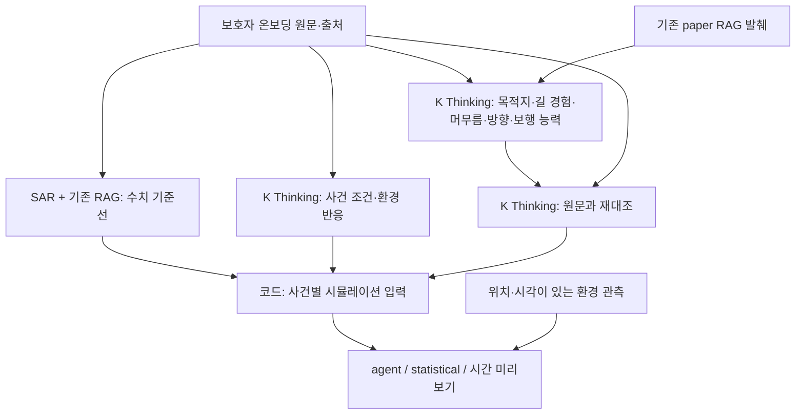
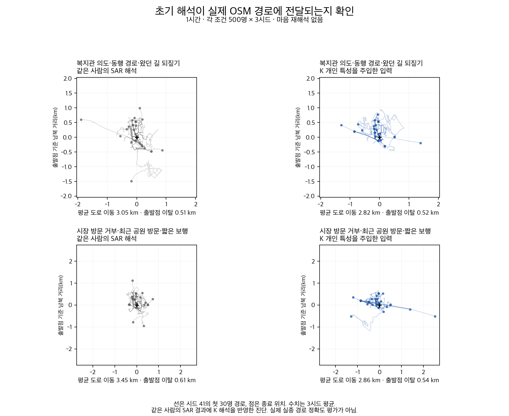

# 돌아오길: 온보딩의 개인 특성을 K로 해석해 시뮬레이션에 연결

## 왜 바꿨나

목적지를 말했다고 그 길을 아는 것은 아니다. 계속 걷는다고 직진하는 것도 아니다. 앞선 실험에서는 이런 구분을 잃거나, 모델의 증감 설명과 실제 수치가 반대로 나오는 문제가 있었다. 기존 SAR 설명에도 미확인을 부재로 단정하거나 개인에게 없는 관찰을 덧붙인 사례가 있었다.

이번 변경은 **보호자 원문 → 개인 특성·조건 해석 → 원문 재검토 → 엔진 입력**을 연결한다. K가 좌표나 임의의 확률을 생성하지 않는다. SAR + 기존 RAG는 기존 수치 기준선을 만들고, K는 원문과 연구 발췌를 바탕으로 의미를 판단한다. 코드가 그 판단을 수치 입력에 연결한다. 이는 단어 파싱이 아니라 모델의 문맥 해석을 구조화해 소비하는 방식이다.

## 최종 파이프라인

정상 처리 시 K 3회(핵심·조건 병렬, 핵심 재검토 순차), 자동 재시도 없음. K가 SAR의 추정 문장을 보호자의 관찰 사실로 읽는 구조는 채택하지 않았다. 두 시뮬레이션 모두 같은 개인 입력을 받으며 statistical도 개인화 정보를 사용한다.

K 설정이 있으면 `run_prediction`에서 호출된다. 실패 시 `fallback_to_sar`와 오류 유형을 남긴다. 운영 배포는 이 PR에서 하지 않았다. 원문은 Persona에 보존하되 공개 조회와 비용 원장에 노출하지 않는다. 출력의 한국어 요약은 enum을 코드가 설명한 문장이다.

## 실제로 무엇이 나아졌나

| 검증 | 결과 | 해석 범위 |
| --- | --- | --- |
| 간결한 핵심 해석 v37 | 첫 단계 6/7 → 원문 재검토 후 7/7 | 개발·회귀용 합성 사례 |
| 환경 범위·조건 v40 | 7/7 | 단일 조건 해석, 실제 경로 정확도 아님 |
| 최종 함수 저장 응답 재생 v42 | 7/7 | 네트워크 차단, 새 모델 호출 없음 |
| 새 두 사례 실시간 검증 v41 | 최종 기준 2/2, 형식 실패·SAR 복귀 0건 | 같은 보호자 내용을 SAR/K에 제공, 각 1회 |
| 이번 PR 조건식 확장 | AND/OR·긍정/부정·미확인·충돌·만료·공간 범위 테스트 | **새 condition_clauses 출력 계약은 아직 실제 K API 재검증 전** |

v41에서는 ‘공원에 가고 싶음·새 길을 모름·길을 잃으면 기다림’을 함께 유지했다. 다른 사례에서는 낮과 밤을 구분해 야간의 계속 이동·같은 방향 유지를 반영했다. 실제 원문, 출력, 수치 변화와 처리 시간(163.0초/283.6초)은 [실시간 검증 상세](LIVE_RESULTS.md)에 있다.

표본 2개는 기존 실패 유형을 참고해 만든 새 입력이다. 독립 임상 평가나 충분한 일반화 검증으로 해석하지 않는다. 실제 실종 경로 데이터는 미확보다. v41은 조건식 확장 **이전** 후보의 실측이며, 새 필드까지 실호출 통과했다고 주장하지 않는다.

## 조건별 회피를 엔진에 연결

이전에는 ‘붐비고 시끄러운 시장만 피함’을 이해해도 조건부 회피 소비부가 없어 보류했다. 이제 K 조건 출력에 `condition_clauses`를 추가하고, 실제 갈림길 선택에서 위치·시각별 관측과 대조한다.

- 같은 절 안의 항은 AND, 여러 절은 OR. `crowded`, `noisy` 각각 `present`/`absent`를 구분한다.
- 조건이 없던 기존 EnvResponse는 그대로 동작한다. 과거의 `condition=present`만 있는 응답에서 상세 조건을 만들어 내지 않는다.
- 조건 해석이 불분명하거나 지원하지 않는 조건이면 보류한다. 키워드로 조건을 복원하지 않는다.
- 관측이 없거나 충돌하면 긍정·부정 조건 모두 미충족으로 본다. ‘소음 미확인’을 ‘조용함’으로 바꾸지 않는다.
- 관측은 지정 반경과 유효 시간 안에서만 사용한다. OSM의 시장 태그로 혼잡도를 추측하지 않는다.
- agent/statistical/시간 미리보기 모두 같은 관측을 받는다. 마음 재해석은 변경하지 않았다.
- 조건을 생략하면 잘못된 안내가 되는 시민 문구에는 조건부 반응을 무조건적인 성향으로 내보내지 않는다.

[입력 계약과 호출 예](CONDITIONAL_ENVIRONMENT.md). 실시간 혼잡·소음 수집 서비스나 앱 입력 화면을 새로 구현한 것은 아니다. 신고 API에 구조화된 관측을 전달할 수 있고, 관측이 없으면 조건부 회피는 중립이다. 특정 장소 이름 자체에만 국한된 반응은 여전히 실행 보류다.

## 이전 경로 검증 그림

기존 v32의 의미 기준 통과 사례 두 개에서 2구성 × 3시드 × 500명 = 6,000명을 재생한 그림이다. 실제 저장 OSM 도로망과 합성 사람·장소 설정을 썼으며 마음 재해석은 껐다. **이번 조건식 확장의 효과 그림이 아니다.** 평균 도로 이동 거리는 복지관 사례 3.05→2.82km, 짧은 보행 사례 3.45→2.86km였다. 경로가 바뀌었다는 증거이며 더 정확하다는 증거가 아니다.

## 실패와 채택 판단

[실험 이력](EXPERIMENT_HISTORY.md)에 실패도 함께 남겼다. 긴 설명문·의미가 있는 예시·형식 제약 제거·non-Thinking 환경 해석을 모두 최종 방식으로 채택하지 않았다. 초기 실시간 통합 v32는 2/4만 성공했고, 이후 같은 사례에서 고친 결과를 최초 4/4 성공으로 바꾸지 않았다.

보행의 반경과 전략 가중치는 기존 제약 안에서 변환한다. 배율은 잠정 엔진 규약이며 임상 보정값이 아니다. 3분마다 휴식, 기억한 실제 경로, 도움 요청, 감정의 수치화까지 해결하지 않았다. SAR LoRA 재학습도 수행하지 않았다.

## 검증과 비용

백엔드 테스트 **941개 통과, 2개 건너뜀**. 이전부터 있던 미추적 프로토타입 테스트 3개는 후보에 포함하지 않아 제외했다. 실제 OSM fixture의 갈림길 소비·경로 분포 변화, 신고 API 저장, 두 모드와 미리보기 전달, 관측 만료/충돌, 기존 무조건 반응 하위호환을 검증한다. 테스트에서는 모델 키를 비우고 새 외부 호출을 하지 않는다.

v27~v42 집계: K 129회·915,671 보고 토큰, 자가호스팅 SAR 14회·24,113 토큰. 이 중 이번 승인 실행 v41은 K 6회·52,199 토큰, SAR 2회·3,817 토큰. 단가·청구액·지원 차수는 미확인이다. SAR 토큰을 K API 과금에 합산하지 않았다. [집계](evidence/usage_rollup.json), [원장 무결성 확인](evidence/ledger_integrity.json).

이 PR에는 합성 사례와 검토용 모델 최종 응답만 수록했다. API 키, 요청 헤더, 논문 전문, 실사용 보호자 정보, 원격 호스트 설정은 포함하지 않았다. 전체 실험 원장·요청·응답은 로컬 연구 아카이브에 보존한다.
