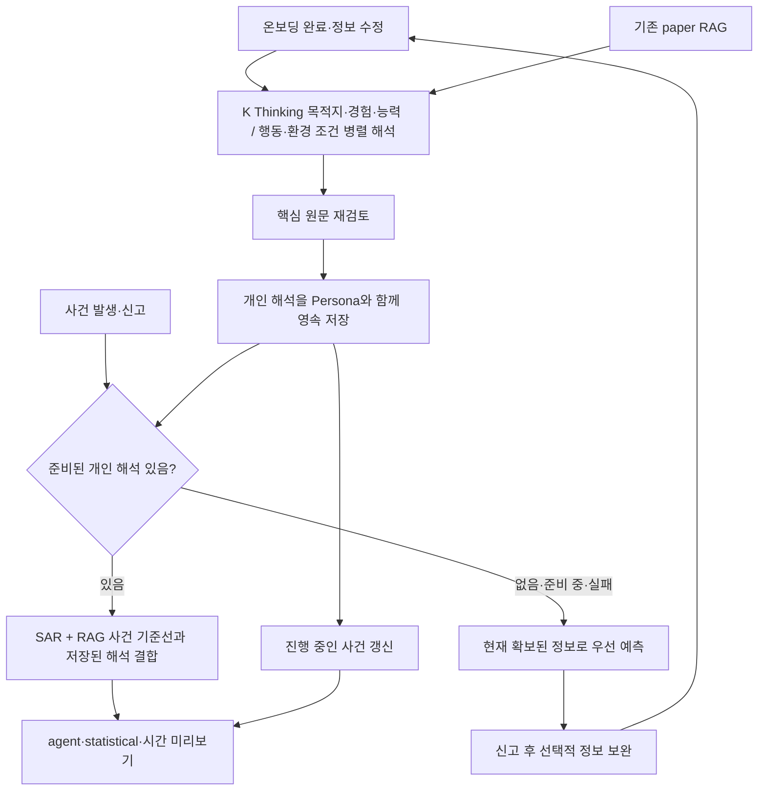
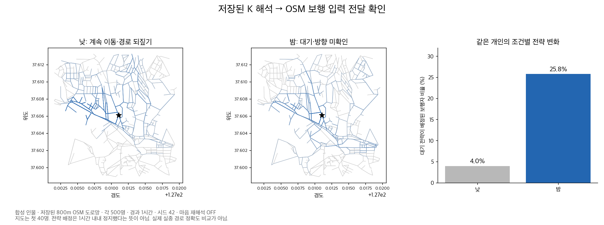

# 돌아오길: 온보딩의 개인 특성을 K로 해석해 시뮬레이션에 연결

## 왜 바꿨나

목적지를 말했다고 그 길을 아는 것은 아니다. 계속 걷는다고 직진하는 것도 아니다. 앞선 실험에서는 이런 구분을 잃거나, 모델의 증감 설명과 실제 수치가 반대로 나오는 문제가 있었다. 기존 SAR 설명에도 미확인을 부재로 단정하거나 개인에게 없는 관찰을 덧붙인 사례가 있었다.

이번 변경은 **보호자 원문 → 개인 특성·조건 해석 → 원문 재검토 → 엔진 입력**을 연결한다. K가 좌표나 임의의 확률을 생성하지 않는다. SAR + 기존 RAG는 기존 수치 기준선을 만들고, K는 원문과 연구 발췌를 바탕으로 의미를 판단한다. 코드가 그 판단을 수치 입력에 연결한다. 이는 단어 파싱이 아니라 모델의 문맥 해석을 구조화해 소비하는 방식이다.

## 현재 구현: 사전 준비와 긴급 신고 분리

온보딩 완료 응답은 K의 완료를 기다리지 않는다. 정상 준비 작업은 K 최대 3회이며, 사건이 없는 입력에 목격 시각이나 상황을 만들지 않는다. 저장 결과는 개인정보와 함께 영속화·파기된다. 예측에서는 저장된 해석을 읽어 수치 입력으로 변환하며 K를 다시 부르지 않는다. SAR + 기존 RAG는 사건별 기준선을 담당한다.

사전등록 없는 신고는 개인 특성 미확인 상태로 먼저 접수·예측한다. 앱 접수 화면에서 가족 정보를 추가하면 `PATCH /phase1/cases/{case_id}/persona`로 같은 사건에 연결하고 새 사건은 만들지 않는다. 준비가 끝나면 진행 중 사건을 갱신한다. 연결 재시도는 멱등적이며 다른 사람으로 바꾸거나 종결 사건을 다시 여는 요청은 거부한다. 기존 사건 ID 기반 접근 방식을 따르며, 이 변경이 인증·소유권 체계 전체를 개선한 것은 아니다.

준비 중·실패·중단·입력 변경·삭제를 구분한다. 서버 재시작 시 queued 작업은 복구하되 running 작업을 자동 유료 재시도하지 않는다. 실패 재요청은 별도 prepare API로 받는다. 오래된 작업 결과는 수정된 프로필을 덮어쓰거나 삭제한 프로필을 되살릴 수 없다.

등록 당시 ‘오늘 공원에 가겠다’는 발언을 몇 달 뒤 사건의 현재 의도로 간주하지 않는다. 원래 해석은 저장하고 사건 주입에서는 과거 보고로 다룬다. 낮/밤 분기는 별도 저장하며 사건 시각에 적용한다. 06~18시/18~06시는 엔진 시간대 구분이고 실제 밝기 관측은 아니다. 지원하지 않는 조건·감정·특정 장소 반응은 보존하되 실행 보류가 남는다.

운영 배포는 하지 않았다. 앞단의 시범 도입 판정은 [별도 기준](DEPLOYMENT_GATES.md)으로 진행하며, 과거 실험의 성공을 새 백그라운드 구조의 실호출 성공으로 간주하지 않는다.

## 실제로 무엇이 나아졌나

| 검증 | 결과 | 해석 범위 |
| --- | --- | --- |
| 간결한 핵심 해석 v37 | 첫 단계 6/7 → 원문 재검토 후 7/7 | 개발·회귀용 합성 사례 |
| 환경 범위·조건 v40 | 7/7 | 단일 조건 해석, 실제 경로 정확도 아님 |
| 최종 함수 저장 응답 재생 v42 | 7/7 | 네트워크 차단, 새 모델 호출 없음 |
| 새 두 사례 실시간 검증 v41 | 최종 기준 2/2, 형식 실패·SAR 복귀 0건 | 같은 보호자 내용을 SAR/K에 제공, 각 1회 |
| 이번 PR 조건식 확장 | AND/OR·긍정/부정·미확인·충돌·만료·공간 범위 테스트 | v43 실호출: 형식 4/6, 사전 의미 기준 2/6. 분리 계약 v44 조건 의미 6/6; 전체 준비 최종 주입 통과·중간 기준 미통과 |

v41에서는 ‘공원에 가고 싶음·새 길을 모름·길을 잃으면 기다림’을 함께 유지했다. 다른 사례에서는 낮과 밤을 구분해 야간의 계속 이동·같은 방향 유지를 반영했다. 실제 원문, 출력, 수치 변화와 처리 시간(163.0초/283.6초)은 [실시간 검증 상세](LIVE_RESULTS.md)에 있다.

표본 2개는 기존 실패 유형을 참고해 만든 새 입력이다. 독립 임상 평가나 충분한 일반화 검증으로 해석하지 않는다. 실제 실종 경로 데이터는 미확보다. v41은 조건식 확장 **이전** 후보의 실측이며, 새 필드까지 실호출 통과했다고 주장하지 않는다.

## 조건별 회피를 엔진에 연결

이전에는 ‘붐비고 시끄러운 시장만 피함’을 이해해도 조건부 회피 소비부가 없어 보류했다. 이제 K 조건 출력에 `condition_clauses`를 추가하고, 실제 갈림길 선택에서 위치·시각별 관측과 대조한다.

- 같은 절 안의 항은 AND, 여러 절은 OR. `crowded`, `noisy` 각각 `present`/`absent`를 구분한다.
- 조건이 없던 기존 EnvResponse는 그대로 동작한다. 과거의 `condition=present`만 있는 응답에서 상세 조건을 만들어 내지 않는다.
- 조건 해석이 불분명하거나 지원하지 않는 조건이면 보류한다. 키워드로 조건을 복원하지 않는다.
- 관측이 없거나 충돌하면 긍정·부정 조건 모두 미충족으로 본다. ‘소음 미확인’을 ‘조용함’으로 바꾸지 않는다.
- 관측은 지정 반경과 유효 시간 안에서만 사용한다. OSM의 시장 태그로 혼잡도를 추측하지 않는다.
- agent/statistical/시간 미리보기 모두 같은 관측을 받는다. 마음 재해석은 변경하지 않았다.
- 조건을 생략하면 잘못된 안내가 되는 시민 문구에는 조건부 반응을 무조건적인 성향으로 내보내지 않는다.

[입력 계약과 호출 예](CONDITIONAL_ENVIRONMENT.md). 실시간 혼잡·소음 수집 서비스나 앱 입력 화면을 새로 구현한 것은 아니다. 신고 API에 구조화된 관측을 전달할 수 있고, 관측이 없으면 조건부 회피는 중립이다. 특정 장소 이름 자체에만 국한된 반응은 여전히 실행 보류다.

## 이전 경로 검증 그림

기존 v32의 의미 기준 통과 사례 두 개에서 2구성 × 3시드 × 500명 = 6,000명을 재생한 그림이다. 실제 저장 OSM 도로망과 합성 사람·장소 설정을 썼으며 마음 재해석은 껐다. **이번 조건식 확장의 효과 그림이 아니다.** 평균 도로 이동 거리는 복지관 사례 3.05→2.82km, 짧은 보행 사례 3.45→2.86km였다. 경로가 바뀌었다는 증거이며 더 정확하다는 증거가 아니다.

## 실패와 채택 판단

[실험 이력](EXPERIMENT_HISTORY.md)에 실패도 함께 남겼다. 긴 설명문·의미가 있는 예시·형식 제약 제거·non-Thinking 환경 해석을 모두 최종 방식으로 채택하지 않았다. 초기 실시간 통합 v32는 2/4만 성공했고, 이후 같은 사례에서 고친 결과를 최초 4/4 성공으로 바꾸지 않았다.

보행의 반경과 전략 가중치는 기존 제약 안에서 변환한다. 배율은 잠정 엔진 규약이며 임상 보정값이 아니다. 3분마다 휴식, 기억한 실제 경로, 도움 요청, 감정의 수치화까지 해결하지 않았다. SAR LoRA 재학습도 수행하지 않았다.

## 검증과 비용

백엔드 테스트 **962개 통과, 2개 건너뜀**. 이전부터 있던 미추적 프로토타입 테스트 3개는 후보에 포함하지 않아 제외했다. 실제 OSM fixture의 갈림길 소비·경로 분포 변화, 신고 API 저장, 두 모드와 미리보기 전달, 관측 만료/충돌, 기존 무조건 반응 하위호환을 검증한다. 테스트에서는 모델 키를 비우고 새 외부 호출을 하지 않는다.

v27~v42 집계: K 129회·915,671 보고 토큰, 자가호스팅 SAR 14회·24,113 토큰. 이 중 이번 승인 실행 v41은 K 6회·52,199 토큰, SAR 2회·3,817 토큰. 단가·청구액·지원 차수는 미확인이다. SAR 토큰을 K API 과금에 합산하지 않았다. [집계](evidence/usage_rollup.json), [원장 무결성 확인](evidence/ledger_integrity.json).

이 PR에는 합성 사례와 검토용 모델 최종 응답만 수록했다. API 키, 요청 헤더, 논문 전문, 실사용 보호자 정보, 원격 호스트 설정은 포함하지 않았다. 전체 실험 원장·요청·응답은 로컬 연구 아카이브에 보존한다.

## v43 조건식 실호출에서 확인한 실패

동일 조건식 과업 6개를 실제 K에 호출했다. 형식 검증 4/6, 사전 등록한 의미 기준 2/6이었다. OR식은 내용이 맞아도 기존 범위 enum 조합 때문에 거부됐고, 한 장소에만 적용되는 소음 조건도 과도한 검증 제약으로 거부됐다. 반면 관찰 미확인 사례는 범위를 한 장소로 불필요하게 좁혔고, 어두울 때 회피 사례는 알려진 회피 자체를 unknown으로 지웠다.

따라서 반응·공간 범위·발동 조건을 독립 필드로 나누었다. 특정 장소 조건은 보존하되 유형 전체에 적용하지 않는다. 이 수정 후 같은 사례를 쓰는 v44는 개발 회귀이며 독립 검증이 아니다. v43의 실패 집계를 사후 변경하지 않는다. v43 K 6회, 44,941 보고 토큰. SAR/임베딩 추가 호출 없음. 단가·청구액·지원 차수 미확인, 원장 14개 이벤트 동기화.

마지막 목격 시각은 신고 화면에서 직접 입력받으며 UTC 표기를 제거하지 않는다. 한국 시간대별 해석은 Asia/Seoul 기준으로 적용한다. 잘못된 날짜와 미래 시각은 접수 전 확인한다. TypeScript 타입 검사와 시각 파싱 5개 점검을 통과했으며 실기기 화면 검수는 아직이다.

## v45에서 발견한 실제 조건 확대 오류와 v46 후보

조건 초안을 핵심 최종 검토에도 제공해 보았지만 기존 사례의 무조건 방향 표현은 해소되지 않았다. 새 반대 시간대 사례에서는 낮의 경로 되짚기가 야간에도 주입됐다. ‘방향 정보가 조건에 따라 달라진다’는 사실을 두 과업이 나누어 다루면서, 조건 과업이 방향 규칙을 빠뜨리면 핵심 출력이 무조건 성향으로 사용되는 문제다. v45는 실패로 보존한다(K 4회, 34,706 보고 토큰).

v46 후보는 역할을 분리한다. 사건 전 핵심 과업·재검토는 목적지/경로 경험/보행 능력/정서를 맡고, 방향/머무름은 조건 과업이 무조건 기본값과 시간대 규칙을 함께 맡는다. core의 방향을 일부러 unknown으로 답하게 하는 지시 경쟁을 없앴다. 조건 없는 방향도 `baseline_direction`으로 별도 보존한다. 이는 단어 파싱이 아니라 K가 해석한 조건 구조의 소비자 역할을 하나로 정한 변경이다. 새 계약의 실호출에서 기존 실패 사례의 목적지·경로 경험·보행 능력·낮/밤 주입·시장 AND 조건을 모두 보존했고, 무조건 방향을 확인하는 별도 조건 과업도 통과했다. 전체 준비 1개 사례와 조건 점검 1개이며 독립 95% 정확도 검증이 아니다. 전체 준비는 124.4초였다. 출력 필드를 없앴다는 이유로 정확도가 올랐다고 계산하지 않는다.

역할 분리 후 주입: 낮은 계속 이동 + 경로 되짚기, 밤은 대기 + 방향 미확인. 밤에도 경로 되짚기를 적용하던 v45 오류가 v46에서는 사라졌다. [사전 기준별 판정](evidence/v46/semantic_review.json).

## v46 저장 해석의 실제 도로망 전달

저장된 실제 K 출력을 800m 범위의 OSM 도로망에서 재생했다. 합성 인물, 유형 기본 수치 기준선(SAR 신규 호출 없음), 낮/밤 × agent/statistical × 500명 = 2,000명, 시드 42 하나, 경과 1시간, 마음 재해석 OFF다. 두 모드가 같은 결과인 것은 마음 재해석을 끈 통제 조건에서 예상되는 동작이다.

낮과 밤의 대기 전략 배정은 각각 20/500(4.0%), 129/500(25.8%)이었다. 평균 도로 이동 길이는 3.529km/3.118km였으며 도로에 없는 노드 간 이동 0건, 마음 호출 이벤트 0건이었다. 전략 배정은 한 시간 내내 정지했다는 뜻이 아니다. 이 수치는 조건 해석이 실제 엔진에 전달된다는 진단이며, 현실의 머무름 확률이나 위치 예측 정확도가 아니다. 작은 고정 지도·한 시드·합성 인물이라는 한계가 있다.

v43~v46 추가 실호출 합계 K 23회, 184,770 보고 토큰. 새 SAR·임베딩 실호출은 0회이며, 로컬 CPU 재생 기록도 원장에 추가했다. 금액·지원 차수는 미확인이다.
