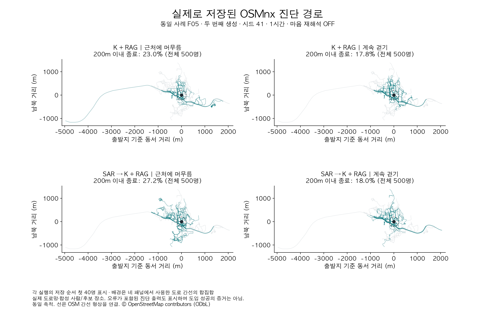
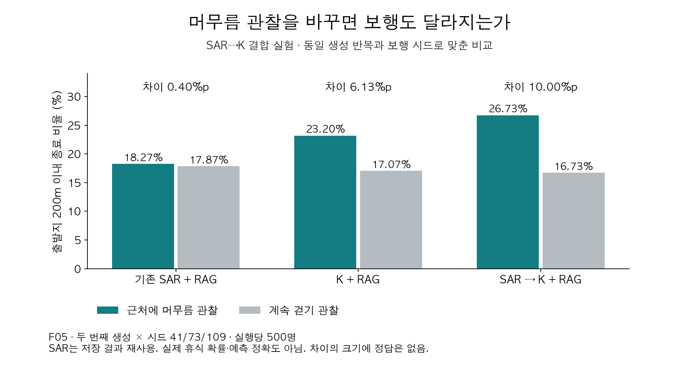
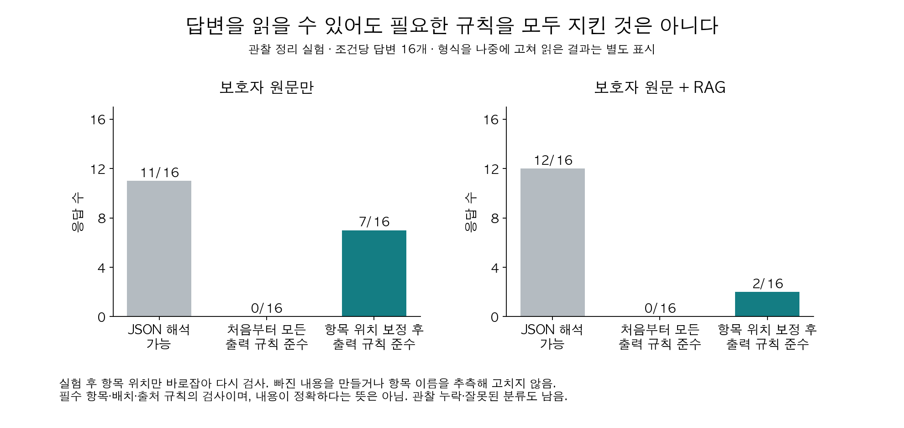

# 실제 모델 해석과 저장 경로

모든 인용은 저장 응답 원문과 문자 단위로 대조했다. 그림은 모델이 생성한 이미지가 아니라 저장 수치·OSM 간선·응답으로 작성한 검토 자료다.

## SAR의 해석을 K가 따라간 사례

T02 입력은 계속 걷는다고 했지만, 방향 전환이나 익숙한 경로 이용은 가족이 관찰하지 못했다고 명시했다.


### T02_SAR.json

> 최근 길을 잃었을 때 멈추지 않고 계속 직진하는 모습이 관찰되었기 때문이다.

<details>
<summary>이 응답의 전체 모델 출력 원문</summary>

````text
```json
{
  "strategy_probs": {
    "route_following": 0.45,
    "direction_keeping": 0.15,
    "random_walk": 0.10,
    "backtracking": 0.05,
    "staying_put": 0.05,
    "landmark_seeking": 0.20
  },
  "attraction_levels": {
    "시장": "상",
    "공원": "중",
    "복지관": "하"
  },
  "radius_level": "중",
  "reasoning": "세 장소 모두 과거에 자주 방문했던 곳으로, 보호자가 직접 관찰한 최근 행동에서도 이들 장소로 향하는 모습이 확인되었다. 특히 시장은 최근 가장 자주 향한 장소로, 이는 '상' 등급의 끌림점으로 판단했다. 공원과 복지관은 각각 '중'과 '하' 등급으로 분류했다. 'route_following' 확률이 높은 것은 과거 방문 경험이 있는 장소로의 이동이 빈번했기 때문이다. 'direction_keeping' 확률 또한 높게 설정했는데, 이는 최근 길을 잃었을 때 멈추지 않고 계속 직진하는 모습이 관찰되었기 때문이다."
}
```
````

</details>

[해당 실험 전체 출력](evidence/08_casewise/saved_outputs.json)

### T02_A_1.json

> 개인이 길을 잃었을 때의 방향 전환 여부나 경로 선택 방식은 관찰되지 않아, 경로 형태에 대한 직접적 정보는 부족하다.

<details>
<summary>이 응답의 전체 모델 출력 원문</summary>

````text
```json
{
  "features": {
    "destination_pull": {
      "personal_evidence": [
        {
          "note_id": "N1",
          "quote": "최근 한 달 동안 혼자 외출하면 시장 쪽으로 걷는 모습을 가족이 여러 번 봤다."
        }
      ],
      "interpretation": "개인은 최근 외출 시 시장 방향으로 이동하는 경향이 있으며, 이는 시장에 대한 끌림점이 존재함을 시사한다.",
      "domain_hypotheses": [
        {
          "basis": ["R1"],
          "claim": "소수의 익숙한 장소(시장 포함)로의 이동은 정상 배회 패턴의 일부일 수 있으며, 이는 '소수 익숙 거점 회귀형' 성향을 지지한다.",
          "limitation": "개인의 최근 관찰(N1)은 시장 방향 이동을 언급하지만, 그 경로가 익숙한지 여부는 확인되지 않아 R1의 전제가 완전히 적용되지는 않는다."
        },
        {
          "basis": ["R0"],
          "claim": "정면만 보고 직진하는 행동은 방향 전환이 어려운 상태에서 특정 목적지(시장)로 향하는 외형적 행동일 수 있다.",
          "limitation": "N3에서 방향 전환이나 익숙 경로 이용 여부가 관찰되지 않았으므로, R0의 '앞만 보고 걸어감' 해석은 개인에게 직접 적용할 수 없다."
        }
      ],
      "unknowns": [
        "시장으로 가는 경로가 익숙한지 여부",
        "시장 방문이 반복적인지 여부",
        "다른 장소(공원, 복지관)로의 이동 여부"
      ],
      "conflicts": []
    },
    "movement_persistence": {
      "personal_evidence": [
        {
          "note_id": "N2",
          "quote": "최근 길을 몰라 헤매는 상황에서는 멈추지 않고 계속 걸어가는 모습을 가족이 여러 번 봤다."
        }
      ],
      "interpretation": "개인은 길을 잃었을 때 멈추지 않고 지속적으로 이동하는 경향이 있으며, 이는 이동 지속성이 높음을 나타낸다.",
      "domain_hypotheses": [
        {
          "basis": ["R0"],
          "claim": "멈추지 않고 계속 걷는 행동은 '앞만 보고 걸어감' 형태와 유사하며, 방향 전환이 어려운 상태에서 이동이 지속됨을 시사한다.",
          "limitation": "R0는 방향 인식 제한을 전제로 하지만, N3에서 방향 전환 여부가 관찰되지 않아 동일한 메커니즘인지 불확실하다."
        }
      ],
      "unknowns": [
        "헤맬 때 멈추지 않는 행동이 지속적인 이동인지, 아니면 정지 후 재시작인지",
        "지속 이동 중 방향 전환 여부"
      ],
      "conflicts": []
    },
    "route_shape": {
      "personal_evidence": [
        {
          "note_id": "N3",
          "quote": "최근 헤맬 때 방향을 바꾸는지, 익숙한 길을 이용하는지는 가족이 직접 관찰하지 못했다."
        }
      ],
      "interpretation": "개인이 길을 잃었을 때의 방향 전환 여부나 경로 선택 방식은 관찰되지 않아, 경로 형태에 대한 직접적 정보는 부족하다.",
      "domain_hypotheses": [
        {
          "basis": ["R3"],
          "claim": "익숙한 경로 의존 성향이 존재할 가능성이 있으며, 이탈 시 원래 경로 주변에서 재진입을 시도할 수 있다.",
          "limitation": "N3에서 익숙 경로 이용 여부가 관찰되지 않았고, N1의 시장 방향 이동이 익숙한지 여부도 불명확하므로, R3의 해석은 개인에게 직접 적용하기 어렵다."
        }
      ],
      "unknowns": [
        "헤맬 때 방향 전환 여부",
        "익숙한 경로를 이용하는지 여부",
        "시장으로 가는 경로가 익숙한 경로인지 여부"
      ],
      "conflicts": []
    },
    "mobility_range": {
      "personal_evidence": [
        {
          "note_id": "N1",
          "quote": "최근 한 달 동안 혼자 외출하면 시장 쪽으로 걷는 모습을 가족이 여러 번 봤다."
        },
        {
          "note_id": "N2",
          "quote": "최근 길을 몰라 헤매는 상황에서는 멈추지 않고 계속 걸어가는 모습을 가족이 여러 번 봤다."
        }
      ],
      "interpretation": "개인은 외출 시 시장 방향으로 이동하며, 길을 잃었을 때도 지속적으로 이동하는 경향이 있어 이동 범위와 지속성이 모두 관찰된다.",
      "domain_hypotheses": [
        {
          "basis": ["R2"],
          "claim": "치매 노인이 익숙한 장소(시장 포함)로 이동하는 행동은 정상 배회 패턴의 일부일 수 있으며, 이는 이동 범위가 제한적일 가능성을 시사한다.",
          "limitation": "R2는 익숙한 장소로의 이동이 반복적이고 성공적인 경로였음을 전제로 하지만, N1과 N2는 반복성이나 성공 여부는 언급하지 않아 전제가 완전히 충족되지 않는다."
        },
        {
          "basis": ["R0"],
          "claim": "지속적인 이동과 직진 경향은 이동 범위가 예측 불가능하게 확장될 수 있음을 시사하며, 이는 배회 위험 증가와 연결될 수 있다.",
          "limitation": "R0는 방향 인식 제한을 전제로 하지만, N3에서 방향 전환 여부가 관찰되지 않아 동일한 메커니즘인지 불확실하다."
        }
      ],
      "unknowns": [
        "시장까지의 실제 거리 또는 이동 시간",
        "시장 방문이 반복적인지 여부",
        "이동 중 휴식 여부",
        "이동 범위의 최대치 또는 한계"
      ],
      "conflicts": []
    }
  }
}
```
````

</details>

[해당 실험 전체 출력](evidence/08_casewise/saved_outputs.json)

### T02_B_1.json

> 개인은 길을 잃었을 때 멈추지 않고 직진하는 행동을 보였으나, 방향 전환 여부나 익숙한 경로 사용 여부는 관찰되지 않았다.

<details>
<summary>이 응답의 전체 모델 출력 원문</summary>

````text
```json
{
  "features": {
    "destination_pull": {
      "personal_evidence": [
        {
          "note_id": "N1",
          "quote": "최근 한 달 동안 혼자 외출하면 시장 쪽으로 걷는 모습을 가족이 여러 번 봤다."
        }
      ],
      "interpretation": "개인은 최근 외출 시 시장 방향으로 이동하는 행동을 반복적으로 보였으며, 이는 시장에 대한 뚜렷한 장소 지향성을 시사한다.",
      "domain_hypotheses": [
        {
          "basis": ["R1"],
          "claim": "반복적인 방문 이력이 있는 장소는 끌림점으로 작용할 가능성이 높으며, 특히 최근 관찰된 행동과 일치할 경우 그 강도는 '상'으로 평가할 수 있다.",
          "limitation": "개인의 관찰(N1)은 시장 방향 이동만 언급하고 있으며, 공원이나 복지관에 대한 최근 이동은 확인되지 않았다. 따라서 끌림점 등급은 관찰된 행동에 기반해야 하며, 과거 이력만으로 등급을 상향 조정할 수 없다."
        },
        {
          "basis": ["R0"],
          "claim": "정면만 보고 직진하는 행동은 특정 장소로의 끌림과 결합될 경우, 그 장소로의 이동 경향을 강화할 수 있다.",
          "limitation": "N2는 직진 행동을 관찰했지만, 그 방향이 시장인지 여부는 명시되지 않았다. 따라서 직진 성향과 목적지 지향성은 별개의 피처로 분리하여 해석해야 한다."
        }
      ],
      "unknowns": [
        "공원이나 복지관 방향으로의 이동 여부",
        "최근 외출 시 다른 장소로의 이동 가능성"
      ],
      "conflicts": []
    },
    "movement_persistence": {
      "personal_evidence": [
        {
          "note_id": "N2",
          "quote": "최근 헤맬 때 멈추지 않고 계속 걸어가는 모습을 가족이 여러 번 봤다."
        }
      ],
      "interpretation": "개인은 길을 잃었을 때 멈추지 않고 지속적으로 이동하는 행동을 보였으며, 이는 이동 지속성(머무름 없이 계속 걷기)이 높음을 나타낸다.",
      "domain_hypotheses": [
        {
          "basis": ["R0"],
          "claim": "정면만 보고 멈추지 않고 걷는 행동은 방향 유지 성향과 결합되어, 특정 방향으로의 지속적 이동을 유도할 수 있다.",
          "limitation": "N2는 이동 지속성만 언급하고 있으며, 그 방향이나 목적지에 대한 정보는 없으므로, 이동의 지속성과 방향성은 별도로 평가되어야 한다."
        }
      ],
      "unknowns": [
        "이동 중 휴식 여부",
        "지속 이동의 거리 또는 지속 시간"
      ],
      "conflicts": []
    },
    "route_shape": {
      "personal_evidence": [
        {
          "note_id": "N2",
          "quote": "최근 헤맬 때 멈추지 않고 계속 걸어가는 모습을 가족이 여러 번 봤다."
        },
        {
          "note_id": "N3",
          "quote": "최근 헤맬 때 방향을 바꾸는지, 익숙한 길을 이용하는지는 가족이 직접 관찰하지 못했다."
        }
      ],
      "interpretation": "개인은 길을 잃었을 때 멈추지 않고 직진하는 행동을 보였으나, 방향 전환 여부나 익숙한 경로 사용 여부는 관찰되지 않았다. 따라서 경로 형태(직진·전환·되돌아감·경로 익숙함)는 부분적으로만 확인 가능하다.",
      "domain_hypotheses": [
        {
          "basis": ["R0"],
          "claim": "정면만 보고 걷는 행동은 '직진' 형태의 경로 성향을 나타내며, 방향 전환이 어려운 경우 익숙하지 않은 경로에서도 지속 이동이 발생할 수 있다.",
          "limitation": "N3에 따르면 방향 전환이나 익숙한 길 사용 여부는 관찰되지 않았으므로, '경로 익숙함' 또는 '전환' 여부는 확인되지 않았다."
        },
        {
          "basis": ["R3"],
          "claim": "익숙한 경로 의존 성향이 있더라도, 이탈 후에는 원래 경로 주변에서 재진입을 시도할 가능성이 있다.",
          "limitation": "개인의 관찰(N3)은 방향 전환 또는 익숙한 길 사용 여부를 직접 관찰하지 못했다고 명시하고 있으므로, 경로 형태에 대한 판단은 제한적이다."
        }
      ],
      "unknowns": [
        "헤맬 때 방향 전환 여부",
        "익숙한 경로 사용 여부",
        "직진 시 그 방향이 시장인지 여부"
      ],
      "conflicts": []
    },
    "mobility_range": {
      "personal_evidence": [
        {
          "note_id": "N1",
          "quote": "최근 한 달 동안 혼자 외출하면 시장 쪽으로 걷는 모습을 가족이 여러 번 봤다."
        }
      ],
      "interpretation": "개인은 외출 시 시장 방향으로 이동하는 행동을 반복적으로 보였으나, 이동 거리나 시간, 반경에 대한 구체적인 수치는 제시되지 않았다. 따라서 이동 능력 및 거리 관련 근거는 원문에 기재된 진술 외에는 존재하지 않는다.",
      "domain_hypotheses": [
        {
          "basis": ["R1"],
          "claim": "소수의 익숙한 장소(시장, 복지관, 공원) 사이를 왕복하는 이동 패턴은 제한된 이동 반경을 시사할 수 있으며, 이는 '중' 등급의 반경 수준으로 해석될 수 있다.",
          "limitation": "개인의 관찰에는 이동 거리나 반경에 대한 직접적 언급이 없으므로, 반경 등급은 과거 이력과 최근 행동의 일관성에 기반한 간접 추정일 뿐이다."
        }
      ],
      "unknowns": [
        "최근 외출 시 이동한 최대 거리",
        "이동에 소요된 시간",
        "이동 반경의 실제 범위"
      ],
      "conflicts": []
    }
  }
}
```
````

</details>

[해당 실험 전체 출력](evidence/08_casewise/saved_outputs.json)

## 최신 관찰 추출: 부정 반전과 맥락 보존

H02는 방향 전환 미관찰, 보호자 동행 시 80m 뒤 휴식 후 재개, 혼자일 때 거리·휴식 미확인의 합성 사례다.

### H02_WITH_RAG_1.json

> 방향 전환 없이 멈추지 않고 걷는 모습을 여러 번 관찰했다.

<details>
<summary>이 응답의 전체 모델 출력 원문</summary>

````text
{
  "destination_pull": {
    "observation_note_ids": ["N0"],
    "observation_summary": "시장 쪽으로 걸어가는 모습을 여러 번 관찰했다.",
    "hypotheses": [],
    "unknowns": ["시장에 도착했는지 여부", "시장 방향 선택의 빈도나 지속성"],
    "conflicts": []
  },
  "movement_persistence": {
    "observation_note_ids": ["N1"],
    "observation_summary": "방향 전환 없이 멈추지 않고 걷는 모습을 여러 번 관찰했다.",
    "hypotheses": [],
    "unknowns": ["걷는 속도나 지속 시간의 일관성", "휴식 없이 걷는 생리적 가능성"],
    "conflicts": []
  },
  "route_shape": {
    "observation_note_ids": [],
    "observation_summary": "미확인",
    "hypoth0eses": [],
    "unknowns": ["경로 이용 여부", "같은 경로 반복 여부"],
    "conflicts": []
  },
  "mobility_range": {
    "observation_note_ids": ["N2", "N3"],
    "observation_summary": "보호자 동행 산책에서 80m 걷고 잠시 쉰 후 다시 걷는 모습을 관찰했다.",
    "hypotheses": [],
    "unknowns": ["혼자 있을 때의 이동 거리", "혼자 있을 때 휴식 여부"],
    "conflicts": []
  }
}
````

</details>

[해당 실험 전체 출력](evidence/09_observation/saved_outputs.json)

### H02_NO_RAG_2.json

> 보호자와 산책 시 약 80m 걷고 잠시 쉰 후 다시 걷는 모습을 관찰했고, 혼자 있을 때의 보행 거리나 휴식 여부는 미확인이다.

거리 설명은 원문의 상황을 잘 보존했지만, 같은 답변에서 경로 관련 항목 이름이 잘못 출력되어 프로그램에 그대로 전달할 수 없었다. 이 한 문장을 전체 출력 성공으로 세지 않았다.

<details>
<summary>이 응답의 전체 모델 출력 원문</summary>

````text
{
  "destination_pull": {
    "observation_note_ids": ["N0"],
    "observation_summary": "가족이 시장 쪽으로 걸어가는 모습을 여러 번 관찰했다.",
    "hypotheses": [],
    "unknowns": ["시장에 도착했는지 여부", "시장 방향으로 향한 빈도와 지속성"],
    "conflicts": []
  },
  "movement_persistence": {
    "observation_note_ids": ["N1"],
    "observation_summary": "길을 몰라 헤맬 때 멈추지 않고 걷는 모습이 여러 번 관찰되었다.",
    "hypotheses": [],
    "unknowns": ["헤맬 때의 구체적 위치", "지속 걷기의 평균 지속 시간"],
    "conflicts": []
  },
  "route_shape": {
    "observation_note_ids": ["N1", "N2"],
    "observation_summary": "방향 전환 방식은 관찰되지 않았고, 보호자와 산책 시 일정 거리 걷고 잠시 쉰 후 다시 걸었다.",
    "hypeses": [],
    "unknowns": ["갈림길 선택 여부", "휴식 후 이동 방향"],
    "conf conflicts": []
  },
  "mobility_range": {
    "observation_note_ids": ["N2", "N3"],
    "observation_summary": "보호자와 산책 시 약 80m 걷고 잠시 쉰 후 다시 걷는 모습을 관찰했고, 혼자 있을 때의 보행 거리나 휴식 여부는 미확인이다.",
    "hypotheses": [],
    "unknowns": ["혼자 있을 때의 최대 보행 거리", "휴식 간격과 빈도"],
    "conflicts": []
  }
}
````

</details>

[해당 실험 전체 출력](evidence/09_observation/saved_outputs.json)

## 실제 OSMnx 경로와 공통 조건 집계



그림은 SAR→K 결합 실험의 F05 A/B, K 단독/결합 네 실행이다. 같은 질문에 두 번 받은 답변 중 두 번째 것을 사용하고, 무작위 이동의 시작 조건인 시드(seed)를 41로 고정한 뒤 **저장 순서 첫 40명**을 표시했다. 결과를 보고 경로를 골라내지 않았다. 비율은 각 실행의 **전체 500명** 기준이다. 보행은 1시간 조건이며 마음 재해석 OFF다. 배경은 표시 경로가 사용한 도로 간선의 합집합이고, 실존 도로 위 가상 사건이다. [OpenStreetMap 출처·라이선스](https://www.openstreetmap.org/copyright).

원문 오류를 표시한 진단 보행이므로 경로 모양이 자연스럽다는 이유로 채택할 수 없다. 40개 그림은 분포 추정용 표본 전체도 아니다. 최신 사례별/관찰 추출 실험에는 보행 결과가 없어 이 그림을 최신 출력의 경로로 해석하면 안 된다.



위 막대는 세 시드 평균이라 단일 시드 경로 그림의 비율과 다를 수 있다. SAR는 이전 저장 결과이며 동시 재호출하지 않았다. 실제 정지·휴식 측정이 아니라 출발지 가까이 종료된 비율이다.

## 최신 출력 형식 진단



원문만 준 조건과 RAG를 함께 준 조건에서 각각 답변 16개를 받았지만, 필수 항목·배치·출처 규칙을 처음부터 모두 지킨 답변은 두 조건 모두 없었다. 이후 내용은 바꾸지 않고 항목 위치만 정리해 다시 검사하자 원문만 조건 7개, RAG 조건 2개가 통과했다. 이는 형식을 바로잡아 읽을 수 있는지 확인한 결과이며, 해석 내용이 맞다거나 이전 실험보다 개선됐다는 뜻은 아니다. 잘못된 항목 이름이나 빠진 내용은 추측해서 채우지 않았다.
