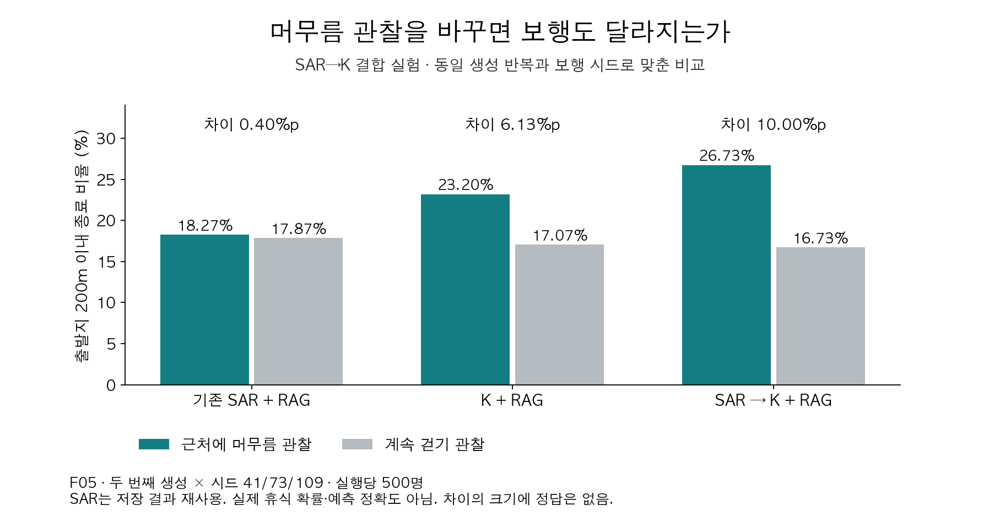

# K-EXAONE 초기 이동 성향 실험 종합 기록

2026-09-22~24 · 팀 동행 / 돌아오길 · 저장 결과 정리 PR

**K가 개인 관찰을 보행에 반영하는 사례는 있었지만, SAR의 오류를 따라가거나 관찰하지 않은 행동을 추가하는 문제가 남았다. 현재까지의 결과로 운영 도입을 확정하지 않는다.** 이번 문서는 K 사용을 포기하자는 결론이 아니라, 무엇을 확인했고 어떤 근거가 더 필요한지 남기는 자료다.

## 왜 실험했는가

돌아오길은 보호자가 알려준 이력과 치매 실종 관련 지식을 바탕으로 초기 이동 성향을 만들고, 가상 보행자의 이동을 집계한다. 우리가 알고 싶은 것은 K가 설명을 더 자연스럽게 쓰는지가 아니라 **‘이 사람은 어디로 향하고, 머무는지 계속 걷는지, 어떻게 방향을 고르고, 거리 정보를 어떻게 해석하는가’를 기존 SAR보다 충실하게 표현하는지**다.

SAR는 도메인 학습을 거친 기존 모델이고, RAG는 기존 Upstage 인덱스에서 검색한 논문·QA 발췌다. 이 지식을 유지하면서 K의 개인 해석을 활용할 수 있는지 검토했다. SAR도 개인 정보와 RAG를 받으므로 ‘순수 통계 vs 개인화’ 실험이 아니다. 마음 재해석은 껐고, 초기 성향과 보행 연결에 집중했다.

처음에는 모델 직접 비교를 하고, 도로 환경과 시간 조건을 확인했다. 이후 K→SAR, 프롬프트·RAG 조건, SAR→K, 피처별 해석, 사례별 SAR 참조, 관찰 추출을 차례로 시험했다. **서로 다른 프롬프트·사례·검사 기준의 통과율을 모델 성능 추세로 비교하지 않는다.**

## 읽는 순서

1. [실험별 목적·방법·결론](EXPERIMENTS.md): 무엇 때문에 다음 실험으로 넘어갔는지.
2. [실제 출력과 보행 그림](EXAMPLES.md): 좋은 사례와 실패 사례의 원문.
3. [현재 판단과 다음 검증 범위](DECISION.md): 완료 결과와 미실행 설계를 구분.
4. [사용량 및 증빙 범위](USAGE.md): 재사용 제외, API별 집계, 비용 미확인 항목.

## 핵심 결과

| 질문 | 확인한 결과 | 판단 범위 |
|---|---|---|
| 개인 관찰이 보행에 전달되는가 | SAR→K의 머무름/지속 이동 대조에서 출발지 200m 이내 종료 차이 10.00%p; 같은 반복 SAR 0.40%p, K 6.13%p | 합성 대조 하나의 입력 반응. 큰 차이가 정답이거나 정확도 향상이라는 뜻은 아님 |
| SAR 참조가 K 해석을 돕는가 | 후속 사례별 실험에서 방향 미관찰 12출력 중 근거 없는 직진 단정 A 1개 / SAR 추가 B 5개 | 사후 특정 오류 진단. SAR의 학습 지식 전체에 대한 평가 아님 |
| 형식만 고치면 해결되는가 | 최신 실험 사전 전체 계약 0/16·0/16; 최상위 구조만 사후 정리하면 7/16·2/16 | 의미 정확도 아님. 관찰 누락·피처 오배치·출처 오류는 별도로 남음 |
| 실제 수색 정확도가 좋아졌는가 | 실제 실종 경로 데이터 미확보 | 검증하지 못함 |



## 기록과 현재 방향을 구분

`evidence/*/REPORT_SNAPSHOT.md`는 **실험 당시 보고서를 원문 그대로 보존한 기록**이다. 과거 보고서에는 K 추출→SAR 같은 다음 단계 제안이 남아 있다. 이는 현재 확정한 구조나 운영 적용을 뜻하지 않는다. 현재 검증하려는 후보는 **보호자 원문 + SAR 해석 + RAG → K 최종 초기 이동 성향 → 기존 코드 변환 → 보행**이며, [DECISION.md](DECISION.md)에 따로 적었다. 이 후보의 새 프롬프트·수치 변환·실행 범위는 아직 확정 또는 실행하지 않았다.

## 증거와 재현

- 8개 생성 실험의 **모델 응답 원문 324개**와 합성 입력(최근 3개 실험), 시스템 프롬프트, 집계·검토 기록을 포함한다. OSM 전환은 저장 출력을 재사용한 별도 1단계다.
- `saved_outputs.json`의 `raw_content`는 원문 그대로이며 문법 오류도 보존한다. 원본 파일 해시와 원문 해시를 함께 저장한다.
- 요청 전체, RAG 문헌 전문, 키·인증·호스트 정보, 전체 도로망·전체 워커 경로는 원본 아카이브에 보존한다. 이 패키지는 오프라인 검토·그림 재생성용이며 모델 실험 전체의 독립 재실행 패키지는 아니다.
- [source_provenance.json](source_provenance.json)은 원본 보고서 해시와 변환 범위를 기록한다. 사람이 직접 판정한 독립 맹검 결과는 아직 없다.
- 이 PR 준비 중 모델/API·GPU·보행 실험을 추가 실행하지 않았고 운영 코드를 수정하지 않았다.

```bash
python3 -m unittest discover -s backend/experiments/kexaone_review_20260924 -p 'test_*.py' -v
# matplotlib와 한국어 폰트 필요. 네트워크·모델 호출 없이 저장 증거로 그림 생성.
python3 backend/experiments/kexaone_review_20260924/render_figures.py
```
