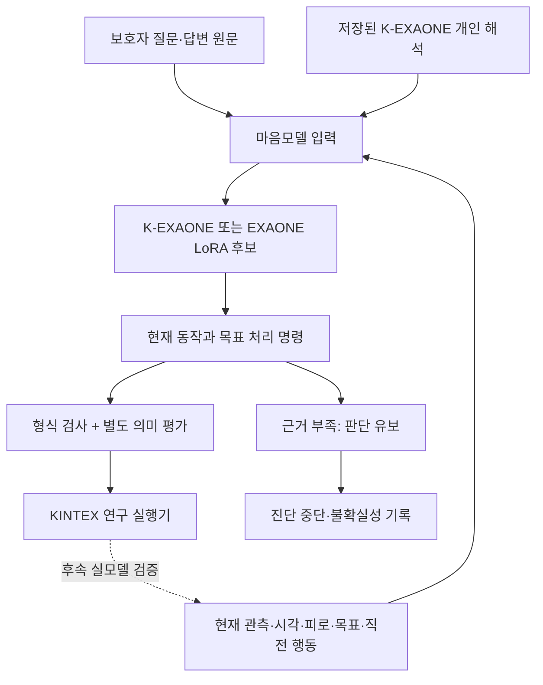
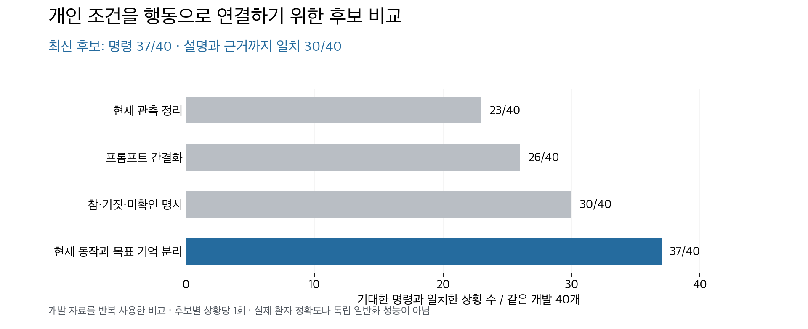
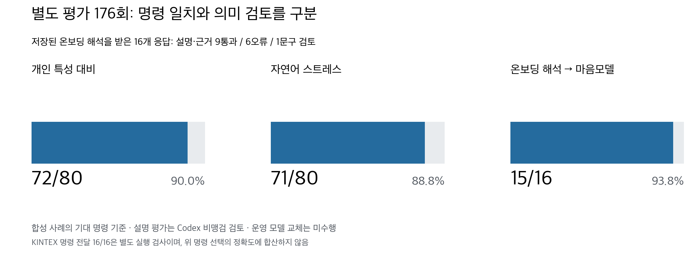

# 온보딩된 사람의 특성을 마음모델의 행동으로 연결하기

2026-09-29~30 연구 기록. **K 프롬프트 비교·추가 LoRA 학습·합성 자료 확대·마지막 176회 검증을 정리한 PR**이다. 확보한 결과를 보존하고 다음 엔진 작업으로 넘기기 위한 단위이며, 운영 모델을 교체하거나 배포 적합 판정을 변경하는 작업은 포함하지 않는다.

## 왜 이 실험을 했나

돌아오길의 목표는 ‘치매 어르신이면 비슷하게 걷는 에이전트’가 아니라 **보호자가 온보딩한 그 사람의 특성을 현재 환경·피로·시간에 맞춰 행동으로 나타내는 에이전트**다. 앞단에서 개인 특성을 잘 저장해도 마음모델이 이를 읽지 못하거나, 말로는 회피한다고 하면서 실행 값은 계속 걷기로 내보내면 목적을 달성하지 못한다.

예를 들어 “시장 소리가 크면 멀어지지만 가족이 곁에 있으면 원래 길을 간다”는 사람은 소음만 보고 일괄 회피해서도, 가족 동행이 미확인인데 있다고 가정해서도 안 된다. 이 때문에 JSON 형식, 개인 조건 해석, 실행 명령, 실제 보행에의 전달을 따로 검사했다. 자유로운 보호자 표현을 단어→행동 규칙으로 바꾸는 방식은 사용하지 않았다.

## 기존 PR과 이번 PR의 관계

| PR / 단계 | 포함 범위 |
|---|---|
| #259 | 기존 마음모델·KINTEX 실행기·첫 LoRA 파일럿 |
| #260 | 기존 72개와 보강 120개로 각각 6epoch 학습, 2·4·6epoch 비교 |
| #261 | 실제 앞단 K 해석과 원문 전달, 휴식 종료·회피 유지 등 실행 연결 수정 |
| **이번 PR** | 이후 96개 fresh/warm LoRA 2회, K 조건 해석 비교 511회, 자료 확대, 최종 176회 진단, 판단 유보의 연구용 실행 처리 |

코드는 #261 브랜치 위의 후속 변경이다. #260의 과거 학습을 이번 2회에 중복 합산하지 않았다. 여기서 SAR-EXAONE은 **LG AI Research EXAONE 3.5 7.8B Instruct에 수색·구조(Search and Rescue, SAR) 도메인 Low-Rank Adaptation(LoRA) 어댑터를 적용한 기존 모델**을 가리킨다. 이번 fresh/warm 학습은 EXAONE 기반 새 후보 실험이며 **K-EXAONE API 자체를 튜닝한 것이 아니다.**

## 어떤 구조를 시험했나



이 그림은 연구 경로다. 운영 `run_prediction`에 기본 연결된 새 마음모델 구조라는 뜻이 아니다. `defer`는 모델이 판단을 유보한다는 뜻이며, 실종자가 실제로 서서 기다린다는 행동이 아니다.

## 실험을 거치며 무엇을 알았나

### 1. 학습 시간만 늘려서는 개인 조건 오류가 해결되지 않았다

EXAONE 3.5 7.8B Instruct / NVIDIA A100 80GB에서 96개 합성 기록으로 두 학습을 진행했다. fresh는 새 LoRA, warm은 앞선 augmented120 6epoch 어댑터 가중치에서 시작하되 optimizer를 새로 만든 후보다. 각각 최대 4epoch, rank 16·alpha 32·dropout 0.05·학습률 1e-4·seed 929·유효 batch 4이며 2·4epoch에서 같은 개발 8개를 확인했다.

| 후보 | 2epoch 명령 일치 | 4epoch 명령 일치 |
|---|---:|---:|
| 새 어댑터 | 5/8 | 5/8 |
| 기존 후보에서 이어 학습 | 4/8 | 4/8 |

형식은 네 체크포인트 모두 8/8이었다. 학습은 2회이고, GPU 개발 생성은 32회다. 체크포인트마다 별개의 학습을 실행한 것이 아니다. 명령과 설명이 어긋나거나 소음 ‘미확인’을 ‘조용함’으로 바꾸는 문제가 남았다. [재학습 전체 결과](evidence/MIND_person_handoff_retraining_20260929/결과보고서.md)

### 2. 작은 성공률에 가려진 분기 오류를 확인했다

K 입력을 전체 문맥, 현재 사실 중심, 원문과 관측의 연결표, 단일 명령 선택으로 바꾸어 비교했다. 미확인 조건을 여러 가정으로 나누어 시험한 후보는 최종 집계만 보면 **16/16**이었지만 내부 가정별 행동은 **56/60**, 가정을 모두 맞힌 호출은 **15/16**, 반복 명령 일치는 **7/8쌍**이었다. 여러 다른 반응을 한데 묶어 ‘판단 유보’로 집계하면서 개별 오류가 가려질 수 있었다.

출력 한도 6,000→12,000, 완전한 JSON 출력 지시 보완, 가정을 요청별로 분리하는 방법도 시험했다. JSON 완성과 개인 의미 해석은 별개였고, 분리 요청도 명령과 설명의 모순을 완전히 해결하지 못했다. [분기 반복 검증](evidence/MIND_condition_alignment_20260929/분기모델_반복검증_결과.md) · [단일 상황 분리 결과](evidence/MIND_condition_alignment_20260929/단일상황_분리검증_결과.md)

### 3. ‘기억한 목표’와 ‘지금 하는 동작’을 분리해 개발 사례가 개선됐다

목적지를 기억하는 것과 지금 그곳으로 계속 걷는 것은 다르다. 휴식·대기·회피 중에도 목적지는 기억할 수 있다. 최신 후보는 명령 목록에 **현재 동작의 의미와 목표를 유지·설정·해제하는 효과**를 함께 제시하고, 관측의 참·거짓·미확인을 별도로 표시한다.



같은 개발 40개에서 간결한 프롬프트 후보는 26개, 최신 후보는 37개가 기대 명령과 일치했다. 13개가 개선되고 2개가 악화됐으며 25개는 같았다. 그러나 최신 후보도 설명까지 검토하면 **30통과·8오류·2문구 검토**였다. 이 결과는 프롬프트·입력 표현·선택지 구조를 합친 후보의 개발 성과이며, K 모델 자체의 우월성이나 실제 환자 정확도는 아니다.

[개발 40개 최신 결과](evidence/MIND_state_alignment_20260930/contrast_pilot4/comparison.json) · [설명별 판정](evidence/MIND_state_alignment_20260930/contrast_pilot4/semantic_review.json)

### 4. 개인 대비 자료와 자연어 평가 자료를 늘렸다

| 자료 | 규모 | 의미 |
|---|---:|---|
| 학습 후보 | 2,160행 | 80개 합성 개인 프로필, 40개 대비 계열, 720상황 × 표현 3종 |
| 개발 | 180상황 | 20개 합성 프로필, 10개 대비 계열 |
| 별도 합성 평가 | 360상황 | 40개 합성 프로필, 20개 대비 계열 |
| 자연어 스트레스 | 80상황 | 20개 합성 서사 × 관측 조건 4개 |
| 실제 저장된 앞단 K 출력 연결 | 16상황 | 8개 합성 개인에 대해 과거 실호출로 생성한 해석 |

같은 환경에 서로 다른 개인 반응을 배치하고, 조건의 결합·예외·우선순위·정정과 미확인을 포함했다. 피로 발언의 참·거짓이 엔진의 피로 수치 하나에 고정 대응하던 우회 단서도 제거했다. 단순히 같은 문장을 늘려 독립 사례 수처럼 세지 않았다.

**동결 v5의 2,160행은 토큰화 검사까지 완료했고 아직 학습하지 않았다.** 이후 평가 중 ‘조건일 때만 이동’과 ‘조건이 아니어도 이동’을 함께 쓴 모호한 표현이 학습 3프로필·81행에서 발견됐다. 수정 전 v5는 학습용 확정 데이터가 아니다. 모든 직전 행동이 `seek`, 경과 시간이 60분인 등 커버리지 한계가 있어 전체 마음모델 자료라고 소개하지 않는다. 실제 환자·독립 보호자 수집·임상 검토 수는 0이다.

**2026-10-03 후속:** [personal_contrasts_v6](revisions/wording_v6/README.md)는 이 81행의 원문만 수정한 새 버전이다. 나머지 2,079행·정답·관측·분할과 동결 개발/평가는 그대로 보존했다. 새 회귀 검사 96개와 학습 2,160행 CPU 토큰화가 통과했다(최대 2,724/8,192토큰). [기계적 준비 상태](revisions/wording_v6/readiness.json)는 PASS이며, 기존 검토 플래그와 커버리지 한계는 유지한다. 실제 학습·모델 성능 검증·독립 검토는 수행하지 않았고 아래 동결 평가 점수도 바꾸지 않았다.

[자료 확대 내역](evidence/MIND_state_alignment_20260930/데이터확대_실행현황.md) · [최신 자료](evidence/MIND_state_alignment_20260930/personal_contrasts_v5) · [문구 문제](evidence/MIND_release_gate_20260930/data_wording_caveat.json)

## 마지막 176회에서 확인한 범위

후보를 고정한 뒤 앞단 연결 16개, 모든 평가 계열에서 고른 개인 대비 80개, 자연어 스트레스 80개를 각각 한 번 실호출했다. 실행 전 정한 기준에 따라 이 단계가 통과할 때만 합성 평가의 나머지 280개로 확대하도록 했다.



| 검사 | 결과 |
|---|---:|
| 개인 대비 기대 명령 | 72/80, 90.0% |
| 같은 관측에 다른 행동을 요구한 개인 쌍 양쪽 정답 | 27/31쌍, 87.1% |
| 자연어 기대 명령 | 71/80, 88.8% |
| 저장된 앞단 K 해석을 받은 마음모델의 허용 명령 | 15/16 |
| 위 16개 마음모델 설명·출처까지 검토 | 9통과·6오류·1문구 검토 |
| 형식 | 개인 대비 79/80, 자연어 80/80, 앞단 연결 16/16 |

설명 평가는 Codex의 비맹검 검토다. 온보딩 해석 모델 자체를 새로 채점한 결과가 아니다. 나머지 160개의 모든 설명을 전수 의미 평가한 것도 아니다. 모호한 자료 4개를 맞힌 경우까지 제외해도 개인 대비는 **70/76, 92.1%**였다. 동결한 원래 점수는 바꾸지 않았다.

**사전에 정한 확대 기준을 통과하지 못해 나머지 280개는 실행하지 않았다.** 95%는 이번 합성 검사의 프로젝트 진행 기준이며 임상적으로 검증된 배포 기준이 아니다. 사용자가 이 결과를 정리하고 다음 작업으로 넘어가기로 한 것과 기술적인 배포 적합 판정은 구분해 기록한다.

### 실제 최종 응답 예시

**조건이 반영된 사례 — E2_1**

현재 푸른시장의 소음이 확인됐고 이 개인은 그 소음을 피한다. 최종 응답은 다음과 같다.

```json
{"next_command_id":"avoid_market","source_ids":["N2"],"reason":"현재 푸른시장이 시끄럽고(noisy=true) 원문 N2에 따라 시장을 피하는 행동을 합니다."}
```

**남은 오류 — E1_1**

다른 개인은 같은 시장에서 소음과 혼잡이 함께 있을 때 멀어진다. 현재 두 조건이 모두 확인됐지만 `continue`를 선택했다.

> 푸른시장이 시끄럽고 사람 많아 시장 회피 조건 충족됨. 그러나 목적지는 은빛경로당으로 시장 회피가 경로 조정이 필요하나 현재 이동 방식 유지가 가능해 보입니다.

입력에는 목적지가 다르므로 회피하지 않아도 된다는 경로 정보가 없다. ‘목표를 기억함’과 ‘지금 회피함’을 함께 처리하는 데 오류가 남은 사례다.

**남은 오류 — 보호자의 부탁과 관찰 구별**

원문은 “피해서 가라고 제가 부탁했어요. 실제로 … 어떻게 움직이시는지는 본 적 없어요”인데, 모델은 이를 개인의 회피 반응으로 적용했다. 다른 사람의 행동을 대상자의 특성으로 읽거나, 실종자 본인 대신 아버지를 찾는 사람의 행동을 설명한 사례도 있었다.

[16개 마음모델 최종 응답·설명 검토](evidence/MIND_release_gate_20260930/frontend/semantic_review.json) · [대표 실패의 원문·최종 응답](evidence/MIND_release_gate_20260930/selected_failure_semantic_review.json) · [전체 배포 검증 보고서](evidence/MIND_release_gate_20260930/배포검증_결과.md)

## 코드와 KINTEX 보행 연결

- `mind_action_decision.py`: 연구용 행동 계약, 등록 목적지·회피 대상 검사, 판단 유보를 실제 행동과 분리한다. 자체 네트워크 호출이나 문장 키워드에 따른 정답 보정은 없다.
- `create_v5_session`: 계량된 요청 함수를 외부에서 전달받는 연구용 세션. 유보 응답에서는 가짜 이동을 만들지 않고 진단을 끝낸다.
- `WalkingSession`: `allow_abstention=False` 기본값을 유지하고, 진단용 명시 설정에서만 유보 종료를 허용한다. 이 필드가 없는 기존 경로의 동작은 유지한다.
- 최신 `separate_motion_and_goal` 프롬프트는 아카이브 안의 후속 실험 후보다. `create_v5_session`을 호출하면 자동으로 이 최신 후보가 사용된다는 뜻은 아니다.

실제 K 최종 응답 16개를 동일한 판단 사실에서 KINTEX 연구 실행기에 한 번씩 넣어 명령과 목표가 전달되는 것을 확인했다. **잘못 고른 명령도 그대로 실행되므로 16/16 전달 성공은 개인 행동 정확도가 아니다.** 유보 4개는 진단 종료였다.

지도는 기존 KINTEX OSMnx 캐시를 사용했다. 원본 취득일·해시·OSM 출처는 [지도 기록](../../tests/fixtures/KINTEX_README.md)에 있다. 검사 좌표는 도로망에 둔 합성 배치이고 실종자 실제 목적지가 아니다. 이 테스트 캐시는 환경별 거리 자료가 없어 회피 방향 검증을 완료하지 못했다. 운영 코드에는 환경 레이어 구현이 있으므로 이를 제품 전체 미구현으로 해석하지 않는다. 장소 분류가 실시간 소음·혼잡 관측을 뜻하지도 않는다.

고정 응답으로 1·2·4·6시간 연속 상태 보존을 검사했지만 **실모델의 시간별 심리 변화·확률지도 정확도와 호출 예산 소진 후 재사용은 아직 미검증**이다. 운영 서버는 기존 `mind_contract=v2`, 호출 예산 5회 경로이며 이번 후보를 연결하거나 서비스 재시작하지 않았다.

## 비용과 실행량

| 이 PR의 단계 | K 호출 | 입력 토큰 | 출력 토큰 |
|---|---:|---:|---:|
| 96개 재학습과 연결 개발 | 16 | 23,354 | 30,776 |
| 조건 연결·가정 분리 | 99 | 196,831 | 304,251 |
| 현재 상태 정리·개인 대비 개발 | 220 | 325,722 | 583,819 |
| 마지막 배포 가능성 진단 | 176 | 351,064 | 450,065 |
| **합계** | **511** | **896,971** | **1,368,911** |

GPU 학습 2회·개발 생성 32회는 별도다. GPU 생성 입력 60,592·출력 3,047토큰을 API 비용으로 다시 계산하지 않는다. 학습 프로세스 경과 시간 합계 817.9초는 GPU 청구 시간이 아니다. 단가·청구액·지원 차수는 미확인이고 0원으로 쓰지 않았다. 이번 PR 작성·오프라인 검증에서 추가 모델·GPU·임베딩·지도 호출은 없다.

## 리뷰어가 재현하는 방법

저장 응답에서 명령 점수를 다시 계산하고, 176개 요청 본문 재생성 결과를 실호출 당시 해시와 대조한다. 정답·시나리오·후보 코드와 공개 최종 응답만 사용하며 재호출하지 않는다.

```bash
cd backend
python experiments/mind_alignment_20260930/verify_archive.py
python -m pytest -q tests/test_mind_person_handoff.py tests/test_mind_action_decision.py tests/test_mind_upgrade.py
```

추가 계약 테스트는 `evidence/MIND_condition_alignment_20260929`에서 `python -m pytest -q test_*.py`(31개), `evidence/MIND_state_alignment_20260930`에서 같은 명령(19개)으로 실행한다. 연결·실행기 48개와 합쳐 **98개 통과**. 테스트 통과는 모델 배포 판정과 별개다.

`SOURCE_MANIFEST.json`은 원본/공개 사본의 파일 해시와 변환 내역을 기록한다. `verification.json`은 이식한 자료의 재계산 결과다. 과거 보고서는 당시 상태를 보존한 스냅샷이므로 이 README와 마지막 배포 검증을 우선한다. 원격 실행·서빙 제어·키·비공개 추론·모델 가중치·전체 제공자 원응답은 포함하지 않았다. 최신 2,160행은 문구 수정 전 학습 금지 상태이며, 데이터 확장본으로 새 학습을 실행한 적 없다.

## 다음 작업으로 넘길 항목

1. **개인 해석의 보존:** 보호자의 부탁·관찰·당사자 발언·다른 사람 이야기를 구별하고, 원문에 없는 조건을 추가하지 않기.
2. **상태 전달:** 경과 시간·실제 연속 보행·휴식·현재 목표·현재 동작을 각각 유지하기.
3. **불확실성의 실행:** 유보를 환자의 정지로 바꾸지 않기. 조건이 달라진 뒤 이전 답변을 그대로 재사용하지 않기.
4. **엔진 검증:** KINTEX 환경 거리와 명령을 연결하고 실제 모델을 사용해 시간별 행동·확률지도를 확인하기.
5. **평가 분리:** 이번 실패를 수정에 사용하면 이 자료는 회귀 검사다. 다음 후보의 최종 평가에는 새로 분리한 개인·표현·상황이 필요하다.
