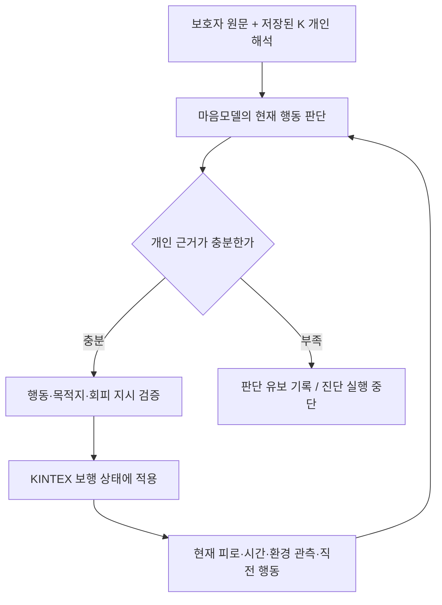

> 실험 당시 기록. 최신 상태는 이 아카이브의 README와 배포 검증 결과를 우선한다. 실행 승인이나 배포 지시가 아니다.

# 개인 해석 → 마음 판단 → 보행 연결: 재튜닝 결과

2026-09-29. **이번 후보들은 다음 평가로 넘어갈 기준을 통과하지 못했다. 운영 모델은 교체하지 않았다.** 연결 코드는 검증했지만, 모델이 개인 조건을 안정적으로 적용한다는 근거는 확보하지 못했다.

## 왜 이 실험을 했나

돌아오길의 목표는 치매라는 분류에 맞춰 획일적으로 걷게 하는 것이 아니라, 보호자가 설명한 바로 그 사람의 특성이 현재 환경·피로·시간에 따라 행동에 나타나도록 하는 것이다. 앞단 K-EXAONE의 개인 해석이 저장되어 있어도 마음모델이 이를 읽지 못하거나 잘못 읽으면 실제 보행에 반영되지 않는다. 이번에는 원문과 저장 해석을 함께 전달하고, 의미 판단과 명령 실행을 나누어 점검했다.

## 무엇을 바꾸었나

이 그림은 연구 후보의 연결 구조다. 운영 예측기에 기본 적용된 구조가 아니다. 판단 유보 시 진단을 멈추는 정책을 환자가 제자리에 머문다는 예측으로 사용하지 않는다.

원문의 조건·예외·과거 정보를 보존했다. 높은 피로와 낮은 피로, 관측 없음과 소음 없음, 휴식 종료와 회복을 구분했다. continue는 진행 중인 이동 유지, seek는 목적지 지정/재개, rest는 휴식, stay는 대기로 구분했다. 사람이 사용한 단어를 찾아 행동으로 고정하는 규칙은 넣지 않았다.

## 학습·개발 자료와 실행

- 베이스: **LG AI Research EXAONE 3.5 7.8B Instruct**, NVIDIA A100 80GB에서 Low-Rank Adaptation(LoRA) 학습.
- 새 LoRA: 베이스에서 새 어댑터 초기화. 이어 학습: 직전 augmented120 6epoch 어댑터의 가중치를 가져오고 optimizer는 새로 시작.
- 두 군 모두 96개 합성 기록, 24개 사례 계열, 최대 4epoch. 2·4epoch 각각 개발 8개를 생성했다. rank 16, alpha 32, dropout 0.05, 학습률 1e-4, seed 929, 유효 batch 4.
- 96개는 96명 환자의 관찰 자료가 아니다. 기존 합성 사례를 새 계약으로 변환했으며 개인 해석은 손작성한 요약이다. 이를 실제 K 출력이라고 표시하지 않았다.
- 개발 8개는 두 사례 계열이며 이전에 검토한 자료다. 독립 환자 평가나 블라인드 평가가 아니다.
- 저장된 K 실호출 결과 8개 합성 프로필로 별도 평가 16개를 준비·고정했다. 개발 탈락으로 이번 후보의 평가 실호출은 하지 않았다.
- 기존 RAG·지도 캐시를 유지했다. 새 검색·임베딩·지도·Mi:dm·앞단 K 준비 호출은 없다.

## 결과

‘명령 일치’는 행동, 목적지 처리, 목적지, 회피 대상, 판단 유보가 사전에 정한 기대값과 일치했는지를 뜻한다. 형식 통과가 개인 행동 성공을 의미하지 않는다.

| 후보 | 형식 통과 | 명령 일치 |
| --- | ---: | ---: |
| fresh_epoch_2_development | 8/8 | 5/8 |
| fresh_epoch_4_development | 8/8 | 5/8 |
| warm_epoch_2_development | 8/8 | 4/8 |
| warm_epoch_4_development | 8/8 | 4/8 |
| k_v3_development | 4/5 | 1/5 |
| k_v4_development | 0/1 | 0/1 |
| k_v5_development | 2/2 | 0/2 |
| k_v6_development | 0/2 | 0/2 |
| k_v7_development | 4/6 | 0/6 |

K 후보마다 시험한 사례 수와 설정이 다르므로 이 표를 모델 순위나 일반 정확도로 해석하면 안 된다. v3/v6은 Thinking을 켰고, v4/v5/v7은 껐다. v7은 실행 가능한 행동 카드 중 하나를 선택하게 했으며, 코드는 선택을 명령으로 전사했을 뿐 의미 정답을 보정하지 않았다. v7의 6개는 실패 조건 중심의 부분 개발 검사다.

K v3의 명령이 맞은 1건도 이유에서 ‘피로도 0.9가 소음 회피 수준보다 높다’는 입력에 없는 수치 비교를 했다. v6의 휴식 선택은 개인 조건과 맞지만 목적지 처리 필드가 null이라 실행 명령 검증에서 탈락했다. 이 둘을 같은 종류의 실패로 묶지 않는다.

## 원문과 실제 출력으로 본 문제

**원문 A:** “공원 소리를 꺼려 돌아가는 분이지만, 몸이 많이 지치면 우선 앉습니다. 덜 지쳤고 공원이 조용하면 그대로 걸어요.”

- 피로 높음 + 소음 있음: 새 LoRA 2epoch는 rest를 선택했다. “소음이 확인됐고 이 사람의 휴식 우선 조건이 성립한다.” 이 조건은 맞게 반영했다.
- 피로 낮음 + 소음 있음: 새 LoRA 2epoch는 avoid였지만, 4epoch는 continue로 바뀌었다. 실제 이유는 “소음이 있어도 낮은 피로에서는 원래 이동을 유지한다는 개인 기록을 따른다.” 원문에는 없는 조건이다. 더 오래 학습한다고 이 구분이 좋아지지 않았다.
- 피로 낮음 + 소음 미확인: 이어 학습 4epoch는 “공원이 조용하다는 조건이 추가되어” continue를 선택했다. 미확인을 조용함으로 바꾼 사실 오류다.

**원문 B:** “시장이 시끄러울 때 혼자면 돌아갑니다. 가족이 옆에 있으면 시끄러워도 같이 원래 길을 갑니다. 조용하면 혼자라도 계속 갑니다.”

- 소음 있음 + 혼자임 확인: 이어 학습 4epoch는 이유에 “개인의 단독 회피 조건을 적용한다”고 쓰고 실제 action은 continue였다. 설명과 실행 명령이 충돌했다.
- 소음 있음 + 동행자 미확인: 원문만으로 가족 동행 예외 적용 여부를 정할 수 없다. 미확인을 ‘혼자’ 또는 ‘함께’로 바꾸면 개인 특성을 잘 반영한 것으로 세지 않는다.

전체 원문·기대 명령·모델 원문은 `response_comparison.jsonl`, 의미 검토는 `semantic_review.json`에 보존했다. 검토자는 Codex이며 독립 사람/임상 평가가 아니다.

## 코드에서 확보한 것

관련 로컬 테스트 **53개 통과**. KINTEX 캐시 위에서 1·2·4·6시간으로 나누어 갱신한 결과와 한 번에 6시간 진행한 결과의 경로·누적 거리가 일치했다. 휴식 후 재개, 관측 만료 후 미확인 전달, 판단 유보 시 가짜 행동을 만들지 않는 것도 확인했다.

이 검사는 정해 둔 응답을 공급한 엔진 검사다. 실제 모델이 시간마다 올바른 심리 변화를 판단한다거나, 실제 치매 환자의 경로를 재현했다는 성과가 아니다. 신규 모델 응답을 승인 없이 경로 반복문에서 추가 호출하지 않았다.

## 사용량·복구

- K-EXAONE 16회. 입력 23,354, 출력 30,776토큰. 출력 한도 소진으로 최종 content가 없는 응답 2건 포함.
- GPU 개발 생성 32회. 입력 60,592, 출력 3,047토큰. 이 토큰을 API 비용으로 중복 계산하지 않음.
- 학습 2회 완료. 학습 프로세스 벽시계 합계 817.9초(체크포인트 생성 검사 포함). GPU 청구 시간이 아님.
- 기존 EXAONE 서빙 복구 확인. Mi:dm 원래 프로세스 유지 확인. 중단~복구 확인 879.2초.
- 단가·청구액·지원 차수·GPU 청구 시간 미확인. 0원으로 기록하지 않음. 공용 사용량 원장에 원격 event_id 중복 없이 동기화.
- 최종 평가 호출 0회. 개발 K 16회·학습 2회 상한을 모두 사용했다. 남은 평가용 호출을 개발 재실험에 전용하지 않음.

## 결론과 다음 개선 방향

이번에 확보한 것은 ‘개인 자료가 마음모델 입력까지 전달되고 판단을 실행하는 경로’다. **‘그 자료를 마음모델이 안정적으로 맞게 해석한다’는 단계는 미완료**다. 새 LoRA 2·4epoch는 각각 5/8에 그쳤고, 기존 어댑터에서 이어 학습하는 방식도 진입 기준을 만족하지 못했다. 이번 결과만으로 K-EXAONE이나 기존 모델 전체의 능력을 일반화하거나 앞단 K 도입을 취소할 근거로 쓰지 않는다.

다음에는 단순히 epoch를 추가하기보다 원문에서 조건·예외와 현재 관측을 연결하는 부분을 분리해 검증해야 한다. 공개 가능한 중간 결과에 ‘어느 원문 조건이 어떤 현재 사실과 연결되는지, 무엇이 미확인인지’를 남기고, 이 관계 판독 결과와 최종 행동을 따로 평가하는 방향이다. 학습 자료도 ‘정답 action’만이 아니라 조건 충족/불충족/미확인, 동행 예외, 휴식과 대기의 차이를 같은 사람의 대비 사례로 보강하는 것이 다음 가설이다. 아직 효과가 입증된 해법은 아니다.

추가 학습·호출은 별도 범위 확정이 필요하다. 이번 승인 안에서 운영 모델을 교체하지 않았고, 실패한 개발 결과를 배포 성공으로 표시하지 않았다.
