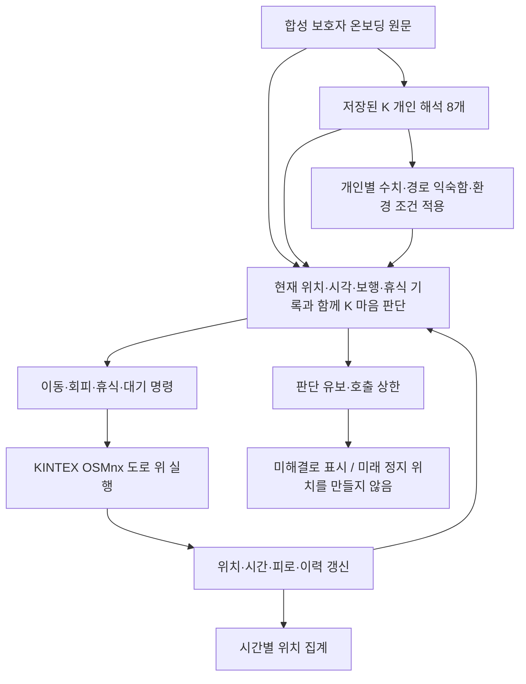
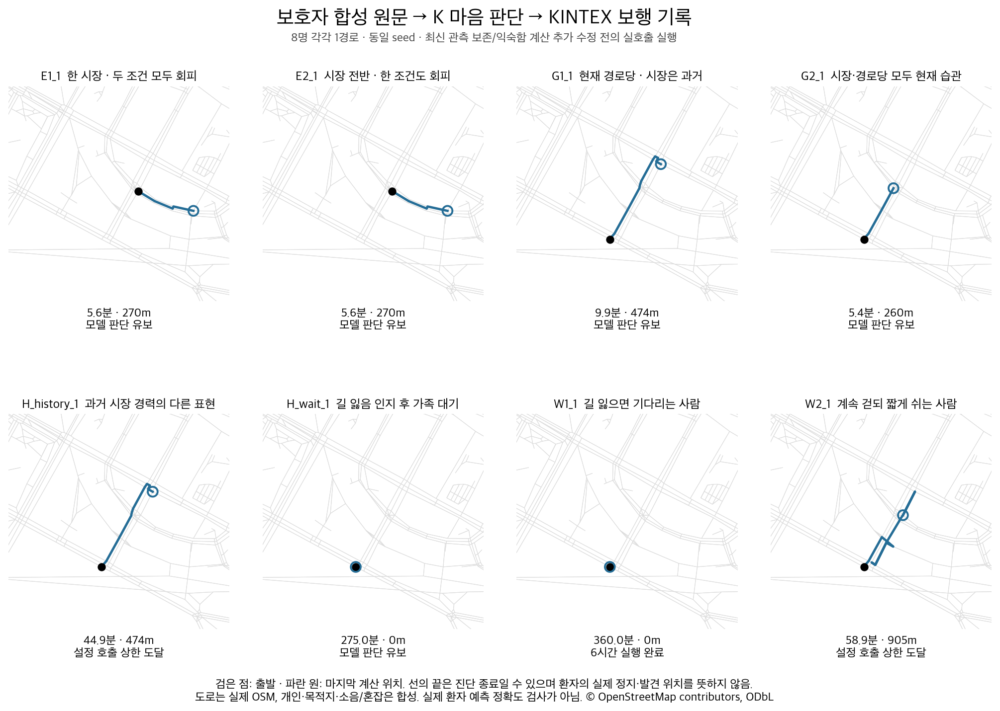
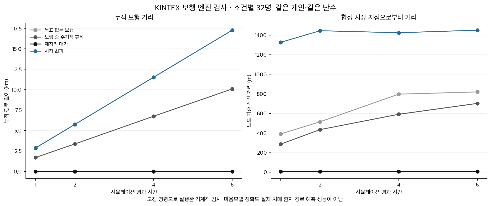

# 온보딩된 개인이 KINTEX 시뮬레이션에서 어떻게 움직이는지

2026-10-04 · 팀 동행 / 돌아오길 · 통합 진단과 코드 수정 기록

## 결론

**저장된 K 개인 해석 → 마음모델의 명령 → 실제 도로 위 이동으로 이어지는 연구용 연결은 확인했다. 그러나 이 코드를 그대로 운영에 넣어도 온보딩된 그 사람의 시간별 동선을 안정적으로 예측한다고 결론 내릴 단계는 아니다.** 개인 특성이 누락되는 코드를 수정했고, 실제 호출에서도 기다림과 계속 걷기·휴식의 차이가 이동으로 나타났다. 동시에 목적지 도착 이후의 판단, 알 수 없는 상황의 후속 이동, 시간별 지도 갱신에는 구체적인 미해결 지점이 남았다.

이번 판단은 ‘근거가 막연히 부족하다’는 뜻이 아니다. **어떤 입력이 빠졌고, 그 뒤 어떤 명령과 경로가 나왔는지를 파일로 추적했다.** 이 문서의 코드 변경은 별도 로컬 브랜치에 있으며 운영 배포·PR 머지·서버 교체는 하지 않았다.

## 무엇을 연결해서 검사했는가

위 도식은 **이번 연구 실행기의 연결**이다. 제품의 `run_prediction`은 아직 기존 `simulation.generate_poa`와 `exaone-mind-dem5` 계약 경로를 사용한다. 새 K 마음 계약과 연속 실행기를 운영 경로에 교체 연결한 상태가 아니다. 운영 서버의 실제 환경변수와 배포 버전은 이번에 재검증하지 않았다.

사전등록 API부터 새로 호출한 시험도 아니다. 이전에 **합성 보호자 원문을 실제 K API로 해석해 저장한 8개 결과**를 재사용했다. 8개 모두 원문·모델 설정에 대한 fingerprint 검사를 통과했고, 마음 요청에 원문·core·scope가 전달되는 것을 확인했다. SAR·Mi:dm·임베딩·지도 신규 호출이나 GPU 재학습은 없었다. 마음 단계의 RAG 추가 효과를 비교한 실험도 아니다.

## 이번에 고친 연결 문제

| 문제 | 바꾼 내용 | 확인한 범위 |
|---|---|---|
| 앞단의 개인별 계산 결과가 새 보행 실행기에 빠짐 | 제품과 같은 `simulation_persona` 적용 | 원본 변경 없이 개인 축·환경 반응·경로 익숙함 전달 |
| 경로 익숙함이 저장만 되고 혼란도 계산에는 안 쓰임 | 실제 그 목표 경로를 따라가는 동안 `known_score` 소비 | 같은 보행에서 익숙함 차이가 혼란도 누적에 반영. 회피 중 기억만 유지하는 목표에는 적용하지 않음 |
| 최근 행동 8개가 쌓이면 최초 관측이 사라짐 | 최근 행동과 관측 종류별 최신 기록을 함께 보존 | 원래 시각을 유지하며, 이후 `unknown` 관측은 이전 `true`를 대체 |
| 실종 경과 시간을 실제 보행 시간처럼 읽을 위험 | 보행·연속 보행·휴식·대기를 별도 계측 | 대기 270분 / 보행 0분을 구분 |
| 모델 유보를 미래 시점까지 정지한 것으로 처리 | 마지막 실제 계산 시각에서 진단 종료 | 미래 지도에서 임의 정지점이나 재정규화된 확률을 만들지 않음 |
| 기존 보행 엔진의 즉시 역주행 억제가 빠짐 | 기존과 동일한 0.2 가중치 적용 | 막다른 길은 되돌아갈 수 있음 |
| 온보딩 위치 후보를 하나로 좁혀도 다른 지역의 첫 결과가 저장될 수 있음 | 지역 필터를 통과한 유일 후보의 좌표 저장 | 집 위치 관련 회귀 테스트 포함 |

관련 테스트 **181개 통과**. 마지막 예산 종료 시 이전 응답을 새 응답처럼 기록하지 않도록 한 수정 뒤에는 영향받는 10개 테스트를 추가로 재실행해 통과했다. 임상 성능이나 실제 실종자 발견 정확도를 뜻하는 숫자가 아니다.

경로 익숙함 소비와 관측 기록 보존 테스트는 **수정 전 실제 실패 → 수정 후 통과**를 확인했다. 이미 실행 중인 모델 실험의 소스는 `code_at_final_loop_launch/`에 그대로 보존했다. 따라서 아래 8명 연속 실호출 결과와 마지막 두 수정의 검증을 혼합하지 않는다.

## 개인 차이가 실제 행동으로 이어진 사례

### 기다리는 사람과 계속 걷는 사람

W1의 보호자 원문은 “길을 놓쳤다는 걸 알고는 그 자리에 서서 가족이 올 때까지 기다렸다”는 내용이다. W2는 “길을 놓쳤다는 걸 알면서도 가족을 기다리지 않고 계속 걸어갔다”는 내용이다. 두 사람 모두 짧게 걷고 쉬는 보행 특성과 공원에 가겠다는 발언이 있다.

모델은 W1에 `stay`, W2에 `continue`를 선택했다. 엔진은 W1의 거리를 0m로 유지했고 W2를 도로 위로 이동시켰다. W2는 연속 보행 약 **6.25분**에 `rest`를 선택했고, 엔진이 **5분의 휴식**을 실행했다. 이 5분은 실험 실행기의 설정값이며 개인의 임상적으로 측정된 휴식 시간은 아니다. “약 5분 보행 후 휴식”을 읽었어도 도로 노드에서 판단하므로 실제 발동이 늦어질 수 있다.

이 결과는 개인 문장을 다른 행동으로 연결할 수 있다는 구체적인 증거다. 그러나 한 사람당 한 경로이며, 다음처럼 뒤의 판단까지 모두 맞지는 않았다.

### 목적지 도착 후에는 아직 과잉 추론이 발생

W2의 원문은 공원까지 실제로 가 본 적이 없다고 설명한다. 그런데 휴식 후 응답에는 **“이전에 경험하지 못한 경로를 계속 시도하는 행동이 관찰됨”**이라는 원문에 없는 관찰이 추가됐다. 이후에는 목적지에 도착했다는 이유로 `stay`를 선택했다가 다시 이동하기도 했다. 목적지 좌표 도달, 본인의 장소 인식, 도착 후의 개인 행동을 구별할 필요가 있다.

E1의 두 번째 응답도 명령은 `continue`여서 기존 회피가 유지되지만, 설명에는 경로당으로 향한다는 표현이 함께 들어갔다. **명령을 받아 실행했다는 사실과 설명이 실제 동작을 정확히 설명한다는 사실은 별개**다.

### 관측 누락 수정은 같은 장면에서 별도 확인

H_wait는 처음에는 기다렸다. 시간이 지나 최초의 길 잃음 관측이 최근 기록에서 사라졌고, 270분에는 **실제 보행 0분인데도** 무릎 때문에 휴식한다는 응답이 나왔다. 275분에는 현재 상태가 미확인이라는 이유로 판단을 유보했다.

마지막 입력의 다른 필드는 그대로 두고, 사라진 원래 관측만 **원래 시각으로 복원**해 K를 1회 다시 호출했다. 결과는 `stay`였고, 엔진은 275→276분 동안 대기를 이어갔다. 수정할 가치가 있는 전달 누락임을 보여 주는 국소 확인이다. 1회의 비맹검 개발 확인이며 6시간 전체 재검증이나 일반화된 개선율은 아니다. 오래된 관측의 실제 유효기간은 여전히 별도로 정해야 한다.

## 8개 연속 실호출 결과

각 사람은 동일한 난수 seed 104에서 출발했다. 6시간까지 실행을 시도하되 판단 유보·호출 상한·오류이면 진단을 종료했다. 종료 후 위치를 미래 시점의 위치로 복사하지 않았다.

| 사례 | 원문상 주요 차이 | 최종 연속 실험 호출 | 실제 계산한 시각 | 누적 거리 | 종료 사유 |
|---|---|---:|---:|---:|---|
| E1_1 | 한 시장에서 혼잡·소음이 모두 있을 때 회피 | 3 | 5.63분 | 270m | 판단 유보 |
| E2_1 | 시장 전반에서 혼잡·소음 중 하나만 있어도 회피 | 3 | 5.63분 | 270m | 판단 유보 |
| G1_1 | 현재 경로당 습관 / 시장은 과거 직장 | 6 | 9.88분 | 474m | 판단 유보 |
| G2_1 | 현재 경로당·시장 모두 반복 방문 | 4 | 5.42분 | 260m | 판단 유보 |
| H_history_1 | 과거 시장 경력을 다른 말로 설명 | 7 | 44.88분 | 474m | 이번 실험의 호출 상한 도달 |
| H_wait_1 | 길 잃음을 깨달으면 가족 대기 | 11 | 275.00분 | 0m | 판단 유보 |
| W1_1 | 길 잃으면 기다림 / 짧은 보행 능력 | 12 | 360.00분 | 0m | 6시간 실행 완료 |
| W2_1 | 길 잃어도 계속 걸음 / 짧게 걷고 휴식 | 12 | 58.86분 | 905m | 이번 실험의 호출 상한 도달 |

**6시간에 도달한 것은 1개 사례**다. 이것은 실험 실행의 완주 수이지 행동 정확도나 예측 정확도가 아니다. 완주 사례에서도 후반 설명이 원문·관측에 적절한지는 별도 문제다. 호출 상한으로 끝난 사례를 모델의 의미 오류와 같은 실패로 세지 않는다. 환경 관측 범위를 벗어나 판단을 유보한 경우도 정보 부족과 모델 오류를 구분해야 한다.

E1·E2는 처음에 소음과 혼잡이 **모두 있는** 상황을 받았다. 따라서 처음에 둘 다 회피한 것은 정상이며, 이 실행만으로 AND 조건과 OR 조건을 구별하는 능력이 입증되지는 않는다. G1·G2도 둘 다 경로당 습관이 있으므로 같은 첫 목적지 자체가 오류는 아니다. 개인 간 차이가 드러나는 조건을 별도로 마련해야 한다.

## 보행 엔진만 분리해서 검사한 결과

같은 개인·같은 출발점에서 4가지 고정 명령을 주고 각각 32명, 총 **128개 경로**를 실행했다. 모델이 생성한 명령이 아니라 엔진 소비처를 확인하기 위한 실험자가 정한 명령이다.

| 고정 명령 | 1시간 누적 거리 평균 | 6시간 누적 거리 평균 | 1시간 뒤 합성 시장과의 거리 평균 |
|---|---:|---:|---:|
| 계속 보행 | 2880m | 17280m | 391m |
| 보행 중 주기적 휴식 | 1713m | 10092m | 287m |
| 제자리 대기 | 0m | 0m | 7m |
| 시장 회피 | 2880m | 17280m | 1326m |

휴식은 이동 시간을 줄였고, 대기는 거리를 늘리지 않았고, 회피는 지정한 시장에서 멀어지는 방향으로 영향을 줬다. 보행만 강제한 6시간 거리는 17.28km로, 실제 치매 환자의 보행 능력을 확인한 값이 아니다. 기존 발견거리 통계의 보정까지 이 연속 실행기에 옮긴 상태도 아니다.

최근 두 소비처 수정 후 같은 오프라인 실험을 다시 실행했으며 결과 파일이 이전 결과와 동일했다. 이 고정 명령에는 해당 목적지 경로 익숙함이나 오래된 개인 관측을 다르게 쓰는 조건이 없기 때문이다.

## 왜 1시간마다 지도를 다시 계산하는 것만으로 충분하지 않았나

기존 제품의 `statistical` 경로를 저장된 개인 8개에 대해 각각 100명씩, 1·2·4·6시간으로 실행했다. 같은 seed에서 **8개 모두 4시간 지도와 6시간 지도가 같았다.** 여기서 `statistical`도 개인화된 초기 입력을 공유하며, 순수 통계만 사용하는 대조군이 아니다.

기존 방식은 출발점에서 발견 시점의 이탈거리를 표집하고 시간에 따른 도달 가능 상한을 적용한다. 그 상한이 통계 상한에 닿은 뒤에는 같은 입력·같은 seed의 결과가 같아질 수 있다. 이 설계에는 발견거리 통계를 임의로 시간에 비례해 늘리지 않으려는 이유가 있으므로, 상한을 무작정 키우는 수정은 하지 않았다.

다만 사용자가 원하는 **“1시간 때 움직이던 그 사람이 다음 1시간에도 걷거나 쉬고, 그 결과로 위치 분포가 달라지는가”**를 이 방식만으로 보장하지는 못한다. 새 실행기는 위치·목표·휴식·시각을 이어받아 계산할 수 있지만, 이 연속 상태와 기존 통계 보정을 함께 쓰는 제품 연결이 남아 있다. 대기하는 사람의 지도는 시간이 지나도 같을 수 있으므로 지도 변화 자체를 성공 기준으로 삼아서는 안 된다.

## 다음 개선의 우선순위

1. **도착과 인식을 구분.** 목적지 좌표에 도착한 상태와 본인이 알아본 상태, 이후 기다리거나 다시 떠나는 행동을 구분한다. 기존 보행 엔진의 목적지 인식 처리와 문헌 근거를 새 실행기로 옮길 때 빠뜨리지 않는다.
2. **모르는 상황에서도 확률적 예측을 이어갈 설계.** 모델 유보를 정지로 바꾸지 않는다. 알려진 개인 제약을 보존하면서 가능한 후속 행동을 나눠 계산하고, 근거 없는 확률을 모델이 임의로 확정하게 하지 않는다. 미해결 질량과 가정을 표시한다.
3. **사건별 상태를 보존하는 시간별 예측 연결.** 1시간마다 출발점으로 돌아가 표집하는 방식과 연속 상태 방식을 구분해 비교한다. 기존 발견거리 통계·물리 도달 범위·도로망 경계를 함께 확인한다.
4. **호출 재사용 조건 검증.** 이전의 예측당 5회 + 풀 표집 정책을 새 계약에 바로 복사하지 않는다. 원문 버전·목표·현재 이동 방식·조건의 참/거짓/미확인·관측 시각이 달라졌을 때 오래된 명령이 재사용되지 않는지 확인한다. 이번 동일 요청 캐시는 진단용이며 운영 호출 예산의 최적화 결과가 아니다.
5. **새 사례에서 다시 평가.** 이번 8개와 수정에 사용한 장면은 개발 자료다. 정보 부족, 목적지 도달 후, 조건 해제, 휴식 재개, 관측 정정, 표현 변화가 포함된 별도 입력과 여러 난수 경로로 검증한다. 실제 환자의 행동 타당성과 위치 예측 정확도는 비식별 사례·돌봄 경험자 검토·실제 경로가 확보돼야 별도로 평가할 수 있다.

## 실행·비용·재현 기록

- 코드 기준: PR #262 계열 브랜치에 develop을 로컬 병합한 `a376c41869398b1a8c066cd4cbc2d055c6eaf2c2` + 이번 수정. 브랜치 `codex/kintex-closed-loop-20261004`.
- K 실호출: **84회 시작 / 84회 종료 기록**, 미동기화 0회. 전체 96회·개인별 12회 이내. 단가·실청구액·지원 차수는 미확인이다.
- 공급자 보고 토큰: 입력 576,870, 출력 296,501, 합계 873,371. Thinking이 공급자 출력 사용량에 포함됐다면 이 합계에도 포함된다. 내부 추론 내용은 보고서에 포함하지 않았다.
- 응답 종료 사유는 정상 종료 83회·출력 한도 도달 1회. 출력 한도 소진도 사용량에서 제외하지 않았다. 공급자 응답 시간 평균 약 53초·중앙값 약 40초이며, 이 지연이 여러 번 누적되는 운영 구조는 별도 최적화가 필요하다.
- 초기 연결 진단 7회, 개인 투영 적용 후 진단 18회는 보존하되 최종 연속 실험의 분모에서 제외했다. 특히 두 번째 진단의 목적지가 없는 3개 사례를 `seek`로 초기화한 오류를 수정했다. 해당 호출의 비용은 제외하지 않았다.
- 지도: 2026-09-28 취득한 고양 KINTEX 주변 보행망, OSMnx 2.1.0, 3,260노드·9,978엣지. SHA-256 `b8bce04b2fda6db26f30bbaea428cce04179e695b462295b5471c66c5bbd418c`.
- 중심은 킨텍스역 인근이며 전시장 부스 실내 동선이 아니다. 시장·공원·경로당 이름과 위치 및 소음·혼잡은 합성 입력이다. 실제 시설 분류나 실시간 관측으로 주장하지 않는다. 250m 밖의 합성 환경 관측은 미확인으로 유지했다.
- 저작자 표시: © OpenStreetMap contributors, ODbL. 지도 범위 밖의 이동은 검증하지 않았다.
- 저장 자료: [공개 응답 전체 대조](모델_공개응답_대조.md), [실호출 요약](final_loop_summary.json), [사용량 요약](usage_summary.json), [수정 후 1회 확인](repair_check/H_wait_1/result.json), [오프라인 결과](offline_results.json), [코드 테스트 기록](code_test_summary.json).

실제 환자 수 0명, 실제 실종 경로 정답 0건, 독립 사람 평가자 0명이다. 의미 오류에 대한 서술은 원문·현재 상태·공개 출력·실행 로그를 대조한 Codex의 비맹검 개발 검토다. 이번 자료로 K 자체의 우월성이나 SAR 대비 개선율을 새로 주장하지 않는다.
