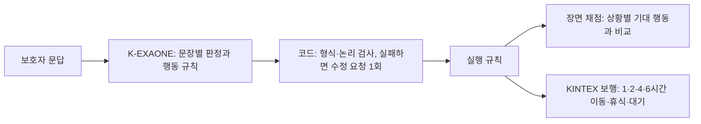

# 마음모델 해석 계약 개선 안내 (2026-10-07)

> **2026-10-08 목적 정정:** 가족과 재회하여 안전 확보가 확인되면 사건 종료다. 아래의 가족 귀환 후 보행은 과거 합성 부품 검사이며 실종 예측 성공 근거로 쓰지 않는다. 미래 관측을 빼고 재검사하니 대기 쏠림이 드러났다. [정정과 실제 재검사 결과](evidence_20261008/search_scope/README.md).

처음 읽는 팀원을 위한 안내입니다. 이 폴더 하나에 2026-10-07 하루 동안의 작업이 모두 들어 있습니다. 이 작업은 PR 세 개로 나눠 올렸습니다.

## 1. 무엇을 하려는가

보호자는 온보딩에서 어르신의 특징을 말합니다. 예: "8분쯤 걸으면 무릎 때문에 앉아 쉬어야 해요", "길을 잃은 걸 알면 가족이 올 때까지 그 자리에서 기다려요".

이 말을 **K-EXAONE이 읽고 시뮬레이션이 실행할 수 있는 규칙으로 바꿉니다.** 그러면 지도 위의 가상 어르신이 실제로 8분 걷고 쉬고, 가족이 올 때까지 기다립니다. 코드는 보호자 문장을 단어로 해석하지 않습니다. 모델이 낸 규칙을 검사하고 실행만 합니다.

목표는 JSON 형식을 잘 맞추는 것이 아닙니다. 다음 두 가지가 실제 행동까지 보존되는지가 기준입니다.

- 같은 사람을 다르게 표현해도 특성이 유지되는가
- 특성이 달라지면 실제 이동·휴식·대기·회피가 달라지는가



## 2. 어떻게 시험하나

| 자료 | 내용 | 상태 |
|---|---|---|
| 개발 8명 (dev8) | 10/06 실험의 대표 실패 5명 + 과잉 생성 반례 3명, 2반복 = 64판정 | 여러 번 본 개발 자료 |
| 개발 128입력 (dev128) | 원형 32명 × (원본, 같은 뜻 다른 표현, 한 요소만 바꾼 반사실, 어려운 경계), 2반복 = 1,024판정 | 파생 96입력은 AI 초안, 사람 검토 전 |
| 평가 64명 (eval64) | 치매 실종 연구 근거를 인용한 새 페르소나 | AI 초안, **사람 검토 전에는 최종 평가에 쓰지 않음** |

**장면 채점:** 입력마다 상황 4개를 미리 정합니다(발동, 비발동, 경계·해제, 미관측·충돌). 모델이 만든 규칙이 각 상황에서 기대 행동을 내는지 봅니다. 출력에 실패한 응답은 4개 상황 모두 실패로 셉니다.

**진행 기준:** 개발 8명은 58/64 이상, 유효 출력 15/16 이상, 치명 오류 0입니다. 128입력은 922/1,024(90%) 이상, 행동군별 80% 이상, 반응 장면·미관측 장면 각 90% 이상, 유효 출력 244/256 이상, 치명 오류 0입니다. 기준은 모두 실행 전에 PLAN 파일에 고정했습니다.

## 3. 후보 이력

| 후보 | 바꾼 것 | 개발 8명 | 128입력 |
|---|---|---:|---:|
| 10/06 v4 (참고) | 기존 후보 | 39/64 | — |
| A | 목적지와 적용 장소 필드 분리 | 34/64 | — |
| B | 답변을 의미 단위로 판정 | 30/64 | — |
| C | 생성 설정(temperature 1.0, 모델 카드 권장), JSON 스키마 강제, 수정 요청 1회 | 19/64 | — |
| D | 인용문 대신 문장 번호, 조건을 구조로 작성 | 56/64 | — |
| D2 | 개발 수치와 겹치는 예시 제거, 근거 손실 방지, 특성 손실 집계 | **60/64** | 827/1,024 |
| D3 | 행동 목록과 나머지 문장 분류를 분리 | **60/64** | **882/1,024** |
| D4 | 검사기 결함 수정 반영(불가능 조건 거절 등) | **58/64** | 진행 중 |

- A·B는 생각 과정이 같은 문장을 수백 번 반복하며 출력 한도를 다 썼습니다. C부터 생성 설정·프롬프트·출력 형식을 함께 바꾼 뒤 반복이 줄었습니다. **temperature 하나의 효과로 단정하지 않습니다.**
- C는 인용문과 조건 문자열의 글자가 망가졌습니다(숫자 "이백팔십" → "이백오십"). D부터 모델이 자유 문자열을 쓰지 않게 바꿨습니다.
- D 프롬프트에는 개발 자료의 수치(8분/450m 등)가 예시로 들어 있었습니다. 개발 점수는 일반화 근거가 아닙니다.
- D4의 58점은 "검사가 엄격해져서" 낮아진 것이 아닙니다. D3·D4 검증기로 다시 계산해도 58입니다. 실제 실패는 두 가지입니다. 가족이 없을 때 대기하는 것을 있을 때로 해석한 오류(2판정), 그리고 근거 문장 누락으로 무효가 된 응답 하나(4판정)입니다.

## 4. 검사 자체를 검사했나

모델을 고치기 전에 검사가 맞는지부터 확인했습니다.

- **반박 검토:** 다른 에이전트들이 코드의 허점을 찾고 재현했습니다. 26건이 확인됐고, 그중 major는 9건입니다(`results/` 아래 기록과 `run_v2.py`·`scoring_v2.py`·`contract_d4.py`·`engine_outputs_v2.py`의 설명). 확인된 예는 다음과 같습니다. 불가능한 조건(가족 있음과 없음을 동시에 요구)이 유효로 통과했고, 치명 판정이 정답 자체를 잡았고, 보행 검사가 규칙을 빠뜨린 출력을 보존으로 셌습니다.
- **채점 수정 전후 비교:** D2·D3 128입력을 기존 채점과 수정 채점으로 나란히 계산했습니다. 장면 점수는 같았고 치명 판정만 달라졌습니다. 그래서 기존 점수가 채점 결함 때문에 부풀려진 것은 아닙니다.
- **보행 검사 판별력:** 정답 규칙을 일부러 틀리게 바꿔(삭제, 조건 뒤집기, 행동 바꾸기) 보행 검사가 잡는지 봤습니다(`results/engine_mutation/`). 108입력에서 각각 102·93·108건을 잡았고, 오경보는 6건(복수 행동의 규칙 순서)이었습니다. 회피 행동은 시나리오가 조건을 거의 만들지 못해 보행으로 판정하기 어렵습니다. 이 결과는 **실험용 합성 시설 레이어** 위의 결과이며 실제 KINTEX 환경 검증이 아닙니다.

## 5. 연구 근거와 평가 페르소나

- `research/행동후보_카탈로그.md`: 치매 실종·배회 연구 근거 241개입니다. AI가 원문과 대조했고, 사람 검증은 아닙니다. 이를 바탕으로 넣을 행동 후보 32개를 정리했습니다. **지금 계약으로 바로 표현되는 후보는 3개뿐입니다.** 직진, 숨기, 대중교통 같은 연구 속 행동 대부분은 엔진 기능 추가나 다른 층이 필요합니다. 그래서 표현하지 못한 본인 특성은 "특성 손실"로 따로 셉니다.
- `dataset/eval64/`: 평가 페르소나 64명입니다. 개발 자료와 겹치는지 검사하는 기준을 고친 뒤 다시 보니, 세밀 구조가 같은 8명이 나왔습니다. 이 8명은 다시 쓰거나 개발 자료로 옮겨야 합니다(`REVIEW_NOTES.md`). 사람 검토가 끝나야 최종 평가에 쓸 수 있습니다.

## 6. 128입력 결과에서 본 약점과 다음 계획

- D3 기준 원본 문장은 235/256인데, 같은 뜻을 다르게 쓴 문장은 215/256입니다. **표현이 바뀌면 특성을 놓치는 경우가 있습니다.**
- 같은 입력에 두 번 물어 같은 규칙이 나온 경우는 41/128입니다. 다만 근거 인용이나 규칙 순서 차이까지 '다름'으로 센 수치라 안정성을 낮게 잡은 값입니다.
- 실패 원인 분석: `results/d3_dev128_analysis/`. 질문 속 조건을 버림, 조건 일부만 남김, 우선순위 미표현, 형식 실수 등입니다.
- **D5 방향(`D5_설계_수정결정.md`가 우선):** 질문과 답을 함께 해석하기, 조건 누락 방지, 정정 관계 보존, 근거가 있는 우선순위, 수정 요청 개선을 넣습니다. 기존 시험 점수에 맞추려고 개인 특성을 빼지 않습니다. 예를 들어 "힘들어도 멈추지 않고 계속 걸으셨어요"는 관찰된 이동 지속이라 조건이 있는 걷기 규칙으로 표현합니다. 엔진도 이를 일반 피로 휴식보다 우선합니다. 정지·대기 중 휴식, 가족이 없을 때 시작되는 행동도 거절하지 않습니다. 기존 정답은 그대로 두고, 해석이 갈리는 사례는 별도 자료로 검증합니다.

## 7. 한계

- 모두 합성 문답과 수기 기대 행동의 일치율입니다. 실제 치매 어르신의 동선 정확도, 임상 타당성, 독립 전문가 평가가 아닙니다.
- 128입력은 원형 32명의 계보이며 독립된 128명이 아닙니다.
- 운영 모델은 바꾸지 않았습니다. 모든 후보는 `RELEASE_QUALIFIED=False`입니다.

## 8. 파일 지도

| 파일 | 역할 |
|---|---|
| `PLAN*.md` | 단계별 실행 전 계획과 진행 기준 |
| `contracts.py`(A·B), `contract_c.py`, `contract_d.py`, `contract_d2.py`, `contract_d3.py`, `contract_d4.py` | 후보별 프롬프트·스키마·컴파일러 |
| `completion.py` | 출력 완료 판정(잘림·경계 문자·복수 객체·중복 키 구분, 고치지 않음) |
| `scoring.py` → `scoring_v2.py` | 장면 채점과 치명 판정(v2는 결함 수정) |
| `run_stage.py`, `run_candidate.py` → `run_v2.py` | 실행기(원장 기록, 수정 요청, 이어하기, v2는 결함 수정과 재채점) |
| `transport.py` | K-EXAONE 호출(맥미니 컨테이너 경유, 주소는 환경변수) |
| `engine_replay.py`, `engine_outputs.py` → `engine_outputs_v2.py` | KINTEX 보행 검사(v2는 합성 시설·판별 기준선·시나리오 3개) |
| `engine_mutation_check.py` | 보행 검사 판별력 검증 |
| `dataset/` | 개발 128입력 빌더·자료, 평가 페르소나 빌더·자료, 누출 검사 |
| `research/` | 연구 근거·후보 카탈로그 |
| `results/` | 단계별 채점 요약·공개 최종 응답·분석 |

## 9. 재현 (모델 호출 없음)

```bash
cd backend
python -m pytest -q tests/test_mind_contract_ab.py tests/test_mind_contract_d4.py tests/test_mind_runner_v2.py tests/test_mind_engine_v2.py
python -m experiments.mind_contract_ab_20261007.dataset.build_dev128 --out /tmp/dev128_check
python -m experiments.mind_contract_ab_20261007.dataset.leakage_check --dev experiments/mind_contract_ab_20261007/dataset/dev128 --eval experiments/mind_contract_ab_20261007/dataset/eval64
```

K-EXAONE 호출은 승인된 단계별 상한 안에서만 실행했습니다. 모든 시작·종료·실패는 공용 사용량 원장에 기록했습니다. 단가·실청구액은 미확인입니다.
