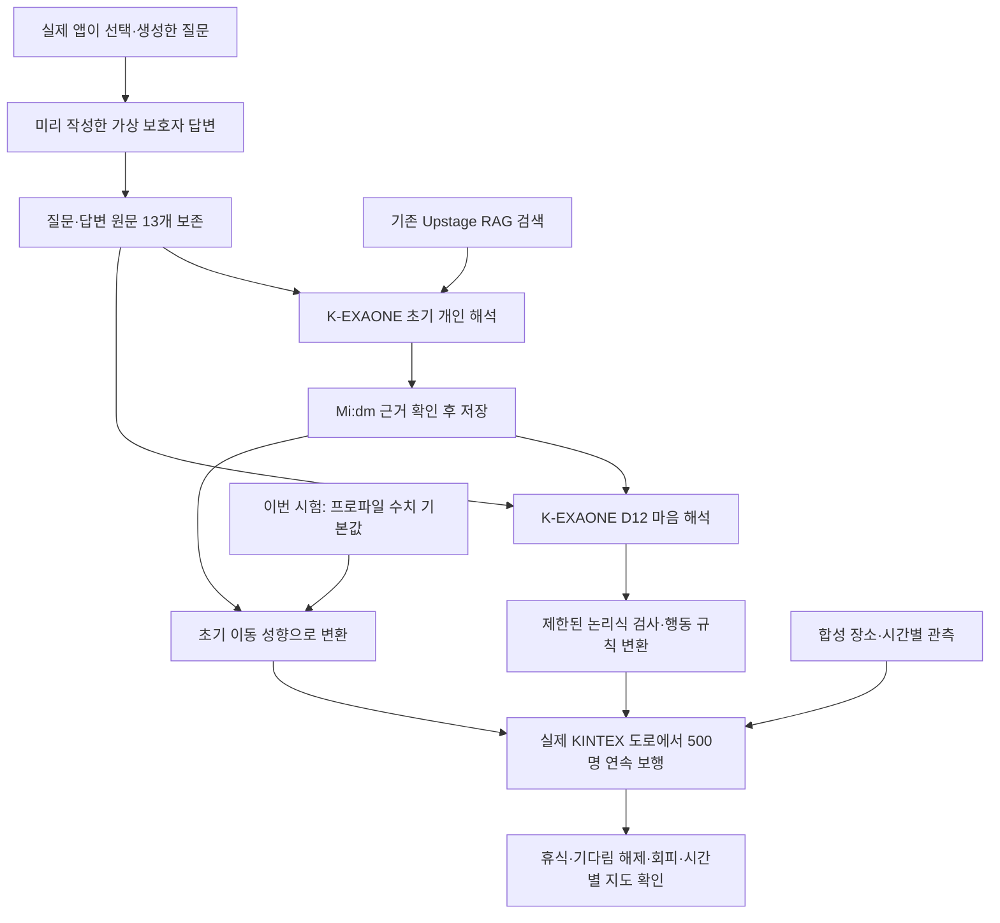
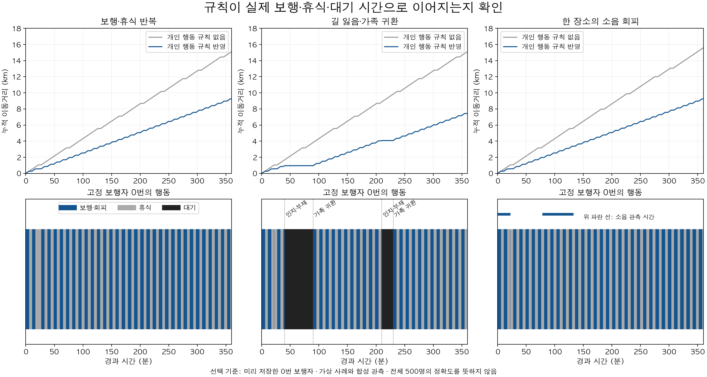
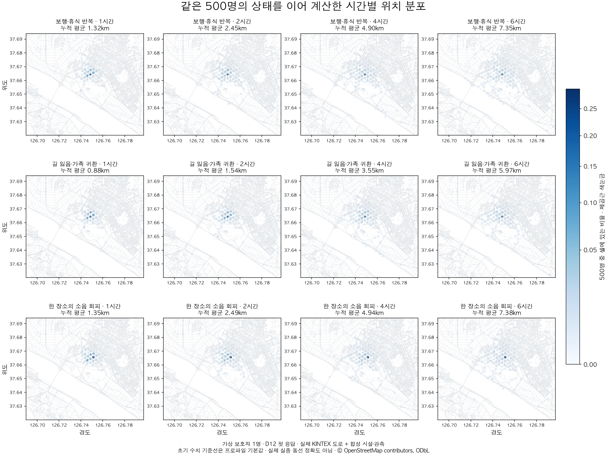

# 온보딩에서 실제 도로 보행까지 — 2026-10-08 연결 검증

**가상 보호자1명의 답변을 실제 앱 질문으로 받아 초기 개인 해석을 저장하고, 새 마음 해석(D12)을 거쳐 KINTEX에서6시간 걷게 하는 연결을 확인했다.** D12의 두 응답 모두 기다림·휴식·특정 장소 회피의 실행 조건을 보존했고, 세 장면의 보행 결과가 작성자 기준 해석과 일치했다.

이것은 연결된 기능이 작동한다는 근거다. 실제 환자1명을 조사한 결과가 아니며, 실제 실종 위치 예측 정확도를 검증한 결과도 아니다. 다른 개발 사례에는 아직 조건 누락이 남아 후속 후보를 비교 중이다.

## 1. 이전과 달리 무엇을 연결했나

이전 보행 시험의 테스트용 인물을 새로 만드는 대신, 앱에서 생성한 Persona를 그대로 읽었다. 등록한 장소·동행 경험·초기 K 해석의 보행 능력 보정까지 함께 사용했다. 동일한500명과 난수 상태를1·2·4·6시간으로 이어 계산했다.



운영의 신고 시점 SAR-EXAONE 수치 생성은 이 시험에서 새로 호출하지 않았다. 초기 수치는 프로파일 기본값에 저장된 K 해석을 적용했다. 온보딩의 별도 축 채점, 운영 API 전체, 알림·제보까지 통합 검증한 것으로 확대하지 않는다.

## 2. 실제로 전달된 답변과 최종 행동 규칙

모델에게 검사 정답은 보내지 않았다. 아래 규칙은 가상 보호자의 원문과 저장된 초기 해석을 받은 K의 최종 공개 응답에서 컴파일됐다. 보호자 문장을 코드의 단어 사전으로 치환하지 않는다.

| 원문 일부 | 최종 실행 조건 | 보행에서 확인한 동작 |
|---|---|---|
| N4: “길을 잃었다고 본인이 알아차리고 제가 곁에 없을 때는 그 자리에 서서 기다리는 모습을 두 번 봤어요. 제가 오면 기다림은 끝났어요.” | 길 잃음 인지 AND 가족 부재 → 기다림 |40분에 조건 발생,90분에 가족 귀환. 개인 대기 규칙이 꺼짐.210~230분 재발동|
| N9: “여섯 분을 계속 걷거나 이백팔십 미터 가면 먼저 도달한 쪽에서 앉아 쉬어야 해요. 쉬실 때는 오 분 앉아 있다가 다시 걸으세요.” | 걷는 중 AND (연속6분 OR 휴식 후280m) →5분 휴식 |보행·휴식 반복. 고정 추적5명의 완료된 개인 휴식 길이는5분|
| N5: “해든상가 안에서 시끄러우면 밖으로 나오시는 것은 직접 봤어요. 다른 상가도 그러시는지는 모르겠어요.” | 해든상가 범위 AND 그곳의 소음 관측 → 회피 |해든상가에서 출발한500명 모두 해당 장소 회피를 수행. 다른 장소 전체로 확대하지 않음|

예를 들어 두 응답의 휴식 규칙은 다음과 같은 실행 조건이었다.

```text
is_walking and (continuous_walk_minutes >= 6 or distance_since_rest_m >= 280)
action = rest
hold_minutes = 5
근거 = N9
```

초기 K 해석에서는 해든상가 반응의 해석이 엇갈려 적용이 보류됐다. 마음 해석에 보호자 원문을 함께 전달했기 때문에, 최종 마음 규칙에서는 해당 장소·소음 조건을 복원했다. 초기 해석의 보류를 전체 단계 성공으로 가려 쓰지 않는다.

## 3. 결과: 출력뿐 아니라 실제 움직임이 달라졌나

| 장면 | 개인 행동 규칙 없음:6시간 평균 거리 | D12 규칙 반영:6시간 평균 거리 | 관찰 |
|---|---:|---:|---|
| 기다림 조건 없이 보행·휴식 반복 |12.31km|7.35km|보고한 주기의 개인 휴식이 실제 거리·시간을 바꿈|
| 길 잃음·가족 귀환 |12.31km|5.97km|정해진 조건에서 기다리고 가족 귀환 후 해당 규칙 해제|
| 해든상가 소음 |12.34km|7.38km|출발 장소의 소음 반응과 개인 휴식이 함께 적용|

대조군도 같은 개인의 초기 성향을 공유한다. **순수 통계와 개인화의 비교가 아니다.** 개인 행동 규칙의 유무만 달리한 비교다. 거리가 짧아졌다는 사실 자체를 예측 정확도 향상으로 해석하지 않는다.

D12 두 응답은 각 장면에서 작성자 기준과 같은 최종 위치 분포·이동거리·개인 휴식·개인 대기·회피 대상을 만들었다. 기존 비교 후보 D4는 두 응답 중 하나만 사용 가능했고 다른 하나는 수정 후에도 실행 형식 검사에 실패했다. 가상 인물1명·2반복이므로 일반적인 모델 우월성의 근거로 쓰기에는 작다.



## 4. 시간이 지나도 지도가 같았던 문제는 어떤가

이번3장면에서는1→2시간,2→4시간,4→6시간의 위치 확률 분포가 모두 달라졌다. 첫 D12 응답에서 셀 확률 분포의 차이(Total Variation)는17.8~25.8%였다. 이는 두 지도에 배분된 확률의 차이이고, 환자를 찾을 확률이나 이동한 사람의 비율이 아니다.



그림 중심에 질량이 남는 원인도 구분해야 한다. 이번 수치 기본값에서는500명 중107명이 초기 `staying_put` 전략을 뽑았다. 이들은 개인의 기다림 조건이 꺼져 있어도 기준선 때문에 계속 머물 수 있다. 이것은 K의 개인 대기 규칙이 계속 켜진 것과 다르다. 보고된 개인 조건과 초기 머무름 가설이 함께 있을 때 이중으로 반영되는지, 머무름 전략을 언제 재평가할지는 추가 점검이 필요하다.

## 5. 연결 과정에서 고친 코드

| 문제 | 수정·검증 |
|---|---|
| 후속 Mi:dm 추출에서 장소 유형을 받아도 기존 장소에 병합하지 않음 |동일 저장 응답 재생에서 장소 유형 보존0/3→3/3. 기존 유형은 덮어쓰지 않음. 커밋 `a2fd062`|
| 준비 완료 시각에 시간대가 있으면 신고 시각 비교에서 예외가 발생해 전체 해석이 무효 처리됨 |같은 시간 규약으로 변환 후 비교. 저장된 동일 해석이 `preparation_invalid`→`applied`. 관련49개 테스트 통과. 커밋 `200ace7`|

두 변경은 별도 개발 브랜치에 있으며 운영 배포는 하지 않았다. 보행에는 시각 수정본을 사용했다. 기존 캡처의 빈 장소 유형을 뒤에서 정답으로 채워 넣지는 않았다. 실험용 장소 분류는 처음부터 선언한 합성 시설 레이어에 명시했다.

## 6. 무엇이 아직 증명되지 않았나

- 일반 성능: D12의 기존 실패 개발8개에서는 행동62/64, 추가 조건12/16, 구별 가능한 보행10/14였다. 이 온보딩1명의 성공이 다른 사례의 실패를 없애지는 않는다.
- 전문가 타당성: 기준은 작성자의 해석이다. 치매 전문가나 돌봄 경험자의 검토를 완료한 정답이 아니다.
- 신체 현실성: 분당 속도, 휴식 후 회복, 수치 반경·머무름 가설은 실측 경로로 보정하지 않았다.
- 표현 범위: 이름을 부르면 고개를 돌림, 보호자에게 방향 도움을 받음 등은 현재 행동 명령만으로 충분히 표현하지 못한다.
- 검사의 범위:전체500명의 분포·누적량을 비교했고, 세밀한 휴식 길이·종료·회피 범위는 미리 정한 첫5명의 저장 경로에서 검사했다.500명 전원의 모든 중간 상태를 세밀하게 검사한 것은 아니다.

## 7. 호출 기록과 재현 자료

초기 준비는 K4회·Mi:dm10회·기존 RAG 검색용 임베딩1회였다. 마음 규칙 비교는 D4가 수정 포함4회, D12가2회였다. 이 마음 비교의 총 토큰은88,490이며 단가·실청구액·지원 차수는 미확인이다. 보행·재채점·그림 생성에는 신규 모델·지도 호출이 없다.

- `../MIND_actual_onboarding_20261008/capture_v2/output/`: 앱 질문·가상 답변·추출 원문
- `../MIND_captured_initial_20261008/capture/output/`: 초기 K 해석·Mi:dm 근거 검사·저장 인물
- `../MIND_captured_policy_20261008/`: 마음 모델 원응답·컴파일·조건 비교·사용 기록
- `manifest.json`: 지도 해시·앱 코드 해시·모든 실험 가정
- `summary.json`, `behavior_audit.json`: 보행 집계와 고정 경로 검사
- 각 장면 폴더:1·2·4·6시간 분포와 첫5명의 원시 경로

현재 의미는 **가상 사례에서 원문→초기 해석→마음 규칙→도로 보행의 연결을 확인했다**는 것이다. 임상적 재현성이나 실종 위치 정확도, 운영 배포 준비 완료를 뜻하지 않는다.
