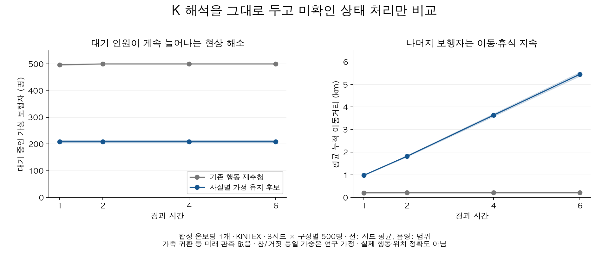

# 미확인 상태의 대기 쏠림 수정·검증

## 결론

저장된 K-EXAONE D12 해석을 바꾸지 않고 **미확인 사실을 반복 추첨하는 엔진 문제를 분리·수정**했다. 명시된 대기 시간이 검사할 때마다 연장되는 문제도 실행 후보에서 고쳤다.

새 실행기 PersistentContextPopulation은 검증용 선택 경로다. 기존 Population의 선택 부분을 메서드로 분리했으며 **운영 API의 기본 실행기는 바꾸지 않았다**. 이번 결과는 이 후보의 계산 편향 수정 근거이며 실제 실종 위치 정확도, 임상 확률, 운영 배포 완료 판정은 아니다.

## 1. 원인 재현

지도·K 호출 없이 결정 부분만 분리했다. “길을 잃었다는 자각”은 계속 미확인이며, 6분 보행 뒤 휴식 조건만 변한다.

| 분리 검사 | 최초 대기 | 120분 대기 |
|---|---:|---:|
| 기존: 가능한 행동을 조건 후보가 바뀔 때 다시 추첨 | 246/500 | 500/500 |
| 후보: 같은 미확인 사실의 가정을 유지 | 262/500 | 262/500 |

걷는 사람은 휴식 조건에 도달하면서 추첨 기회가 추가되고, 기다리는 사람은 조건이 잘 바뀌지 않는다. 이 비대칭 때문에 정보가 늘지 않아도 대기 쪽으로 쏠렸다. 후보의 262명은 검증된 현실 비율이 아니라 고정된 연구 가정과 시드의 결과다. 원 기록은 selection_before.json·selection_after.json이다.

대기 시간도 별도로 재현했다. “10분 대기”의 종료 시각이 기존에는 10→11→12분처럼 밀렸다. 초기 기본 성향이 보행인 12분 검사에서 기존은 12분 내내 기다렸고, 후보는 10분 대기 후 2분 걸었다. KINTEX 검사에서는 3.5분과 10분, 외부 조건 변경, 재발동까지 확인했다.

## 2. 무엇을 바꿨나

- **행동 대신 사실 가정의 일관성 유지:** 같은 보행자의 같은 미확인 사실을 다른 행동·목적지 때문에 다시 뽑지 않는다. 모순되는 참·거짓을 규칙마다 따로 만들지 않는다.
- **가정과 관측 분리:** 실제 입력의 미확인은 그대로 None이다. 가정은 context_assumptions에 출처와 세대를 따로 기록한다. 유효한 사실은 가정보다 우선하고, 관측이 만료되면 새 미확인 구간으로 남긴다.
- **장소 구분:** 상가 A의 소음과 상가 B의 소음, 장소별 인지를 같은 사실로 섞지 않는다. 도로 분류로 실제 소음이 있다고 간주하지 않는다.
- **명시 대기 시간:** 시작 시각을 기준으로 한 번 계산한다. 만료된 같은 대기는 조건이 해제됐다가 다시 생기기 전까지 자동 재시작하지 않는다. 이동 중 발동한 대기가 스스로 이동을 멈췄다는 이유로 즉시 풀리지 않도록 시작 시 이동 조건을 보존한다. 외부 조건의 해제는 계속 반영한다.
- **지속시간 미제공:** 임의로 “30분 후 다시 걷기”를 개인 특성에 넣지 않는다. 같은 가정 아래 대기가 지속될 가능성은 그대로 남기며 미검증이라고 표시한다.
- **저장·복원:** 가정·대기 완료 상태를 저장한다. 실행기 종류나 가정 가중이 바뀐 체크포인트를 조용히 재사용하지 않는다.

K의 출력·보호자 원문·초기 개인 해석은 고치지 않았다. 새 학습과 모델 호출도 없다.

## 3. 실제 앱의 합성 온보딩 → KINTEX 6시간

같은 합성 보호자 1개 사례·저장 D12 첫 응답·초기 개인 성향을 썼다. 구성별 500명이며 시드 3개를 비교했다. 미래 가족 귀환·자각·소음 관측은 넣지 않았다.

| 시드 | 기존 6시간 대기 | 후보 6시간 대기 | 기존 평균 누적 이동 | 후보 평균 누적 이동 |
|---|---:|---:|---:|---:|
|17|500/500|213/500|0.208km|5.371km|
|29|500/500|209/500|0.182km|5.443km|
|43|500/500|204/500|0.223km|5.540km|

후보의 대기 인원은 1·2·4·6시간에 각 시드 안에서 유지됐다. 나머지 보행자는 휴식·회피와 이동을 이어 갔다. 대기를 지워 지도를 퍼뜨린 결과가 아니다. 초기 성향 자체에서 뽑힌 머무름도 남아 있다.

전원이 멈추던 계산 편향은 이 3시드에서 해소됐다. 이동거리가 길어졌다는 이유로 예측 정확도 향상이라고 주장하지 않는다. 시드 3개는 독립 환자 3명이나 1,500명의 실제 사례가 아니다.

## 4. 다른 행동을 망가뜨리지 않았나

- 신규 17개를 포함한 관련 검사 **92개 통과**, 실패·건너뜀 0. 시간 제한, 상태 일관성, 반대 조건의 상관, 관측 우선·만료, 장소 구분, 저장 복원, 기존 예측·종결 경계를 검사했다.
- 조건이 명시된 기존 보행·휴식 및 상가 소음 회피의 2장면을 각 500명·6시간 재생했다. **1·2·4·6시간 분포와 전체 집계가 원 결과와 동일**했다. 이 장면은 고정 관측을 넣은 부품 검사이며 실종 중 미래를 안다는 뜻이 아니다.
- 기존 D12 개발 원형 24개×2응답의 **48개 저장 규칙**을 기준선/후보 각각 16명·4시간·미래 관측 없음으로 실행했다. 양쪽 모두 실행 오류·지도 미완주 0건, 확률 질량 1을 유지했다. 환경·휴식·대기·목적지·외부 상태·근거 보존·시각·복합 행동을 포함한다.
- 마지막 48개 검사는 초기 성향을 공통 기본값으로 둔 **규칙 실행 호환성 검사**다. 실제 앱 온보딩을 48건 다시 진행하거나 48건의 행동 정답을 맞힌 것이 아니다. 기존 D12의 해석 누락을 대신 고쳤다고 주장하지 않는다.

초기 수정본의 실패도 남겼다. 클래스 이름으로 저장 형식을 구분하자 기존 호환 실행기 테스트 3개가 깨져, 의미상 실행기 계열로 구분하도록 고쳤다. 또 미확인 처리와 관계없는 “확정된 휴식·회피의 충돌 선택”까지 바꾸자 기존 상가 장면이 달라졌다. 이 부분은 원래 동작을 보존하도록 고쳤으며 최종 재생에서 동일성을 확인했다. 초기 실패 결과는 덮어쓰지 않았다.

## 5. 여전히 가정에 의존하는 부분

명시 시간의 종료는 해당 대기 규칙의 에피소드 종료다. 그 뒤에는 기존 성향으로 돌아가므로 초기 머무름 성향이면 계속 머무를 수 있다. 원문이 “10분 후 다시 걷는다”처럼 **후속 행동까지 명시했다면 그 전이를 표현하는 계약도 따로 필요**하다. 이번 수정이 모든 초기 성향에서 그 후속 행동까지 구현했다고 주장하지 않는다. 후속 보행을 근거 없이 강제하지 않는 보충 검사도 추가했다.

현재 사실별 미확인 가정은 기본 참/거짓 동일 가중이다. **치매 연구로 교정된 확률이 아니다.** 유효한 새 관측이 없으면 그 가정을 유지하며, 관측되지 않은 자각·인지의 자연 변화율을 만들어 넣지 않았다.

같은 사례에서 자각 가정의 참 가중만 0.1과 0.9로 바꾼 민감도 검사를 했다. 6시간 대기는 **131/500 ↔ 288/500**, 평균 누적 이동은 **6.906km ↔ 3.967km**였다. 이 숫자는 실제 확률의 추정치가 아니라 가정에 따라 예측이 얼마나 달라지는지 보여 준다.

따라서 이번 통과는 **반복 추첨 편향·대기 시간 갱신 오류 수정**까지다. 실제 내부 상태의 변화, 보호자가 말하지 않은 대기 지속시간, 공통 보행 속도의 개인화, 초기 머무름과 조건부 대기의 중복, 실제 관측의 수집 가능성은 별도 검증 대상이다. 이 후보를 API에 연결하기 전에 이런 미확인 범위를 표시하는 방식과 실제 요청→저장→시간 갱신을 점검해야 한다.

## 6. 재현과 증빙

summary.json에 각 시드의 시간별 집계, 품질 표시, 분포 해시, 코드 해시, 92개 검사와 회귀 결과를 보존했다. diverse_rules.json은 48개 출력 전부의 결과다. PLAN.md는 실행 전 범위 및 추가 회귀 계획이다. 새 모델·GPU·지도·임베딩 호출은 모두 0회다.

~~~bash
cd backend
python -m experiments.mind_contract_ab_20261007.captured_unobserved_search \
  --capture /path/to/saved/capture/output \
  --policies /path/to/saved/scored.json \
  --map /path/to/verified/kintex_walk.graphml \
  --product-backend /path/to/product/backend \
  --output /path/to/new/evidence \
  --candidate d12_rep1 --walkers 500 --seed 17 \
  --executor persistent --checkpoint-each-horizon

python -m experiments.mind_contract_ab_20261007.persistent_rule_replay \
  --product-backend /path/to/product/backend \
  --map /path/to/verified/kintex_walk.graphml \
  --output /path/to/new/diverse_evidence
~~~

원본 캡처·도로·전체 경로와 모든 후보 소스는 로컬 MIND_persistent_context_20261008에 보존했다. 공개 묶음은 작은 결과·명세·실행 코드이며 원 결과를 수정하지 않았다. 운영 배포·머지는 하지 않았다.

실험 후 품질 표시 문구 하나를 정정했다. 확정 조건에서는 기존 선택, 미확인 조건에서는 고정 순위를 사용한다는 설명이며 보행 계산은 바꾸지 않았다. summary.json에 실험 소스 해시와 문구 정정 후 소스 해시를 구분해 남겼다.
