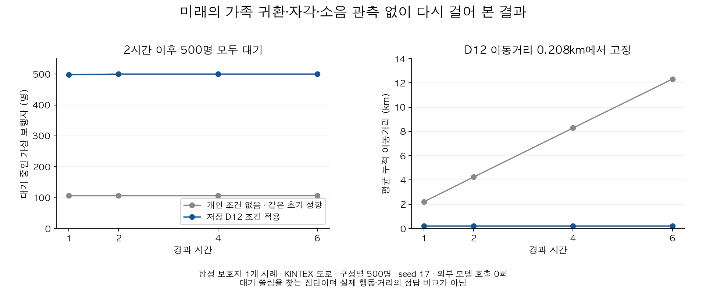

# 실종 예측의 목적·평가기준 정정 — 2026-10-08

**목표는 아직 발견되지 않은 특정 어르신의 이동 가능성을 추정하는 것**이다. 가족과 실제로 재회하여 안전 확보가 확인되면 사건을 종료한다. 이후에 기다림을 풀고 다시 걷는지를 실종 예측의 성공 조건으로 두지 않는다.

기존 결과를 삭제하거나 새 정답으로 재채점하지 않았다. D12의 187/192와 보행 33/34는 합성 조건을 넣어 작성자 참조와 비교한 부품 검사 결과로 보존한다. 이 정정으로 성공률이 올라갔다고 주장하지 않는다.

## 1. 무엇을 혼동했나

보호자 원문이 “길을 잃은 것을 알아차리고 제가 없을 때 기다렸고, 제가 오면 기다림이 끝났어요”라면 세 가지를 구분해야 한다.

| 원문에서 알 수 있는 것 | 원문만으로 알 수 없는 것 | 서비스가 해야 할 일 |
|---|---|---|
| 과거 해당 상황에서 기다린 행동 | 지금 길을 잃었다고 자각하는지 | 개인 특성으로 보존하되 현재 관측 사실로 만들지 않음 |
| 가족 도착으로 그 관찰 에피소드가 끝남 | 가족이 오지 않으면 얼마나 기다리는지, 스스로 언제 재출발하는지 | 무기한 대기나 임의의 재출발 시간을 개인 특성으로 만들지 않음 |
| 가족과 실제 재회·안전 확보가 확인됨 | 단순히 가족이 근처에 있다는 입력만으로 구조가 끝났는지 | 확인된 사건 종료를 별도 수명주기로 처리 |

과거 사실을 삭제하거나 가족 관련 모든 조건을 무시하자는 뜻이 아니다. **보호자 문장의 의미 보존, 시뮬레이션의 미확인 상태, 현실의 사건 종료를 구분**한다. family_present=True 자체를 자동 발견 판정으로 바꾸지 않는다.

## 2. 기존 장면과 수치의 적용 범위

- wait_release는 40분에 길 잃음 자각, 90분에 가족 귀환을 미리 넣었다. 90분 귀환을 실제 재회·안전 확보로 해석하면 그 뒤의 2·4·6시간 예측은 수색 범위 밖이다. 1시간 결과도 미래 자각을 작성자가 넣은 부품 검사다.
- rest_cycle과 place_noise는 대기 반응을 억제하려고 가족 있음·길 잃음 자각 없음 등을 0~360분 고정했다. 휴식·회피의 분리 검사는 가능하지만 실제 미발견 상황을 재현했다고 볼 수 없다.
- D12 확대 24개·2반복의 187/192, 보행 33/34는 기존 분모·실패·정답 그대로 남긴다. 목적 밖 장면만 빼서 더 높은 “새 정확도”를 만들지 않는다.
- 기존 그림과 779,303개 구간 검사도 합성 조건을 넣었을 때 실행이 일관된다는 근거다. 실제 환자 수나 임상적 행동 정확도로 바꾸지 않는다.
- K-EXAONE을 통한 원문 해석의 개선까지 모두 무효라는 뜻은 아니다. **그 개선에서 실제 실종 예측의 타당성으로 넘어가는 검증이 빠졌다는 정정**이다.

## 3. 미래 상황 없이 다시 걸어 본 결과

실행 전에 [계획](PLAN.md)을 저장했다. 실제 앱의 합성 보호자 1개 사례, 저장된 초기 해석과 D12 첫 응답을 재사용했다. 새 모델·GPU 학습·임베딩·지도 호출은 없다.

- KINTEX 기존 검증 지도, 같은 초기 성향, 가상 보행자 500명, seed 17, 6시간.
- 개인 조건 없음과 저장 D12 조건 있음의 2구성. 대조군도 같은 초기 개인 해석을 공유한다.
- 길 잃음 자각·가족 위치·통증·어둠·소음의 미래 관측을 전혀 넣지 않았다. 미확인을 거짓으로 채우지 않았다.
- 1·2·4시간에 JSON 저장·복원하여 이어 계산했다. 이번 실행만으로 별도의 무중단 실행과 동일성을 재검증했다고 쓰지 않는다.
- 등록 좌표와 시설 분류는 기존 합성 사례다. 도로만 실제 OSM이며 시설을 실시간 환경 관측으로 사용하지 않는다.

| 시간 | 개인 조건 없음: 대기 중 | D12: 대기 중 | D12 평균 누적 이동 |
|---|---:|---:|---:|
| 1시간 | 107/500 | 498/500 | 0.207km |
| 2시간 | 107/500 | 500/500 | 0.208km |
| 4시간 | 107/500 | 500/500 | 0.208km |
| 6시간 | 107/500 | 500/500 | 0.208km |

**이 사례에서 D12 실행은 미확인 조건 아래 대기에 쏠렸고, 2시간 뒤부터 분포가 고정됐다.** 이것은 치매 어르신이 실제로 모두 기다린다는 근거가 아니다. 개인 조건 없는 대조군의 평균 12.31km도 실제 정답이 아니다. 관측값을 사람이 배치한 성공 장면만으로 배포를 판정하면 이 문제를 놓친다.

현재 코드 확인: 미확인 사실이 만들 수 있는 서로 다른 행동 중 하나를 동일 가중으로 뽑으며, 행동 후보·대상 등 서명이 달라지면 다시 뽑는다. 이는 교정된 임상 확률이 아니다. 대기 선택 후에는 보행 거리와 연속 보행 시간이 늘지 않으므로, 걷는 분기와 재선택 기회가 달라질 수 있다. 이것은 대기 쏠림을 설명하는 **코드 기반 원인 후보**이며, 이 진단 하나로 모든 원인을 분리한 것은 아니다.

이번 D12 결과의 uncertain_time_fraction=1.0은 계산된 시간 전부가 미확인 분기에 의존했다는 뜻이다. unresolved_mass=0은 계산이 완주했다는 뜻이지 정보가 충분하거나 실제 위치를 맞췄다는 뜻이 아니다. [숫자·소스 해시](unobserved_summary.json), [지도·입력·제품 소스 명세](unobserved_manifest.json)를 함께 보존했다. 원 명세의 “three synthetic scenes” 문구는 재사용한 실행기의 고정 한계 설명이며 실제 이번 장면 수는 scenarios의 1개다.

## 4. 바로 수정한 사건 종료 경계

제품 PR #271에서 다음을 보완했다.

1. 내부 예측 함수·연속 예측·시간 미리보기에서도 종결 상태를 먼저 검사한다. 모델·지도 접근보다 앞선다.
2. 저장소에 종결된 사건이 있으면 작업자가 가지고 있던 과거 활성 복사본으로 다시 예측하지 못한다.
3. 같은 프로세스의 예측과 종결을 같은 사건 잠금으로 직렬화한다. 종결이 오래된 복사본으로 최신 예측 저장값을 덮지 않도록 저장소의 최신 사건을 다시 읽는다.
4. API 진입 검사와 실제 예측 사이에서 종결되어도 HTTP 409로 응답한다. 종결 사건의 시간 슬라이더는 캐시 유무와 관계없이 새 시간 예측을 차단한다.
5. 이미 저장된 마지막 지도 조회는 과거 기록으로 남는다. 새 예측이 아니다.

이 수정은 가족 위치를 추정하여 사건을 자동 종료하는 기능이 아니다. 이미 돌고 있는 연산을 즉시 취소하는 기능이나 여러 서버 프로세스에 걸친 데이터베이스 잠금도 아니다. 현재 프로세스에서는 진행 중 예측이 끝난 후 종결이 확정되며 그 뒤 예측은 거절한다.

## 5. 올바른 연결

~~~mermaid
flowchart TD
    A[온보딩 원문과 과거 관찰] --> B[K: 개인 특성·조건·근거·모르는 부분 보존]
    B --> C[초기 개인 성향과 행동 표현 저장]
    R[실종 신고·마지막 확인 위치와 시각] --> G{발견·안전 확보 확인}
    G -- 확인 --> Z[사건 종료: 이후 예측 없음]
    G -- 미발견 --> D[사건 시점에 사용 가능한 정보 구분]
    C --> D
    D --> E[관측 사실 + 보행 상태 + 명시적 미확인 가정]
    E --> F[개인별 이동·휴식·대기·회피]
    F --> H[시간별 위치 분포와 불확실성]
    H --> G
~~~

내부 자각·인지 상태는 위치 센서처럼 읽을 수 없다. 모델 또는 시뮬레이션 가정으로 추정한 값은 그렇게 표시한다. 향후 관측은 해당 시점 이전 예측에 넣지 않고, OSM 시설 분류로 현재 소음·혼잡을 만들어내지 않는다.

## 6. 다음 개선과 판정 순서

| 단계 | 확인할 것 | 통과로 세면 안 되는 것 |
|---|---|---|
| 원문 의미 | 관찰 행동·조건·장소·지속시간의 유무·에피소드 종료 이유 보존 | 출력 형식만 맞거나 원문에 없는 시간 생성 |
| 사실 경계 | 실제 관측, 내부 가정, 미확인, 사건 종료 구분 | 미래 가족 귀환·자각 시점을 정답처럼 입력 |
| 미발견 행동 | 조건이 알려졌을 때 반응, 모를 때 가정별 경로·민감도·대기 쏠림 확인 | 매 단계 임의 추첨으로 전원이 흡수되는 것을 개인 특성이라 해석 |
| 종료·연결 | 확인된 발견 후 추가 예측 금지, 시간 연속성·저장 복원·원문 연결 | API 일부만 확인하고 전체 운영 완료 판정 |

우선 **미확인 사실의 지속성과 갱신 정책**을 분리해 반복 행동 추첨의 편향을 비교해야 한다. 같은 잠재 상태를 일관되게 유지하는 가정과, 근거가 있는 상태 변화 가정을 구분한다. 이를 위해 원문에서 행동 증거와 “가족이 와서 관찰 종료”를 구분하는 해석 표현을 준비한다. 단어 파싱으로 치환하지 않는다.

관측되지 않은 대기 지속시간은 알려진 개인 수치로 채우지 않는다. 범위나 여러 가정을 사용하면 출처·가정·민감도를 공개하고, 검증되지 않은 동일 가중을 실제 발생 확률로 부르지 않는다. 단순히 몇 분 뒤 강제로 걷게 하거나 대기 규칙을 삭제하여 그림만 바꾸는 것은 해결로 세지 않는다.

대기뿐 아니라 휴식·통증·목적지·특정 장소 회피가 같은 입력에서 유지되는지 함께 비교한다. 원문 변형과 별도 사례로 회귀를 확인한 뒤 실제 API 흐름을 검사한다. 새 점수의 분모와 목적에 맞는 기준은 실행 전에 고정하고, 기존 점수와 별도 보고한다.

**현재 결론:** 조건 실행 개선 근거는 보존한다. 발견 후 예측 경계는 수정·검증했다. D12를 실제 미발견 행동 예측으로 확정할 근거는 이번 진단에서 확보되지 않았으며, 바로 고쳐야 할 문제는 미확인 조건의 시간 변화·대기 쏠림이다. 운영 모델 변경·배포는 하지 않았다.
