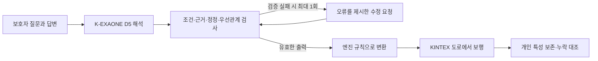

# D5 재개 점검과 다음 실험

중단됐던 D5 초안과 논쟁 사례를 복구했습니다. 새 K-EXAONE 호출은 아직 하지 않았으며, 현재 결과는 코드·자료·보행 연결의 사전 점검입니다. 목표는 온보딩된 개인의 조건과 반응을 보존해 실제 보행에 전달하는 것입니다.

## 무엇을 고치려는가

D3에서는 질문에 들어 있는 조건을 답변과 함께 읽지 못하거나, 여러 조건 중 일부를 빠뜨리는 문제가 있었습니다. 반대로 검사기가 너무 엄격하면 보호자가 관찰한 “피곤해도 계속 걷기”, “기다리던 중 쉬기”를 표현 대상에서 제외하게 됩니다.

D5는 질문·답변을 함께 주고 문장별 역할, 정정 관계, 행동 간 우선순위를 명시하도록 바꾼 후보입니다. 검사기는 논리적 모순을 찾지만, 관찰된 개인 특성이라는 이유만으로 특정 행동을 일괄 거절하지 않습니다. 이 설계가 실제 모델의 오해석을 줄이는지는 아직 측정하지 않았습니다.



그림의 B·D는 다음 실호출 단계입니다. 이번에는 저장된 D3 응답 또는 직접 작성한 D5 출력으로 C·E·F 연결을 확인했습니다. 실제 앞단 7개 사례 연결과 최종 평가 64개도 아직 남아 있습니다.

## 현재 근거

| 확인 | 결과 | 의미와 한계 |
|---|---|---|
| D5 검사·실행기 회귀 | 165개 통과 | 컴파일러·실행 제어 검사. 모델 정확도 아님 |
| 저장된 D3 유효 응답 재생 | 247개 중 D4·D5 모두 수용 238개 | 수용한 238개의 규칙 순서 포함 엔진 입력 동일. 나머지 9개는 둘 다 거절 |
| D5만 새로 거절 | 0개 | 고정 변환을 썼으므로 새 역할·정정 필드의 모델 생성 능력은 미측정 |
| 논쟁 자료 빌드 | 32개 합성 사례·128장면 | AI 작성 초안, 사람 검토 전 |
| 빈 규칙 대조 | 57/128장면 통과 | 특성을 전부 누락해도 맞는 장면이 존재. 나머지 71장면을 별도로 보고해야 함 |
| 개발 자료 중복 검사 | 구조·문장 표시 7개, 거친 구조 검토 2개 | 독립 최종 평가가 아닌 개발 진단 자료 |
| KINTEX 연결 검사 | 작성 출력 2종 × 시드 2개 × 개인 규칙 유무 2개 = 8회, 회당 50명 | 실제 도로·합성 시설·합성 관측. K의 해석 품질·실종 위치 정확도·임상 타당성은 미측정 |

코드 테스트를 하기 전 초안의 D4/D5/실행기/보행 검사 249개도 통과했습니다. 수정 후 165개는 그중 영향 범위와 새 실행기 테스트를 실행한 결과이며, 두 숫자를 독립 검사 개수처럼 합치지 않습니다.

규칙 순서를 정렬해 “같은 엔진 입력”으로 보던 진단을 수정했습니다. 엔진은 동시에 적용 가능한 규칙의 목록 위치를 이용해 선택하므로, 순서가 바뀌면 같은 시드에서도 행동이 달라질 수 있습니다. 이 수정은 모델 프롬프트나 제품 엔진을 바꾸지 않습니다.

## 보행 연결에서 실제로 확인한 것

가족이 없는 첫 30분에는 대기하고, 30분부터 가족이 있다는 합성 관측을 넣었습니다. 개인 규칙을 주입한 50명은 두 시드 모두 평균 30분 대기 후 이동했습니다. 빈 규칙에서는 개인 대기가 0분이었습니다.

피로 상황에서는 걷기를 지속하되 통증에 반응해 쉬는 출력도 주입했습니다. 개인 휴식은 두 시드에서 평균 44.9분·44.7분이었고, 가장 길게 연속해서 걷는 시간의 평균도 빈 규칙과 달라졌습니다. 이는 주입한 규칙의 효과이며 치매 환자의 실제 보행량을 검증한 값이 아닙니다. 보행 속도·체력·인구 사전값은 기존 연결 검사 값을 고정했습니다.

## D2·D3·D4와 비교할 때 지킬 것

- D2: 827/1,024장면 통과, 최종 유효 출력 228/256.
- D3: 882/1,024장면 통과, 최종 유효 출력 247/256. 일부 치명 오류 검사도 남아 있어 진행 기준 미통과.
- D4: dev8 58/64장면, 유효 15/16. 확대 시험은 재개 확인 시 실행 중이며 최종 점수 미정.
- D4 연습 점수가 낮아진 이유를 “검사가 엄격해졌기 때문”이라고 단정하지 않습니다. 저장된 D4 응답은 D3·D4 검사에서 모두 58/64였습니다.
- dev128은 **32개 원형 합성 사례의 변형 128입력**입니다. 128명의 독립적인 실제 환자 자료가 아닙니다. 각 입력 2반복·4장면으로 1,024장면을 채점합니다.
- 장면 점수는 연구용 참조 규칙과의 일치입니다. “실제 치매 환자를 86% 정확하게 예측”으로 표현하지 않습니다.

## 다음 실행 순서

1. 기존 D4 실행과 결과를 보존하고 완료를 확인합니다. 중복 실행하지 않습니다.
2. D5 승인 기록을 새 실행 폴더에 남긴 뒤, `run_d5`로 dev8을 실행합니다. D4 작업 트리와 원본 실행기는 바꾸지 않습니다.
3. 사전 진행 기준을 통과한 경우에만 dev128로 넘어갑니다. 실패는 원응답과 함께 보존합니다.
4. 저장된 실제 D5 출력을 보행 검사 v2로 재생합니다. 빈 규칙과 구별할 수 없는 입력은 보존율 분모에서 구분해 보고합니다.
5. 논쟁 사례 32개와 실제 앞단 7개 연결은 별도 진단으로 다룹니다. 실행 범위와 적합한 어댑터를 먼저 고정합니다.
6. 최종 평가 64개는 사람 검토와 중복 처리 후에만 사용합니다. D5 개발 승인에 포함하지 않습니다.

새 실호출 승인 요청 범위는 dev8 최대 32회 + dev128 최대 512회 = 544회입니다. 검증 실패 후 한 번의 수정 요청과 실패를 포함하며, 전송 오류 자동 재시도는 없습니다. 호출당 출력 상한은 16,384토큰, 입력 토큰·단가·청구액·지원 차수는 미확인입니다. 새 GPU 학습·Mi:dm·SAR·RAG 검색·지도 취득·배포는 없습니다.

## 파일과 재현

- `audit.json`: 저장 응답 재생, 요청 크기, 중복 검사, 빈 규칙 대조와 소스 해시.
- `kintex_wiring.json`: 작성 출력 원문, 변환 규칙, 개인 규칙 유무별 보행 결과.
- `../../PLAN_d5.md`: 후보 변경 사항·단계·중단 기준.
- `../../run_d5.py`: 승인·해시·단계 검사를 유지하는 D5 전용 진입점.
- `../../dataset/disputed_v1/README.md`: 논쟁 자료의 사용 범위.

```sh
python -m experiments.mind_contract_ab_20261007.audit_d5_preflight --run-dir "$PREVIOUS_RUN_DIR" --output experiments/mind_contract_ab_20261007/results/d5_preflight/audit.json
python -m experiments.mind_contract_ab_20261007.probe_d5_kintex --map "$KINTEX_MAP" --output "$NEW_PROBE_OUTPUT"
pytest -q tests/test_mind_contract_d5.py tests/test_mind_d5_entry.py tests/test_mind_runner_v2.py
```

보행 검사는 기존 결과를 덮어쓰지 않습니다. 재현 시 새 출력 경로를 사용합니다. 지도 해시가 다르면 중단하며 다른 지역으로 대체하지 않습니다.
