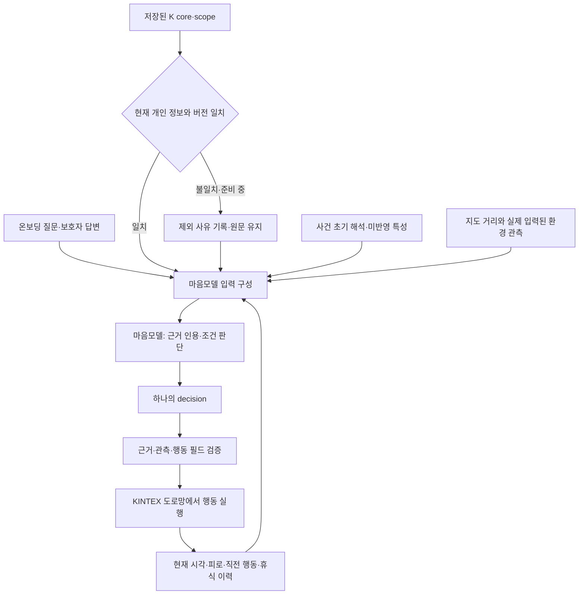

# K 개인 해석 → 마음 판단 → 보행 실행 연결 수정

## 문제와 이번 변경

목표는 온보딩된 **그 사람의 조건부 행동이 현재 상황에서 실행되는 것**이다. JSON 형식 통과나 일반적인 치매 행동을 만드는 것만으로 달성했다고 판단하지 않는다.

운영 `mind_v2.build_input`은 보호자 행동 요약, 게이지 문장, 장소 목록을 받는다. 저장된 K 해석의 `core`·`scope`, 보호자 질문과 답변, 직전 휴식·회피 실행을 충분히 전달하는 경로는 아니다. 기존 `experiments/mind_upgrade/contract.py`에는 더 풍부한 문맥이 이미 있었지만 운영 경로와 구분되어 있었고, 저장 해석의 유효성 검사가 없었다. 이번 작업은 그 실험 구조를 이어서 **유효한 개인 자료를 받고 하나의 실행 지시로 연결하는 후보**를 구성한다.



## 실제로 고친 부분

| 문제 | 수정 후 |
|---|---|
| 저장된 K 결과를 현재 개인 정보와 대조하지 않고 전달 | 온보딩 준비와 같은 fingerprint 검사. 준비 중·수정 전 결과·잘못된 형태는 제외하고 상태 기록 |
| 오래된 K 결과를 제외해도 초기 prior에 같은 해석이 남을 수 있음 | prior의 preparation_fingerprint도 대조. 다르면 해석과 입력용 장소 가중치를 제외. 과거 데이터에 버전 근거가 없으면 `unverified` 표기 |
| 초기 수치로 바뀌지 않은 개인 특성이 사라질 가능성 | `core.other_traits`, `scope`, 시간대 규칙의 양쪽 분기와 초기 해석의 `unrepresented` 보존 |
| 휴식 종료 시 판단 전에 상태를 `continue`로 덮어씀 | 직전 행동 `rest`와 휴식 완료 시각을 그대로 전달. 새 판단이 실제 이동 재개를 결정 |
| 회피 후 `continue`를 실행하면 회피 대상이 `None`이 됨 | 이전 이동 방식·목적지·회피 대상 유지. 목적지로 복귀하려면 `seek` 선택 |
| 실행 이력에 `continue`와 실제 실행된 `avoid`의 구분이 없음 | 요청 행동과 실제 실행 행동을 함께 기록 |
| 실제 이동 전인데 `continue` 선택 가능 | 새 후보에서는 이전 이동이 없을 때 거부 |
| 소음 미확인을 조용함으로 바꿔 적어도 통과 | 현재 상태·관측을 그대로 대조. null/false/0 구분 |

온보딩 때 “지금 시장에 간다”고 한 기록은 이후 실종 시점의 관측이 아니다. 저장 시각과 ‘개인 해석은 새로운 관측이 아님’을 함께 전달한다. 동행 여부가 입력되지 않았다면 혼자라고 가정하지 않도록 명시한다. 이 지시를 **모델이 실제로 지키는지는 실호출 평가 대상**이다.

## 파일과 실행 경로

- `app/llm/mind_handoff.py`: 원문·저장 해석·상태 구성, 후보 프롬프트, 응답 검증, 단일 행동 변환. 네트워크 호출을 직접 생성하지 않음.
- `experiments/mind_person_handoff/session.py`: 실제 Persona 객체에서 위 입력을 만들고 승인·계량된 요청 함수를 받아 지속 보행 실행기에 연결하는 후보 진입점.
- `experiments/mind_upgrade/runtime.py`: 회피 유지·휴식 완료 버그 수정 및 후보 입력 구성기 주입.
- `tests/test_mind_person_handoff.py`: K 저장 형식의 합성 자료 → 실제 요청 payload → 고정된 모델 대역 응답 → KINTEX 보행 검증.

기존 `mind_v2` 프롬프트와 운영 `run_prediction`은 이 후보로 교체하지 않았다. 기존 LoRA 학습 계약과 다르므로 새 입력을 기존 어댑터에 넣는 것만으로 성능이 유지된다고 볼 수 없다. 이 경로는 운영 예측의 보정된 이동 반경·가중합 전체를 대체하는 실행기가 아니다.

## 행동을 실행하는 방식

| 모델 결정 | 실행 결과 |
|---|---|
| seek | 등록된 목적지를 지정하고 그 방향에 가중치 부여 |
| roam | 목적지를 해제하고 배회 |
| avoid | 목적지는 보존하고 지정 환경에서 멀어지는 도로 선택을 선호 |
| continue | 직전 이동 방식과 회피 대상을 유지 |
| rest | 이동 거리는 늘리지 않고 휴식 시간을 진행한 뒤 다시 판단 |
| stay | 그 자리에 머물며 시간 진행 후 다시 판단 |

설명 문장에서 “돌아간다”, “쉰다” 등의 단어를 찾아 행동으로 바꾸지 않는다. `decision`만 실행한다. 모델이 “피한다”고 설명하면서 `continue`를 내는 의미 모순은 여전히 잘못된 모델 응답이며, 이번 인터페이스 검사만으로 자동 해결되었다고 주장하지 않는다.

## 검증 범위

```bash
python -m pytest tests/test_mind_person_handoff.py tests/test_mind_upgrade.py tests/test_mind_context_view.py tests/test_mind_v2_integration.py tests/test_person_preparation.py -q
```

2026-09-29 로컬 검증: **84개 통과**. 기존 FastAPI/Starlette 의존성 사용 중단 예정 경고 1건이 있으며 테스트 실패는 없음.

KINTEX 캐시만 사용. 고정 응답을 쓰는 코드 검증이며 신규 K·EXAONE·GPU·지도·임베딩 호출은 없다. 1시간 후와 2시간 후를 나누어 진행해도 2시간 연속 실행과 경로·누적 거리가 같은지 검사한다. 이는 시간 연속성 검증이며 시간대별 개인 행동의 정확도를 입증한 결과는 아니다.

### 남은 검증

1. 같은 개인 정보에서 조건만 바꿨을 때 마음모델이 행동을 올바르게 바꾸는지 실호출 비교.
2. 설명과 행동의 일치, 필요한 개인 근거 사용, 미관측 조건을 사실로 만들지 않는지 판독.
3. 새 스키마의 실제 지원 여부·입력 길이·지연·출력 잘림 확인. 로컬 통과를 API 호환성·성능 통과로 간주하지 않음.
4. 결과 재사용 예산과 문맥 적합성, 운영 예측의 반경·분포·시간 갱신 연결은 별도 검증. 현재 후보 실행기는 자동 재시도나 문맥 무시 재사용을 하지 않음.

정확도나 실서비스 배포 성공 수치를 새로 주장하지 않는다. 재학습 비교 결과는 별도 PR #260에 보존한다.
