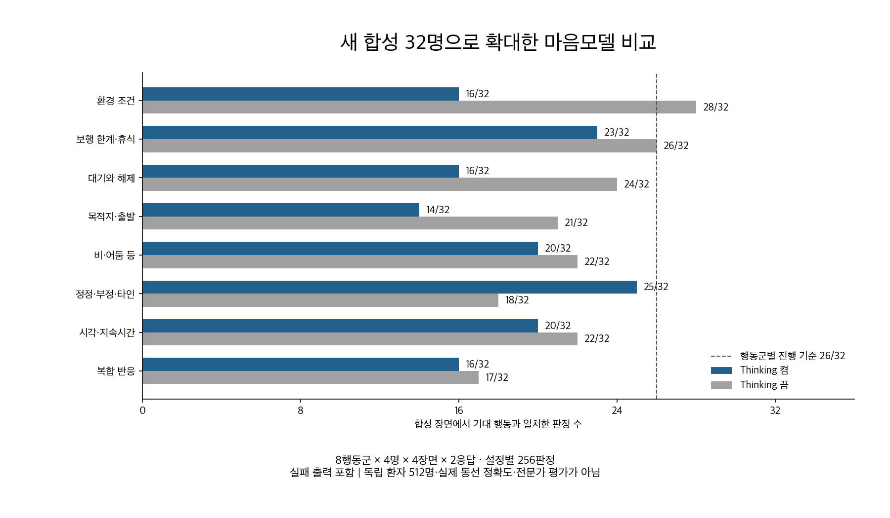
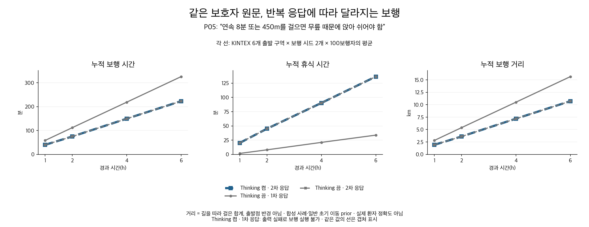
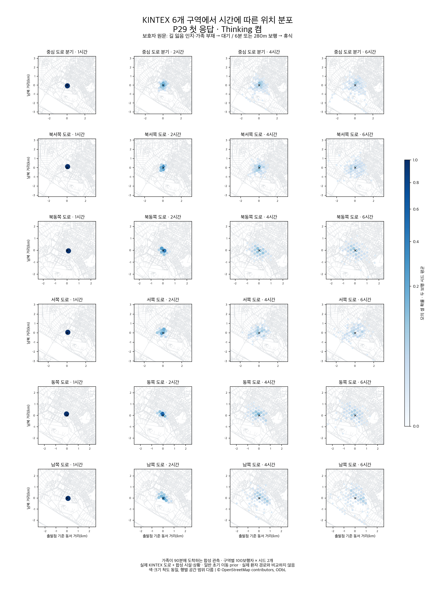

# 마음모델 확대 검증과 다음 개선 계획

2026-10-06 실험 · 2026-10-07 PR 정리 · #266 후속

**더 많은 합성 인물과 상황으로 넓히자, 개인의 휴식·기다림·목적지 정보가 실행 규칙에서 빠지는 문제가 드러났다. 이번 후보는 운영 교체 기준에 미달했다.** 이 문서는 실패를 포함한128회 비교와 KINTEX 보행 증거, 다음 수정·증강 계획을 연결한다.

## 무엇을 확인하려 했나

목표는 보호자가 설명한 특정 치매 어르신의 특성이 실제 시뮬레이션 행동까지 보존되는 것이다. 기존 작은 개발 비교만으로는 새로운 사람·표현·환경에서도 이 연결이 유지되는지 판단하기 어려워, 최신 후보를 고정하고32합성 프로필·8행동군으로 확대했다.

| 자료 | 읽는 목적 |
|---|---|
| [실험 요약](evidence_diverse_20261006/실험요약.md) | 전체 성적·보행·판정·한계 |
| [원문과 실제 출력 보고서](evidence_diverse_20261006/확대비교_결과보고서.md) | 보호자 표현이 어떤 정책이 되었는지 |
| [실패 원인과 수정 후보](evidence_diverse_20261006/오류원인_수정후보.md) | 휴식/대기 누락·목적지 혼동·출력 미완료 |
| [다음 개선 계획](evidence_diverse_20261006/handoff/마음모델_다음개선계획.md) | 계약 수정→증강→별도 평가→실제 앞단 통합 |
| [증강 설계](evidence_diverse_20261006/handoff/데이터_증강_설계.md) | 개발/평가 분할,12개 초안의 검토 방법 |
| [AI 인계 안내](evidence_diverse_20261006/handoff/README.md) | 새 AI의 작업 시작점·경로 대응 |
| [공개 자료 안내](evidence_diverse_20261006/PUBLICATION.md) | 원본/공개본 해시, 전체 공간 기록 접근 |

## 숫자를 읽는 방법

한 프로필에4장면을 미리 정하고 같은 원문으로 모델을2회 호출했다. Thinking 켬/끔을 비교하므로 총128호출이고, 설정마다256행동 판정이다.512명의 환자가 아니며 실제 환자 자료도 아니다.

| 항목 | Thinking 켬 | Thinking 끔 | 시작 전 정한 기준 |
|---|---:|---:|---:|
| 전체 행동 일치 |150/256 (58.6%)|178/256 (69.5%)|231/256|
| 실제 반응이 필요한 장면 |46/84|32/84|76/84|
| 유효하게 완성된 응답 |40/64|60/64|61/64|
| 두 응답 모두 모든 장면 일치 |9/32프로필|11/32프로필|보조 지표|
| 행동군별 최저 성적 |14/32|17/32|모든 군26/32|

두 설정 모두 기준에 미달해 별도64호출 평가로 넘어가지 않았다. Thinking 끔이 빠르고 완성률은 높지만 필요한 행동을 더 많이 누락해, 단순히 끄는 것으로 해결됐다고 판단하지 않았다. 켬의 유효한 응답만 보면150/160이지만 실패24응답을 뺀 값이므로 전체 성능으로 제시하지 않는다.



이전13/16과 이번150/256·178/256은 서로 다른 데이터다. 이를 그대로 비교해 성능이 하락하거나 상승했다고 주장하지 않는다. 이번에는 **더 넓은 조건에서 아직 부족한 부분을 발견했다.**

## 실제 출력이 행동을 바꾼 사례

### 휴식이 빠지면 실제로 더 오래 걷는다

P05 합성 보호자 원문:

> 연속 팔 분 정도 걷거나 사백오십 미터쯤 가면 무릎 때문에 앉아 쉬어야 해요. 둘 다 채워야 하는 건 아니고 먼저 힘든 쪽에서 쉬어요.

Thinking 끔의 첫 응답은 휴식 규칙을 비웠고, 두 번째 응답은 규칙을 보존했다. 같은 중심 출발점·시드17·100보행자의6시간 결과다.

| 결과 | 첫 응답: 개인 휴식 누락 | 두 번째: 개인 휴식 보존 |
|---|---:|---:|
| 개인 휴식 규칙 평균 적용 시간 |0분|135.63분|
| 일반 휴식 포함 평균 휴식 |32.77분|136.57분|
| 평균 누적 보행 거리 |15.71km|10.72km|



거리는 길을 따라 걸은 합계이며 출발점으로부터의 반경이 아니다. 실제 환자의 정답 거리를 측정한 결과도 아니다. [첫 기록](evidence_diverse_20261006/spatial_examples/P05_off_1_C_17.json)과 [두 번째 기록](evidence_diverse_20261006/spatial_examples/P05_off_2_C_17.json)을 공개했다.

### 목적지를 해석하고도 목표로 지정하지 않았다

P14의 실제 요약에는 공원을 알아보면 그쪽으로 걷는다고 적었다. 그러나 실행 출력은 다음이었다.

```json
{"command":"walk","condition":"target_recognized","place_labels":["느티공원"]}
```

현재 계약에서 `walk`는 새 목적지 지정 없는 걷기, `place_labels`는 행동을 적용할 장소 범위다. 따라서 ‘공원으로 향하기’가 ‘공원 가까이에서 걷기’로 바뀌었다. 필요한 것은 공원을 목표로 하는 `seek`다. JSON 형식이 맞아도 이 의미 오류는 남는다. [실제 최종 응답](evidence_diverse_20261006/comparison/on/P14/2/response.public.json)을 함께 확인할 수 있다.

### 올바른 응답에서는 대기 해제와 보행이 연결됐다

P29의 올바른 응답에서는 가족이 없을 때 기다리다가90분에 가족이 도착하면 대기를 끝내고, 이후 개인 보행 한계에 따라 걷기와 휴식이 이어졌다.



이 성공 사례로 전체 실패를 대체하지 않는다. 시간별 그림이 달라지는 것만으로 위치 예측이 정확하다고 판단하지 않는다.

## 보행 검사는 어디까지 통과했나

사전에 고른8프로필×2설정×2응답×6구역×2보행 시드=384계획 칸이며 칸당100보행자다.276개를 실행했고108개는 모델 출력 문제로 실행할 수 없었다. 실패 응답을 새 응답으로 대체하지 않았다.

실행276개에서는 확률 질량·시간 합계·보행 시간과 거리·6시간 연속 계산이 유지됐고, 저장 후 재개23건도 일치했다. 이것은 엔진 계산의 정상성을 보여 준다. 개인 조건까지 맞혔다는 뜻은 아니다. 개인별 행동 검사는 별도 표로 [요약](evidence_diverse_20261006/실험요약.md)에 기록했다.

실제 도로는 KINTEX OSMnx 캐시, 시설 배치·소음·혼잡·가족 도착은 합성 관측이다. 일반 치매 persona와 공통 초기 prior를 사용했으므로 새 온보딩 전체를 거친 검증이 아니다. © OpenStreetMap contributors, ODbL.

## 다음에는 무엇을 바꾸나

1. 목표 장소와 적용 장소를 분리하고 `walk`·`seek` 의미를 명시한다.
2. 실제 관찰·신체적 필요의 근거가 행동 규칙까지 연결되는지 검사한다. 원문 단어를 파싱해 누락을 자동으로 채우지 않는다.
3. 출력 미완료와 JSON 경계 오류를 분리한다. 단순히 대기 시간을 늘리거나 실패를 제외하지 않는다.
4. 같은 의미의 다른 표현과 한 조건만 다른 대조 자료로 확대한다.12개 증강 예시는 검토 전 초안이다.
5. 별도 새 평가를 통과한 후보를 실제 저장된 앞단 개인 해석과 연결한다.

현재32프로필은 개발 자료가 됐다. 후속128개발입력·새64평가원형 및 최대416호출은 **계획**이며 실행/승인된 결과가 아니다. API K-EXAONE을 직접 튜닝할 수 있다고 가정하지 않는다. SAR LoRA 재학습은 오류 분석과 검토된 정답 확보 후 별도 후보로 검토한다.

## 저장 결과 검증과 사용량

```bash
cd backend
python -m experiments.mind_policy_candidates.verify_diverse_evidence
python -m pytest -q tests/test_condition_program.py tests/test_note_policy_candidate.py
```

검증 도구는 네트워크 없이 공개 파일·압축 내부 해시,512행동 판정,384공간 상태와 저장된 계산 지표를 확인한다. 큰 지도나 모델을 재실행하는 명령이 아니다.

추가 실험128회 사용량은 입력218,096·생성383,341·총601,437토큰이다. 원격/로컬256시작·종료 이벤트를 대조했고 단가·실청구액·지원 차수는 미확인으로 유지했다. PR 작성 중 새 모델 호출·학습·배포는 없다. 기존 초기 해석·SAR·운영 마음모델 교체도 이 PR의 범위가 아니다.
