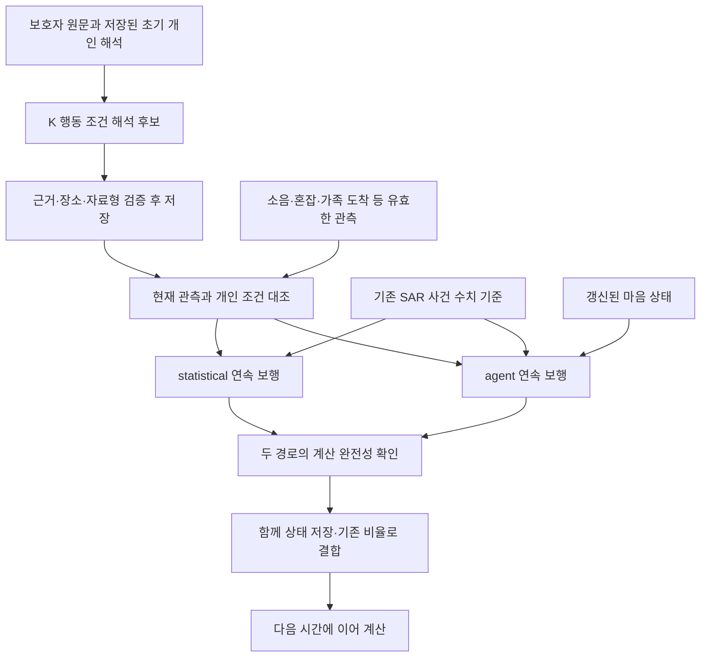
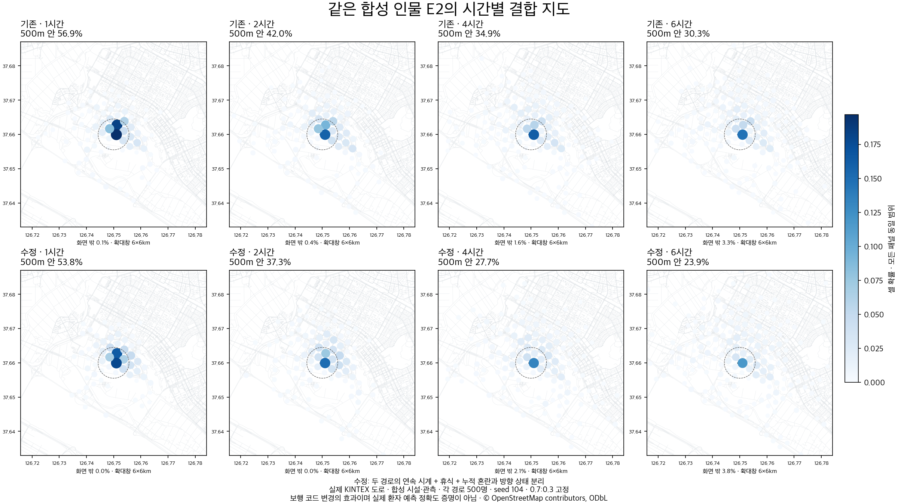
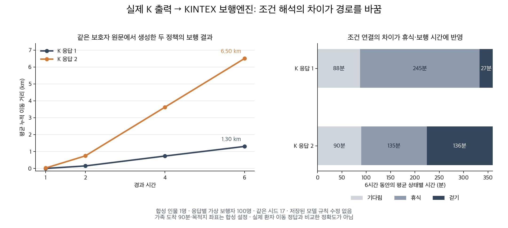

# 시간별 보행 수정과 마음모델 후속 실험

2026-10-06 · PR #265 이후 · 로컬 변경 · 운영 미배포

## 결과부터 읽기

온보딩에서 설명한 사람이 실제 도로 위에서도 그 특성에 맞게 걷고, 쉬고, 기다리는 것이 목표다. 이번에는 시간별 지도 정체와 휴식·상태 저장 문제를 수정하고, K-EXAONE이 개인 행동의 조건을 정확히 만들어 주는지 여러 구조로 비교했다.

**보행 코드의 회귀 검사는 통과했다. 마음모델의 새로운 운영 후보는 아직 통과하지 못했다.** 같은 합성 개발 장면의 행동 일치율은 9/16에서 13/16(81.25%)으로 개선됐지만, 사전에 정한 15/16에는 미달했다. 실제 환자 경로나 독립 전문가 평가가 없으므로 실종 위치 정확도 향상이라고 표현하지 않는다.

| 읽을 자료 | 무엇을 확인할 수 있는가 |
| --- | --- |
| [최신 64회 실험 보고서](evidence_20261006/MIND_practical_gate_20261006/실험결과.md) | 왜 했는지, 12개 후보/진단 묶음, 실제 출력, 81.25%의 범위와 실패 |
| [시간·보행 개선 보고서](evidence_20261006/MIND_time_dynamics_20261005/개선결과.md) | 시간별 정체 원인, 피로와 방향 분리, 12개 KINTEX 실행 |
| [앞선 64회 장면 해석 비교](evidence_20261006/MIND_source_scene_20261005/결과보고서.md) | 원문·현재 사실 입력, Thinking 및 출력 제약 비교 |
| [#265 직후 추가 18회](evidence_20261006/MIND_release_convergence_20261004/후속개선_결과.md) | 조건 프로그램 재검토와 현재 장면 선택의 초기 실패 |

앞선 보고서는 당시의 기록이다. 특히 10월 5일에는 조건 정책을 뺀 대조 경로를 결합했으나, 10월 6일 수정본에서는 **두 경로가 같은 개인 조건을 공유**한다. 과거 결과를 현재 구조의 결과로 바꾸어 적지 않았다.

## 1. 실제로 고친 동작

| 문제 | 수정 | 의미와 한계 |
| --- | --- | --- |
| statistical 경로가 도달 범위 상한 이후 같은 시점 분포로 반복 | 두 경로가 각각 위치·보행 상태·난수를 저장하며 다음 시각까지 이어 계산 | 시간이 흐른다는 근거. 더 정확한 위치를 맞혔다는 근거는 아님 |
| 누적 피로가 일반 휴식에 연결되지 않음 | 기존 피로 곡선을 분당 평가해 휴식 가능, 명시된 개인 신체 반응과 대기·휴식 우선 | 휴식 5분·회복 0.4 등은 잠정 가정 |
| 누적 혼란 게이지가 방향 산포를 계속 포화 | 발동용 누적 게이지와 방향 선택 상태를 분리 | 미관측 방향 상태 0.5는 기존 기본값이며 임상 추정치 아님 |
| 관측이 분 중간에 변해도 늦게 반영 | 관측 시작·종료 시각과 개인 보행 경계에서 계산 분할 | 가족 도착·환경 변경에 맞춰 재평가 |
| 일부 실패한 결과가 정상 상태를 덮음 | 두 경로 모두 계산을 끝낸 경우에만 체크포인트 함께 확정 | 이전 정상 지도·상태 유지, 미리보기는 원본 보존 |
| 개인 조건이 결합 중 희석 | agent·statistical이 같은 개인 정책을 사용, 갱신된 마음 상태만 구분 | 정책을 뺀 경로는 별도 대조 실험. 0.7:0.3은 고정값 유지·재검증 필요 |
| 미만/이상 경계 표현 부족 | `lt`, `gt`와 일관된 수치 허용오차, 보행 경계 분할 추가 | 조건 표현·실행 검사이며 자연어 해석 성공과 별개 |

기존 K 초기 개인 해석·SAR-EXAONE 사건 수치 기준·운영 마음모델은 서버에서 교체하지 않았다. 새 조건 후보의 `RELEASE_QUALIFIED=False`를 유지한다. 기존 후보가 준비되지 않은 제품 실행은 legacy 경로를 사용한다. 후보를 비활성으로 두었다고 공통 파이프라인 코드 리뷰가 불필요한 것은 아니다.



이 그림은 **검증 중인 로컬 후보 연결**이다. statistical도 개인 정보를 공유하므로 순수 통계 대 개인화 비교가 아니다. 보호자의 단어를 코드로 매핑한 것이 아니라 모델이 해석한 명시 조건을 엔진이 평가한다.

## 2. 시간별 지도가 같아 보였던 문제

기존 합성 E2에서 결합 지도 전체가 모두 같았던 것은 아니다. statistical의 **4시간과 6시간 셀별 확률이 동일**했고 개인 경로에는 6시간 동안 휴식이 0분이었다. 시간별 계산 방식과 휴식 소비를 따로 수정했다.



KINTEX에서 4조건 × 3시드 × 두 경로 × 경로당 500명을 확인했다. 총 12개 실행·96개 시점 지도에서 시간·확률이 보존됐고, 걷는 대조 경로는 모두 4→6시간 사이 추가 이동했다. 수작업으로 만든 대기·휴식 정책도 포함된 **엔진 검사**다. 가상 보행 12,000회를 실제 환자 12,000명으로 세지 않는다.

이 그림의 정책을 뺀 경로는 10월 5일 대조 실험이다. 현재 결합은 양쪽에 개인 조건을 공유한다. 이후 수작업 기다림 정책으로 세 시드를 검사했을 때 1시간 대기 셀 밖 질량이 27.6~28.8%에서 0%로 바뀌었다. 개인 조건 희석을 제거한 근거이며 모델 정확도에 합산하지 않는다.

## 3. 모델이 설명은 잘해도 움직임이 틀릴 수 있음

최신 비교에서 사람의 문답을 함께 해석하고 Thinking을 켠 후보가 13/16으로 가장 좋았다. 회피는 1/4, 개인 행동을 확정하지 않아야 하는 장면은 8/8, 휴식 2/2, 기다림 2/2였다. 휴식 장면을 맞힌 출력에도 다른 상황에서 바로 쉬게 만드는 조건 오류가 있었다.

원문: “오 분 정도, 삼백 미터쯤 걸으면 앉아서 쉬어야 해요.”

첫 실제 응답의 실행 의미:

```text
(5분 이상 걸음 AND 300m 이상 걸음) OR 현재 걷는 중 → 휴식
```

`OR 현재 걷는 중` 때문에 방금 걷기 시작해도 휴식 조건을 만족한다. 다른 응답은 이 연결을 다르게 만들고, “다온공원에 가야 한다고 말함”에서 근거 없는 출발 조건을 추가했다.



같은 합성 원문·초기 성향·KINTEX 지도·시드, 응답당 100명에서 6시간 평균 누적 거리가 **1.30km와 6.50km**로 갈렸다. 규칙을 수동으로 고치지 않았다. 두 정책에서 여러 요소가 함께 다르므로 각각의 인과 효과 비율은 분리하지 않았다. 합성 인물 1명의 실패 진단이며 어느 거리가 실제 환자의 정답인지는 모른다.

## 4. 호출과 단계 판정

| #265 이후 묶음 | 실제 K 요청 | 결과 | 확인된 입력 / 출력 토큰 |
| --- | ---: | --- | ---: |
| 조건 재검토·장면 선택 | 18 | 정식 채택 후보 없음 | 36,976 / 33,843 |
| 원문·현재 장면 비교 | 64 | 같은 기준으로 환산한 최고 9/16 | 94,918 / 266,242 |
| 문답별·사람별 조건 정책 | 64 | 최고 13/16, 개발 기준 15/16 미달 | 63,319 / 139,446 |
| **추가분 합계** | **146** | 별도 평가로 확대한 후보 없음 | **195,213 / 439,531** |

확인된 총 토큰 소계 634,744. 최신 묶음의 HTTP 422 오류 18건에는 usage가 없어 0으로 계산하지 않았다. 과거 원장 누적 128회와 그 안에 포함된 추가 18회를 중복 합산하지 않는다. 단가·실청구액·지원 차수는 미확인이다. 신규 GPU 학습·SAR·Mi:dm·RAG 검색·임베딩·지도 호출은 없다. PR 작성 중 추가 모델 호출도 없다.

처음 정한 약 90% 기준을 유지한다. 개발 15/16 이후 후보 고정, 별도 합성 평가 116/128 이후 KINTEX 통합 판정이다. 최신 7/8 진단은 한 반복뿐이라 전체 기준 통과로 사용하지 않는다. 평가 전용으로 남은 64회를 개발에 전용하지 않았다.

## 5. 리뷰와 재현

최종 PR 작업본에서 **전체 1,475개 통과·하위 검사 7개 통과·기존 실호출 검사 2개 건너뜀**을 확인했다. 코드 테스트 수와 모델 정확도 사례 수는 합산하지 않는다.

```sh
cd backend
python -m experiments.mind_policy_candidates.verify_followup_evidence
python -m pytest -q
```

첫 명령은 공개 자료 해시를 확인하고 저장 정책을 같은 조건 평가기에 넣어 점수를 재계산한다. 대형 KINTEX 지도를 다시 실행하거나 모델을 호출하지 않는다. 과거 #265의 `verify_evidence`는 당시 의미 모듈과 소스 해시를 요구하므로 당시 커밋에서 실행해야 한다. 현재 검증이 과거 엔진을 다시 실행했다고 주장하지 않는다.

공개 묶음에는 합성 입력·최종 응답·점수·그림·시점별 코드 사본을 담았다. 비공개 추론 필드와 로컬 홈 경로를 정리했으므로 원본과 공개본의 해시는 `publication_manifest.json`에 구분했다. 지도는 크기 때문에 제외하고 취득 명세·해시·OSM 출처를 보존했다. 당시 코드 사본은 남기고 원격 실행 로그·실행 표시 파일은 제외했다. 당시 스크립트와 문서의 외부 작업 폴더 참조는 출처 기록이며 현재 저장소에서 모두 재실행 가능한 경로라는 의미는 아니다.

검토할 핵심은 개인 신체 반응과 일반 피로 휴식의 우선순위, 두 경로의 원자적 상태 저장, 고정 결합 비율의 재검증, 자연어 해석과 실행 조건의 불일치다. 임상적으로 보정되지 않은 기본값을 환자별 정답으로 설명하지 않는다. 이 PR은 변경과 실험 기록의 검토용이며 머지·배포·모델 교체를 수행하지 않는다.
