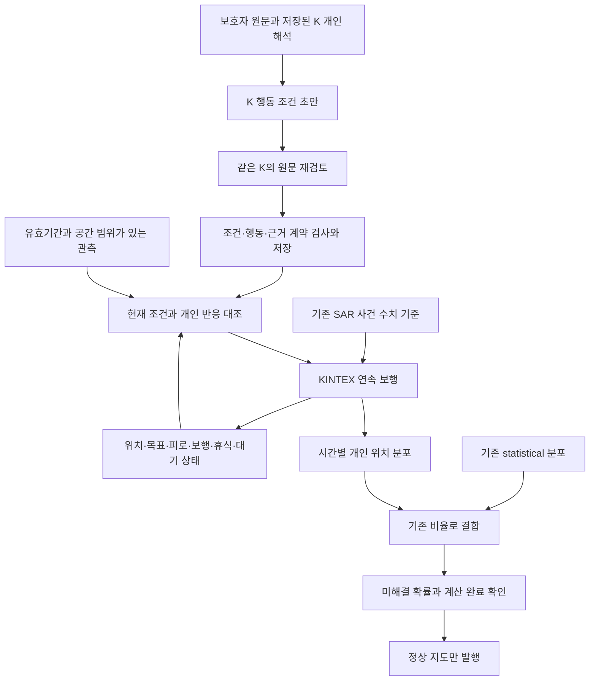
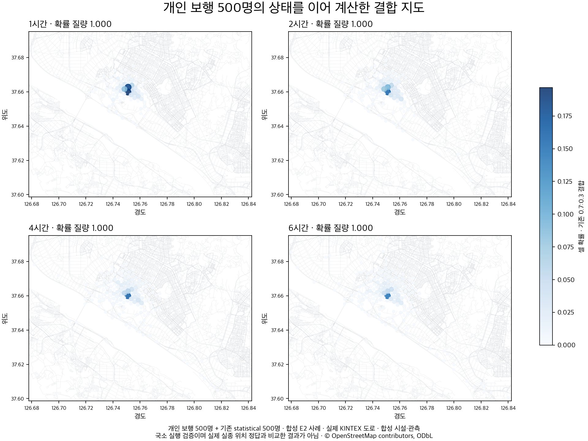
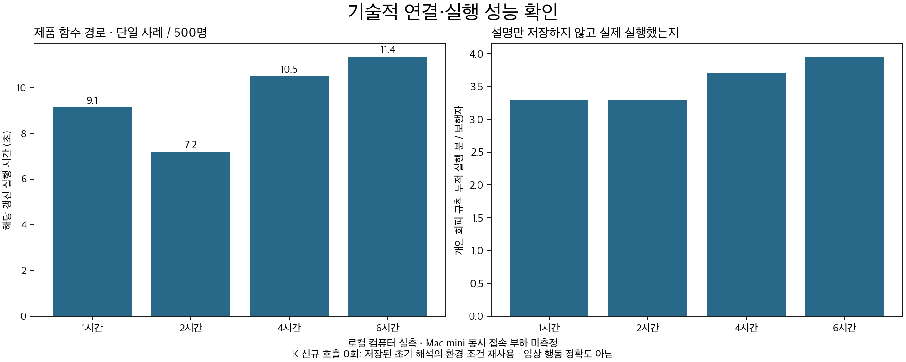

# 온보딩된 개인의 행동을 시간별 이동으로 연결한 작업 정리

> 2026-10-06 후속은 [새 통합 안내](FOLLOWUP_20261006.md)를 참고한다. 아래는 #265 당시 설명과 결과를 보존한 문서다. 현재 로컬 후보의 결합은 두 경로가 같은 개인 조건을 공유한다.

2026-10-04 · 돌아오길 · #262 이후 작업

## 먼저 알아야 할 결과

이번 목표는 **보호자가 설명한 그 사람의 기다림·휴식·목적지·환경 반응이 실제 도로 위 움직임에 나타나는지** 확인하는 것이었다. 앞단에 저장한 정보가 마음 판단에 전달되는지, 그 판단을 보행 엔진이 실행하는지, 시간이 지난 뒤에도 같은 사람의 위치와 상태를 이어 계산하는지를 함께 살폈다.

연결 누락과 시간 계산을 고쳤고, 실제 모델의 일부 반응이 KINTEX 도로 위 이동에 반영되는 것을 확인했다. 시간별 상태를 저장하는 제품 함수 연결도 로컬에서 검사했다. **하지만 새 K 행동 조건 후보는 형식 실패·조건 누락을 남겼고, 장시간의 휴식 근거가 부족한 사례도 있었다. 전체 완성이나 운영 모델 교체를 승인하는 결과는 아니다.**

기존 **K-EXAONE 초기 개인 해석**, **SAR-EXAONE(기존 LG AI Research EXAONE 3.5 7.8B 기반 SAR LoRA)의 사건 수치 기준**, 기존 운영 마음모델을 서버에서 교체하지 않았다. SAR의 추가 효과나 RAG의 효과를 새로 비교한 실험도 아니다. 저장된 앞단 해석과 SAR 응답을 사용했고, 신규 Mi:dm·SAR·임베딩 호출 및 GPU 학습은 없었다. 여기서 K는 설정된 K-EXAONE API 배포를 뜻하며, 배포 별칭 아래 가중치 리비전까지 독립적으로 확인한 것은 아니다.

## 두 단계로 실험한 이유

| 단계 | 확인하려던 질문 | 실행과 결과 | 다음 단계로 이어진 이유 |
|---|---|---|---|
| 1차: 움직이는 도중 K에 현재 행동을 질문 | 개인 원문·현재 환경·직전 행동이 실제 다음 움직임을 바꾸는가 | 저장된 합성 개인 8개. 최종 연속 시험 58회 호출에서 6시간까지 계산한 사례 1개, 판단 유보 5개, 호출 상한 종료 2개 | 관측 누락·도착 후 추론·반복 호출을 해결해야 했음 |
| 2차: 개인의 조건부 반응을 먼저 구조화 | 반복 호출 없이 개인의 조건을 현재 환경에 대입할 수 있는가 | 합성 개인 24개·38장면. 최초 최종 형식 통과 9/24, 행동 제약 통과 15/38 | 형식 실패 초안에도 예정된 원문 재검토를 연결 |
| 2차 후속 수정 확인 | 남은 두 번째 검토 기회를 사용하면 오류가 줄어드는가 | 13개 추가 검토 후 형식 18/24, 행동 제약 27/38 | 형식과 의미의 실패가 남아 운영 채택 보류 |

1차의 1/8은 **계산 완주 수**다. 2차의 15/38은 **사전에 정한 행동 제약 검사**다. 같은 정확도로 비교하지 않는다. 2차 후속은 결과를 본 뒤 수정한 개발 확인이며 독립 평가가 아니다. 최초 결과는 그대로 보존했다. 모든 사례는 합성이며 실제 환자·실제 실종 경로 정답·독립 사람 평가자는 각각 0이다.

## 무엇을 고쳤는가

| 기존 문제 또는 위험 | 변경 | 검증 근거와 한계 |
|---|---|---|
| 저장된 개인 성향·길 익숙함이 연구 실행기에 빠짐 | 제품과 같은 개인 투영을 적용하고 실제 그 길을 따라갈 때 익숙함을 소비 | 전달·게이지 회귀 검사. 모든 특성의 해석 성공을 뜻하지 않음 |
| 최근 행동이 쌓이면 최초 길 잃음 관측이 사라짐 | 관측 종류별 최신 값을 원래 시각과 함께 보존 | 같은 장면 실호출 1회에서 대기 반응 복구. 8개 전체 재실호출은 아님 |
| 실종 경과 시간과 실제 보행 시간이 혼동됨 | 보행·연속 보행·휴식·대기·거리 분리 | 기다린 270분을 걸은 270분으로 계산하지 않음 |
| 목적지 좌표에 도착했다는 이유로 인지·대기를 추정 | 물리적 도착·장소 인지·도착 후 반응 구분 | 인지만으로 대기를 만들지 않는 코드 검사 |
| 장소 전체와 특정 장소의 회피 조건이 섞일 수 있음 | 조건의 AND/OR·장소 범위·관측 시각을 보존 | 합성 조건이 발동한 시간과 해제된 시간의 실제 회피 실행 기록 |
| 모델 유보나 지도 경계 도달이 제자리 대기로 집계될 위험 | 미해결 확률을 별도 기록하고 불완전한 지도를 발행하지 않음 | 이전 정상 지도 보존·API 503 회귀 검사 |
| 시간별 계산에서 같은 보행자의 상태가 이어지지 않음 | 위치·도로 중간 진행량·목표·난수 상태를 사건에 저장 | 1→2→4→6시간 갱신, 미리보기 격리, 정보 변경 시 무효화 |
| 좁혀진 온보딩 집 후보와 저장 좌표가 다를 수 있음 | 지역 필터를 통과한 유일 후보의 좌표 저장 | #264 위에서 후속 회귀 검사 |

새 조건 후보는 K가 원문의 의미를 해석한다. 코드는 이미 생성된 조건식과 근거를 검사하고 실행한다. “시끄럽다” 같은 단어를 발견하면 곧바로 회피로 매핑하는 구현이 아니다.

## 새 후보를 연결해 본 흐름



이 도식은 로컬 후보의 연결이다. `RELEASE_QUALIFIED=False`이므로 새 후보가 자동 호출되거나 운영 계산에 채택되지 않는다. 테스트에서는 연결 동작만 확인하기 위해 격리된 조건에서 통과 상태를 주입했다. 단순히 이 값을 바꾸는 것으로 배포 검증이 완료되지는 않는다. 기존 `statistical` 경로도 개인 정보를 공유하며, 0.7:0.3은 기존 고정값이다.

후보가 미채택이라고 해서 이 PR의 모든 변경이 비활성인 것은 아니다. 사건 수치 기준 재사용, 공개 API 필드 제외, 오래된 미리보기 무효화, 집 좌표 저장 수정은 공통 경로에 닿는다. 이 부분은 후보 채택 여부와 별도로 코드 리뷰가 필요하며, 이번 PR에서 머지·배포하지 않는다.

## 실제 원문·응답·움직임 예시

합성 원문: **“십 분 연속 걸으면 앉아서 삼 분 쉬고, 다시 걸어요.”**

최초 출력은 존재하지 않는 조건명 `is_사고`를 만들었다. 예정된 두 번째 원문 검토 후 다음 규칙이 나왔다. 아래는 최종 JSON의 해당 규칙 전체다.

```json
{
  "id": "walk_rest_10min",
  "action": "rest",
  "when": {
    "continuous_walk_minutes": {"gte": 10},
    "is_walking": true
  },
  "target": null,
  "feature": null,
  "places": [],
  "minutes": 3,
  "supersedes": [],
  "notes": ["N0"]
}
```

이 생성 규칙을 500명에게 적용해 6시간 실행했을 때 보행 279분·휴식 81분으로 집계됐다. **규칙이 실제 보행 시간을 바꿨다는 예시**이며, 성공한 출력을 골라 재생한 결과다. 전체 24개 성공률이나 실환자 행동 정확도로 확대하지 않는다. [원문과 최초·후속 출력](evidence_20261004/모델_원문_대조.md), [행동 재생 결과](evidence_20261004/generated_policy_walks.json).

반례도 남았다. “200m 걸으면 쉬며 쉬는 시간은 모름”에서는 지원하지 않는 `sit` 명령이 나왔고, 일부 개발 출력은 “40분 걸을 수 있음”을 “40분까지 계속 걷기”로 바꿨다. 가족을 기다리는 조건에서 가족 도착이라는 종료 조건이 빠진 경우도 있다. 이 때문에 형식 통과만으로 도입을 결정하지 않았다.

## KINTEX 시간별 지도와 실행 규모

실제 OSM 보행망 위에서 개인 보행자 500명과 기존 statistical 보행자 500명을 결합했다. 장소 이름·위치·소음·혼잡·관측은 합성 입력이다. 기존 E2 개인 해석의 환경 조건을 사용한 시험이며, 새 K 후보가 모든 특성을 잘 추출했다는 시험은 아니다.

| 계산 시점 | 해당 갱신 소요 시간 | 결합 확률 합 | 미해결 확률 |
|---|---:|---:|---:|
| 1시간 | 9.13초 | 1.000 | 0.000 |
| 2시간 | 7.19초 | 1.000 | 0.000 |
| 4시간 | 10.51초 | 1.000 | 0.000 |
| 6시간 | 11.37초 | 1.000 | 0.000 |





4시간과 6시간의 분포가 달라졌고, 합성 환경을 조용하고 한산하게 둔 구간에서는 회피 규칙이 추가로 실행되지 않았다. 개인 규칙이 위치·시간에 따라 다르게 소비되는 것을 확인했다. 최대 메모리 약 1.32GiB, 사건 체크포인트 약 4.58MiB다. 로컬 단일 사례 측정이며 Mac mini 동시 사건 부하 시험은 아니다.

같은 E2에서 6시간 평균 누적 보행은 약 15.7km였다. “40분 걸을 수 있음”만으로 6시간의 휴식 패턴을 결정할 수 없는데, 근거가 없는 구간을 기존 이동 기준으로 채운 한계가 드러났다. **지도가 움직였다는 것과 그 사람답게 움직였다는 것은 다르다.** 휴식·피로의 일반 기준과 개인 예외를 검증해야 한다.

## 재현과 연구지원 기록

- backend 전체 회귀: **1,440개 통과, 2개 skip, 하위 테스트 7개 통과**. 이후 실행 불가 문맥 처리 수정 뒤 관련 12개 통합 테스트 통과. 이 수들을 독립 표본처럼 더하지 않는다.
- 4개 고정 명령 × 3개 seed × 500명: 6,000개 가상 보행자의 시간·확률 보존 검사. 사람이 작성한 엔진 검사이며 모델 정확도 표본이 아니다.
- 저장된 공개 최종 응답에서 최초와 후속 점수를 [오프라인 검증기](verify_evidence.py)로 재계산할 수 있다. [실행 방법](README.md).
- 1차 K 호출 84회: 시작·종료 84쌍, 입력 576,870·출력 296,501토큰. [1차 사용량](../mind_closed_loop/evidence_20261004/usage_summary.json).
- 2차 K 시도 110회: 시작·종료 110쌍, 응답 99회·오류 9회·서버 미제출 2회. 공급자 usage가 있는 응답 합계 입력 154,065·출력 526,007토큰. 실패의 미확인 토큰을 0으로 보지 않는다. [2차 사용량](evidence_20261004/usage_summary.json).
- 신규 지도 요청 2회. 단가·청구액·지원 차수는 미확인이다. 지도 출처 © OpenStreetMap contributors, ODbL. [확대 지도 명세와 해시](evidence_20261004/kintex_map_manifest.json).
- 이 PR 작성 중에는 추가 모델·GPU·지도 호출을 하지 않았다. 실험 시점의 원본 기록과 공개용 최종 출력은 구분했고 인증정보와 비공개 추론은 포함하지 않았다.

## 검토 순서와 남은 일

기획팀은 이 문서의 결과·예시·그림을 먼저 읽고, 개발팀은 [2차 상세 보고서](evidence_20261004/완성검증_결과.md) 및 [1차 상세 보고서](../mind_closed_loop/evidence_20261004/통합검증_결과.md)를 확인하면 된다. 1차 보고서의 “다음 과제”는 당시 상태이고 현재 판정은 2차 보고서에 있다.

다음 완료 판정에는 개인 조건 누락 수정, 새로운 별도 사례 평가, 일반 피로·휴식 반응 기준, 관측 변경·도착·재출발을 포함한 연속 검증이 필요하다. 운영 측면에는 기존 프로필의 마음 준비 이행, 실제 환경 레이어, Mac mini 동시 사건·메모리·재시작 복구 검증이 남았다. 이 PR은 수정 코드와 실패를 포함한 증거를 검토하기 위한 Draft이며 배포 승인이 아니다.
