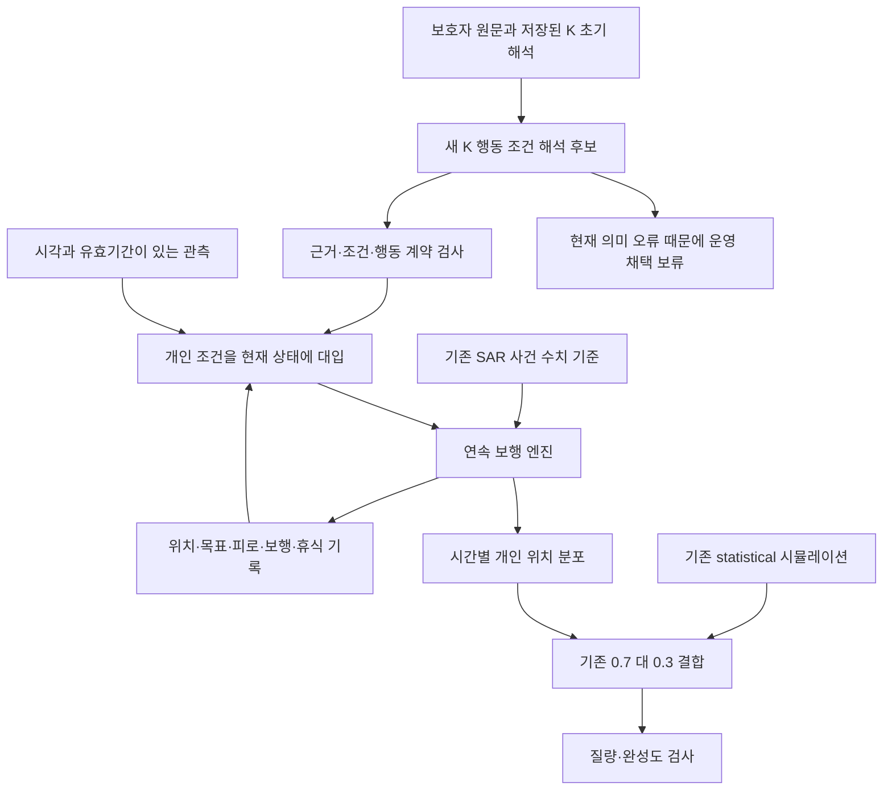
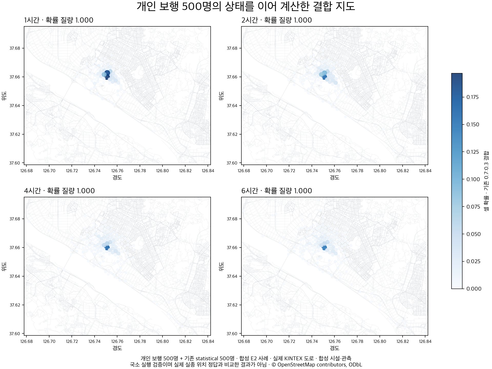
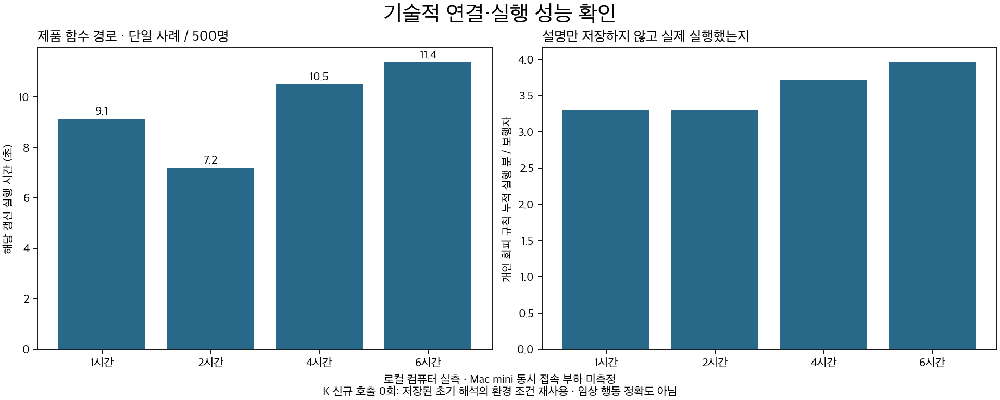

# 돌아오길 개인 행동 시뮬레이션 통합 개선 결과

2026-10-04 · 팀 동행 · 개발 검증 보고서

## 판정

**요청한 다섯 영역을 구현·검증했지만, 전체 완성이나 운영 교체 판정은 아직 내리지 않았다.** 시간과 위치를 이어가는 보행, 개인 조건의 실행, 도착과 인식 구분, 오류 시 확률 보존은 코드와 로컬 제품 경로에서 확인했다. 그러나 새 K 마음 해석 후보가 보호자 원문의 조건을 안정적으로 보존하지 못했다. 원문에 없는 행동을 만들거나 필요한 휴식 조건을 잃는 사례가 있어 교체하면 안 된다.

기존의 **K-EXAONE 초기 개인 해석, SAR-EXAONE 사건 수치 기준, 운영 중인 마음모델을 삭제하거나 서버에서 교체하지 않았다.** 변경은 별도 로컬 브랜치에 있다. 후보의 `RELEASE_QUALIFIED=False`는 검증 실패를 운영에 흘리지 않기 위한 판정이다. 단순히 옵션을 켜서 도입하는 것이 남은 일이 아니다.

## 1. 무엇을 완성하려 했는가

목표는 JSON을 잘 만드는 모델이 아니라, **온보딩된 그 사람의 목적·길 경험·휴식·기다림·환경 반응이 실제 이동에 반영되는 시뮬레이션**이다. 그 과정에서 세 가지를 따로 확인했다.

- 해석: 보호자 문장이 어떤 조건과 반응을 뜻하는가.
- 실행: 그 조건이 참일 때 보행 엔진이 실제로 멈추거나 쉬거나 피하는가.
- 예측: 그런 이동을 집계한 지도가 실제 실종 위치를 잘 설명하는가.

이번에는 첫째와 둘째의 연결을 개발했다. 실제 실종 경로 정답이 없으므로 셋째의 실제 위치 예측 정확도는 측정하지 않았다.

| 요청 영역 | 이번에 한 일 | 판정 |
|---|---|---|
| 온보딩 정보 전달 | 원문·질문 맥락·저장된 core/scope·버전 연결, 변경 시 결과 무효화, 오래된 완료 응답 덮어쓰기 차단 | 기술적 전달 확인. 모든 개인 특성의 해석 성공은 아님 |
| 도착 이후 행동 | 좌표 도착·장소 인지·이후 반응 구분. 인지했다는 이유만으로 대기 생성하지 않음. 목표 기억과 동작 분리 | 명시된 조건의 실행 테스트 통과 |
| 정보 부족 처리 | 미확인을 false로 바꾸지 않음. 가능한 행동 분기 유지. 실행 불가능 질량을 별도 기록 | 계산 처리 확인. 분기 비율의 경험적 보정은 미완료 |
| 시간별 제품 연결 | 위치·도로 중간 진행량·난수 상태·목표·휴식/대기/보행 시간을 저장하고 다음 시간에 이어 계산 | 로컬 제품 함수 경로 확인. 운영 활성화는 보류 |
| 새 사례·운영 규모 | 별도 합성 24개 / 38장면, KINTEX 보행자 500명 + 기존 통계 500명, 성능·질량 검사 | 실행 측정 완료. 새 해석 후보의 의미·형식 검증 미통과 |

## 2. 이번 후보 구조와 기존 구조의 관계

이전 연속 실험은 현재 상황마다 K에 행동을 물었다. 8개 중 6시간까지 계산한 사례는 1개였고, 나머지는 정보 부족이나 호출 상한 등으로 멈췄다. 이 숫자는 행동 정확도가 아니라 계산 완주 수였다.

이번에는 반복 호출을 줄일 수 있는지 보기 위해 **개인의 조건부 반응을 온보딩 뒤 한 번 구조화하고, 보행 중에는 현재 조건에 대입하는 방식**도 시험했다. 보호자 원문을 단어로 파싱해서 행동에 매핑하지 않았다. 의미 해석은 K가 수행하고, 코드는 K가 출력한 조건식·시간·공간 범위만 검사했다.

이 그림은 **로컬 후보 연결**이다. `statistical`도 개인 정보를 공유하며 순수 통계 대조군이 아니다. 결합 비율 0.7:0.3을 새로 최적화하지 않았다. RAG를 재구축하거나 SAR의 추가 효과를 새로 입증한 실험도 아니다. 기존 초기 해석과 저장된 SAR 응답을 재사용했고 새 SAR·Mi:dm·임베딩·GPU 학습은 하지 않았다.

조건을 사전에 준비해 호출을 없애는 방법은 실행 비용 면에서 가능성을 보였지만, **현재 K 출력의 의미와 형식이 부족해 이 구조를 최종 아키텍처로 확정할 근거는 확보하지 못했다.** 기존의 상황별 마음 판단을 이 후보로 통째로 바꾸지 않는다.

## 3. 보행·제품 연결에서 수정한 내용

### 시간이 흘렀다는 것과 걸었다는 것을 분리

실종 경과 시간, 실제 보행 시간, 연속 보행 시간, 휴식, 대기를 별도 저장한다. 따라서 270분 동안 기다린 사람에게 “270분 걸었으니 휴식”을 적용하지 않는다. 도로 한 구간의 중간에서도 보행 시간·거리 한계에 도달하면 반응할 수 있게 했다.

고정된 연구용 조건으로 “5분 보행 후 5분 휴식”을 넣었을 때, 12분 뒤 실제 보행 7분·휴식 5분으로 계산됐다. **이 5분 휴식은 명시한 실험 조건이지 환자의 실제 휴식 시간 측정값이 아니다.** 휴식 길이가 없는 경우 사용하는 5분과 대기 검토 간격 30분은 잠정 설정으로 결과에 표시한다.

### 도착·인지·행동을 분리

공원 좌표에 도착했다고 그곳을 알아봤다거나 계속 기다린다고 가정하지 않는다. 인지 관측과 개인의 도착 후 반응 규칙이 있어야 그 반응을 적용한다. 인지 정보가 없으면 미확인 상태로 둔다. 이미 도착한 목표를 매번 새로 지정해 반복 방문하게 하지 않으면서 목표 기억은 보존한다.

### 환경 반응이 실행되는 위치를 확인

실제 도로 위 중간 좌표로 환경 관측의 공간 범위를 평가한다. 특정 장소 한정 반응을 모든 시장으로 확대하지 않고, 소음·혼잡 조건의 AND/OR를 유지한다. OSM 장소 분류를 실제 소음·혼잡 관측으로 사용하지 않는다.

환경 지도 자체가 없으면 “그 환경이 없다”고 처리하지 않는다. 회피 방향을 계산할 위치 정보가 없는 분기는 미해결로 남긴다. 도로 경계나 실행 실패로 멈춘 보행자를 환자의 자발적 대기로 집계하지 않는다.

### 시간별 지도와 저장·오류 경로

같은 사건의 다음 갱신은 이전 상태를 이어받는다. 보호자 정보·사건 관측·지도·설정이 달라지면 오래된 상태를 그대로 재사용하지 않는다. 시간 미리보기는 운영 중인 사건 상태를 바꾸지 않는다. 개인 해석과 경로 체크포인트는 공개 API 응답에서 제외하고 삭제 대상에 포함했다.

계산되지 않은 확률이 남으면 살아남은 경로만 100%로 재정규화하지 않는다. 제품 API는 503과 계산 상태를 돌려주며 이전 정상 지도를 보존한다. 이 실패 경로도 테스트했다.

최종 backend 회귀는 **1,440개 통과·2개 건너뜀·하위 테스트 7개 통과**였다. 새 상태 전달·행동 조건·API 오류·두 번째 검토 연결을 포함한다. 이후 실행 불가 문맥의 오류 경로를 보완하고 관련 12개 통합 테스트를 통과했다. 단위·통합 테스트 수는 환자 행동 정확도 표본 수가 아니다. 루트 디렉터리에서 실행한 한 번의 테스트 수집 실패는 보존했고, backend 디렉터리에서 정식 실행했다.

## 4. KINTEX에서 실제로 측정한 결과

지도는 KINTEX 동일 중심 주변의 도로망이다. 최초 작은 지도에서 경계에 닿는 보행자가 나왔고, 6km 지도도 보존한 사건 통계 반경을 충분히 덮지 못해 최종 14km 반폭 범위까지 확보했다. 최대 반경의 근거를 임의로 키운 것이 아니라 **기존 수치 기준이 허용한 범위를 지도에 포함**했다.

최종 지도: 78,502개 노드·226,318개 엣지, OSMnx 2.1.0. SHA-256: `953d2bca91fe7388011e9ca161dc576c3c79366c578ed314d7cc8deea677db92`. 중심은 킨텍스역 인근이며 부스 실내 지도가 아니다. © OpenStreetMap contributors, ODbL.

제품 함수 시험은 저장된 E2 개인 해석의 시장 회피 조건을 사용했다. **새 후보가 휴식 등 모든 특성을 잘 추출했다는 사례가 아니라, 이미 확보한 환경 조건이 실제 실행되는지 확인한 사례**다. 도로는 실제 OSM 자료지만 시설 이름·좌표·소음·혼잡·개인 관측은 합성 입력이다.

| 예측 시각 | 해당 갱신 시간 | 이전 상태 | 결합 확률 합 | 미해결 질량 |
|---|---:|---|---:|---:|
| 1시간 | 9.13초 | 초기 생성 | 1.000 | 0.000 |
| 2시간 | 7.19초 | 재사용 | 1.000 | 0.000 |
| 4시간 | 10.51초 | 재사용 | 1.000 | 0.000 |
| 6시간 | 11.37초 | 재사용 | 1.000 | 0.000 |

1·2·4·6시간 결과에서 확률 합은 1로 유지됐다. 4시간과 6시간 지도는 달랐다. 두 지도의 총변동거리(TV)는 0.21이었다. 이는 **분포가 실제로 달라졌다는 수치**이며 예측 정확도 향상률이 아니다. 기다리는 사람은 시간이 지나도 같은 위치에 있을 수 있으므로 지도 변화 자체가 보편적 성공 기준도 아니다.

K 신규 호출 없이 저장 조건을 적용했고, 6시간 동안 시장 회피 규칙이 총 1978.3 보행자·분 실행됐다. 조용하고 한산하도록 둔 60~120분 구간에서는 해당 규칙 누적 시간이 늘지 않았다. 원문의 OR 조건과 합성 관측이 해제될 때의 차이를 실행 기록으로 확인했다.

이 측정은 **로컬 컴퓨터의 단일 사례**다. Mac mini 동시 접속 부하, 서버 재시작 후 500명 규모 실제 재개, 모바일 푸시까지 검증한 결과는 아니다. 프로세스 최대 메모리는 약 1.32 GiB, 사건 체크포인트 JSON은 약 4.58 MiB였다. 메모리에는 지도·라이브러리가 포함된다. 여러 사건을 동시에 처리할 수 있다고 아직 주장하지 않는다.

그리고 완료 판정을 막는 행동 문제가 남았다. 이 E2 사례의 새 연속 실행에서는 6시간 평균 누적 보행이 약 **15.7km**, 평균 실제 보행 시간이 **327.6분**이었다. 보호자 원문은 “40분 걸을 수 있다”고 했을 뿐 6시간 동안의 휴식 패턴을 제공하지 않았다. 이를 임의의 휴식 규칙으로 바꿔도 안 되지만, 누락된 반응을 기존 이동 기준만으로 채운 결과를 “그 사람다운 이동”이라고 할 수도 없다. **일반 보행·피로 반응 기준과 개인별 예외를 함께 검증해야 한다.**

검증 과정에서 합성 장소의 `place_type`이 비어 환경 입력이 전달되지 않은 초기 재생도 발견했다. 그 파일은 삭제하지 않았고 환경 반응 성과에서 제외했다. 위 표와 그림은 시설·관측을 명시적으로 연결한 후의 결과다. 초기 약 225초→8.6초 비교는 시간대 변환 병목 진단일 뿐, 최종 환경 검증의 성능 수치로 사용하지 않는다.

## 5. 새 K 후보의 별도 24개 사례 결과

개발 사례에만 맞추지 않도록 새 합성 24개 입력과 38개 장면의 기대 제약을 먼저 저장했다. 원문의 부정·보호자 권고와 실제 행동·AND/OR·장소 범위·휴식 시점·인지·관측 정정을 포함했다. 별도 평가 전 후보와 입력 해시를 고정했고, 결과에 맞춰 프롬프트나 정답을 바꾸지 않았다.

개발 단계에서 이미 문제가 남았으므로 이 평가는 **실패 범위 확인**이다. 통과 후보의 최종 인증으로 표현하지 않는다. 초안 1회 뒤 같은 K의 원문 재검토 1회이며, 두 독립 반복이나 사람 검토가 아니다. 초안 형식이 실패하면 자동 재시도하지 않았다.

- 최종 정책을 형식상 읽을 수 있었던 사례: **9/24**.
- 사전에 정한 행동 제약을 만족한 장면: **15/38**.
- 해당 사례의 모든 준비된 장면을 통과한 사례: **9/24**.
- 실제 환자: 0명. 독립 사람 채점자: 0명. 실제 실종 경로 정답: 0건.

23개 장면은 최종 정책 형식 실패로 행동 자체를 검사할 수 없었고, 검사 가능한 15개 장면은 제약을 통과했다. 이것을 23개의 의미 오류로 세지 않는다. 실행 가능한 결과를 안정적으로 확보하지 못했다는 실패다. 또한 이 검사 통과만으로 조건의 모든 의미·설명·목표·시간 지속이 맞다고 볼 수 없다. 전체 결과는 [24개 사례 판정표](별도24사례_판정표.md)에 실패를 포함해 남겼다. [보호자 원문과 모델 공개 출력](모델_원문_대조.md)도 직접 대조할 수 있다.

개발 단계의 구체적 반례는 다음과 같다.

| 보호자 원문의 뜻 | 후보에서 나온 문제 | 왜 실패인가 |
|---|---|---|
| “연속 40분 정도 걸을 수 있음. 길 잃었을 때 대처는 못 봄” | `continuous_walk_minutes <= 40`이면 `walk` 규칙 생성 | 보행 능력을 실제 행동·우선순위로 바꿈 |
| “약 5분·300m 뒤 휴식. 1시간 연속 보행은 불가” | 60분 휴식 조건, 휴식 누락, 잘못된 필드 생성 | 실제 휴식 시점과 부정된 능력 상한을 혼동 |
| “가족이 올 때까지 기다림” | 가족 도착이라는 종료 조건 누락 | 조건 해제 후에도 대기가 이어질 수 있음 |
| 특정 시장의 혼잡과 소음 조건 | 회피를 휴식으로 바꾸거나 장소 범위를 잘못 설정 | 같은 사람의 환경 반응을 다른 행동으로 바꿈 |

JSON Schema 강제, 자유 JSON, Thinking 켬/끔, 피처 분리, 앞단 해석 보존, 원문 재검토, 더 단순한 출력 계약을 비교했다. 마지막으로 Thinking을 유지하고 온도를 0.2로 낮춘 2개 개발 사례도 최대 4회 확인했다. E1에서는 잘못 생성했던 보행 능력 규칙이 사라지고 장소 한정 AND 회피가 보존됐지만, W1 초안은 휴식 및 가족 도착 조건을 누락했고 최종 검토가 출력 한도로 끝났다. 이 추가 조건도 채택하지 않았다. 형식을 엄격하게 요구했을 때 공백만 반복하며 출력 한도를 소진한 응답도 있었고, 형식이 유효해도 의미가 틀린 응답도 있었다. **프롬프트를 바꾸어 형식 통과만 올리는 것으로 해결했다고 판정할 수 없다.**

### 형식 실패 초안에도 두 번째 검토를 연결한 후속 개선

최초 실행기는 초안 형식이 잘못되면 계획한 두 번째 원문 검토를 생략했다. 이를 수정해, 아직 두 번째 호출을 쓰지 않은 13개에 원문과 깨진 공개 초안을 그대로 전달했다. 코드가 행동을 추정하거나 `sit`을 임의로 `rest`로 바꾸지 않았다. 사례당 총 두 번을 넘지 않았다.

이 후속 결과는 최초 24개 평가를 본 뒤의 **적응적 개발 확인**이다. 최초 수치를 덮어쓰거나 독립 평가 성과로 바꾸지 않는다. 후속 최종 형식 통과는 **18/24**, 행동 제약 통과는 **27/38**, 해당 사례의 모든 장면 통과는 **17/24**다. 그중 1개 장면은 “그냥 가세요”를 기존 보행 유지로 정한 사전 정답과, 특정 시장으로 향함으로 읽은 모델 해석 사이의 불일치다. 원문 자체가 모호하여 확정적 모델 오류로 단정하지 않는다. 사전 점수는 그대로 보존하고 정답 기준 검토 항목으로 따로 표시했다. 따라서 이 숫자를 의미 정확도라고 부르지 않는다. 여전히 원문 의미 전체와 장시간 행동을 입증한 숫자는 아니다. [후속 판정 JSON](adaptive_evaluation.json)과 원본 응답을 별도로 보존했다.

### 새 K 출력의 실제 행동 소비도 확인

후속까지 형식이 유효한 결과 중 기다림·10분 보행 후 3분 휴식·조건부 시장 회피·인지 후 대기 4개를 골라 각각 500명, 6시간까지 실행했다. 숫자 성향과 장소 배치는 통제한 합성 설정이므로 새 온보딩 전체의 종단 정확도가 아니라 **생성된 행동 규칙의 소비처 검사**다. 성공 사례를 고른 설명용 재생이며 24개 전체 성공률로 확대하지 않는다.

기다림 사례는 보행 0분·대기 360분이었다. 10분 보행/3분 휴식 사례는 총 보행 279분·휴식 81분으로 실행됐다. 이 수치는 지정된 조건이 실행됐다는 뜻이며 실환자가 실제로 이렇게 움직인다는 뜻이 아니다. [생성 규칙 재생 결과](generated_policy_walks.json)에 원문·규칙 파일·시간별 결과를 함께 연결했다.

추가로 모델과 분리한 4개 고정 제어 조건을 3개 seed×500명씩, 총 6,000개 보행자로 확인했다. 모든 조합에서 질량 손실은 0이었고, 보행+휴식+대기 시간은 계산 시간과 일치했다. 대기 조건은 4시간과 6시간 지도가 같았고, 이동 조건은 달랐다. 이 6,000개는 환자나 독립 개인 사례 수가 아니다. [제어 조건 결과](multiseed_controls.json).

## 6. 현재 확정할 수 있는 것과 다음 판정

보행 엔진과 저장·갱신 연결의 수정은 유용한 개발 결과다. 반면 **개인 반응 전체를 한 번에 실행 프로그램으로 만들어 기존 마음모델을 대체하는 후보는 채택하지 않는다.** 기존 K 초기 해석의 장점까지 부정하거나 SAR로 모두 되돌아간다는 뜻이 아니다.

다음 개선은 새 조건식 생성을 계속 길게 요구하는 방향보다, 이미 전달된 개인 정보와 현재 상황을 바탕으로 **실행 가능한 행동을 선택하는 기존 마음 계약에 이번 보행·관측·도착 구분을 연결하는 방향**이 적절하다. 이 권고도 새 성능 입증으로 표현하지 않는다. 다음 항목이 남아 있다.

1. 휴식·대기·걷기를 개인 원문과 현재 조건에 맞게 구별하는 후보를 개발하고, 새로운 별도 사례에서 다시 평가. 이번 24개를 수정에 쓰면 그때부터 개발 자료로 분류.
2. 개인 관찰이 부족한 경우의 일반 행동 기준을 검증. “모르니 계속 걷기”나 “모르니 대기”를 기본 진실로 삼지 않음. 잠정 분기 비율·휴식 시간·피로 반응을 민감도 분석하고 돌봄 경험자의 검토와 구분해 기록.
3. 한 장면의 올바른 명령을 넘어, 관측 변경·도착·휴식·재출발을 거친 6시간 연속 동작에서 오류 누적 확인.
4. 기존 앞단 준비가 끝난 프로필의 별도 마음 준비 이행, 실제 시설 환경 레이어, Mac mini 메모리·동시 사건·재시작 후 복구를 운영 수준에서 확인. 이번 정적 지역 지도 경로에는 실제 환경 레이어가 자동 부착되지 않음.
5. 실제 비식별 사례와 위치 정답이 확보되면 행동 타당성 및 위치 예측 성능을 별도로 평가. 합성 제약 통과율로 대체하지 않음.

**현재 배포를 막는 것은 막연한 표본 부족만이 아니다. 원문 의미 오류와 휴식·일반 행동 기준의 공백이 실물 출력과 이동에서 확인됐다.** 이를 고치기 전에는 전체 완성이라고 기록하지 않는다.

## 7. 실행·비용·재현

- 코드: `codex/kintex-closed-loop-20261004`, 기준 커밋 `a376c41869398b1a8c066cd4cbc2d055c6eaf2c2` + 로컬 변경. 이번 작업의 배포·머지 없음.
- K 시도: **110회 시작 / 110회 종료**, 미정산 요청 0회. SSH 단계에서 서버에 제출되지 않은 2회도 승인 상한 사용 기록에 포함.
- 공급자 usage를 받은 응답 99회. 해당 합계 입력 154,065토큰, 출력 526,007토큰, 총 680,072토큰. usage 없는 실패의 토큰은 미확인.
- 모델 대상: 기존 K 설정 `api.friendli.ai/dedicated/v1`, 배포 별칭 `depmkuykpfon9lg`. 별칭 아래 가중치 리비전까지 별도 입증한 것은 아님.
- 지도 요청 2회 / 종료 기록 2회. 새 SAR·Mi:dm·임베딩·GPU 학습 0회. 단가·청구액·지원 차수는 **미확인**, 크레딧이 있다고 0원으로 기록하지 않음.
- [실행 범위](실행계획.md), [사용량 요약](usage_summary.json), [고정 평가 명세](diagnostic_holdout_manifest.json), [평가 결과 JSON](holdout_evaluation.json), [제품 경로 측정](product_benchmark_final.json), [실제 경로 재생](live_policy_replay_final.json).
- 원문·요청·모델 공개 응답·실패·코드 버전은 실험 폴더에 보존. 내부 추론은 보고서에 사용하지 않음. 합성 원문은 비용 원장에 넣지 않음.

로컬 오프라인 재현: backend 폴더에서 `python -m pytest -q tests/test_person_policy.py tests/test_person_walk_dynamics.py tests/test_continuous_prediction.py`. PR에는 공개 최종 응답으로 같은 점수를 재계산하는 검증기도 포함했다: `python -m experiments.mind_policy_candidates.verify_evidence`. 원래 실험 폴더의 `evaluate_holdout.py`와 달리 공유한 파일만으로 실행하며 추가 호출이 없다. 실호출 runner를 재실행하면 새 요청이므로 승인 범위·원장을 새로 확인해야 한다.
