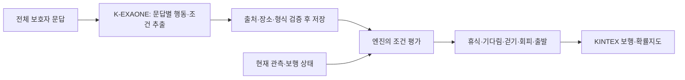

> **실행 완료 상태 — 2026-10-06:** 사용자가 아래 재배분 범위를 승인해 개발 64회를 실행했다. 최고 정식 비교는 13/16으로 개발 기준 미달이며, 조건부 별도 평가 64회는 미사용이다. 배포 없음. [실험 결과](실험결과.md)를 참고한다. 아래 본문은 결과를 보기 전에 작성한 계획을 보존한 것으로, ‘승인 요청·실호출 0회·미판정’ 표현은 작성 당시 상태다. 문답별 후보 외에 동일 한도 내 사람 단위 후보도 비교했다.

# 마음모델: 90% 단계 통과 기준과 개선 후보

2026-10-06. 사용자 요청에 따라 100% 의미 정답을 요구하는 개발 방식을 바꾼다. 아래 기준은 이번 후보의 결과를 보기 전에 정한 프로젝트 내부 기준이며, 임상적 정확도 기준이 아니다.

## 무엇이 되면 넘어가는가

| 단계 | 미리 정한 기준 | 통과 후 할 일 |
| --- | --- | --- |
| 개발 비교 | 기존 8장면 × 2반복 중 15/16 이상 | 후보·프롬프트·컴파일러를 고정하고 별도 평가 |
| 별도 합성 평가 | 32명 × 2장면 × 2반복 중 116/128 이상 | KINTEX 시뮬레이션 통합 검증으로 이동 |
| 통합 검증 | 위 모델의 실제 저장 응답을 사용해 행동 선택·보행에 반영됐는지 확인 | 제한된 시연/시험 운영 여부 판단 |

성공은 원문이 뒷받침하는 행동과 조건에 맞는 엔진 명령을 만든 경우다. JSON 형식 통과만으로 성공 처리하지 않는다. 빈 응답·출력 중단·해석 또는 컴파일 실패는 평가 분모에서 빼지 않는다. 행동을 알 수 없다고 명시한 사례와 기준선 사례는 모두 개인 행동을 확정하지 않는 출력을 허용한다. 반대로 쉬어야 하는 정답에 '모름'을 내면 실패다.

중복 출력에서 정답만 골라내지 않는다. 두 반복을 전부 합산하고, 사람별·행동별 성적과 반복 불일치도 함께 공개한다. 같은 사람의 여러 장면·반복은 독립 환자 수가 아니다. 휴식·기다림·회피 등 한 종류의 실패가 전체 평균에 가려지면 제한 사항으로 표시한다. 90% 통과 후의 오류는 기록하고 범위를 정해 개선한다. 100%를 기다리며 모든 다음 단계를 멈추지 않는다.

원문과 관계없는 개인정보 노출, 잘못된 실행 구조, 확률 질량 소실 같은 시스템 오류는 별도 코드 결함이다. 이 결함에 '의미 평가 90%'를 적용해 무시하지 않는다. 실제 실종 경로 정답·전문가 독립 평가·현장 운영 근거는 이번 합성 실험에서 확보됐다고 주장하지 않는다.

## 이번에 무엇을 바꾸는가

기존 현재 장면 방식의 최고 결과는 9/16이었다. 보행 가능 시간을 지금 걸어야 한다는 지시로 바꾸거나, 가족이 도착했는데도 계속 기다리게 하는 오류가 남았다. 그 결과를 새 기준으로 소급 통과시키지 않는다.

새 후보는 보호자 문답 하나씩 행동 조건을 해석한다. 다른 문답도 모두 함께 보여 주어 정정·주어·예외를 읽을 수 있게 한다. 현재 장면과 정답은 해석 요청에 보내지 않는다. 모든 문답의 출력이 완성된 경우에만 하나의 정책으로 합쳐 저장한다. 의미 해석은 K-EXAONE이 담당하고, 이후 가족 도착 여부·연속 보행 시간 등의 현재 조건 비교는 기존 엔진의 조건 평가 코드가 맡는다. 단어 매핑으로 보호자 문장을 해석하지 않는다.

원문을 읽는 모델 호출은 개인 해석 준비 시점의 호출이다. 가상 보행자마다 API를 부르는 구조가 아니다. 원문을 바꾸면 다시 준비해야 한다. 나중의 미확인 조건은 가능 분기로 남기며, 조건이 사실인지 모델이 임의로 관측했다고 만들지 않는다.

숫자 조건에는 `lt`(미만)와 `gt`(초과)를 추가했다. 기존 `lte`(이하)·`gte`(이상)만으로 '8분 전 걷기, 8분부터 휴식'을 쓰면 경계에서 겹칠 수 있었다. 새 비교 연산은 일반적인 숫자 조건을 실행하며 문장 속 특정 단어를 찾는 규칙이 아니다.

## 실행 범위

이전 승인 묶음의 개발 64회는 소진됐고 평가 128회는 미사용이다. 남은 128회를 개발 최대 64회와 최종 평가 최대 64회로 재배분하는 승인을 요청한다. 평가 전용 승인을 개발에 임의로 전용하지 않는다.

- 개발: 3명, 각 3문답, 2반복이면 후보당 18회. 최대 64회 안에서 프롬프트·출력 구조·Thinking 조건을 수정·비교한다. 후보를 바꿀 때마다 승인받지 않는다. 모든 후보와 실패를 보존한다.
- 평가: 선정 후보를 고정한 뒤 32명 × 1문답 × 2반복 = K 호출 64회. 저장된 개인 해석을 두 장면씩 실행하므로 행동 판정은 128건이다. 평가 결과를 보고 같은 자료를 수정해 재통과시키지 않는다.
- 호출당 입력 최대 40,000 UTF-8 바이트, 출력 최대 12,000토큰. 전체 출력 상한 1,536,000토큰. 동시 최대 2회. 실패·빈 응답 포함, 자동 모델 재시도 없음.
- 단가·실청구액·지원 차수 미확인. 공용 사용 원장에 시작/종료·실패·usage 기록, 원격 원장 보존. 미확인 비용을 0원으로 쓰지 않는다.
- 신규 GPU 학습·SAR·Mi:dm·RAG 검색·임베딩·지도 취득·배포는 포함하지 않는다. 이 실험은 기존 마음 경로처럼 원문 의미 추출을 비교하며, RAG의 추가 효과를 주장하지 않는다.
- 통과 이후 공간 검증은 기존 KINTEX 캐시만 사용한다. 추가 모델 호출이 없는 보행 검사는 로컬에서 수행한다.

## 평가 자료의 한계

별도 평가 자료는 앞서 고정해 둔 합성 보호자 서술 32명, 총 64장면이다. 새 모델 응답은 아직 생성하지 않았다. 개발자가 자료와 정답을 작성하고 읽었으므로 독립적인 사람 평가나 임상 맹검 자료는 아니다. 입력·정답 파일 해시, 후보 코드 해시, 원문, 최종 모델 출력, 실패를 보존한다. 이것은 온보딩 전체 정확도나 실제 위치 정확도가 아니라 보호자 서술에서 조건부 행동을 추출하고 적용하는 평가다.

## 결합 지도를 판단할 때

기존 0.7:0.3은 고정값이다. 개인의 반응을 아예 뺀 대조군을 30% 섞으면 지도를 합치는 과정에서 기다림·휴식이 희석될 수 있다. 그 대조군은 실험 비교에는 유용하지만 실제 운영의 결합 근거와는 구분해야 한다. 로컬 수정본에서는 저장된 개인 조건을 두 경로가 공통으로 사용하고, 갱신된 마음 상태만 한쪽에 적용한다. 새 K 출력의 통합 검증 때 이 연결도 함께 확인한다. 가중치는 바꾸지 않았으며 정확도 개선을 가정하지 않는다.

## 현재 상태

새 후보와 자동 평가 코드를 준비했다. 관련 검사 61개 통과, 연구 실험 테스트까지 포함한 전체 백엔드 검사 1,473개 통과·하위 검사 7개 통과·외부 키가 필요한 기존 검사 2개 건너뜀. 전체 검사 뒤 사람별·반복별 집계 항목을 추가한 평가 모듈은 관련 검사 11개를 다시 통과했다. 원문 보존, 출처와 장소 범위 검증, 기다림 해제, 숫자 경계, 미확인 조건, 지도와 체크포인트 보존을 확인했다.

KINTEX 캐시에서 수작업 기다림 조건을 100명 × 세 시드로 실행했다. 이전 결합은 1시간 시점에 대기 장소가 속한 셀 밖으로 27.6~28.8%의 질량을 배치했고, 공유 조건을 쓰는 수정본은 0%였다. 두 경로 모두 90분까지 기다린 뒤 3분 보행을 재개했다. 이 테스트의 입력 정책은 수작업이므로 모델 성공률에 합산하지 않는다. 새 실호출 결과와 90% 통과 판정은 아직 없다. 서비스 배포는 하지 않았다.
