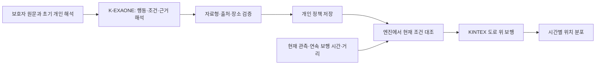
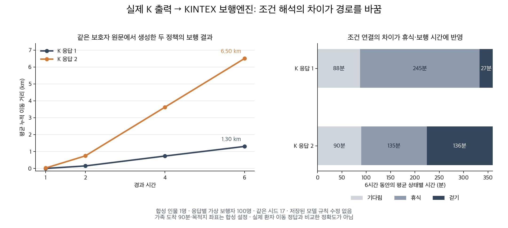

# 돌아오길 마음모델 개선 실험 결과

2026-10-06 · 승인된 개발 64회 완료 · 별도 평가 0회 · 서비스 배포 없음

## 결론

같은 8개 개발 장면을 두 번씩 판정했을 때, 이전 후보의 9/16에서 이번 최고 후보의 **13/16(81.25%)**으로 개선됐다. 미리 정한 개발 통과 기준은 15/16이므로 다음 별도 평가로 넘어가지는 않았다. 최신 소규모 후보의 7/8은 한 번만 실행한 진단 결과이며, 정식 통과 결과로 사용하지 않는다.

이번에 확인한 중요한 문제는 **설명문이 맞아도 실행 조건이 틀릴 수 있다는 것**이다. 실제 저장된 K 출력을 수정 없이 KINTEX 보행엔진에 넣었을 때, 같은 합성 인물·같은 난수 시드에서 두 응답의 6시간 평균 누적 이동 거리가 **1.30km와 6.50km**로 달라졌다. 조건 연결과 근거 없는 행동 추가가 시뮬레이션까지 전달됐다. 어느 거리가 실제 환자의 정답인지는 이 실험으로 알 수 없다.

이는 100%를 기다리기 위한 추가 요구가 아니다. 이미 정한 약 90%의 단계 기준에 아직 도달하지 않았고, 선택한 장면의 점수만으로는 개인 정책 전체의 충실성을 설명할 수 없다는 결과다. 서비스에 넣는 후보로 확정하지 않았으며 `RELEASE_QUALIFIED=False`를 유지했다.

## 1. 왜 이 실험을 했는가

목표는 보호자가 온보딩에서 설명한 사람의 특성이 걷기·휴식·기다림·환경 회피에 실제로 반영되게 하는 것이다. 단순히 JSON을 잘 만드는지, 지도가 시간에 따라 달라지는지만 확인해서는 이 목표를 판정할 수 없다.

이전 실험에서는 보행 능력을 행동 지시로 바꾸거나, 가족이 도착했는데도 기다리게 하는 오류가 남았다. 이번에는 K-EXAONE이 보호자 원문에서 조건부 행동을 준비해 저장하고, 보행 중에는 엔진이 현재 조건에 대조하는 구조를 비교했다. 가상 보행자마다 K를 호출하는 구조는 아니다.



모델이 자연어를 해석하고, 코드는 조건 비교와 실행을 담당한다. 보호자 문장을 특정 단어로 매핑해 정답 규칙으로 고치는 방식은 사용하지 않았다. 형식 검사 통과는 의미 정확성 통과와 구분했다.

## 2. 실험 범위와 판정 기준

| 구분 | 내용 |
| --- | --- |
| 개발 자료 | 합성 인물 3명, 각 3개 문답, 총 8개 장면 |
| 정식 개발 비교 | 8개 장면 × 모델 응답 2반복 = 16개 행동 판정 |
| 사전 통과 기준 | 15/16 이상이면 후보를 고정하고 별도 평가 |
| 별도 평가 계획 | 합성 32명 × 2장면 × 2반복, 116/128 이상이면 통합 검증으로 이동 |
| 실제 호출 | 개발 K-EXAONE 64회, 별도 평가 0회 |
| 요청 제한 | 입력 40,000 UTF-8 바이트 이하, 출력 12,000토큰 이하, 동시 최대 2회 |
| 실패 처리 | 요청 실패·빈 응답·출력 중단 모두 사용량 기록, 자동 모델 재시도 없음 |
| 추가 자원 | 신규 GPU 학습·SAR·Mi:dm·RAG 검색·임베딩·지도 취득 없음 |

별도 평가 64회는 개발 통과 후보가 나왔을 때만 사용하는 승인이다. 개발 64회 소진 뒤 그 예산을 개발에 전용하지 않았다. 입력·원문·정답은 합성 자료이며, 개발자가 작성하고 읽었다. 독립적인 사람 평가나 임상 맹검 자료가 아니다. 실제 환자 0명, 독립 평가자 0명이다.

기준선 행동 장면은 개인 행동을 근거 없이 확정하지 않는 출력을 허용한다. 따라서 `baseline`뿐 아니라 조건을 몰라 행동을 확정하지 못한 출력도 해당 장면에서는 통과할 수 있다. 반대로 휴식·회피가 명확히 필요한 장면에 '모름'을 내면 실패다. 이 점수는 고정 장면의 행동 일치율이며 개인 해석 전체 정확도나 실종 위치 정확도가 아니다.

## 3. 무엇을 바꾸며 비교했는가

| 후보 | 실제 호출 | 변경점과 결과 |
| --- | ---: | --- |
| note_v1_off | 18 | Pydantic 전체 JSON Schema 사용. 전부 HTTP 422로 요청 거절. 의미 성능 평가 불가 |
| note_v2_probe | 1 | 단순한 외곽 구조로 요청은 수락. 내부 필드·자료형·규칙 연결 실패 |
| note_v3_probe | 1 | 참조·합집합 없는 스키마, Thinking 켬. 회피 대상·장소 범위 누락 |
| note_v4_probe | 1 | 행동과 대상을 한 명령으로 묶음. 출력 12,000토큰 소진 |
| note_v4_off_probe | 1 | 같은 방식, Thinking 끔. 한 문답의 시장 AND 조건은 정상 |
| note_v4_off | 18 | 전체 문답별 반복 비교. 문답 혼동·예시 수치 복사 등으로 개인 정책 완성 실패, 0/16 |
| note_v5_probe | 1 | 한국어 지시·대상 문답 마지막 배치·숫자 예시 제거. 한 문답은 정상, 동등 규칙 중복 |
| note_v5_on | 6 | 문답별 확장 중 보행 능력 문답에서 출력 소진. 조기 중단, 정식 비교 미완료 |
| person_v6_off | 6 | 사람 전체 원문을 한 번에 해석, Thinking 끔. 5/16 |
| person_v6_on | 6 | 동일한 사람 단위 구조, Thinking 켬. **13/16** |
| person_v7_on_pilot | 3 | 원문 요약을 먼저 출력, 단일 사용자 메시지. 7/8, 1반복 진단 |
| person_v7_off_or_probe | 2 | 마지막 OR 사례 진단, Thinking 끔. 1/2, 정식 전체 비교 아님 |
| **합계** | **64** | **개발 통과 후보 없음** |

API 요청 실패 18건을 모델이 의미를 틀린 18건이라고 해석하지 않는다. 문답 하나만 시험한 결과도 전체 사람 해석 성공률로 환산하지 않는다. `note_v5_on`은 중단 당시 이미 제출된 두 요청의 완료 응답까지 회수했으며 실제 6회로 집계했다. 재호출한 것은 아니다.

이번 요청은 K-EXAONE 연결에 설정된 배포 ID `depmkuykpfon9lg`를 사용했다. 특정 기반 가중치 버전의 우월성을 검증한 실험은 아니다. 각 후보의 요청·최종 응답·코드 사본·해시를 `development/`에 보존했다.

## 4. 최고 후보의 점수와 점수 밖의 오류

| 같은 장면·같은 행동 판정 기준 | 결과 |
| --- | ---: |
| 이전 후보 | 9/16 (56.25%) |
| 이번 person_v6_on | 13/16 (81.25%) |

| 이번 후보의 행동별 판정 | 결과 |
| --- | ---: |
| 환경 회피 | 1/4 |
| 개인 행동을 확정하지 않아야 하는 장면 | 8/8 |
| 휴식 장면 | 2/2 |
| 기다림 장면 | 2/2 |

이전 저장 출력을 현재의 같은 행동 기준으로 다시 집계한 결과가 `baseline_metric_alignment.json`이다. 4개 판정, 25%p 개선을 확인했지만 같은 소수 개발 자료를 반복해 본 결과다. 새로운 사람에게 일반화됐거나 K 모델 자체가 우월하다는 통계적 근거는 아니다.

휴식 2/2 통과도 휴식 규칙 전체가 맞았다는 뜻은 아니다. 원래 장면에서는 시간과 거리가 둘 다 휴식 경계를 넘었으므로, 잘못 만든 조건도 우연히 같은 행동을 냈다. '40분 걸을 수 있다'를 '정확히 40분이면 걸어라'로 만든 응답도 있었지만, 해당 기존 검사 장면은 45분이라 그 오류를 드러내지 못했다. 이 한계를 숨기지 않고 아래 실제 보행 진단으로 확인했다.

### 사례 A: 휴식 조건의 연결 오류

합성 보호자 원문:

> 무릎 때문에 한 번에 오 분 정도, 삼백 미터쯤 걸으면 앉아서 쉬어야 해요. 쉬고 난 뒤에 다시 걷는 것은 가능해요. 한 시간 연속으로 걷지는 못해요.

`person_v6_on`, W1_1, 첫 번째 실제 응답의 휴식 조건은 다음과 같다. 읽기 위해 논리식으로만 옮겼으며 규칙을 수정한 것이 아니다.

```text
(연속 보행 ≥ 5분 AND 휴식 후 거리 ≥ 300m) OR 현재 걷는 중
```

마지막 OR 때문에 막 걷기 시작한 상태도 휴식 대상으로 들어간다. 두 번째 응답은 다음과 같았다.

```text
(현재 걷는 중 AND 연속 보행 ≥ 5분)
OR (현재 걷는 중 AND 휴식 후 거리 ≥ 300m)
```

이 실험의 실행 가정은 보행 중 두 경계 중 하나에 도달하면 쉬는 것이다. 원문의 '약 5분, 약 300m'를 엄밀한 임상 한계나 보편적인 치매 보행 기준으로 해석하지 않는다. 두 응답의 차이는 실제 보행에서 드러났다.

### 사례 B: 목적지 발언을 출발 규칙으로 격상

> 매일 오전에 다온공원에 가야 한다고 말씀하세요. 실제로 간 적은 없고 그곳까지 가는 길도 한 번도 다녀보지 않았어요.

W1_1 두 번째 응답은 여기에 `target_recognized == true → seek_0`를 추가했다. 목적지 발언은 장소에 대한 끌림을 해석할 자료가 될 수 있지만, 이 원문에는 '대상을 알아보면 출발한다'는 관찰된 반응은 없다. 모델이 만든 출발 조건을 관찰 사실처럼 실행하는 문제가 남았다.

### 사례 C: 자연어 요약은 맞지만 정책 범위가 달라짐

마지막 `person_v7_off_or_probe`, E2_1, 두 번째 실제 응답의 요약 일부:

> N2: 세 시장에서 붐비거나 시끄러우면 입구에서 몸을 돌려 멀어짐. 둘 다 없을 때는 피하지 않음.

실행 규칙에서는 회피 범위를 `place_labels: ["푸른시장"]`으로 제한하고, 조용하고 한산할 때 세 후보 장소로 향하는 `seek_0`, `seek_1`, `seek_2`를 추가했다. 원문은 세 장소가 비교 후보일 뿐 가려는 곳이나 방문 이력이 아니라고 명시한다. 출처 ID가 존재하고 JSON이 유효해도, 출처가 그 행동을 뒷받침하는지는 별도로 검증해야 한다.

## 5. 실제 K 출력을 보행엔진에 넣은 결과



최고 후보의 W1_1 반복 1·2에서 저장된 정책을 그대로 사용했다. 같은 초기 성향, 같은 KINTEX 도로, 같은 난수 시드 17, 응답마다 가상 보행자 100명이다. 합성 인물은 1명이며 200명의 실제 환자를 평가한 것이 아니다.

가족이 90분에 도착한다는 합성 관측으로 기다림 조건 해제를 확인했다. 다온공원이라는 합성 목적지의 좌표는 시작점에 부여했다. 실제 환자의 목적지나 실제 가족 도착 관측이 아니다. 가족을 만난 뒤에도 계산을 계속한 것은 조건 해제 진단이며, 실제 수색 사건 종료 절차를 재현한 것이 아니다.

| 경과 시간 | K 응답 1 평균 누적 거리 | K 응답 2 평균 누적 거리 |
| --- | ---: | ---: |
| 1시간 | 0.000km | 0.024km |
| 2시간 | 0.150km | 0.745km |
| 4시간 | 0.735km | 3.625km |
| 6시간 | **1.303km** | **6.505km** |

| 6시간 상태별 평균 시간 | K 응답 1 | K 응답 2 |
| --- | ---: | ---: |
| 기다림 | 87.5분 | 89.5분 |
| 휴식 | 245.4분 | 135.0분 |
| 걷기 | 27.1분 | 135.5분 |

두 실행 모두 확률 질량은 부동소수점 오차 범위에서 1로 유지됐고 미배치 질량은 0이었다. 4→6시간 위치 분포도 달라졌다. 따라서 저장된 조건을 엔진이 받아 실행하고 시간에 따라 움직이는 연결은 확인했다. 다만 서로 다른 두 정책은 휴식 조건과 목적지 규칙이 함께 다르므로, 각 오류가 거리 차이에 기여한 비율은 분리 측정하지 않았다. '지도가 달라졌다'를 '그 사람처럼 움직인다'는 근거로 사용하지 않는다.

이 실행은 **미통과 후보의 원인 진단**이다. 개발 기준을 통과한 후보의 정식 통합 평가로 합산하지 않는다. 실행 스크립트에서 외부 네트워크를 차단했고, 새 모델·지도 호출은 없다.

지도는 고양 KINTEX 캐시, OSMnx 2.1.0, 2026-10-04 취득, 78,502노드·226,318간선이다. 원본 해시·범위는 `kintex_map_metadata.json`에 보존했다. OSM 분류는 실제 소음·혼잡 관측이 아니다. 지도 출처: © OpenStreetMap contributors, ODbL.

## 6. 엔진 수정의 근거는 별도로 유지

실호출 전에 개인 정책을 agent·statistical 두 경로에 공유하도록 수정했다. 갱신된 마음 상태의 적용 여부만 다르게 하고, 개인 반응 자체를 제거한 경로는 대조 실험에 남겼다. 고정 결합 비율 0.7:0.3은 바꾸지 않았다.

수작업 기다림 조건을 KINTEX에서 세 시드로 실행했을 때, 이전 결합의 1시간 대기 셀 밖 질량 27.6~28.8%가 공유 조건 적용 후 0%가 됐다. 이 결과는 개인 조건이 결합 과정에서 희석되던 문제의 수정 근거이며, K 의미 해석 성공률과는 합산하지 않는다.

코드 회귀 검사: 관련 61개 통과, 전체 백엔드·연구 실험 검사 1,473개 및 하위 검사 7개 통과, 기존 외부 키 필요 검사 2개 건너뜀. 이후 연구 후보의 출력 구조 수정은 관련 검사 13개를 통과했다. 전체 검사는 마지막 연구 후보 수정 전 결과이므로 최신 후보를 포함한 전체 재검사 결과라고 쓰지 않는다. 운영 코드 변경은 로컬 상태이며 배포하지 않았다.

## 7. 다음 개선 방향

이번 결과상 다음 우선순위는 프롬프트의 길이를 더 늘리는 것보다 **원문 해석과 실행 조건의 일치 여부를 검사하는 구조**다.

1. **이미 준비한 개인 해석을 재사용.** 앞단에 근거와 함께 저장된 환경 조건·장소 범위를 마음모델이 원문에서 매번 새로 작성하며 바꾸지 않도록 한다. 관찰된 반응, 목적지 발언, 보행 능력, 미확인을 각각 보존한다. 실제 앞단 저장 값과 원문의 일치 검증은 유지한다.
2. **행동 근거와 조건 조합을 분리.** K가 행동과 근거를 해석한 뒤, 실행 표현에서는 '모두 충족'·'하나 이상 충족'·'적용 장소'를 명시한다. 코드는 이 명시 구조를 컴파일한다. 단어 파싱으로 보호자 문장을 해석하거나, 실패한 K 출력을 정답에 맞춰 수리하지 않는다. 이런 구조도 실험으로 효과를 확인해야 한다.
3. **경계와 반례를 저장 응답에 대조.** 걷기 직후, 시간만 넘음, 거리만 넘음, 둘 다 넘음, 휴식 중, 가족 도착 전후를 나눈다. 환경은 소음·혼잡의 네 조합과 다른 장소를 나눈다. 40분 보행 능력이 40분 시점의 행동 명령으로 바뀌는지도 확인한다. 이번에 확인한 반례는 개발 자료로 표시하고 독립 평가 자료라고 부르지 않는다.
4. **같은 단계 기준 유지.** 수정 후보가 개발 15/16을 통과하면 고정 후 별도 116/128 기준으로 평가한다. 추가 반례 검사는 원래 16개 점수와 별도 표로 공개한다. 통과한 후보의 실제 출력으로 KINTEX 보행을 확인하고 시연·시험 운영 판단으로 넘어간다.

이 방향은 제안이며 새 후보의 개선 성공을 주장하지 않는다. 이번 자료만으로 K-EXAONE을 포기하거나 SAR-EXAONE이 더 낫다고 결론낼 수도 없다. RAG와 재학습의 추가 효과는 이번 범위에서 비교하지 않았다.

## 8. 사용량과 재현 자료

| 사용량 | 이번 기록 |
| --- | ---: |
| 개발 요청 / 완료 | 64 / 64 |
| HTTP 422 / HTTP 200 | 18 / 46 |
| 정상 종료 / 출력 길이 종료 | 40 / 6 |
| usage가 있는 응답 | 46건 |
| 확인된 입력 토큰 소계 | 63,319 |
| 확인된 출력 토큰 소계 | 139,446 |
| **확인된 총 토큰 소계** | **202,765** |
| usage가 없는 오류 응답 | 18건, 0으로 간주하지 않음 |
| 단가·실청구액·지원 차수·GPU 청구 시간 | 미확인 |

공용 원장과 원격 원장의 시작·종료 이벤트 128개가 event_id 기준으로 일치한다. 미완료 요청은 없다. 토큰은 확인 가능한 응답의 소계이며 전체 청구 사용량을 확정한 숫자가 아니다.

- `authorization.json`, `usage_summary.json`, `ledger_reconciliation.json`: 승인·사용량·대조 결과
- `development/*/summary.json`: 후보별 원문 응답과 고정 장면 판정
- `development/*/source_snapshot/`: 각 호출 당시의 코드
- `recovered/`: 중단 시 진행 중이던 요청의 최종 응답 회수
- `actual_k_replay.json`, `replay_actual_k.py`: 실제 K 출력의 보행 진단
- `plot_actual_k.py`: 그림 재생성
- `source_snapshot/`, `source_manifest.json`: 실호출 시작 전 사본
- `final_source_snapshot/`, `final_source_manifest.json`: 이번 작업 종료 시 사본
- `실행계획.md`: 결과 확인 전 정한 단계 기준

보고서에 사용할 수 있는 문장: **“합성 개발 사례에서 조건부 행동 일치율을 9/16에서 13/16으로 개선했으며, 저장된 모델 출력이 KINTEX 보행에 반영되는 것을 확인했다. 다만 조건 연결과 근거 없는 행동 추가 오류가 남아 별도 평가 및 서비스 교체는 진행하지 않았다.”**
