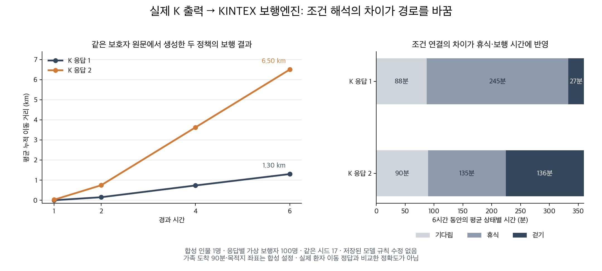

# 2026-10-06 마음모델 실험 종료 정리

승인된 개발 64회를 완료했다. 최고 후보는 같은 개발 장면 기준으로 **9/16 → 13/16(81.25%)**까지 개선됐지만, 사전 기준 15/16에는 미달했다. 조건부 승인된 별도 평가 64회는 사용하지 않았고 서비스 배포도 하지 않았다.

[상세 실험 결과](실험결과.md)에 실험별 호출 수, 실제 모델 응답, 남은 오류, 사용량과 다음 개선 방향을 정리했다.

## 실제 보행까지 확인한 내용

저장된 K 출력 두 개를 수정 없이 KINTEX 엔진에 넣었다. 같은 합성 인물·초기 성향·시드에서 응답별 가상 보행자 100명의 6시간 평균 누적 이동 거리는 **1.30km와 6.50km**였다. 휴식 조건의 논리 연결과 추가된 목적지 행동이 서로 달랐다. 어느 값이 실제 환자의 정답인지 측정한 결과는 아니다.

이 진단은 모델의 해석이 엔진에 반영된다는 것과, 틀린 해석도 그대로 행동 차이를 만든다는 것을 보여 준다. 개발 미통과 후보의 진단이며 정식 통합 통과 결과에 합산하지 않는다.

## 완료한 수정과 검사

- agent·statistical 두 경로에서 같은 개인 조건을 사용하도록 로컬 결합 코드를 수정했다. 갱신된 마음 상태 적용 여부는 구분한다. 0.7:0.3 가중치는 유지했다.
- 미만·초과 숫자 조건과 보행 단계 분할을 보완했다.
- 문답별·사람별 추출, Thinking 켬/끔, 요약 선출력 후보를 비교했다. 실패를 제외하거나 최선의 반복만 골라 점수를 내지 않았다.
- 전체 코드 검사 1,473개 및 하위 검사 7개 통과, 기존 외부 키 필요 검사 2개 건너뜀. 전체 검사 이후 변경한 연구 후보는 관련 검사 13개 통과. 두 검사 시점을 구분한다.
- 앞서 수작업 정책으로 확인한 KINTEX 결합 수정 근거는 [실호출 전 정리](실호출전_작업정리.md)에 보존했다. K 의미 해석 성능과 합산하지 않는다.

## 사용량과 다음 판단

개발 64회 중 HTTP 422 요청 오류 18회, 응답 46회다. 확인된 토큰 소계는 **202,765**이며, 오류 18회의 미확인 usage를 0으로 처리하지 않았다. 단가·실청구액·지원 차수는 미확인이다. 공용·원격 원장 128개 시작/종료 이벤트가 모두 일치하고 미완료 요청은 없다.

다음 우선순위는 앞단에 저장된 개인 근거를 재사용하고, 해석한 행동과 실행 조건의 일치를 따로 검증하는 것이다. 휴식 직전·시간만 초과·거리만 초과·가족 도착·소음/혼잡 네 조합처럼 조건을 나눈 반례가 필요하다. 새 방식의 성공을 미리 주장하지 않으며, 이번 81.25% 결과를 본 뒤 통과 기준을 낮추지 않았다.

실제 환자 0명, 독립 사람 평가 0명. 이번 실험은 합성 자료의 행동 일치 평가이며 실제 실종 위치 예측 정확도가 아니다.
