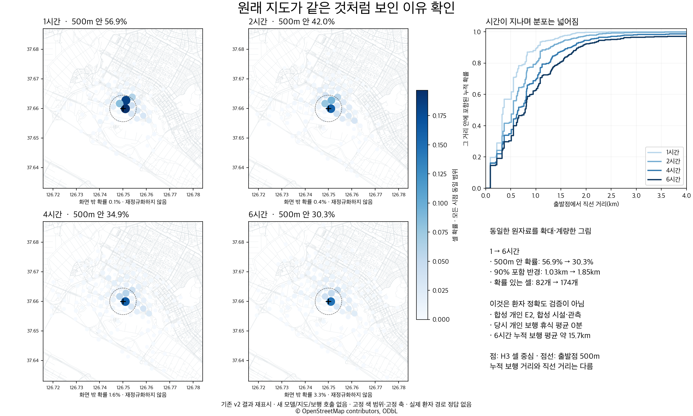
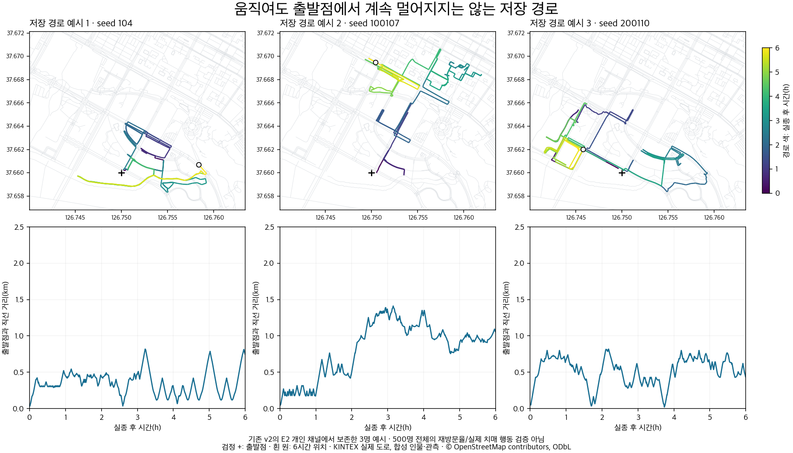

# 시간별 확률지도가 비슷한 이유와 행동 현실성 재검토

작성일: 2026-10-05. 대상: `MIND_completion_20261004/시간별_확률지도.png`의 원자료. 실제 실종 경로와 비교한 정확도 평가가 아니다. 새 지도·임베딩·모델 호출 없이 저장 결과를 분석했다.

## 판단

네 지도는 수치상 동일하지 않다. 그러나 지도에 변화가 있다는 사실은 “온보딩된 그 치매 어르신처럼 움직인다”는 증거가 아니다. 원래 결과에는 6시간 동안 평균 약 15.7km를 걸으면서 휴식은 0분인 실행상 문제가 있다. 이 지도만으로 배포 가능이나 환자 행동 재현 성공을 주장하면 안 된다.

## 원자료에서 확인한 변화

| 실종 후 시간 | 출발점 500m 안 확률 | 출발점 1km 안 확률 | 확률 90%를 포함하는 반경 | 확률이 있는 셀 |
|---|---:|---:|---:|---:|
| 1시간 | 56.9% | 89.1% | 1.03km | 82 |
| 2시간 | 42.0% | 79.7% | 1.29km | 106 |
| 4시간 | 34.9% | 69.4% | 1.70km | 157 |
| 6시간 | 30.3% | 62.8% | 1.85km | 174 |

반경은 출발점 `(37.66, 126.75)`에서 H3 셀 중심까지의 직선 거리를 결합 확률로 누적한 값이다. 경로를 따라 실제로 걸은 누적 거리와 다르다. 원래 화면은 약 14km 폭을 보여주고, 선형 색상 범위에서 낮은 확률의 바깥 셀이 매우 옅게 보인다. 따라서 중심의 진한 셀만 비교하면 차이가 작아 보인다. `확률 질량 1.000`은 셀 확률의 합이 1이라는 뜻이며 정확도 100%라는 뜻이 아니다.

이 그림은 기존 v2 결과의 표시만 바꾼 것이다. 모든 시점의 축·색 범위가 같으며 화면 밖 확률도 따로 표기했다. 바깥 질량을 지우고 재정규화하지 않았다.

## 지도가 넓어져도 남는 문제

같은 E2의 저장된 개인 보행 500명 실행에서 평균 누적 보행은 1시간 약2.62km, 2시간 약5.24km, 4시간 약10.48km, 6시간 약15.72km였다. 평균 휴식은 모든 시점에서0분이었다. 6시간의 평균 보행327.6분과 대기32.4분을 합하면360분이다. 추가 채널 재현에서 원래 결합 분포와 정확히 일치하는 실행의 보행 통계도 같은 값임을 확인했다. 시간 계산이 이어진다는 검증은 되지만 휴식·피로의 행동 효과를 충분히 구현했다는 검증은 되지 않는다.

6시간 누적 시간의98.9%에는 추가적인 개인 조건 규칙이 선택되지 않아 기존 이동 기준이 적용됐다. **개인화가98.9% 사라졌다는 뜻은 아니다.** 초기 성향·페르소나 정보는 기존 이동 기준에도 들어간다. 다만 이 사례의 조건부 마음 규칙이 실제 행동을 바꾼 시간은 제한적이었다. 개인 규칙이 항상 켜져 있어야 한다는 뜻도 아니다. 상황이 성립하지 않으면 억지로 켜면 안 된다.

합성 E2는 특정 환경에서의 회피 반응을 가진 사례다. 제공하지 않은 목적지 욕구·피로 대응을 이 사람의 실제 특성처럼 추가할 수 없다. 그 밖의 행동을 집단 가정으로 채울 경우 출처·가정·민감도를 별도로 밝혀야 한다.

결합 지도는 개인 연속 보행0.7과 기존 statistical 결과0.3을 합친 값이다. statistical에도 개인 정보가 들어간다. 두 채널을 분리 재현하자 **statistical의4시간·6시간 분포는 셀과 확률이 모두 완전히 같았다.** 개인 보행은 달라졌지만 같은 중심 분포가30% 결합되어 중심부를 유지하는 데 기여했다. 고정0.7:0.3은 검증된 최적 비율이 아니다.

| 채널 | 4시간500m 안 확률 | 6시간500m 안 확률 | 4시간90% 반경 | 6시간90% 반경 |
|---|---:|---:|---:|---:|
| 개인 보행 |26.4%|19.8%|1.81km|2.01km|
| 기존 statistical |54.8%|54.8%|1.32km|1.32km|
| 결합 |34.9%|30.3%|1.70km|1.85km|

재현에는 커밋`2d6af78`의v2 보행·연결 코드를 로컬에서 불러왔다. 저장된 벤치마크의 소스 해시와 커밋 파일 해시가 달라 “소스가 완전히 동일하다”고 쓰지 않는다. 대신 네 시점 모두 원본 결합 분포와 셀별 확률 차이가0임을 검사한 뒤 채널을 분리했다. 실제 환자 경로와 일치한다는 뜻이 아니다. `original_component_replay.json`에 양쪽 해시와 분포 대조를 남겼다.

기존 statistical 경로는 시점별 종점 샘플링이므로 개인 보행의 연속 상태와 시간 처리 방식이 같다거나 같은 피로 변화를 반영한다고 할 수 없다. 이 채널의 시각 의존성과 시간 상한은 별도의 수정·검증 대상이다.

보존된 세 명의 예시 경로를 시간 색으로 표시하면, 같은 주변을 다시 지나며 걸어 누적 거리가 늘어나는 상황을 볼 수 있다. 세 경로는 설명용 예시이며500명 전체나 실제 치매 환자의 재방문 빈도를 추정한 표본이 아니다.

## 전문기관과 연구가 말하는 범위

Alzheimer’s Society는 치매인의 걷기에도 목적이나 믿음이 있는 경우가 많다고 설명한다. 과거 생활 습관이나 특정 사람을 찾으려는 이유로 출발하고, 이동 중 목적 또는 길을 잊을 수 있다. 불안이나 불편한 환경도 관련될 수 있다. 통증이 걷기를 유발하기도 하므로 “통증이면 언제나 쉼” 같은 일괄 규칙으로 바꾸면 안 된다. 이 안내는 개인 맥락을 살필 근거이지 수치 전이 확률을 제공하는 자료가 아니다.

- 출처: [Why a person with dementia might be walking about, Alzheimer’s Society](https://www.alzheimers.org.uk/about-dementia/stages-and-symptoms/dementia-symptoms/dementia-walking-about)

Rowe 등의2011년 연구는 지역사회 실종325건의 신문 보도를 후향적으로 분석했다. 연구진은 일상 활동 중 길을 잃는 실종과 반복적인 왕복·순환 배회를 구분한다. 가까운 곳에 머무는 사례와 멀리 이동한 사례가 모두 있어, 모든 사람에게 같은 근거리 순환이나 단조로운 확산을 부여할 근거가 되지 않는다. 보도된 사건의 선택 편향이 있고, 발견 위치 자료를 시간별 실제 궤적으로 해석해서는 안 된다.

- 출처: [Persons with dementia missing in the community: Is it wandering or something unique?, Rowe et al., BMC Geriatrics, 2011](https://link.springer.com/article/10.1186/1471-2318-11-28)

이번 작업에서 치매 전문의나 돌봄 경험자가 우리 결과를 직접 평가한 것은 아니다. 전문기관 안내와 연구의 내용, 우리 모델의 결과, 향후 검증 가설을 구분한다. 이 자료들만으로 “1시간에는 몇km, 6시간에는 몇km”라는 개인별 정답을 만들 수 없다.

## 좁은 분포에 기여한 보행 계수도 확인

KINTEX의 같은 합성 E2·500명·시드104에서 방향 선택에 들어가는 혼란 효과만 제거하는 진단을 추가했다. 일반 휴식은 두 조건 모두 꺼 원래 보행 조건에 맞췄고, 나머지 입력과 코드는 같았다. 지도·모델 추가 호출은 없다.

| 진단 조건 | 6시간 개인 보행의90% 직선 반경 | 500m 안 비율 |
|---|---:|---:|
| 현재 누적 혼란을 방향에 반영 |2.03km|23.0%|
| 방향 선택의 혼란 입력만0으로 고정 |4.07km|23.2%|

개인 채널만 비교한 값이므로 위 결합 지도 반경과 다르다. H3 셀 중심이 아닌 각 보행자 위치의 직선 거리다. 넓어지는 바깥 부분에 방향 혼란 계수가 영향을 주지만 중심의 질량은 비슷하게 남는다. 한 사례·한 시드의 코드 원인 진단이며, 혼란을0으로 둔 후보를 개선 모델로 추천하거나 정확도 향상으로 계산하지 않는다.

현재 조건에서는 이동 전략을 가진 보행자 전원의 누적 혼란값이6시간에1 이상이 됐다. 방향 집중도 계산은 `min(1, 혼란)`을 사용하므로 그 이후 차이가 하한에 모인다. 이 값은 환자의 실제 혼란 정도를 측정한 점수가 아니다.

기존 저장소의 `docs/혼란도_수치_근거_정리.md`도 방향상실이라는 개념의 연구 근거와 각도·집중도 수치의 근거를 구분하며 κ 계산의2.5·하한0.2를 잠정값으로 명시한다. `gauges.py`의 누적 계수 역시 잠정값이다. 따라서 기존 코드에 문헌이 연결되어 있다는 이유만으로 이6시간 수치까지 검증됐다고 할 수 없다. 개인의 비교적 지속적인 길찾기 특성과 상황에 따라 변하는 불안을 구분하고, 시간에 따른 값의 포화·회복·방향 선택 민감도를 추가로 점검해야 한다.

자료: `bench_direction_sensitivity.py`, `direction_sensitivity.json`. v3 후보에서 원래 휴식 끔 조건을 재현한 진단이며 기존 v2 결과 파일을 덮어쓰지 않았다.

## 이번 보완과 아직 검증하지 못한 것

후속 v3 후보에는 개인 조건이 작동하지 않는 보행에서도 기존 피로 곡선을 사용해 일반 휴식 가능성을 평가하는 경로를 연결했다. 도로 노드 수에 따라 휴식 기회가 달라지지 않도록 시뮬레이션1분 기준으로 평가하고 재시작 시 시계·난수 상태를 보존한다. 관측 시작·만료가 분 중간에 일어나는 경우에도 반영하도록 보완했다.

그러나 휴식5분·회복계수0.4는 잠정 가정이다. 같은 KINTEX 사례3시드의 민감도 검사에서 일반 휴식 길이2/5/10분에 따라6시간 평균 누적 보행이 약15.11/14.31/13.21km로 달라졌다. 이동 거리가 줄었다는 것은 가정이 동작한다는 뜻이지 환자 행동 정확도가 향상됐다는 뜻이 아니다. 명시적 개인 행동을 일반 휴식보다 우선하는 구조도 검토가 남았다.

## 이어서 확인할 항목

1. **개인 해석:** 원문에 있는 관찰·능력·권고·거부를 구분하고 같은 상황의 서로 다른 사람에게 서로 다른 반응을 선택하는지 확인한다. 승인된 K192회 중 개발64회를 완료했으나 통과 후보가 없어 새32명·128회 평가를 시작하지 않았다. 세부 결과는 `../MIND_source_scene_20261005/결과보고서.md`에 기록했다.
2. **행동의 시간적 연결:** 목표를 향함 → 길을 잃거나 환경을 만남 → 회피·대기·휴식 → 재출발의 전환이 개인 조건에 맞는지 확인한다. 조건의 성립·해제 및 미확인 상태를 구분한다.
3. **경로 수준:** 누적 보행 거리, 출발점과의 거리, 한 번에 걷는 시간, 휴식·대기 시간, 재방문, 목표 변경을 함께 기록한다. 지도 색 차이를 성공 기준으로 삼지 않는다.
4. **두 채널의 시간 의미:** 개인 보행·statistical·결합의1/2/4/6시간 분포를 따로 비교한다. 시간 의존 자료가 아닌 수색 종점 통계를 시간별 이동 정답으로 사용하지 않는다. 보기 좋게 반경을 늘리는 보정은 하지 않는다.
5. **현실성의 독립 확인:** 합성 원문 제약 준수와 실제 치매인의 실종 행동 재현을 구분한다. 비식별 실제 경로/종료 사례나 독립 돌봄 경험자 검토가 확보되기 전에는 후자를 입증했다고 표현하지 않는다.

## 재현 자료

- `original_map_spatial_audit.json`: 원래 결합 지도의 수치 재검토.
- `plot_time_audit.py`: 저장 지도 자료만으로 확대 그림 생성.
- `../MIND_completion_20261004/product_benchmark_final.json`: 원래 결합 지도.
- `../MIND_completion_20261004/live_policy_replay_final.json`: 개인 보행·동작 기록.
- `rest_sensitivity_summary.json`: 후속 v3 일반 휴식 가정의 민감도 검사.
- 지도: 고양 KINTEX OSMnx2.1.0, SHA256 `953d2bca91fe7388011e9ca161dc576c3c79366c578ed314d7cc8deea677db92`, © OpenStreetMap contributors, ODbL. 실제 도로 위 합성 시설·관측·인물 실험.
