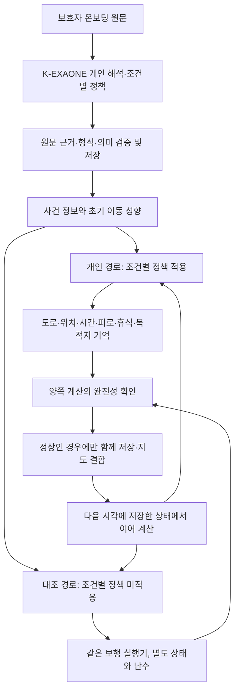
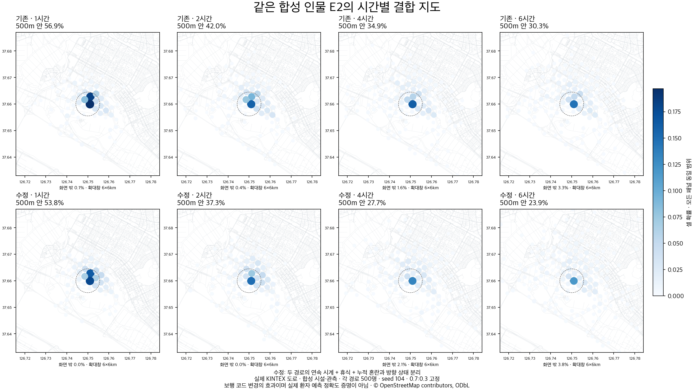
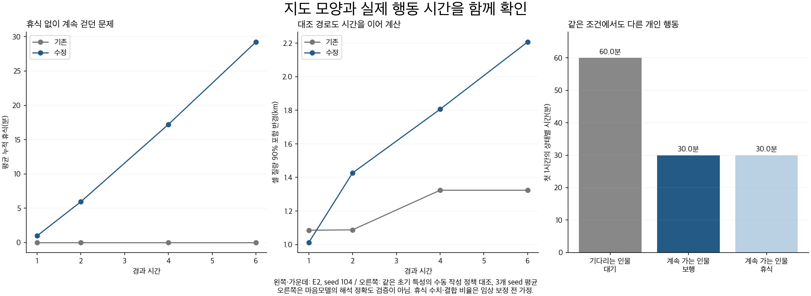

# 돌아오길 시간·개인 행동 실행기 개선 결과

2026-10-05 · 로컬 검증 · 운영 미배포

## 1. 이번에 해결한 것

온보딩에서 해석한 개인 특성을 보행 중 행동으로 연결하는 실행기를 수정했다. 목적은 단순히 시간별 지도가 다르게 보이게 만드는 것이 아니다. 걷는 인물은 실제로 시간이 이어지고, 쉬거나 기다리는 인물은 그 이유에 맞게 머물며, 조건이 달라지면 다시 행동하도록 만드는 것이다.

이번 수정으로 **시간 계산 정체, 휴식 누락, 누적 게이지와 방향 상태의 혼용, 불완전한 계산의 상태 저장** 문제를 보완했다. 코드·합성 보행 검증은 통과했다. 실제 치매인의 실종 위치를 더 정확히 예측한다는 검증과 K-EXAONE의 해석 정확도 검증은 아직 완료되지 않았다. 현재 결과로 실서비스 배포 완료를 선언하지 않는다.

## 2. 왜 바꾸었나

기존 E2 합성 사례의 원자료를 확인하면 결합 지도 전체가 1·2·4·6시간 모두 같은 것은 아니었다. 다만 결합되는 statistical 경로는 4시간과 6시간의 셀별 확률이 완전히 같았다. 이 경로가 개인 보행자처럼 시간을 이어 가지 않고, 발견거리 분포와 도달 가능 거리의 상한에서 매번 다시 계산했기 때문이다. 상한이 더 변하지 않으면 동일한 난수에서 같은 결과가 나왔다.

개인 보행자는 6시간 동안 평균 약 15.7km를 이동했지만 휴식 시간은 0분이었다. 개인 조건이 걸리지 않았을 때 누적 피로가 휴식으로 연결되지 않았다. 또한 상한 없이 쌓이는 혼란 게이지를 0~1 방향 산포 값에 넣어서, 시간이 지나면 방향 선택이 같은 하한에 가까워지는 문제가 있었다. 이 값들을 동일한 의미로 취급할 근거가 없었다.

실제 치매인의 보행에는 익숙한 습관·목적·사람을 찾는 행동 등 여러 이유가 있고, 통증이 오히려 이동의 동기가 되는 경우도 있다. 따라서 치매라는 이유만으로 모두 무작위로 걷게 하거나 모두 쉬게 해서는 안 된다. 이는 [Alzheimer’s Society의 안내](https://www.alzheimers.org.uk/about-dementia/stages-and-symptoms/dementia-symptoms/dementia-walking-about)에 근거한 설계 방향이며, 특정 휴식 시간이나 방향 계수의 수치 근거는 아니다.

또한 [Rowe 외, 2011, BMC Geriatrics](https://link.springer.com/article/10.1186/1471-2318-11-28)는 지역사회 실종 사건을 반복적인 배회와 구분한다. 해당 연구는 신문 보도 325건의 후향 분석으로, 우리 모델의 시간별 경로 계수를 제공하거나 KINTEX 예측을 검증하는 자료는 아니다. 이번 작업에 전문가가 직접 참여한 것은 아니다.

## 3. 수정한 구조

위 도식은 연결 구조다. **현재 K 정책 후보는 배포 검증 미통과 상태**이며, 검증을 우회해 운영에서 활성화하지 않았다. SAR-EXAONE 초기 prior, 기존 RAG, 온보딩 추출 모델의 역할을 이번 수정에서 교체하거나 제거하지 않았다.

| 항목 | 기존 문제 | 수정 내용 |
|---|---|---|
| 시간별 대조 경로 | 발견거리 분포를 다시 계산하여 특정 시점 이후 동일 | 개인 경로와 같은 연속 보행 실행기 사용, 독립 체크포인트 유지 |
| 초기 개인 정보 | statistical에도 이미 포함 | 계속 공유. ‘순수 통계 대 개인화’라는 설명을 사용하지 않음 |
| 대조 경로의 차이 | 기존 시뮬레이션 방식까지 달랐음 | 조건별 개인 정책과 갱신된 마음 상태를 제외. 초기 전략·장소·경로 친숙도·환경 성향·피로 모델은 공유 |
| 혼란 | 누적 게이지가 방향 산포를 포화시킴 | 누적 게이지는 조건 발동용. 방향은 갱신된 MindState 또는 기존 미관측 기본값 0.5 사용 |
| 휴식 | 별도 개인 휴식 행동이 없으면 누락 | 일반 보행·목적지 추구·회피 중에도 기존 피로 곡선에 따라 휴식 가능 |
| 개인 행동 우선순위 | 일반 이동 의도를 무제한 보행 능력으로 취급할 위험 | 피로·통증 등 신체 조건에 대한 walk와 wait·rest는 존중. 일반적인 walk·seek·avoid는 휴식을 막지 않음 |
| 목적지 기억 | 쉬는 것과 목적 포기를 혼동할 위험 | 쉬어도 목적지 보존, 휴식 후 현재 조건 재평가 |
| 상태 확정 | 한 경로만 먼저 진전할 수 있음 | 두 경로 모두 완전할 때 함께 확정. 실패하면 이전 정상 지도와 체크포인트 보존 |
| 시간대 | 서버 위치에 따라 naive 시각 해석 변화 가능 | 기존 naive 시각은 한국 시각으로 명시, UTC 서버에서도 같은 시간대 조건 |

발견거리 통계는 공간적 지지 범위로 남겼다. 임의로 시간의 제곱근을 곱하거나, 지도가 넓어 보이도록 최대 반경을 늘리지 않았다. 새 대조 경로의 의미가 달라졌으므로 **0.7:0.3 고정 결합 비율은 다시 검증해야 한다.** 이번에 최적 비율을 찾은 것이 아니다.

방향 미관측 기본값 0.5, 방향 계수, 피로 곡선, 기본 휴식 5분과 회복 비율 0.4는 여전히 잠정값이다. 누적 혼란을 분리한 것은 값의 의미가 다른 오류를 수정한 것이며, 개인별 방향상실을 임상적으로 추정할 수 있게 되었다는 의미는 아니다.

## 4. 검증 방법

기존에 확보한 고양 KINTEX 보행 도로망을 사용했다. 실제 도로 위에 합성 시설과 합성 관측을 놓았고, 실시간 소음·혼잡을 측정한 것으로 취급하지 않았다.

- 지도: OSMnx 2.1.0, 78,502개 노드, 226,318개 방향 간선. 원본·취득 범위와 시각은 `benchmark_results.json`의 `map_manifest`에 보존.
- 지도 SHA-256: `953d2bca91fe7388011e9ca161dc576c3c79366c578ed314d7cc8deea677db92`.
- 조건 4개 × 난수 3개 × 경로 2개 × 가상 보행자 500명 = 가상 보행 12,000회. 1·2·4·6시간의 경로별 지도 96개.
- **실제 환자 12,000명이 아니다.** 기본 신체·초기 특성은 합성 프로필 2개이고, 그중 한 프로필은 서로 다른 행동을 하는 대조 인물을 수동 구성했다.
- E2 조건은 기존에 저장된 K 후보의 시장 회피 정책을 재사용. W 대기·계속 걷기 조건은 실행기 검증용으로 수동 작성했다. W1의 기존 모델 응답 실패를 성공 출력으로 바꾸어 기록하지 않았다.
- 모델·GPU·지도·임베딩 신규 호출 0회. 벤치마크는 네트워크 연결을 금지한 로컬 프로세스에서 실행.

기존 결과는 `MIND_release_convergence_20261004/original_component_replay.json`을 사용했다. 해당 재현은 원래 결합 지도와 모든 시점에서 일치했지만, 당시 기록된 원본 소스 해시와 재현에 사용한 커밋 소스 해시는 다르다. 원자료 재현 기록에 두 해시를 함께 남겼으며 소스 자체가 동일하다고 주장하지 않는다.

## 5. 결과

### 시간별 이동 정체와 휴식

동일한 E2 입력, seed 104에서 얻은 결과다. ‘90% 포함 반경’은 H3 셀 중심을 기준으로 확률 질량 90%가 포함되는 직선 반경이며 실제 환자 위치를 맞힐 확률이 아니다.

| 경과 시간 | 기존 statistical 90% 반경 | 수정 대조 경로 90% 반경 | 수정 개인 보행 평균 휴식 |
|---|---:|---:|---:|
| 1시간 | 1.085km | 1.012km | 0.96분 |
| 2시간 | 1.088km | 1.426km | 5.94분 |
| 4시간 | 1.323km | 1.806km | 17.22분 |
| 6시간 | 1.323km | 2.206km | 29.24분 |

기존 E2의 개인 보행은 6시간 기준 평균 보행 327.6분·휴식 0분·대기 32.4분이었다. 수정 후 보행 298.36분·휴식 29.24분·대기 32.4분으로, 총 360분이 보존된다. 누적 이동거리는 약 15.72km에서 14.32km로 바뀌었다. **짧아진 거리나 넓어진 지도 자체가 정확도 개선의 근거는 아니다.** 장시간 이동 가능성과 휴식 가정은 실제 자료로 검토해야 한다.

12개 실행의 대조 경로 모두 4→6시간 동안 추가 이동이 있었고, 평균 누적 이동 증가량은 약 3.78~4.68km였다. 셀별 확률도 달라졌다. 반면 지속 대기가 명시된 별도 회귀 테스트에서는 같은 위치에 남으면서 시간이 증가하도록 유지했다.

### 개인 조건이 실제 행동으로 이어지는가

같은 초기 신체 특성·도로·난수 조건에서 정책만 대비했다.

| 입력한 개인 행동 | 실행 결과 | 증명 범위 |
|---|---|---|
| 길을 잃었다고 알면 가족이 올 때까지 대기 | 첫 1시간 60분 대기. 90분 후 가족 도착 관측으로 이 대기 조건 해제 | 대기 조건의 지속·해제 실행. 이후 행동은 초기 전략으로 복귀 |
| 가족을 기다리지 않고 계속 가되, 연속 5분 보행 후 휴식 필요 | 첫 1시간 보행 30분·휴식 30분 | 개인 휴식 조건과 재개 실행. 휴식 5분은 잠정 기본값 |
| 관측된 소음 또는 혼잡이 있을 때 시장 회피 | 관측 조건에 따라 다른 경로 분포 | 환경 관측이 행동에 전달됨. 현실 행동 정확도와는 별개 |
| 시장이 조용하고 한산하다고 관측됨 | 개인 정책 적용/미적용 지도 완전히 동일, 3개 난수 모두 | 조건이 거짓이면 불필요한 회피 효과를 만들지 않음 |

대기와 계속 걷기 정책은 수동 작성한 기준 정책이다. 이 대비를 ‘K-EXAONE이 원문을 정확히 해석했다’는 성과로 쓰지 않는다. 실행기는 맞게 연결되더라도 입력 정책이 잘못 해석되면 실제 인물을 잘못 표현할 수 있다. 가족 도착 이후의 초기 전략 복귀는 조건 해제 검사이며, 실제 인물이 가족과 재회한 뒤 어떻게 행동하는지나 발견 완료 후 운영 흐름을 검증한 것은 아니다.

### 계산·복구 검사

96개 경로별 지도 모두 가상 보행자 500명의 목표 시각 계산이 끝났다. 미해결 확률 질량은 0이었다. 보행·휴식·대기 합의 최대 오차는 약 `8.3e-13`분으로 부동소수점 수준이다.

별도 회귀 테스트로 전체 구간을 한 번에 계산한 결과와 나누어 저장·재개한 결과의 일치, 미리보기의 실시간 상태 보존, 한 경로 실패 시 두 체크포인트 보존, 잘못된 시뮬레이션 문맥과 지도 경계 실패 처리, 목적지 보존, 한국 시각 처리 등을 확인했다. 좁은 1.5km 지도에서는 수정된 보행이 범위를 벗어나는 실패가 실제 발생했으며, 범위를 허위로 늘리지 않고 장시간 검사에 기존의 넓은 KINTEX 캐시를 사용했다.

전체 backend: **1,460개 통과, 2개 건너뜀, subtest 7개 통과**. 관련 실행기·제품 연결 테스트 53개도 포함해 통과했다. 건너뛴 두 건은 카카오 키가 필요한 기존 실호출 검사로, 이번 KINTEX 연속 보행 검사는 건너뛰지 않았다. 세부 근거는 `backend_tests.xml`에 보존했다.

## 6. 현재 실서비스 도입 판정

**보행 실행기 개선: 검증 완료. 전체 서비스의 실제 환자 대상 정확도와 배포 자격: 미확보.**

이번에는 `mind_policy.RELEASE_QUALIFIED=False`를 유지했다. 따라서 운영에서 검증되지 않은 K 조건 정책을 활성화하지 않았고, 기존 운영 배포를 변경하지 않았다. 후보가 준비되지 않은 경우 현재 제품은 기존 legacy 경로로 돌아간다. 즉 이번 결과를 곧바로 운영 중인 서비스의 동작이나 정확도라고 설명해서는 안 된다.

아직 남은 핵심은 다음과 같다.

1. **해석 신뢰성**: 이전 K 개발 비교 64회에서 채택 기준을 통과한 후보가 없었다. 가족 도착 전후, 보행 능력과 실제 행동의 구분, false와 미관측의 구분 같은 의미 오류가 남았다. 별도 평가용 128회는 아직 실행하지 않았다. 코드 테스트로 이 문제를 대체할 수 없다.
2. **방향·휴식의 개인별 보정**: 고정 기본값의 한계를 해결할 자료가 필요하다. 누적 게이지 분리는 의미 오류를 해소하지만 개인별 변화 속도·정지 시간·목표 상실을 자동으로 입증하지 않는다.
3. **수색 성능**: 실제 종료 사례의 시각·발견 위치·가능한 경로를 이용해 시간별 영역 포괄률과 면적, 잘못 좁힌 사례를 확인해야 한다. 종료 위치만 있는 사례로 이동 경로 전체가 맞았다고 말할 수 없다.
4. **결합·관측 갱신**: 변경된 연속 대조 경로에서 고정 결합 비율과 제보 후 결합 방식의 유효성을 검증해야 한다. 예를 들어 개인 경로가 모두 대기하더라도 현재 결합에는 대조 경로의 이동 질량이 30% 가중치로 남는다. 이를 근거 있는 불확실성으로 인정할 수 있는지, 알려진 신체 제약을 양쪽에 공통 적용할지 구분해야 한다. 새 관측으로 계산을 다시 시작하는 경우 과거에 없던 정보를 과거 시점에 적용하는지 등 시각별 정보 가용성도 별도 점검 대상이다.
5. **운영 성능**: 이번에는 로컬 실행만 확인했다. Mac mini의 동시 사건 처리·최대 응답 시간·장애 복구에 대한 운영 부하 검증은 완료하지 않았다.

## 7. 다음 검증에서 확보할 자료

실제 보호자의 비식별 온보딩 문답을 확보하면, 모델명을 가린 원문→해석 쌍을 돌봄 경험자와 도메인 검토자가 독립적으로 판독할 수 있다. 평가 항목은 ‘원문에 없는 행동 추가’, ‘이미 도착한 가족을 기다림’, ‘과거 습관을 현재 행동으로 확정’, ‘미관측을 부정으로 처리’, ‘개인 조건 누락’처럼 실제 사례를 오해하게 하는 오류다. 같은 질문을 바꿔 쓴 증강 데이터는 원사례와 같은 분할에 두어 평가 누수를 막는다.

보행 계수는 보호자 동의·동행하에 기록한 평소 보행의 속도·휴식·재개·길 선택 자료로 먼저 점검할 수 있다. 이 자료는 평소 보행 검증이지 실제 실종 당시 행동 검증은 아니다. 이후 접근 가능한 익명 종료 사례 또는 기관 내 평가로 시간별 예측 영역을 비교해야 한다. 발견 위치가 들어간 사후 정보를 초기 입력에 섞지 않는다.

성공 기준은 단일 ‘정확도 90%’로 정하지 않는다. 해석 오류, 주어진 개인 조건의 행동 반영, 시간별 위치 포괄률과 영역 크기, 자료가 부족한 경우의 실패 표시, 운영 응답 시간으로 나누어 고정한 뒤 새 평가 사례에서 측정한다. 실제 자료 확보 전에는 임상적 검증 완료를 주장하지 않는다.

## 8. 기록과 재현

- `benchmark.py`: 네트워크 금지, 기존 입력·지도 사용, 12개 실행.
- `benchmark_results.json`: 정책 출처, 합성 입력, 지도 메타, 소스 해시, 각 시점의 분포·상태 시간.
- `summary.json`: 기존/수정 비교와 개인 행동 대비 요약.
- `source_snapshot/`, `source_manifest.json`: 최종 후보 코드·테스트 원문과 해시. 커밋되지 않은 로컬 후보임을 명시.
- `summarize.py`, `plot_results.py`: 표·그림 재생성.
- `실행계획.md`: 코드 수정 전 범위와 검증 원칙.
- `benchmark_setup_failure.log`: 최초 실행 준비 중 비어 있는 근거 목록 때문에 스키마 검증에서 중단된 로컬 오류. 이후 수동 정책에 원문 근거를 연결해 다시 실행했다. 외부 모델 호출이나 자동 재시도는 없었다.
- `first_candidate/`: 첫 수정 후보의 원자료와 검사 기록. 일반적인 walk가 휴식을 막는 문제를 추가로 발견해 신체 조건에 대한 walk만 우선하도록 고친 뒤 동일한 12개 실행과 전체 테스트를 다시 수행했다. 이 폴더의 이전 수치를 최종 후보 결과와 섞지 않는다.

이번 실험에서 새 모델·지도·임베딩 API 및 GPU 사용은 없다. 별도로 전문기관 안내와 연구의 웹 문서를 열람했다. 비용 미확인인 기존 호출을 0원으로 바꾸지 않았으며, 과거 사용 원장은 수정하지 않았다.
