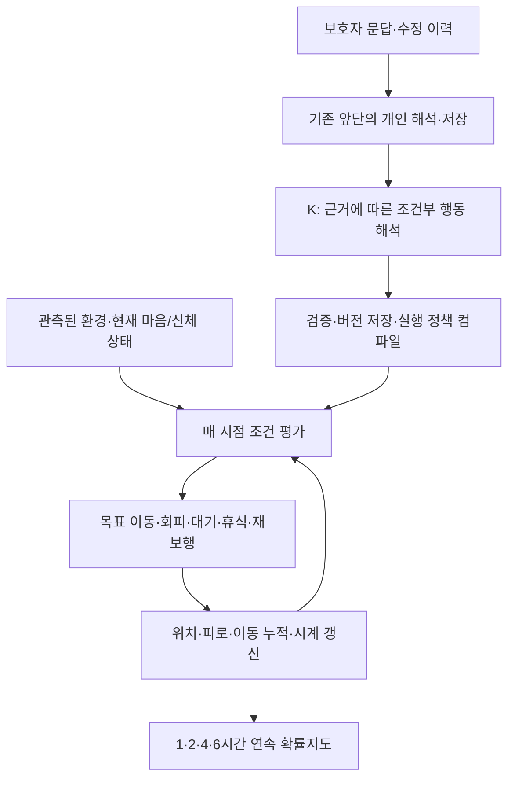

# 다음 개선 계획

## 권고

**K-EXAONE의 개인 의미 해석을 유지한 채, 의미가 실행 규칙으로 넘어가는 계약을 먼저 고친다. 그다음 새 표현과 새 인물로 검증하고, 실제 앞단에서 저장한 개인 해석까지 연결한다.** 지금은 Thinking 끔으로 교체하거나 LoRA 재학습부터 시작할 근거가 충분하지 않다.

이번 비교에서 Thinking 켬은 출력 실패가 많았고, 끔은 완성된 출력에서도 필요한 개인 행동을 많이 빠뜨렸다. 유효한 켬 응답만의 93.8%는 실패를 제외한 진단 수치다. 완료 문제를 고치면 전체가 그 성적이 된다고 가정하지 않는다.

## 1. 우선 고칠 문제

| 우선순위 | 확인한 문제 | 수정 방향 | 검증할 변화 |
|---|---|---|---|
| 1 | P14: 공원을 향한다는 해석이 `walk`와 장소 범위로 변함 | 목표 장소와 적용 장소 분리, `walk`·`seek` 정의 명시 | 공원 밖에서 목표가 지정되고 경로가 그 목표로 향하는가 |
| 2 | P05·P25: 휴식·대기를 요약하고 실행 규칙은 비움 | 관찰·신체적 필요의 근거 단위와 실행 규칙 연결 | 8분 OR 450m 휴식, 8~9시 대기가 실제 발동·해제되는가 |
| 3 | 미관찰·타인·정정·과거 정보 처리 오류 | 전체 문답의 주어·근거·시간 범위 보존 | 모르는 것을 관찰로 만들지 않고 정정된 본인 특성을 남기는가 |
| 4 | Thinking 켬 24/64 출력 실패 | 완성·JSON 경계·의미 검증을 각각 처리 | 완성률 상승과 개인 행동 보존이 함께 유지되는가 |
| 5 | 같은 원문의 반복 응답이 다름 | 성공 응답 선별 없이 반복 비교 | 프로필별 모든 장면을 반복해서 보존하는가 |

P05의 실패 응답은 같은 보행 조건에서 6시간 누적 약15.71km, 규칙 보존 응답은 약10.72km를 걸었다. 이는 휴식 누락의 실제 영향이다. 두 거리 중 하나가 임상적으로 맞다는 뜻이나 출발점 기준 반경이 아니다.

## 2. 바로 할 로컬 작업

신규 외부 호출 없이 다음을 준비한다.

1. 패키지의 저장 응답 512판정을 재현한다. 완료 실험 폴더와 점수는 그대로 둔다.
2. 실패를 `해석 오류 / 규칙 누락 / 목적지 결합 / 출력 미완료 / 출력 경계 / 엔진 소비`로 분류하고 원문·출력·규칙·보행 증거를 한 행에 연결한다.
3. P05·P14·P21·P25·P29와 부정·미관찰 반례로 계약 테스트를 만든다. 정답을 손으로 넣은 컴파일러 테스트는 모델 성능으로 세지 않는다.
4. 아래 두 후보의 프롬프트·스키마·소비 코드·실험 계획을 준비한다. 이 단계에서 `RELEASE_QUALIFIED`를 켜거나 운영 코드를 교체하지 않는다.

## 3. 비교할 두 후보

| 후보 | 바꾸는 부분 | 그대로 둘 부분 |
|---|---|---|
| A: 최소 계약 수정 | 행동별 의미, 목적지/적용 범위, 과거 관찰과 현재 의도 구분을 명시 | 현재 단일 K 호출·전체 원문·기존 조건식 컴파일러 |
| B: 근거 단위 해석 | K가 원문 전체를 읽고 의미 단위별 종류·행동·조건·근거를 출력, 코드는 이를 실행 정책으로 컴파일 | 동일 모델·Thinking 설정·초기 입력·지도·보행 엔진 |

두 후보 모두 우선 **프로필당 K 1회**로 설계한다. B는 LLM을 두 번 부른다는 뜻이 아니다. 전체 문맥을 가진 한 번의 의미 해석과 코드 컴파일을 분리한다. 한 문장에 여러 행동이 있으면 나누고, 여러 문답의 정정·대명사 연결은 보존한다. 피처별 독립 호출로 문맥을 끊지 않는다.

권장 의미 계약은 다음 구분을 갖는다. 실제 필드 이름은 기존 `Rule` 소비 코드를 읽은 뒤 확정한다.

| 의미 | 기존 소비부와의 연결 |
|---|---|
| 행동 | `Rule.action`: walk / seek / wait / rest / avoid |
| 목표 장소 | seek의 `goal_label`에만 연결 |
| 적용 장소 범위 | `place_labels`, 목표 장소와 별개 |
| 발동·유지·해제 조건 | 현재 사실을 매 시점 평가하는 `when`; 종료 조건이 거짓이 되면 해제 |
| 명시된 지속 시간 | 원문이 실제 휴식·대기 지속 시간을 말할 때만 `hold_minutes` |
| 관찰 반응·신체적 필요·능력·발언·타인·정정 | 근거 분류. 비행동 정보에서 행동을 만들지 않음 |
| 근거·미표현 정보 | 원문 ID와 원문 인용, 지원하지 못한 이유 보존 |

새 필드를 추가하면 저장·컴파일·엔진 소비·진단까지 연결한다. 엔진이 받지 않는 필드를 만들어 개선이라고 주장하지 않는다. 범위 밖 사실은 허용 목록에 억지로 끼워 넣지 않고 미표현으로 남긴다.

근거 ID가 모두 존재해도 의미가 맞는 것은 아니다. 관찰 반응을 `non_action`으로 오분류할 수 있으므로, ID 완전성과 의미 평가는 별도로 둔다. K의 자기 재검토를 사람 평가라고 부르지 않는다.

## 4. 출력 완료 문제를 따로 다루기

- `finish_reason=length`는 잘린 응답이다. 서버 대기 시간을 늘리는 것으로 해결됐다고 보지 않는다.
- `stop`이고 완전한 단일 JSON과 짧은 주변 문자만 있는 경우는 경계 처리 후보로 검증한다. 여러 객체·중복 키·잘림·스키마 오류·모르는 조건식은 거부한다. 기존 5건의 복구 가능 진단은 원래 성적에 합치지 않는다.
- 단어 파싱으로 빠진 휴식·목표·시간을 채우거나 정상처럼 빈 정책을 반환하지 않는다.
- Thinking 설정과 출력 길이를 바꾸는 후보는 별도 변경으로 기록한다. 지원 여부를 확인하지 않은 `reasoning_effort`·출력 제약 옵션을 가정하지 않는다.
- 실패 시 상태를 기록하고, 동일 보호자 revision에서 검증된 저장 정책만 재사용하는 복구안을 검토한다. 수정·삭제된 정보의 오래된 정책을 재사용하지 않는다. 정책이 없으면 개인화 미확정 상태를 명시하며 일반 prior를 개인 해석 성공으로 집계하지 않는다.

## 5. 데이터 확대와 실험 순서

증강 상세는 [별도 문서](데이터_증강_설계.md)에 있다. 아래 호출 수는 **새 제안**이며 실행하지 않았다.

| 단계 | 데이터·구성 | 신규 K 호출 상한 | 목적 |
|---|---|---:|---|
| 국소 비교 | 개발 8프로필 × A/B × 2응답 | 32 | 계약 수정 방향 선택. 최종 성능 근거 아님 |
| 확대 개발 | 기존 32원형에 원본 포함 4형태씩, 128입력 × 2응답, 선택 후보 1개 | 256 | 표현 변형·반사실·복합 조건 회귀 검사 |
| 별도 평가 | 새 원형 64개 × 4장면 × 2응답, 후보 1개 | 128 | 개발에 쓰지 않은 입력에서 확인. 512행동 판정 |
| 합계 | 각 단계 통과 시에만 다음 단계 | 416 | 실패·빈 응답 포함, 모델 자동 재시도 없음 |

두 후보의 최초 비교는 Thinking 켬으로 고정하는 것을 권고한다. 이는 우월성 확정이 아니라 기존 출력 완료 문제와 의미 손실을 함께 검사하기 위한 개발 선택이다. 둘 다 실패하면 통과 기준을 낮추거나 더 좋은 응답만 선택하지 말고 실패 종류에 따라 후보를 다시 설계한다. Thinking 켬/끔 추가 비교나 LLM 검토 단계를 추가하면 호출 상한을 다시 계산한다.

호출당 입력 최대40,000 UTF-8 바이트·출력12,000토큰·동시2회를 유지할 경우 위 제안의 생성 상한은4,992,000토큰이다. 실청구액·단가·지원 차수는 미확인이다. 새 RAG·Mi:dm·SAR·임베딩·지도·GPU 학습·배포는 이 호출안에 없다. 기존 실험의 미사용64회는 조건부 평가분이므로 새 개발 호출에 전용하지 않는다.

## 6. 언제 다음 단계로 넘어갈까

**이 문서의 새 기준은 제안이며, 실험 시작 전에 PLAN과 scorer에 고정한다.** 기존32명 비교의 231/256·군별26/32·반응76/84·완성61/64 기준은 수정하지 않는다.

새64원형 평가에는 다음을 권고한다.

- 전체512판정 중461개 이상(90% 이상).
- 8개 행동군 각각64판정 중52개 이상(80% 이상).
- 실제 반응을 요구하는 장면과 미관찰 장면 각각90% 이상. 해당 장면 수는 데이터 고정 시 확정하고 올림 계산한다.
- 유효한 완성 응답128개 중122개 이상(95% 이상).
- 모델 출력 실패도 전체 행동 실패에 포함. 반복 응답을 서로 바꿔 끼우지 않음.
- 치명적 회귀용 고정 사례에서 목적지/범위 뒤바뀜, 명시 휴식 필요 삭제, 미관찰→관찰 조작, 정정된 타인 행동 주입이 없어야 함. 전체 평균으로 숨기지 않음.

이는 합성 개인 행동 해석을 다음 통합 단계로 넘기는 내부 기준이다. 실서비스 동선 정확도나 임상 안전성을 보증하는 비율이 아니다. 한 프로필의 장면·반복·보행자는 서로 관련돼 있으므로 독립 환자 수로 세지 않는다.

## 7. 실제 앞단과 보행 엔진을 연결

현재 공간 검사는 공통 persona/prior를 사용했다. 통과 후보에서는 다음 전체 경로를 별도로 확인해야 한다.

이 도식은 **다음에 검증할 경로**다. 운영 연결 완료나 마음 상태의 임상적 타당성을 선언하는 그림이 아니다. SAR·RAG·초기 prior의 현행 역할은 코드로 확인해 보존하고, 이 비교만으로 삭제·대체하지 않는다.

통합 검사는 저장된 실제 앞단 산출물과 합성 원문을 연결해 먼저 수행한다. 새 온보딩 API를 부르지 않았다면 그 사실을 보고서에 표시한다. 일반 persona로 교체하여 앞단 문제를 숨기지 않는다.

- 같은 원문→동일 정책의 반복 보존, 한 특성만 바꾼 사람 A/B의 예상 행동 차이.
- 목표 지정과 적용 범위, OR/AND 한계, 대기 해제, 휴식 후 재보행, 도착과 인지 구분.
- 환경 조건의 유효 시간·공간, 미관측·충돌 시 불확실성. OSM 상가를 실시간 시끄러움으로 해석하지 않음.
- 같은 입자·시계·난수 상태로1/2/4/6시간 연결, 체크포인트 재개, 확률 질량 보존.
- KINTEX 6구역·2시드에서 대표 사례를 먼저 검사하고, 최종 후보에서는 사전 고른 최소16원형으로 확대. 조건별 근거와 엔진 이벤트를 연결해 검사하며 첫 입자만 본 결과를 전체 입자 성능으로 쓰지 않음.
- 계속 기다려야 하는 조건이면 동일 위치를 허용. 지도를 억지로 퍼뜨리지 않음. 누적 거리와 출발점 반경을 따로 보고.
- 사전 온보딩·정보 수정·미준비 긴급 신고·정책 생성 실패를 각각 확인. 그 결과를 합쳐 하나의 성능 숫자로 만들지 않음.

## 8. 재학습과 실제 사용 결정

새 계약에서도 반복적인 의미 오류가 남을 때 EXAONE 3.5 7.8B + LoRA 재학습을 비교 후보로 검토한다. API K-EXAONE을 바로 튜닝할 수 있다고 가정하지 않는다. 먼저 오류 유형별 수작업 검토 정답과 데이터 사용 권한을 확보한다. 실패한 K 응답을 그대로 학습 정답으로 쓰지 않는다.

논문·RAG는 행동 가설의 근거이며 개인의 실제 행동 정답이 아니다. 기존 Upstage RAG를 기본으로 보존하고, 추가 RAG 효과는 같은 후보·입력에서 별도로 비교한다. 위416회 계획은 신규 RAG 검색이나 학습을 포함하지 않는다.

통합 기준을 통과하면 관찰 가능한 시연/제한된 파일럿의 후보로 판단하고 운영 복구·지연·동시성·개인정보 처리를 따로 확인한다. 실제 치매 어르신을 대상으로 한 수색 지원의 유효성은 비식별 사례·돌봄 경험자/전문가의 독립 검토로 보완해야 한다. 현재 ZIP에는 그 평가가 없다.

다음 보고서는 “해석 보존 → 정책 완성 → 엔진 소비 → 개인 행동 → 운영 준비”를 별도 표로 작성한다. 모든 것을 막연히 ‘정확도’라고 합치지 않는다.
