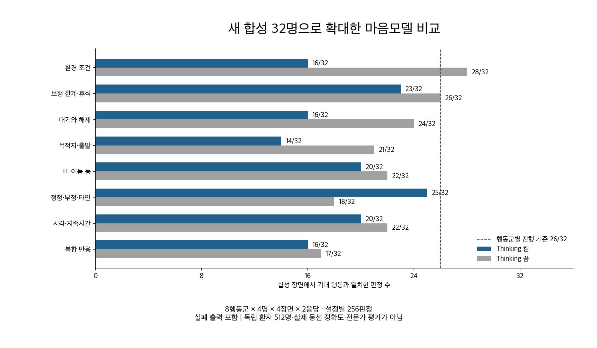
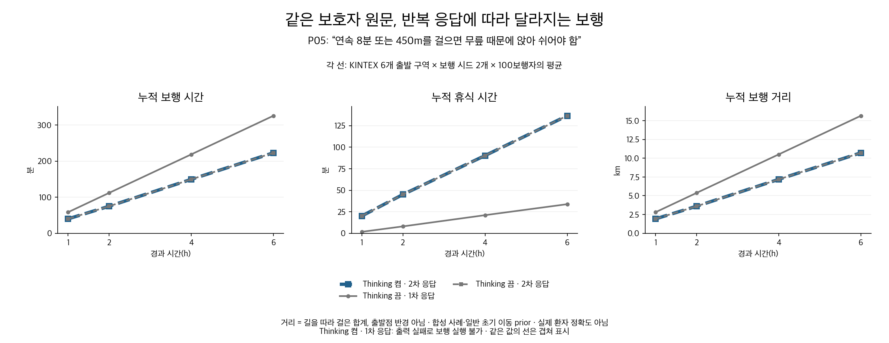

# 마음모델 확대 검증 결과 요약

**이번 후보는 배포 후보로 확정하지 않았다.** 새 합성 32명으로 비교를 넓히자 필요한 행동의 누락, 목적지 의미의 손실, 반복 응답의 차이, Thinking 출력 실패가 드러났다.

## 실행한 범위

- 새 합성 32명·8개 행동군·128개 장면. Thinking 켬/끔, 각각 2응답으로 K-EXAONE 총128회·행동 판정512건. P02 한 명은 저장된 환경 규칙 재사용 조건이므로 K의 신규 추출 성능과 구분.
- 기존 KINTEX OSMnx 지도 안의 중심·북서·북동·서·동·남 6구역. 사전에 고른 8명×2설정×2응답×6구역×2보행 시드=384칸.
- 각 공간 집단은100보행자, 1·2·4·6시간을 이어 계산. 실제 도로 위에 합성 시설·환경 관측을 사용.
- 후보·프롬프트·원문·기대 행동·채점 기준을 비교 도중 수정하지 않음. 실패 출력을 새 응답으로 대체하지 않음.

## 결과

| 검사 | Thinking 켬 | Thinking 끔 | 사전 기준 |
|---|---:|---:|---:|
| 전체 행동 일치 | 150/256 (58.6%) | 178/256 (69.5%) | 231/256 |
| 실제 반응이 필요한 장면 | 46/84 | 32/84 | 76/84 |
| 유효한 완성 응답 | 40/64 | 60/64 | 61/64 |
| 두 응답 모두 4장면을 맞힌 프로필 | 9/32 | 11/32 | 보조 집계 |
| 행동군별 최저 성적 | 14/32 | 17/32 | 모든 군 26/32 |
| 다음 별도 평가 진행 | 미통과 | 미통과 | 위 조건 모두 충족 |

이 비율은 합성 보호자 원문·장면의 기대 행동과 일치한 비율이다. 실제 환자 동선 정확도나 발견율이 아니다. 한 인물의 여러 장면과 반복 응답은 서로 연관돼 있다.

## 실제로 무엇이 달라졌나

P05의 동일한 원문 “8분 또는450m를 걸으면 무릎 때문에 휴식”에 Thinking 끔 첫 응답은 휴식 규칙을 누락하고, 두 번째는 제대로 만들었다. 중심 출발점·같은 시드17에서 첫 응답은 개인 휴식 규칙을 한 번도 적용하지 않았고, 두 번째는 해당 한계를 지켰다. 이것은 출력의 차이가 실제 보행에 연결되는지 확인한 사례다.

P14의 Thinking 켬 두 번째 응답은 요약에는 공원으로 향한다고 쓰고, 명령에는 목표를 지정하지 않는 `walk`와 공원이라는 적용 범위만 넣었다. 목표 장소와 행동 적용 장소의 의미가 바뀌었다. P25에서는 오전8~9시 대기를 요약하고도 실행 규칙을 비워 두었다.

한편 제대로 보존된 P29 응답은 가족이 없는 동안 대기하다가90분에 가족이 도착하면 대기를 해제하고, 이후 걷기·휴식을 연결했다. 6개 구역의 시간별 지도를 함께 저장했다. 성공 사례 한 개로 전체 결과를 대체하지 않았다.

[Thinking 켬의 시간별 지도](KINTEX_시간별_P29_Thinking_on.png) · [Thinking 끔의 시간별 지도](KINTEX_시간별_P29_Thinking_off.png)

## 보행 엔진 연결 결과

384칸 중 실제 실행 276개, 모델 출력 문제로 실행 불가 108개, 엔진 실행 오류 0개다. 실행 불가를 정상 사례로 메우지 않았다.

| 검사 | 결과 |
|---|---:|
| 확률 질량 보존 | 276/276 |
| 시간 합계 | 276/276 |
| 보행 시간·거리 일치 | 276/276 |
| 6시간 전체 계산 | 276/276 |
| 저장 후 재개 일치 | 23/23 |

개인 조건 점검까지 모두 통과한 칸은 아래와 같다. 각 칸은 같은 모델 응답을 다른 출발점·보행 시드로 재생한 결과다. 독립된 사람 수가 아니다. 출력 실패로 실행하지 못한 칸도 예정된24칸에서 빼지 않았다.

| 대표 인물·점검 | Thinking 켬 | Thinking 끔 |
|---|---:|---:|
| P01 · 상가 조건 회피 | 12/24 | 0/24 |
| P05 · 8분·450m 휴식 한계 | 12/24 | 12/24 |
| P09 · 가족 도착 시 대기 해제 | 12/24 | 0/24 |
| P14 · 공원을 목표로 이동 | 0/24 | 0/24 |
| P17 · 비가 그친 뒤 대기 해제 | 12/24 | 12/24 |
| P21 · 정정한 본인의 걷기 규칙 보존 | 12/24 | 0/24 |
| P25 · 오전9시 대기 종료 | 0/24 | 0/24 |
| P29 · 대기 해제 후 걷기·휴식 | 12/24 | 24/24 |

위 공학 검사를 통과해도 개인의 휴식·대기·목적지를 잘못 해석한 응답은 개인 행동 검증 실패로 남는다. `baseline`도 걷기를 만들 수 있으므로, 개인 걷기 규칙이 누락됐다는 사실을 실제로 정지했다는 뜻으로 보고하지 않는다.

## 이번 결과로 결정한 사항

1. 두 설정 모두 사전 기준에 미달했다. 통과 후보용으로 남겨 둔 별도64호출은 실행하지 않았다. 배포나 운영 설정 변경도 하지 않았다.
2. Thinking을 끄는 것만으로 해결되지 않는다. 빠르고 완성된 출력에서도 개인 반응이 빠졌다. 켬의 의미 해석과 출력 완료 문제를 분리해서 개선해야 한다.
3. 다음 수정의 우선순위는 관찰 근거와 행동 규칙의 누락 검사, 목적지와 적용 장소의 명확한 구분, 완전한 최종 JSON 확보다. 단어 매핑으로 누락 행동을 자동 생성하지 않는다.
4. 수정 후보는 이번 자료를 개발 자료로 삼되, 아직 실행하지 않은 별도 평가와 추가 표현으로 확인해야 한다. 이번 결과를 보고 바꾼 후보를 이번 점수의 개선만으로 확정하지 않는다.

Thinking 켬의 미완료 출력은 15개다. 단순히 더 기다리면 끝나는 서버 대기 문제와 구별해야 한다. 완성 JSON의 짧은 주변 문자만 제거 가능한 사례는 5개였으며, 별도 사후 진단으로만 남겼다. 원래 점수에는 합치지 않았다.

Thinking 켬에서 유효한40응답만 따로 보면150/160장면(93.8%)이 맞았다. 그러나 실패한24응답을 제외한 진단 수치이며 전체 성능으로 사용할 수 없다. 응답을 완성하지 못한 사례도 어렵거나 다른 특성을 가진 사례일 수 있으므로, 완료 문제를 해결하면 이 비율이 그대로 유지된다고 단정하지 않는다.

## 사용량·재현

K-EXAONE128회. 입력 218,096토큰, 생성 383,341토큰, 합계 601,437토큰. 단가·실청구액·지원 차수는 미확인. 실패도 원장에 포함했고, 원격·로컬256개 시작/종료 이벤트를 대조했다.

- [전체 결과·원문·실제 응답](확대비교_결과보고서.md)
- [오류의 구체적 원인과 수정 후보](오류원인_수정후보.md)
- [사전 실험 계획](PLAN.md)
- `verification_summary.json`: 저장된512판정 재계산과 원래 집계의 일치.
- `spatial_behavior_audit.json`: 미리 지정한 대표 보행자에서 회피·목적지의 공간 효과를 추가 진단.
- `usage_summary.json`, `ledger_reconciliation.json`: 사용량과 원장 대조.

공간 검사는 일반 치매 persona·공통 초기 이동 prior를 사용해 마음 규칙의 영향을 분리했다. 새 온보딩 전체를 재호출한 결과, 실제 환자 경로, 독립 돌봄 경험자·전문가 평가를 포함하지 않는다.
