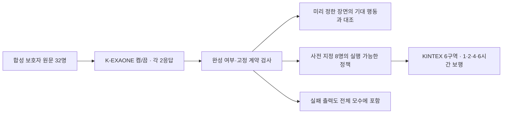

# K-EXAONE 마음모델 확대 비교

**최종 비교 결과: 모델 응답 128/128, 공간 검사 384/384칸.**

## 왜 이번 실험을 했나

직전 8장면×2응답의 작은 비교만으로, 새 보호자 표현과 여러 환경에서도 그 사람의 행동을 보존한다고 판단하기 어려웠다. 최신 후보를 고정하고 새 합성 32명·8개 행동군으로 늘려 Thinking 켬/끔을 같은 조건에서 비교했다. 공간은 기존 고양 KINTEX OSMnx 지도 안의 6개 출발 구역을 사용했다.

## 무엇을 검증했나

보호자의 원문을 K-EXAONE이 조건과 행동으로 해석하고, 코드가 현재 관측과 대조해 행동을 선택하는 부분이다. 시뮬레이션 단계에서는 선택된 행동이 실제 도로 보행·대기·휴식으로 이어지는지 따로 검사한다. 전체 온보딩 파이프라인을 새로 호출하거나 실제 실종 위치 정답과 비교한 실험은 아니다.



32명×4장면×2응답=설정별 256판정이다. Thinking 켬/끔을 합하면 512판정이며, 서로 다른 환자 512명을 검증했다는 뜻은 아니다. 모든 사례와 기대 행동은 연구자가 작성한 합성 자료다. P02 한 명은 미리 작성한 환경 규칙을 기존 컴파일러로 재사용하는 조건이다. 이 사람의 결과를 K가 원문에서 새로 추출한 성능으로 해석하지 않는다.

`baseline`은 개인 반응을 확정하지 않고 기존 이동 prior에 맡긴다는 뜻이다. 멈춤을 뜻하지 않는다. 따라서 보호자가 관찰한 `walk`를 누락하고 baseline으로 남긴 경우는 이 검사에서 근거 보존 실패지만, 실제 보행자가 걷지 않았다는 뜻은 아니다. `unknown`은 가능한 행동이 둘 이상이며, 그 가능 행동까지 맞아야 통과한다. 실제 보행 결과는 공간 검사와 함께 읽어야 한다.

## 개인 행동 해석 결과

| 항목 | Thinking 켬 | Thinking 끔 |
|---|---:|---:|
| 응답 계약 통과 / 완료 응답 | 40/64 | 60/64 |
| 행동 일치 / 완료 판정 | 150/256 | 178/256 |
| 실제 행동을 요구한 장면 일치 | 46/84 | 32/84 |

전체 231/256, 행동군별 26/32, 실제 반응 장면 76/84, 유효 응답 61/64를 모두 충족해야 다음 별도 평가로 넘어간다. 실행 전에 정한 내부 단계 기준이며 임상 배포 기준은 아니다. 실패 출력도 행동 판정의 실패에 포함한다.

| 행동군 | Thinking 켬 | Thinking 끔 |
|---|---:|---:|
| 환경의 복합 조건 | 16/32 | 28/32 |
| 보행 한계·휴식 | 23/32 | 26/32 |
| 기다림과 해제 | 16/32 | 24/32 |
| 목적지 발언·실제 출발 | 14/32 | 21/32 |
| 비·어둠 등 외부 상태 | 20/32 | 22/32 |
| 정정·타인·부정 답변 | 25/32 | 18/32 |
| 시각·보행 시간 | 20/32 | 22/32 |
| 서로 다른 행동의 결합 | 16/32 | 17/32 |

## 실제 출력과 예상 행동

아래는 사전에 고정한 인물의 첫 번째 응답이다. 공개 최종 출력만 사용하며 내부 Thinking 원문은 포함하지 않는다. 원문·모델 해석·장면별 결과를 함께 보아, JSON 형식 성공을 의미 해석 성공으로 오해하지 않도록 했다.

### P05 · 보행 한계·휴식

> 질문: 보행 후 쉬어야 하나요?
> 답변: 연속 팔 분 정도 걷거나 사백오십 미터쯤 가면 무릎 때문에 앉아 쉬어야 해요. 둘 다 채워야 하는 건 아니고 먼저 힘든 쪽에서 쉬어요.

Thinking 켬:
출력 실패: `output_incomplete_length`

Thinking 끔:
```json
{
  "source_assessment": "보행 능력과 보행 후 휴식 필요성, 목적지 발언과 실제 출발, 관찰과 미관찰, 본인과 타인의 행동 구별이 명시됨. 보호자 원문은 직접 관찰한 사실에 기반하며, AI 추출 요약은 미검증 상태임.",
  "rules": [],
  "non_action_note_ids": [
    "N0",
    "N1"
  ]
}
```

| 장면 | 기대 행동 | 선택 행동 | 일치 |
|---|---|---|---|
| 시간 한계 | rest | baseline | 불일치 |
| 거리 한계 | rest | baseline | 불일치 |
| 두 한계 전 | baseline | baseline | 일치 |
| 이미 휴식 중 | baseline | baseline | 일치 |

### P09 · 기다림과 해제

> 질문: 길을 놓친 걸 알았을 때 실제로는요?
> 답변: 길을 잃었다고 알아차린 두 번에는 가족이 곁에 없으면 그 자리에서 기다렸어요. 가족이 오자 대기는 끝났고 그 이후 어디로 갔는지는 기억나지 않아요.

Thinking 켬:
```json
{
  "source_assessment": "Guardian reports waiting in place when lost_awareness is true and family_present is false.",
  "rules": [
    {
      "command": "wait",
      "condition": "lost_awareness and not family_present",
      "place_labels": [],
      "hold_minutes": 0,
      "note_ids": [
        "N1"
      ]
    }
  ],
  "non_action_note_ids": [
    "N0"
  ]
}
```

| 장면 | 기대 행동 | 선택 행동 | 일치 |
|---|---|---|---|
| 발동 | wait | wait | 일치 |
| 가족 도착 | baseline | baseline | 일치 |
| 부재만으로 발동 안 함 | baseline | baseline | 일치 |
| 가족 여부 미확인 | 미확정: baseline, wait | 미확정: baseline, wait | 일치 |

Thinking 끔:
```json
{
  "source_assessment": "보호자는 등록 장소가 실제 방문이나 선호를 의미하지 않으며, 길을 잃었을 때 가족이 없으면 대기하고, 가족 도착 후 이동 경로는 기억하지 못한다고 진술함.",
  "rules": [],
  "non_action_note_ids": [
    "N0",
    "N1"
  ]
}
```

| 장면 | 기대 행동 | 선택 행동 | 일치 |
|---|---|---|---|
| 발동 | wait | baseline | 불일치 |
| 가족 도착 | baseline | baseline | 일치 |
| 부재만으로 발동 안 함 | baseline | baseline | 일치 |
| 가족 여부 미확인 | 미확정: baseline, wait | baseline | 불일치 |

### P14 · 목적지 발언·실제 출발

> 질문: 익숙한 공원을 알아보면 어떻게 행동했나요?
> 답변: 느티공원 입구를 알아봤다고 직접 말한 두 번 모두 그쪽으로 걸어 출발했어요. 입구를 알아보지 못했을 때의 행동은 아직 본 적 없어요.

Thinking 켬:
출력 실패: `output_incomplete_length`

Thinking 끔:
```json
{
  "source_assessment": "보호자는 등록 장소가 특정 장소(느티공원, 해든상가, 솔빛쉼터)를 의미한다고 설명했으며, 실제로 그 장소를 방문하거나 선호한다는 의미는 아님을 명확히 했다. 또한, 느티공원 입구를 인식했을 때 실제로 그쪽으로 걸어 출발한 행동을 관찰했고, 입구를 인식하지 못했을 때의 행동은 아직 관찰되지 않았다.",
  "rules": [],
  "non_action_note_ids": [
    "N0",
    "N1"
  ]
}
```

| 장면 | 기대 행동 | 선택 행동 | 일치 |
|---|---|---|---|
| 실제 출발 | seek_0 | baseline | 불일치 |
| 인지 안 됨 | baseline | baseline | 일치 |
| 물리적 도착과 인지 구분 | baseline | baseline | 일치 |
| 인지 미확인 | 미확정: baseline, seek_0 | baseline | 불일치 |

### P25 · 시각·보행 시간

> 질문: 아침과 낮에 다른 반응을 봤나요?
> 답변: 가족이 곁에 없을 때 오전 여덟 시부터 아홉 시 전까지는 현관에서 기다렸어요. 아홉 시가 되면 그 기다림은 끝났어요. 그 다음 행동은 기록하지 못했어요.

Thinking 켬:
출력 실패: `output_incomplete_length`

Thinking 끔:
```json
{
  "source_assessment": "보호자 원문에 따르면, 등록 장소(느티공원, 해든상가, 솔빛쉼터)는 실제 방문이나 선호를 의미하지 않으며, 단지 후보 이름일 뿐이다. 또한 오전 8시부터 9시 사이에 가족이 곁에 없을 경우 현관에서 기다리다가 9시가 되면 그 기다림이 끝난다. 이후 행동은 기록되지 않았다.",
  "rules": [],
  "non_action_note_ids": [
    "N0",
    "N1"
  ]
}
```

| 장면 | 기대 행동 | 선택 행동 | 일치 |
|---|---|---|---|
| 시작 경계 | wait | baseline | 불일치 |
| 가족 있음 | baseline | baseline | 일치 |
| 종료 경계 | baseline | baseline | 일치 |
| 시작 전 | baseline | baseline | 일치 |

### P29 · 서로 다른 행동의 결합

> 질문: 보행 후 휴식은요?
> 답변: 무릎 때문에 육 분 걷거나 이백팔십 미터 가면 먼저 도달한 쪽에서 쉬어야 해요.

> 질문: 길을 잃은 걸 알면 어떻게 하나요?
> 답변: 두 번 모두 길을 잃었다는 걸 알고 가족이 없으면 그 자리에서 기다렸어요. 가족이 오면 기다림은 끝났어요.

Thinking 켬:
```json
{
  "source_assessment": "Registration places 느티공원, 해든상가, 솔빛쉼터 listed without intention to visit. Rest required after 6 minutes or 280 meters of walking. Wait when lost awareness and no family present.",
  "rules": [
    {
      "command": "rest",
      "condition": "is_walking and (continuous_walk_minutes >=6 or distance_since_rest_m >=280)",
      "place_labels": [],
      "hold_minutes": 0,
      "note_ids": [
        "N1"
      ]
    },
    {
      "command": "wait",
      "condition": "lost_awareness and not family_present",
      "place_labels": [],
      "hold_minutes": 0,
      "note_ids": [
        "N2"
      ]
    }
  ],
  "non_action_note_ids": [
    "N0"
  ]
}
```

| 장면 | 기대 행동 | 선택 행동 | 일치 |
|---|---|---|---|
| 휴식 시간 | rest | rest | 일치 |
| 휴식 거리 | rest | rest | 일치 |
| 별개 기다림 | wait | wait | 일치 |
| 가족 도착 | baseline | baseline | 일치 |

Thinking 끔:
```json
{
  "source_assessment": "보호자는 등록 장소가 실제 방문을 의미하지 않으며, 보행 후 휴식은 무릎 통증으로 인해 6분 또는 280미터 걷고 도달한 지점에서 쉬어야 하며, 길을 잃었을 때는 가족이 없으면 그 자리에서 기다린다고 진술함.",
  "rules": [
    {
      "command": "rest",
      "condition": "is_walking and (continuous_walk_minutes >= 6 or distance_since_rest_m >= 280)",
      "place_labels": [],
      "hold_minutes": 0,
      "note_ids": [
        "N1"
      ]
    },
    {
      "command": "wait",
      "condition": "lost_awareness and not family_present",
      "place_labels": [],
      "hold_minutes": 0,
      "note_ids": [
        "N2"
      ]
    }
  ],
  "non_action_note_ids": [
    "N0"
  ]
}
```

| 장면 | 기대 행동 | 선택 행동 | 일치 |
|---|---|---|---|
| 휴식 시간 | rest | rest | 일치 |
| 휴식 거리 | rest | rest | 일치 |
| 별개 기다림 | wait | wait | 일치 |
| 가족 도착 | baseline | baseline | 일치 |

## KINTEX에서 행동이 보행으로 이어졌나

환경·휴식·대기·목적지·비·원문 정정·시각·복합 반응의 8명, 설정 2개, 응답 2개, 출발 구역 6개, 보행 시드 2개로 384칸을 고정했다. 각 집단은 100보행자이며 1·2·4·6시간을 끊지 않고 이어 계산한다. 형식 오류는 실행 불가로 남기고, 의미 오류가 있는 유효 정책도 그대로 진단한다.

도로는 실제 KINTEX OSMnx 캐시다. 시설 위치, 소음·혼잡·비·가족 도착은 명시적인 합성 관측이다. 일반 치매 persona와 같은 초기 이동 prior를 쓰므로, 새 온보딩 해석까지 포함한 전체 파이프라인 성능을 뜻하지 않는다.

| 공학 검사 | 통과 / 실시 |
|---|---:|
| 확률 질량 보존 | 276/276 |
| 보행·휴식·대기 시간 합계 | 276/276 |
| 보행 시간과 누적 거리 | 276/276 |
| 6시간 내 지도 범위·막힘 없이 계산 | 276/276 |
| 저장 후 재개와 연속 실행 일치 | 23/23 |

지도 색이 시간마다 달라지는 것만으로 성공 판정하지 않는다. 계속 기다리는 조건이면 같은 위치가 정상일 수 있다. 반대로 조건이 풀렸는데 계속 멈추거나 원문에 없는 이동을 만들면 문제다.

## 사용량과 재현 자료

K-EXAONE 시작 128회, 완료 128회. 제공된 usage의 토큰 합계 601,437. 단가·실청구액·지원 차수는 미확인이다. 새 SAR·Mi:dm·RAG·임베딩·지도·GPU 학습 호출은 없다.

- `profiles.json`: 새 합성 32명과 원문.
- `scenes.json`: 고정된 128장면과 기대 행동. 모델에 전달하지 않음.
- `comparison/`: 각 요청·공개 최종 출력·실행 정책.
- `replayed_results.json`: 실패를 포함한 전체 재현 판정.
- `spatial_plan.json`, `sites.json`, `spatial/`: 고정 관측·지도 출발점·시간별 경로와 점검 결과.
- `usage_summary.json`: 비용 원장 집계.

## 결과 해석의 한계

이번 결과는 주어진 개인 원문과 합성 관측에서 기대한 행동을 보존했는지에 관한 근거다. 실제 치매 어르신의 이동·심리를 맞혔다는 비율, 발견율, 실제 수색 안전성을 입증하는 수치가 아니다. 독립 전문가 채점과 실제 비식별 사례의 검증은 이번 자료에 없다.
