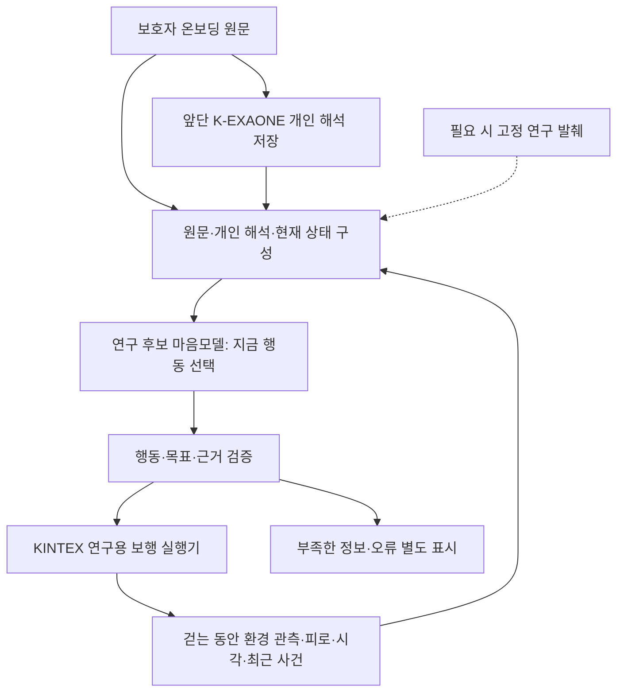
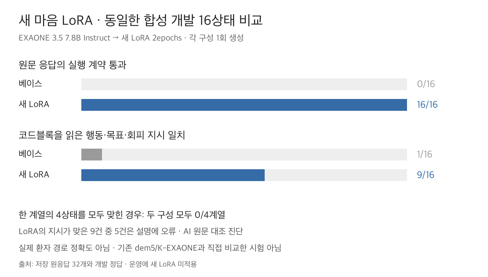
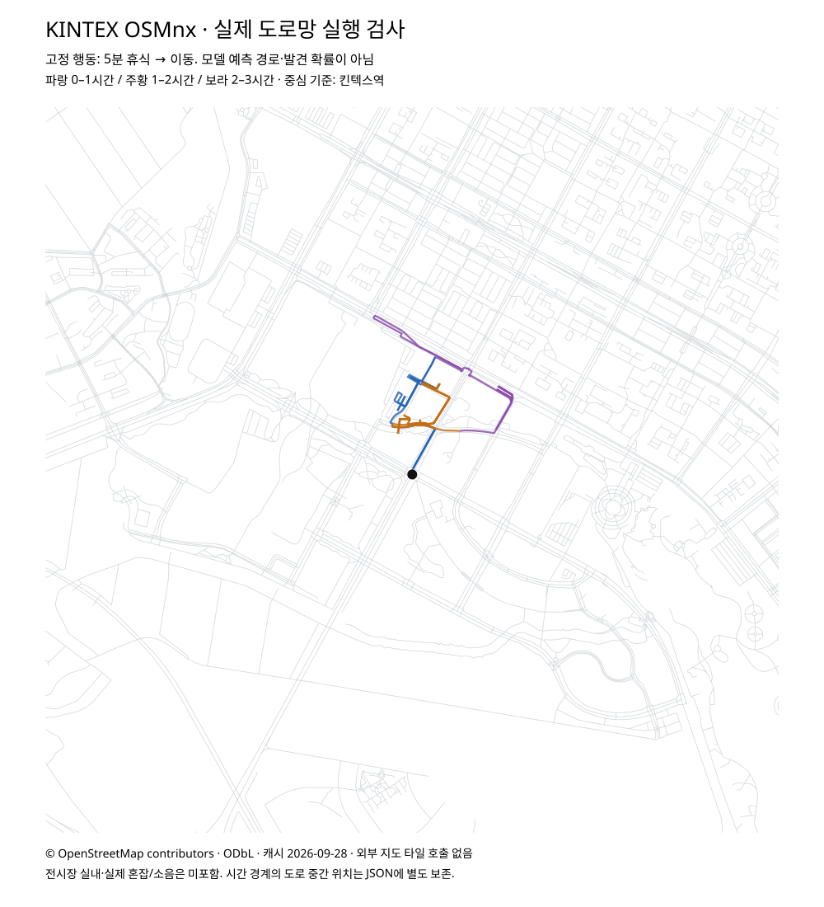

# 돌아오길 마음모델 고도화와 첫 LoRA 재학습

2026-09-28 · 연구 후보 및 실험 기록 · 운영 교체 없음

**목표는 ‘그럴듯한 속마음’이 아니라, 온보딩된 그 사람의 특성이 현재 환경·피로·시간·이력에 따라 실제 행동으로 이어지는 것이다.** 기존 모델의 설명과 실행 값이 충돌하는 문제를 확인해 입력·출력 계약과 연구용 보행 실행기를 보완했고, K-EXAONE 후보와 새 EXAONE 마음 LoRA를 실험했다. 일부 개인 조건은 더 잘 반영했지만 **현재 후보는 운영 도입 기준에 미달한다.**

먼저 [실제 입력과 출력 예시](EXAMPLES.md)를 보면 어떤 문제를 해결하려는지 이해할 수 있다. [LoRA 상세 결과](LORA_RESULTS.md), [호출 예산·시간 갱신 점검](BUDGET_AND_TIME.md), [다음 단계](NEXT.md)를 함께 제공한다.

## 앞단과 이번 마음모델의 구분



위 그림은 연구 후보의 역할 분담이다. 제품 전체가 이 구조로 교체됐다는 뜻은 아니다. 앞단의 개인 해석을 현재 상황에 적용하는 **뒷단 마음모델**을 다룬다. 이번 LoRA는 공개 가중치 모델인 **LG AI Research EXAONE 3.5 7.8B Instruct**에 새 어댑터를 학습한 것이다. K-EXAONE API 가중치를 튜닝한 것이 아니며, SAR 초기 이동 성향 모델도 재학습하지 않았다.

## 왜 시작했는가

기존 `exaone-mind-dem5`에 ‘오래 걸으면 앉아 쉬고, 길을 잃으면 기다리는 사람’을 입력했다. 한 응답은 ‘다리가 아파 앉고 싶다’고 설명하면서 실행할 행동에는 ‘계속 배회’를 출력했다. 코드가 소비하는 것은 행동 값이므로, 자연스러운 설명만으로 개인 표현에 성공했다고 볼 수 없었다.

또한 기존 호출 풀은 같은 사람·같은 예측 안에서 응답을 재사용하지만, 구체적인 피로·휴식 이력·환경이 같다는 것을 보장하지 않는다. 코드 기본 예산은 예측 전체5회이고 보행자별 마음 전환 최대2회와는 다른 값이다.3회나5회가 적절한지는 새 모델·재사용 정책으로 별도 검증해야 한다.

## 진행한 실험과 판단

각 행의 입력·계약·표본이 다르다. 아래 숫자를 같은 시험의 점수나 모델 순위로 비교하지 않는다.

| 단계 | 실행 범위 | 확인한 내용 | 판단 |
|---|---|---|---|
| 기존 마음모델 진단 | 3합성 인물×6상황×2반복=36회 | 형식36/36이나 휴식 설명과 배회 행동의 충돌 | 기존 실패를 재현한 기준선 |
| 새 계약·출력 제약 점검 | 최초3회에서 중단, 수정4회 시간초과, 재수정4회 | 마지막4회는 형식4/4·행동1/4 | 응답 복구와 의미 개선은 별개 |
| K-EXAONE c1~c5 개선 | K74·기존 마음 LoRA6 시도; c5 평가24상태×2반복 | c5 형식48/48·행동/목표/회피35/48; 추가 환경 서술 오류3건 | 도입 기준 미달 |
| KINTEX 실행 연결 | 저장된 c1 응답7개 및 고정 행동의1~3시간 재생 | 휴식·대기·이동·목적지 보존과 시간 누적 코드 점검 | 모델을 계속 호출한 통합 성능 검증 아님 |
| 새 마음 LoRA | 합성72개·2epochs; 동일 개발16상태의 학습 전후32회 | 원문 계약0→16/16, 읽을 수 있는 행동 지시1→9/16 | 일부 개선, 설명 오류와 회피 실패 지속 |

계획에만 남은 K 후속84회는 실행하지 않았다. 원래 LoRA 데이터 확장 계획320/48/96도 완료된 것으로 세지 않는다.

## 코드에서 보완한 내용

- `../mind_upgrade/`: 원문·저장된 개인 해석 전달, 환경의 true/false/unknown 구분, 일시 휴식과 대기 분리, 위치·피로·시간·목표·이력 유지, 회피 시 목적지 방향과 환경 회피 방향의 충돌 보완.
- `../mind_grounded/`: 출처·인용·행동의 입력/출력 계약, 경과 시간 표현, 문맥이 완전히 같을 때만 쓰는 연구용 캐시. 예산 소진 시 근거 없는 응답을 성공처럼 반환하지 않음.
- `lora/`: 합성 데이터104개(학습72·개발16·평가16), 실제 tokenizer의 답변 경계 수정, 정답 잘림·전부 마스킹 거부, EXAONE 실제 층 이름224모듈 적용 확인, 학습·비용 기록 코드.

이 코드는 모두 실험 영역이다. 제품 `app/` 경로의 변경은 없다. 연구용 실행기가 기존 prior·최대 반경·확률지도·알림 흐름을 전부 대체하는 것도 아니다. 피로 회복량·휴식 시간·회피 가중치는 엔진 가정이며 임상적으로 보정된 값이라고 쓰지 않는다.

## LoRA 결과의 읽는 법



베이스의 응답에는 코드블록과 추가 설명이 있어 원문 계약 검사는0/16이었다. 그러나 이를 행동을 전혀 이해하지 못한 것으로 세면 안 된다. 첫 JSON 블록을 읽어 행동·목표·회피 지시만 별도로 비교한 결과가1/16→9/16이다. 같은 목적지로 다시 이동하는 등 넓게 보면 의도가 유사한 베이스 사례도 있어 엄격한 지시 일치와 구분했다.

LoRA의 맞은9건 중5건은 공개 설명에 오류가 있었다. 예를 들어 소음을 관측하지 않았는데 ‘공원 소음이 없다’고 서술하거나, 가족 동행 때문에 이동해야 하는 상황을 ‘혼잡이 없어서’라고 설명했다. 같은 계열의4상태를 전부 맞힌 것은0/4였다. **형식16/16은 개인 재현 정확도100%가 아니다.**

## 실제 도로망에서 확인한 것



도로망은 OSMnx로 받은 KINTEX 주변 캐시로 노드3,260개·방향 간선9,978개다. 기준점은 킨텍스역이며 부스 입구가 아니다. 그림은 ‘5분 휴식 후 이동’을 고정 공급한 실행 검사다. 파랑·주황·보라가 각각0~1·1~2·2~3시간을 나타낸다. **학습한 LoRA의 예측 경로나 실제 실종자 경로가 아니다.** 실제 소음·혼잡·전시장 실내는 포함하지 않는다. © OpenStreetMap contributors, ODbL.

## 학습 자료와 근거

[출처 카드7개](lora/sources.json)에 실제 본문 확인과 초록만 확인한 자료를 구분했다. 기존 DEM24도 포함돼 있어 신규 논문7편이라는 뜻이 아니다. 연구는 소음에 대한 개인차, 보호자 지시와 실제 행동의 차이, 야외 길찾기, 시간 변화 등의 사례 설계 배경으로 사용했다.

개별 정답은 AI가 합성 보호자 조건과 상태를 읽어 작성한 것이다. 논문이104명 환자의 정답 행동을 제공했다는 뜻은 아니다. [돌봄 경험자 검토용12사례](lora/돌봄경험자_검토용_12사례.md)를 준비했지만 실제 섭외·검수는 미완료다. 기존 Upstage RAG 인덱스·검색기를 재구축하지 않았고, 이 실험은 RAG의 독립 효과를 검증하지 않는다.

## 자원 기록과 운영 상태

- 기존 dem5 진단36회: 입력20,226·출력2,323토큰.
- K 개선 묶음: K74시도 중 사용량 확인72응답, 입력132,440·출력68,656토큰. 함께 실행한 자가호스팅6시도 중3응답의 사용량 확인. 실패·시간초과도 시도에 포함.
- 새 LoRA: 학습1회·개발 생성32회. 입력40,246·출력8,283토큰. 전체 프로세스364.84초, Trainer 학습·평가·저장82.38초.
- 단가·실청구액·GPU 청구 시간·지원 차수는 미확인. 토큰을 GPU 요금에 중복 합산하지 않으며 위 경과 시간을 청구 시간으로 쓰지 않는다.
- 학습 때 기존 EXAONE을 약7분5초 중단하고 원래 모델 목록까지 복구했다. Mi:dm Mini는 유지했다. 새 LoRA를 운영에 연결하지 않았다.

PR에는 검토에 필요한 집계·원응답을 포함하고 인증 정보, 호스트별 실행/복구 스크립트, 전체 모델 가중치는 포함하지 않는다. 원본 비용 원장과 서버 복구 기록은 별도 아카이브에 보존한다. [출처·파일 해시](SOURCE_MANIFEST.json)로 포함 범위를 확인할 수 있다.

## 오프라인 재현

저장소 루트:

```sh
python3 -m unittest discover -s backend/experiments/mind_retraining_20260928/lora -p 'test_*.py' -v
python3 backend/experiments/mind_retraining_20260928/lora/audit.py backend/experiments/mind_retraining_20260928/lora/dataset_v2
python3 backend/experiments/mind_retraining_20260928/verify_evidence.py
```

프로젝트 backend 가상환경에서:

```sh
cd backend
python -m pytest -q tests/test_mind_upgrade.py tests/test_mind_upgrade_contract_v2.py tests/test_mind_upgrade_contract_v3.py tests/test_mind_grounded_contract.py tests/test_mind_grounded_cache.py tests/test_mind_context_view.py
```

이번 PR 준비에서 연구 코드 테스트43개·LoRA 전처리 테스트13개를 재실행했다. 위 명령은 모델/API/GPU 호출이나 지도 다운로드를 하지 않는다. 테스트 통과는 의미 정확도나 배포 적합성 통과가 아니다. 실제 학습을 다시 실행하려면 별도 승인된 스펙·로컬 모델·GPU가 필요하며 운영 중단 스크립트는 제공하지 않는다.
