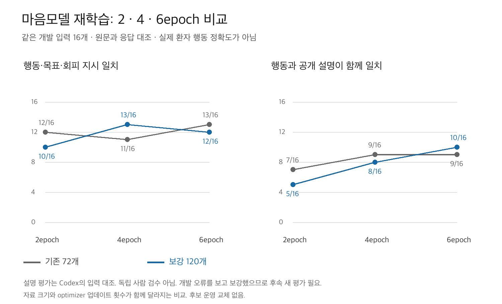

# 마음모델 재학습 2차 결과

2026-09-29 · A100 80GB · 신규 학습 2회 · 개발 응답 96개 · 운영 후보 배포 없음

## 무엇을 확인했는가

온보딩된 특정 치매 어르신의 특성을 현재 환경·피로·시각·이력에 맞게 적용하는 마음모델을 재학습했다. 기존 72개로 학습을 늘리는 경우와 합성 대비 사례 48개를 보강한 120개로 학습하는 경우를 나눠 2·4·6epoch 응답을 비교했다. 형식 준수, 행동 지시 일치, 공개 설명의 근거 일치를 따로 판정했다.

## 결과

| 학습 자료 | epoch | 형식 | 행동·목표·회피 일치 | 행동과 설명 모두 일치 | 설명의 명확한 모순 | 설명 부족·불명료 |
|---|---:|---:|---:|---:|---:|---:|
| 기존 72개 | 2 | 16/16 | 12/16 | 7/16 | 5 | 4 |
| 기존 72개 | 4 | 16/16 | 11/16 | 9/16 | 7 | 0 |
| 기존 72개 | 6 | 16/16 | 13/16 | 9/16 | 5 | 2 |
| 보강 120개 | 2 | 16/16 | 10/16 | 5/16 | 9 | 2 |
| 보강 120개 | 4 | 16/16 | 13/16 | 8/16 | 6 | 2 |
| 보강 120개 | 6 | 16/16 | 12/16 | 10/16 | 4 | 2 |



행동 일치는 status·action·goal_operation·goal_label·avoid_feature가 모두 맞는 엄격한 기준이다. 설명 평가는 Codex가 원문과 현재 상태를 대조한 비맹검 검토이며 독립 사람 평가가 아니다. 명확한 모순과 설명 부족을 구분해 기록했고, 둘 다 종합 성공으로 세지 않았다. 실제 환자의 이동 경로 정확도나 발견율을 측정한 수치가 아니다.

## 현재 판정과 다음 개선 지점

**부분 개선은 있었지만, 이번 후보로 운영 마음모델을 교체할 근거는 확보하지 못했다.** 모든 후보가 형식은 16/16을 통과했으나 개인 조건·현재 관측·행동·설명을 함께 맞히는 개발 기준은 통과하지 못했다.

- 기존 72개에서 행동 일치는 12→11→13/16으로 변했다. 학습을 더 한다고 단조롭게 좋아지지 않았다.
- 보강 120개는 10→13→12/16이었다. 보강 6epoch의 행동·설명 종합 일치는 10/16으로 이번 비교에서 가장 많았으나, 기존 군의 최대 9/16과 한 사례 차이인 개발 결과로 우월성이나 안정성을 입증할 수 없다.
- 보강 6epoch에서 D01-2의 공원 소음 회피를 처음 맞혔다. 다만 D02-3의 낮 목적 미확인, D02-4의 일몰 미확인을 다시 확정 행동으로 바꾸는 퇴행도 있었다.
- D04-1은 모든 후보에서 실행 행동을 틀렸다. 마지막 후보는 “확인된 소음과 혼자라는 조건으로 돌아갑니다”라고 설명하면서 `action=continue`를 출력했다. 일부 개인 조건을 언어로 읽는 것과 실행 행동을 일치시키는 것이 아직 분리돼 있다.

다음 개선에서는 epoch만 추가하기보다 **복합 조건의 우선순위·예외, true/false/unknown 대비, 공개 근거와 행동의 일치**를 함께 학습시키는 설계가 필요하다. 이번 추가 48개는 관측 구분과 단일 조건 사례가 중심이었으며, 보강만으로 핵심 복합 오류를 해결하지 못했다. 이것이 실패 원인의 전부라는 인과적 결론은 아니다.

후속 후보는 같은 개인에서 관측 하나만 바꾸고 나머지를 고정한 사례로 검증해야 한다. 짧은 근거를 먼저 선택한 뒤 행동을 출력하는 순서, 그리고 설명은 회피인데 행동은 지속 이동인 불일치 사례를 대조 학습하는 방안은 다음 실험 가설이다. 아직 구현·실행하지 않았고 개선 효과도 입증하지 않았다. 개인 원문을 단어별 행동 규칙으로 대체하는 방향은 아니다.

## 실제 응답 비교

### D01-1 · 높은 피로일 때 소음 회피보다 휴식이 우선

| 자료·epoch | 행동 | 실제 공개 설명 |
|---|---|---|
| original72 · 2 | rest | 소음이 있어 공원 접근을 피하고 휴식을 취한다. |
| original72 · 4 | rest | 높은 피로에 반응해 휴식을 취하며 공원 소음은 이 경우의 우선 요인이 아니다. |
| original72 · 6 | rest | 높은 피로에 반응해 휴식을 취하며 이 사람의 피로 반응은 소음과 무관하다. |
| augmented120 · 2 | avoid | 소음이 확인됐고 이 사람은 소음을 피해 걷는다고 기록됐다. |
| augmented120 · 4 | rest | 현재 소음이 확인됐고 이 사람의 회피 조건은 소음이므로 휴식을 선택한다. |
| augmented120 · 6 | rest | 공원 소음과 높은 피로에 반응해 잠시 쉬며 소음을 회피한다. |

### D01-2 · 피로가 낮고 공원이 시끄러우면 회피

| 자료·epoch | 행동 | 실제 공개 설명 |
|---|---|---|
| original72 · 2 | continue | 소음이 있지만 피로가 낮아 기존 이동을 유지한다. |
| original72 · 4 | continue | 소음이 있지만 아직 덜 지쳐 있어 원래 이동을 유지한다. |
| original72 · 6 | continue | 소음이 있어도 방향 상실이 없어 원래 이동을 유지한다. |
| augmented120 · 2 | continue | 소음이 확인됐고 피로가 낮아 기존 이동을 유지한다. |
| augmented120 · 4 | continue | 혼잡이 미확인이므로 소음만으로 공원을 회피하지 않는다. |
| augmented120 · 6 | avoid | 공원의 소음이 확인되어 이 사람의 회피 조건이 충족된다. |

### D01-4 · 소음은 미확인이고 피로만 낮음

| 자료·epoch | 행동 | 실제 공개 설명 |
|---|---|---|
| original72 · 2 | continue | 낮은 피로와 미확인 소음으로 기존 이동을 유지한다. |
| original72 · 4 | continue | 조용한 공원에서 원래 이동을 유지한다. |
| original72 · 6 | continue | 조용한 공원에서 방향 상실이 없으므로 원래 이동을 유지한다. |
| augmented120 · 2 | continue | 소음은 미확인이지만 피로가 낮아 기존 이동을 유지한다. |
| augmented120 · 4 | continue | 소음은 미확인이지만 현재 낮은 피로에서는 이동을 유지한다. |
| augmented120 · 6 | continue | 공원은 가깝지만 조용하다는 현재 조건과 낮은 피로가 함께 주어져 원래 이동을 유지한다. |

### D04-1 · 시장이 시끄럽고 가족이 없으면 회피

| 자료·epoch | 행동 | 실제 공개 설명 |
|---|---|---|
| original72 · 2 | continue | 시끄러움만으로 가족 동반 여부를 추정하지 않고 주어진 조건에 따라 이동을 유지한다. |
| original72 · 4 | continue | 시끄러움만으로 가족이 있다고 만들지 않고 주어진 조건에 따라 원래 이동을 유지한다. |
| original72 · 6 | continue | 혼잡이 없다는 현재 관측과 개인 기록을 함께 읽는다. |
| augmented120 · 2 | continue | 혼잡은 미확인이지만 소음이 확인됐고 보호자가 없다는 사실만으로 방향 전환을 확정할 수 없다. |
| augmented120 · 4 | continue | 혼잡은 미확인이지만 보호자의 조용함 조건은 확인되어 소음과 무관하게 이동한다. |
| augmented120 · 6 | continue | 혼잡은 미확인이나 확인된 소음과 혼자라는 조건으로 돌아갑니다. |

## 학습 조건과 해석 범위

- 모델: LG AI Research EXAONE 3.5 7.8B Instruct. 같은 공개 가중치에서 새 Low-Rank Adaptation(LoRA) 어댑터 두 개를 학습했다. 기존 dem5나 SAR 어댑터를 이어 학습한 것이 아니며 K-EXAONE API 가중치 튜닝도 아니다.
- rank 16, alpha 32, dropout 0.05, 유효 batch 4, 학습률 1e-4 고정·warmup 0. 어댑터 생성 전 seed 928과 Trainer seed/data_seed를 고정했다.
- 각 군의 2·4·6epoch는 한 번의 6epoch 학습에서 저장한 체크포인트이다. 기존 군은 epoch당 18 optimizer step, 보강 군은 30 step으로 학습량도 다르다. 데이터만의 순수 효과를 분리한 비교는 아니다.
- 이전 첫 2epoch 학습과는 seed 적용 시점·학습률 스케줄이 다르다. 이전 9/16과의 차이를 epoch 또는 데이터 하나의 효과라고 주장하지 않는다.
- 보강 사례는 AI가 명시적으로 작성한 합성 조건과 정답이다. 단어 파싱으로 개인 행동을 매핑하는 운영 규칙은 만들지 않았다. 전문가 검수·실제 보호자 데이터는 미확보다.
- 기존 개발 오류 유형을 보고 데이터를 보강했고 모든 후보를 같은 개발 16개에서 비교했다. 이 자료에서 후보를 선택하는 것은 독립 일반화 검증이 아니다. 보존 평가 16개에는 생성하지 않았다.
- 이번에는 새로운 RAG·임베딩·지도·K/Mi:dm API 호출이 없다. KINTEX 연속 보행과 실제 온보딩 저장 입력 연결은 아직 이번 후보로 실행하지 않았다.

## 사용량·서비스 복구

- 학습 2회, 생성 96회 시작·96회 종료. 실패 생성 0회. 자동 재시도 없음.
- 생성 입력 120,738토큰·출력 9,114토큰. 자가호스팅 토큰을 유료 API 요금으로 중복 계산하지 않음.
- 각 실행 경과 시간: 533.61초, 687.62초. 로딩·학습·평가·체크포인트 응답 생성을 포함. GPU 청구 시간과 다름.
- 기존 EXAONE 복구 확인: True. Mi:dm 기존 프로세스 유지 확인: True. 서비스 중단부터 복구 확인까지 1282.55초.
- 복구는 기존 모델 목록 확인이며 별도 생성 검증은 추가하지 않았다. 새 어댑터는 연구 결과로 보존하고 운영에 연결하지 않았다.
- 단가·예상 청구액·실청구액·GPU 청구 시간·지원 차수는 미확인. 원격 이벤트를 event_id로 공용 사용 원장에 중복 없이 동기화했다.
- 사전 검사 스크립트 전달 과정에서 들여쓰기 오류 1건이 있었다. 모델·GPU 학습 실행 전 수정했으며 이때 추론·학습은 0회였다. 실패 기록도 원장에 보존했다.

## 증빙

- [실행 계획](재학습_실행계획.md)
- [추가 48개 원문·정답](추가48개_검토.md)
- [설명 검토 기준](의미검토_기준.md)
- [행동 집계](results/evaluation_summary.json)
- [96개 입력·원응답·정답](results/comparison.jsonl)
- [설명별 판정 근거](results/explanation_review.json)
- [사용량 집계](results/usage_summary.json)
- [서비스 복구](results/service_control/result.json)
- [파일 해시](SOURCE_MANIFEST.json)

## PR 패키지와 재현

이 결과는 PR #259의 첫 학습 기록 다음에 수행한 별도 실험이다. 앞선 실험 데이터와 전처리 코드를 재사용하므로 해당 브랜치를 기준으로 한다. 호스트별 업로드·서빙 중단·복구 스크립트와 실행 승인 기록, 모델 가중치는 포함하지 않는다. 실제 체크포인트는 GPU 서버에 보존하고 파일 해시를 제공한다.

```sh
python3 -m unittest discover -s backend/experiments/mind_retraining_round2_20260929 -p 'test_*.py' -v
python3 backend/experiments/mind_retraining_round2_20260929/verify_evidence.py
```

위 명령은 저장 자료만 확인하며 API·GPU를 호출하지 않는다. 추가 학습 실행은 별도 승인 범위와 런타임 설정이 필요하다.
