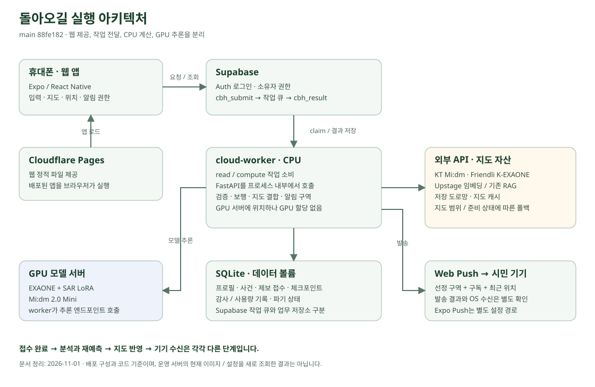
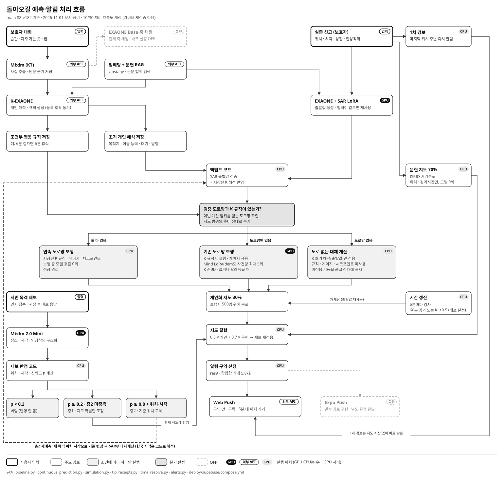

# 실행 아키텍처와 처리 흐름

2026-11-01, main `88fe1823bbe672fcd189ddcf6efaccefd1d3101e`(#358)의 코드와 배포 구성을 대조한 문서입니다. 10월 30일 작성된 처리 흐름도를 개정했습니다. 이번 작업에서 운영 서버를 재배포하거나 모델·보행 실험을 새로 실행하지 않았습니다. 화면 촬영 시점은 [별도 출처](SERVICE_SCREENS_20261101.md)를 따릅니다.

## 실행 위치

| 구성 | 담당하는 일 | 코드·설정 근거 |
|---|---|---|
| Expo / React Native 앱 | 입력, 지도 렌더링, 권한·위치 등록, 작업 제출과 결과 조회 | [프런트엔드 API](../frontend/src/api/) |
| Cloudflare Pages | 웹 앱의 정적 파일 제공 | [배포 연결](../deploy/supabase/README.md) |
| Supabase | Auth, 사용자 권한, 요청 UUID 기반 작업 큐와 결과 전달 | [대기열 SQL](../deploy/supabase/001_bridge.sql), [경로·소유권 정책](../backend/app/cloud_bridge/policy.py) |
| cloud-worker의 CPU | read / compute 작업 소비, 내부 FastAPI 호출, 수치 검증·보행·지도 결합·제보·알림 | [worker](../backend/app/cloud_bridge/worker.py), [compose](../deploy/supabase/compose.yml) |
| GPU 모델 서버 | EXAONE + SAR LoRA 초기 수치, Mi:dm 2.0 Mini 제보 구조화 | [LLM 구성](../backend/app/llm/), [Mini 클라이언트](../backend/app/llm/tip_llm.py) |
| 외부 API | KT Mi:dm 보호자 대화, Friendli K-EXAONE 개인 해석·규칙, Upstage 검색용 임베딩 | [개인 해석 준비](../backend/app/phase0/person_preparation.py), [설정](../backend/app/config.py) |
| SQLite·데이터 볼륨 | 프로필, 사건, 제보 접수, 보행 체크포인트, 파기 상태 | [저장 계층](../backend/app/storage.py), [compose 볼륨](../deploy/supabase/compose.yml) |
| 지도·RAG 자산 | 기존 도로망·지도 캐시, 논문 검색 인덱스 | [지도 로딩](../backend/app/phase2/pipeline.py), [지역 캐시 검증](verification/regional-road-cache-20261026/README.md) |

worker는 GPU 서버에 있지만 컨테이너에는 GPU가 할당되지 않습니다. compose는 CPU 4개·메모리 8GB를 지정하고, 기존 모델 서버의 엔드포인트를 호출합니다. Supabase의 작업 큐와 worker의 업무 DB는 서로 다른 저장소입니다. 웹 지도 타일은 브라우저에서 요청합니다.

## 등록에서 지도와 알림까지

[주요 흐름 — 초록색 도식](assets/architecture-20261101/prediction-flow.svg)은 README용 요약입니다. 아래 상세 그림은 제보·시간 갱신·폴백까지 포함합니다.

[처리 흐름도 SVG 원본 열기](assets/architecture-20261101/processing-flow.svg)

1. **등록 시 준비:** Mi:dm이 보호자 대화에서 사실과 원문 근거를 정리합니다. K-EXAONE은 관련 문헌 발췌와 개인 근거를 읽어 초기 개인 해석과 조건부 행동 규칙을 만듭니다. 코드는 규칙을 검증하고 적용·격리 상태를 저장합니다.
2. **신고와 1차 경보:** 마지막 목격 위치·시각·상황을 등록 프로필과 연결합니다. 신고 직후 주변에 보내는 1차 경보는 예측 지도의 완성을 기다리는 경보와 별도 경로입니다. 앱의 자동 예측 요청과 서버의 미예측 사건 보완 경로가 있습니다.
3. **초기 수치:** EXAONE + SAR LoRA가 이동 전략 비율, 장소 끌림 등급, 이동 반경 등급을 만듭니다. CPU 코드가 수치를 검증하고 저장된 K 해석을 반영합니다. 사건·개인 입력의 지문이 같을 때 저장된 prior를 재사용합니다.
4. **개인화 보행:** 이번 계산 범위를 덮는 검증 도로망과 유효한 K 규칙이 있으면 CPU가 연속 보행을 계산합니다. 보행 상태·휴식·방향·난수 상태를 체크포인트로 보존하며 규칙 실행마다 모델을 호출하지 않습니다.
5. **지도 결합:** 개인화 지도 30%와 독립 문헌 거리분포 지도 70%를 결합합니다. 문헌 채널은 마지막 목격 위치·경과시간·문헌 분포를 사용하며 개인 SAR 전략이나 K 규칙을 다시 넣지 않습니다. 기존 유효 제보는 결합 후 다시 반영합니다.
6. **예측 기반 알림:** 확률/면적으로 H3 res9 후보를 정렬하고 실제 합집합 면적 최대 5.8㎢ 안에서 구역을 고릅니다. 구역 내 기기의 위치·구독·중복 제한 등을 확인해 발송합니다. 인증된 res9 기기의 위치 유효시간은 300초입니다. 발송 접수와 OS 수신은 별도로 확인해야 합니다.

주요 근거: [pipeline](../backend/app/phase2/pipeline.py), [연속 보행](../backend/app/phase2/continuous_prediction.py), [기존 보행·폴백](../backend/app/phase2/simulation.py), [알림](../backend/app/phase3/alerts.py).

## 접수와 분석을 분리한 제보

앱의 비동기 제보는 먼저 접수 레코드를 저장해 응답합니다. 이후 Mini가 목격 문장에서 장소·시간·인상착의·구체성 등급을 추출하고, 코드가 좌표와 목격 시각을 해석합니다. 접수 완료 화면은 저장 확인이며 분석·지도 반영 성공을 보장하는 화면이 아닙니다. 동기 호환 경로는 구조화·층1 갱신까지 수행한 뒤 무거운 뒷일을 분리합니다.

| 판정 | 처리 |
|---|---|
| p < 0.2 | 지도에 반영하지 않음 |
| p ≥ 0.2, 새 기준 위치 조건 미충족 | 위치가 있으면 기존 지도 확률 갱신 |
| p ≥ 0.8, 위치·목격 시각 모두 확보 | 새 목격 위치·시각으로 기준을 바꾸어 재예측 |

p는 시공간 개연성과 정보 구체성으로 계산하는 반영 점수입니다. 제보가 사실일 확률을 검증한 수치로 해석하지 않습니다. 모델은 명시된 시각 표현만 추출하고, 한국 시계 시각·오전/오후 후보와 마지막 목격~접수 시각 범위의 선택은 코드가 처리합니다(#358). 처리 중에는 마지막으로 저장된 지도를 조회할 수 있습니다.

근거: [제보 API](../backend/app/api/phase3.py), [접수·백그라운드 처리](../backend/app/phase3/tip_receipts.py), [판정 흐름](../backend/app/phase3/tip_flow.py), [목격 시각](../backend/app/phase3/time_resolve.py), [점수 계산](../backend/app/phase3/trust.py).

## 준비 상태, 시간 갱신과 종결

- K 규칙이 없거나 오래됐으면 기존 보행 분기로 내려갈 수 있습니다. 도로망도 이번 확률 계산 범위를 덮어야 사용됩니다. 도로망 없는 대체 계산에는 연속 보행 규칙·게이지·체크포인트가 적용되지 않습니다. 응답의 품질·폴백 상태를 확인합니다.
- 전체 축 채점은 배포 설정에서 OFF입니다. SAR 초기 수치와 K 개인 해석·규칙 경로는 유지합니다. 예전 Mind LoRA는 기존 보행의 제한된 fallback이며 새 후보를 최종 모델로 채택한 것이 아닙니다.
- 주기 검사는 기본 300초입니다. 재계산은 경과 시간 또는 KL 이탈로 판단합니다. 코드 기본 주기는 45분이고 **배포 compose는 60분**으로 덮어씁니다. KL 기준은 0.5입니다. 이를 ‘60분과 KL 조건을 모두 만족해야 실행’으로 설명하지 않습니다. [설정](../backend/app/config.py), [트리거](../backend/app/phase3/triggers.py), [갱신기](../backend/app/phase2/refresher.py).
- 대표 보행 궤적은 부스 재생을 위해 사건의 `continuous_state.walker_traces`에 저장합니다(#357). 이는 개인화 채널의 대표 경로이며 전체 확률지도나 실제 실종자의 이동 기록이 아닙니다. [궤적 저장](../backend/app/phase2/walker_traces.py).
- 부스 전용 계정은 온보딩 템플릿을 복제합니다. 준비 결과는 개인 정보 지문과 규칙 리비전이 맞을 때만 재사용하고 출처·준비 시각을 기록합니다. 일반 등록과 시연용 사전 계산을 구분합니다. [부스 시연](DEMO_ONBOARDING.md), [재사용 구현](../backend/app/api/demo_onboarding.py).
- 종결 사건은 예측·추가 제보·알림을 막고 활성 사건에서 제외합니다. 사건 데이터의 기본 보관 기간은 5일이며, 별도 감사·통제 기록과 공급자 저장 정책까지 모두 같은 기간에 삭제된다는 의미는 아닙니다. [개인정보 생명주기](../backend/app/privacy/lifecycle.py).

이 문서는 코드와 배포 구성의 구조를 설명합니다. 현재 운영 환경변수·이미지·사건 상태의 일치는 별도 확인 대상입니다. 10월 30일 원본 그림의 ‘현재 열린 2건’, 당시 워커 태그·DB 집계 등 시점 의존 문구는 개정본에서 제거했습니다. [10월 12일 구조 기록](SERVICE_E2E_20261012.md)과 [기존 평가 결과](experiments/final-alert-policy-20261012.md)는 당시 근거로 보존합니다.
