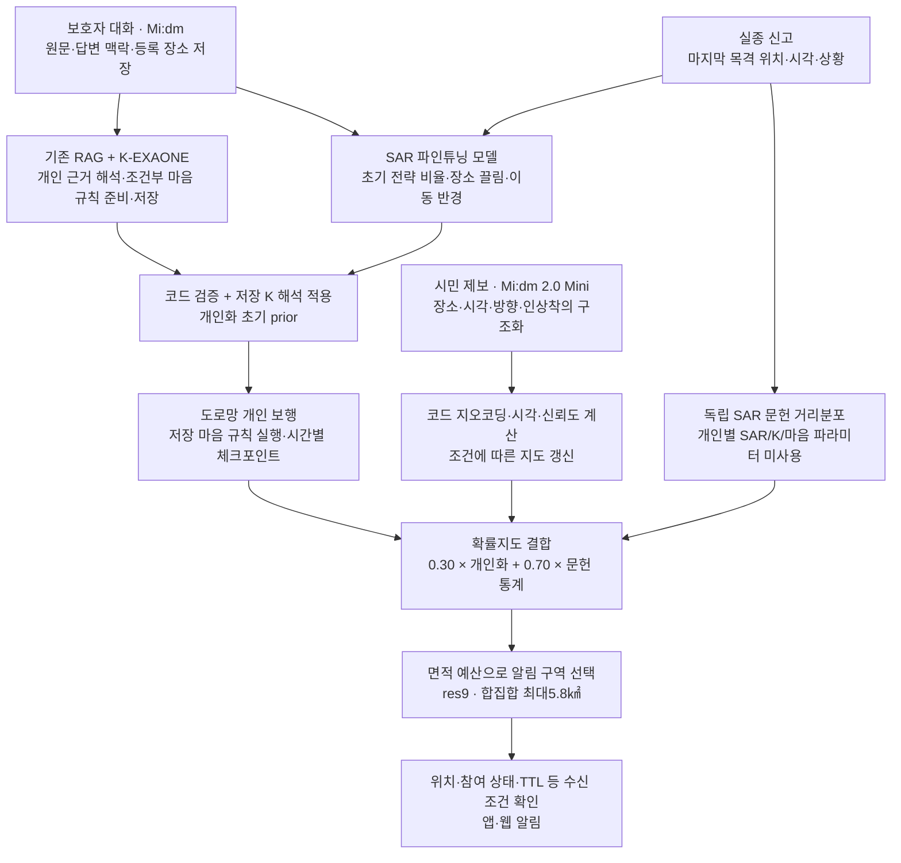
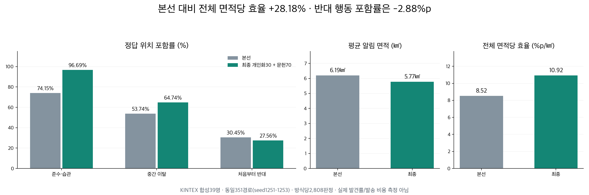
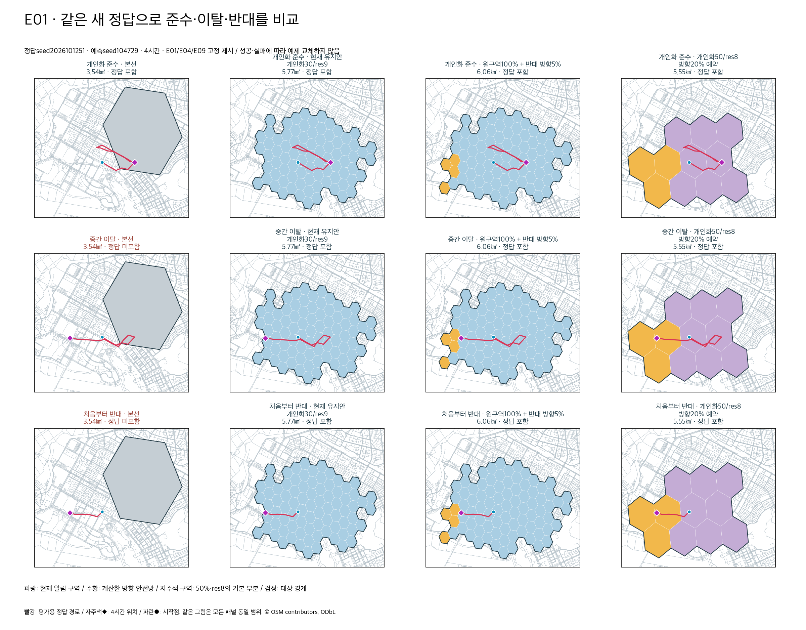
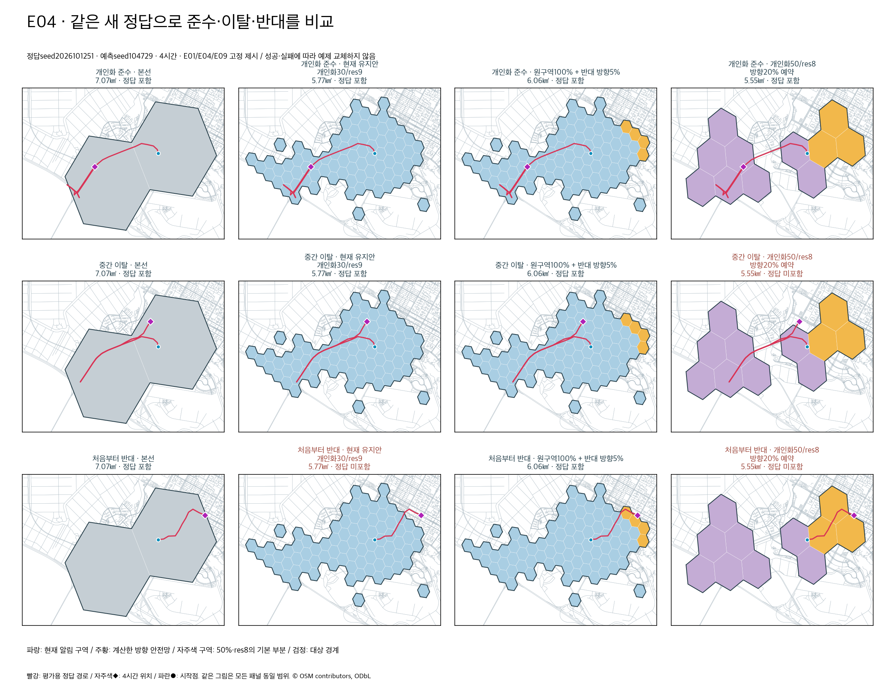
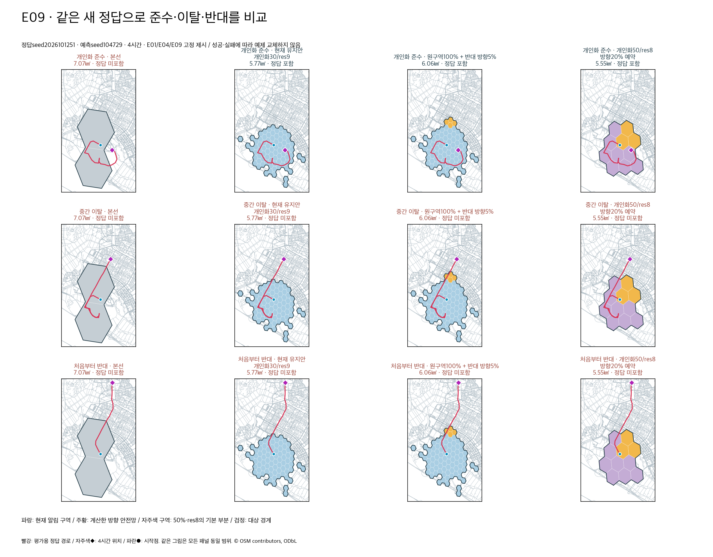

# 돌아오길 최종 발표 정리

> **보호자 정보로 만든 개인화 보행 예측과 수색 문헌 통계를 결합해, 제한된 알림 면적에서 정답 위치를 더 효율적으로 포함합니다. KINTEX 합성 경로 평가에서 본선 대비 전체 면적당 효율이28.18% 높아졌습니다.**

슬라이드에 사용할 문구와 발표 대본을 함께 정리했다. 운영 정책은 **개인화30% + 독립 문헌통계70%, res9, 실제 알림 대상 합집합 상한5.8㎢**다. 전체 축 채점은OFF다. 성능 수치는 실제 발견률이 아닌 합성 경로의 정답 위치 포함 평가다.

## 슬라이드1 — 문제와 목표

**슬라이드 문구**

- 넓은 범위에 알림을 보내면 정답을 포함할 가능성이 커지지만, 알림 대상 면적도 커집니다.
- 보호자의 기억과 개인의 행동 특성으로 예측을 좁히고, 개인화에서 벗어난 이동은 독립 통계로 보완합니다.
- 목표: **알림 대상 면적 대비 정답 위치 포함 효율을 높이는 것**.

**발표 대본**

“우리는 지도를 많이 칠하는 것이 아니라, 제한된 면적 안에 실종자의 실제 위치를 얼마나 잘 포함하는지를 평가했습니다. 보호자가 알려준 습관과 행동 맥락을 예측에 사용하되, 그 습관을 따르지 않는 가능성도 별도의 수색 통계로 남겨두었습니다.”

## 슬라이드2 — 최종 기술 구조

**발표 대본**

“등록 대화는 Mi:dm이 담당합니다. K-EXAONE은 보호자 원문과 검색 근거에서 개인의 행동을 해석하고 조건부 마음 규칙을 미리 준비합니다. 사건이 발생하면 SAR 모델이 초기 수치를 만들고, 코드가 저장된 개인 해석을 반영해 보행 예측을 시작합니다. 준비된 마음 규칙은 보행 중 조건을 만족할 때 코드로 실행하고, 시간 갱신에는 보행 체크포인트를 이어서 사용합니다.”

전체 축 채점은OFF다. EXAONE Base가 축 채점 모델로 설정되어 있어도 현재 새 전체 축 채점은 실행하지 않는다. 기존 축은 보존하며, 없는 축은 엔진 기본 계수를 사용한다. K의 이동 능력 해석과 SAR 초기 prior는 별도로 반영되므로 **축OFF가 초기 prior 미적용을 뜻하지 않는다**.

| 모델·계층 | 현재 역할 |
|---|---|
| 온보딩 Mi:dm (`midm-pro-fp8-kaic`) | 보호자 대화와 답변 맥락·장소 연결.2.5 연결 규약이 구현되어 있으나 ID만으로 제공 버전이나2.5 품질 검증을 단정하지 않음 |
| EXAONE Base | 선택적 전체 축 채점. **현재OFF** |
| SAR 파인튜닝 (`exaone-sar`) | 사건의 초기 전략 확률·장소 끌림 등급·반경 등급 생성 |
| K-EXAONE | 개인 근거 해석·초기 보정·조건부 마음 행동 정책을 준비·저장 |
| 보행 코드 | SAR/K 결과 검증·수치화·보행·저장 규칙 실행·체크포인트 재사용 |
| Mi:dm 2.0 Mini (`midm-2.0-mini`) | 시민 제보 구조화, 별도 문구 모델 미설정 시 수색 안내 문구. 예측 구역이나 발송 대상 결정은 코드 |
| 예전 마음 파인튜닝 (`exaone-mind-dem5`) | legacy/fallback 경로에 남아 있음. 정상 준비 경로의 조건부 규칙 모델은K-EXAONE |

배포: **Cloudflare Pages(웹 앱) → Supabase(Auth·작업 대기열) → GPU 서버 worker → 모델·보행 엔진 → 결과 반환**. Cloudflare가 Supabase나GPU를 대신하는 것은 아니다. [상세 E2E·모델 역할](SERVICE_E2E_20261012.md).

## 슬라이드3 — 30:70을 정확히 설명하기

| 지도 결합 가중치 | 입력·내용 | 포함하지 않는 것 |
|---|---|---|
| **개인화30%** | SAR의 개인별 초기 전략·끌림·반경 + K 초기 개인 해석 보정 + K 조건부 마음·행동 규칙을 적용한 도로망 보행 지도 | 지도 면적의30%를 별도 예약한다는 뜻이 아님 |
| **독립 통계70%** | 마지막 목격 위치·경과시간과 기존 SAR 문헌의 거리분포 근사로 계산한 지도 | 개인별 SAR 전략·끌림·이동 능력, K 개인 목적지·습관·마음 규칙을 넣지 않음 |

각 지도는 확률 질량을 정규화한 뒤 `P = 0.30×P_personal + 0.70×P_literature`로 결합한다. 이후 결합 분포에서 실제 발송 구역의 지리적 면적 예산을 지키며 구역을 선택한다. **30:70은 확률지도 결합 가중치**이며 개인화 효과의 크기, 행동 발생률, 알림 구역 개수, 면적 배분 비율, SAR와K 모델 기여 비율이 아니다.30%가 초기 개인화와 마음을 함께 포함한다.

**발표 대본**

“30은 SAR와K가 만든 개인화 보행 지도의 가중치이고,70은 개인화 정보를 넣지 않은 문헌 거리분포의 가중치입니다. 개인화 효과가30%라는 뜻은 아닙니다. 지도에서 높은 밀도를 만드는 위치가 달라지면 제한된 면적 안에서 선택되는 구역도 달라집니다. 따라서 개인화 기여는 비율 숫자 자체보다, 개인화를 뺀 대조군과의 성능 차이로 평가했습니다.”

## 슬라이드4 — 본선 대비 같은 정답의 성능

비교 자료: #288의 동결 확인 경로seed1251/1252/1253.39명 × 준수·이탈·반대3행동 × 3경로seed = **351경로**. 동일한 두 예측seed,1·2·4·6시간을 평가해 방식당2,808판정, 행동별936판정이다. E20은 기존 독립 예측이 없어 제외했다. 같은 KINTEX 지도와 정답·시점으로 비교했지만, 본선의 기존 대상 선택과 최종 면적 예산 정책은 달라 **실제 면적이 동일한 실험은 아니다**.

| 지표 | 본선 | 최종30/70 · res9 | 변화 |
|---|---:|---:|---:|
| 개인화 준수·습관 행동 포함률 | 74.15% | **96.69%** | **+22.54%p** |
| 중간 이탈 행동 포함률 | 53.74% | **64.74%** | **+11.00%p** |
| 처음부터 반대 행동 포함률 | 30.45% | **27.56%** | **−2.88%p** |
| 전체 위치 포함률 | 52.78% | **63.00%** | **+10.22%p** |
| 평균 실제 알림 대상 면적 | 6.195㎢ | **5.769㎢** | **−6.87%** |
| 전체 면적당 효율 | 8.52%p/㎢ | **10.92%p/㎢** | **+28.18%** |

효율 = `100 × 적중 판정 수 ÷ 대상 면적 합` = `전체 위치 포함률(%) ÷ 평균 알림 면적(㎢)`. 겹치는 실제 H3 발송 구역은 지리적 합집합으로 한 번만 센다. 이 수치는 수신자 기준 알림 정밀도·발견률·원화 비용 절감률이 아니다. 세 행동을 동일 비중으로 구성한 스트레스 평가이며 현실의 발생 비율을 추정한 값도 아니다.

**발표 대본**

“동일한 합성 경로에서 전체 포함률은52.78%에서63.00%로 높아졌고, 평균 알림 면적은6.195에서5.769제곱킬로미터로 줄었습니다. 두 결과를 함께 반영한 면적당 효율은28.18% 높아졌습니다. 준수와 중간 이탈에서는 좋아졌지만, 처음부터 반대 방향으로 움직이는 경우의 포함률은2.88퍼센트포인트 낮았습니다. 따라서 모든 행동에서 개선됐다고 발표하지 않습니다.”

[원본 판정·정의·한계](experiments/directional-alert-safety-20261012/README.md), [원본 집계 JSON](experiments/directional-alert-safety-20261012/confirmation_summary.json).

## 슬라이드5 — 왜 개인화를 유지하는가 / 왜 이 최종안을 골랐는가

**개인화를 뺀 대조군** — #286의seed1231–1233, 동일5.8㎢ 상한:

| 지표 | 독립 통계만 | 최종 개인화30 + 문헌70 |
|---|---:|---:|
| 준수 포함률 | 75.00% | **96.05%** |
| 전체 면적당 효율 | 9.83%p/㎢ | **11.04%p/㎢** |

준수 포함률 차이+21.05%p의 사람 단위95% 구간은[+14.74,+27.88]이다. 이는 개인화 지도를 추가한 정책의 유효성을 뒷받침한다. SAR/K/마음 각각의 개별 기여를 분리한 결과는 아니다. [원본 대조군 보고서](experiments/personal-first-alert-balanced-20261012/README.md).

**70%에도 개인별 SAR 파라미터를 넣은 마지막 비교** — #292의새seed1261–1263, 같은5.8㎢ 상한:

| 지표 | 현행 개인화30 + 독립 문헌70 | 개인화30 + 개인별 SAR70 |
|---|---:|---:|
| 준수 포함률 | **96.15%** | 91.67% |
| 이탈 포함률 | **64.10%** | 59.51% |
| 반대 포함률 | **28.74%** | 21.26% |
| 전체 포함률 | **63.00%** | 57.48% |
| 평균 면적 | 5.769㎢ | 5.521㎢ |
| 전체 면적당 효율 | **10.92%p/㎢** | 10.41%p/㎢ |

현행의 전체 효율은 비교안 대비4.89% 높고, 효율 차이의 사람 단위95% 구간은[+0.141,+0.882]%p/㎢다. 다만1시간만 보면 SAR70 효율이16.34로 현행14.69보다 높다. 일부 현행 누락81판정을 회복하는 대신 기존 적중236판정을 잃었다. 전체 시점에서 준수·이탈·반대 포함률과 전체 효율을 함께 보고 현행을 유지했다.

**세 표는 정답seed가 다르므로 합쳐 평균 내거나, #292 수치를 #288의 본선 수치와 직접 비교하지 않는다.** 최종 정책은 여러 시험안 중 사용자 제약과 평가를 함께 고려한 선택이며 모든 미래 데이터에서의 최적해라는 주장은 아니다. [마지막 비교·구간·개별 예외](experiments/final-sar-literature-comparison-20261012/README.md).

## 슬라이드6 — 같은 사람의 준수·이탈·반대 예제

예제는 #288에서 사전 고정한 E01/E04/E09,seed1251,예측seed104729,4시간이다. 성공한 그림으로 교체하지 않았다. 빨강은 평가용 경로, 자주색◆는 정답 위치, 파랑은 현재 대상이다. 주황은 **미채택 방향 추가 후보**여서 현재 배포된 대상이 아니다. 그림 내 ‘현재’ 열을 최종안으로 설명한다.

발표에서 핵심은 “정답이 색칠된 **실제 알림 대상** 안에 포함되는가”다. 모든 확률지도 색상이 발송 대상인 것은 아니며 대상 구역 안에서도 기기 위치·참여 상태·TTL 등 수신 자격 조건이 적용된다. 지도에 한 덩어리처럼 보여도 개인화 유무의 효과는 같은 면적 조건의 대조군으로 확인한다.

## 슬라이드7 — 구현된 것과 아직 검증하지 않은 것

| 구분 | 발표할 수 있는 내용 | 남은 한계 |
|---|---|---|
| 개인화 | SAR 초기 수치와K의 근거 해석·마음 규칙을 개인 보행에 연결 | K 미준비·실패·오래된 해석에서는 동일 개인화 적용을 보장하지 않음 |
| 효율 | 본선 대비 합성 평가의 전체 면적당 효율+28.18% | 사람 밀도·반복 발송·실제 수신·발견·원화 비용 미포함 |
| 반대 행동 | 독립 문헌 채널로 개인화 외 이동 가능성을 남김 | 본선 대비 우월성 미확인. #288반대678/936판정, #292반대667/936판정 누락 |
| 일반화 | 기존39명 합성 프로필의 새 경로로 재확인 | 새 사람·실제 실종 경로·임상 평가 아님.2,808판정은2,808명의 독립 표본이 아님 |
| 운영 연결 | 실제worker의 인증된 예측·조회, 채널 독립·30:70·res9·면적 상한 확인; 격리stub 수신 대상 일치 | 저장 SAR/K 결과 재생. 새 온보딩부터 실푸시·발견까지 전 과정 실호출 검증 아님 |
| 로그인 | 웹 빌드와 실제 브라우저 인증 경로를 별도 점검 | 기존SQLite계정 자동 이전 없음. 이메일 확인·발송 공급자 제약은 인증 정책대로 유지 |

**마무리 발표 문구**

“개인화와 독립 통계를 결합하고 실제 발송 면적을 제한해, 합성 평가에서 더 작은 면적으로 더 많은 정답 위치를 포함했습니다. 반대 행동과 실제 현장 발견률은 남은 검증 과제로 명확히 구분했습니다.”

## 예상 질문에 바로 답하기

**‘통계가70이면 개인화 효과가 거의 없는 것 아닌가요?’**

“70은 독립 거리분포 지도의 결합 가중치입니다. 개인별SAR 초기 수치와K 초기 해석·마음 규칙은30에 모두 들어갑니다. 같은5.8제곱킬로미터 상한의 통계만 대조군보다 준수 포함률이75.00%에서96.05%로 높아져, 제한된 면적 안의 구역 선택에 개인화 효과가 남는 것을 확인했습니다.”

**‘정확도가28.18% 올랐나요?’**

“28.18%는 전체 면적당 효율의 상대 개선입니다. 전체 위치 포함률은10.22퍼센트포인트 개선이고, 실제 발견 정확도는 아직 평가하지 않았습니다.”

**‘반대 방향까지 모두 잡나요?’**

“아닙니다. 독립 통계가 대비 가능성을 남기지만 누락이 큽니다. 본선 대비 반대 행동 개선을 입증하지 못했습니다. 추가 외곽 후보도 준수·면적 효율·제품 연결 조건을 함께 충족하지 못해 채택하지 않았습니다.”

**‘축 채점이OFF면 초기 prior가 없는 건가요?’**

“전체축 채점과SAR 초기prior는 별개입니다. 현재도SAR 모델이 초기 수치를 만들고K 해석을 코드로 보정해 보행에 전달합니다.”

**‘보행할 때마다 마음 모델을 부르나요?’**

“정상 준비 경로에서는K-EXAONE이 미리 만든 조건부 규칙을 코드가 실행합니다. 준비 단계의 모델 호출과legacy/fallback 호출은 남아 있어 모든 서비스 모델 호출이0이라는 뜻은 아닙니다.”

**‘기존 문자 대비 얼마나 비용을 줄였나요?’**

“구·시 경계 비교는 행정경계 대리지표입니다. 실제 문자 발송 로그나 청구액을 측정하지 않아 실제 비용 절감률로 발표하지 않습니다.”

## 증빙과 운영 정정

- [최종 기술 E2E](SERVICE_E2E_20261012.md), [최종 정책](experiments/final-alert-policy-20261012.md), [worker 배포 검사](releases/final-service-deploy-20261012.md).
- [로그인 장애 원인·프런트 수정·실제 인증 검증](verification/login-cloud-build-20261012/README.md).
- 앞선 배포의 worker검사는 유효하지만, 웹 초기 화면과JS 로딩 확인만으로 브라우저 로그인까지 검증한 것은 아니었다. 이번 로그인 문제로 그 범위 부족을 확인했고, 웹 빌드의 실제Supabase 연결과 인증 성공을 별도 검사한다.
