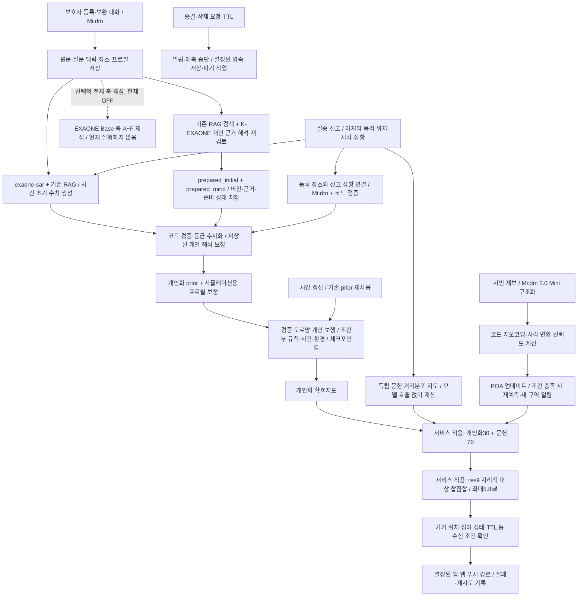

# 서비스 E2E 기술 구조 — 2026-10-12 정본

**전체 축 채점은 OFF다. 초기 prior는 SAR 모델이 만들고, 저장된 K-EXAONE 개인 해석을 코드가 보정해 개인화 보행에 사용한다. Mi:dm 2.0 Mini는 제보 구조화와 수색 안내 문구에 별도로 사용한다.** 축 채점 OFF는 prior 생성이나 개인 행동 규칙 실행을 끄는 설정이 아니다.

이 문서는 현재 최종 선택 구현과 실제 배포 설정을 설명한다. #290 머지 후 2026-10-12 14:25 KST에 서비스 worker를 갱신하고 웹 앱도 배포했다. E2E는 등록→준비→신고→예측→알림→제보→시간 갱신→종결의 흐름 설명이며, 이번 배포 검사는 저장된 합성 SAR/K 결과로 인증된 예측·조회 경로를 검증했다. 새 모델 응답 품질이나 전체 흐름의 재실호출 검증은 아니다. [배포 결과·범위·롤백](releases/final-service-deploy-20261012.md).

발표용 슬라이드 문구·대본·본선 비교·30:70 설명은 [최종 발표 정리](PRESENTATION_FINAL_20261012.md)를 따른다. 웹 로그인 빌드 설정 누락과 후속 수정은 [별도 인증 검증](verification/login-cloud-build-20261012/README.md)에 기록한다. 기존 배포의 브라우저 초기 화면 검사만으로 로그인 성공까지 확인한 것은 아니다.

## 1. 확정 코드와 실제 배포 상태

| 항목 | develop 확정 구현 | 배포 worker 읽기 확인 |
|---|---|---|
| 전체 축 채점 | `axis_scoring_enabled=false` | `false` |
| 축 채점용 모델 | 별도 `AXIS_SCORING_MODEL`; 미설정 시 `EXAONE_MODEL` | `exaone-base` 지정, 채점 OFF |
| SAR 초기 prior | `EXAONE_MODEL`로 생성 | `exaone-sar` |
| 온보딩 Mi:dm | KT API 연결; 2.5 연결 규약 포함 | `midm-pro-fp8-kaic` / KT endpoint |
| 제보 구조화 | 별도 `TIP_LLM_*`, Mi:dm 2.0 Mini 선택 | `midm-2.0-mini` / 자체 호스팅 경로 |
| 안내 문구 | `COPY_LLM_*`; 비우면 `TIP_LLM_*` 상속 | 별도 모델 빈 값 → Mini 상속 |
| 개인 행동 준비 계약 | 저장된 K 해석·조건부 정책 사용 | `guarded_core`, `staging` |
| 개인화·통계 지도 결합 | 개인화30% + 독립 문헌 거리분포70% | 동일 설정·실제 예측의 결합 확인 |
| 실제 알림 대상 선택 | res9, `area_budget`, 상한5.8㎢ | 동일 설정; 합성 예측에서 res9 80구역·5.770㎢ |

현재 worker는 `cbh-cloud-worker:20261012-62b5d88`, Pages 배포는 `68abffec-ac6d-49ef-a021-c563ff355a0f`다. [최종 런타임·실제 요청·코드 해시 확인](verification/final-service-deploy-20261012/verification.json). 13:41 KST의 [이전 worker 확인 자료](verification/service-e2e-20261012/runtime-settings.json)는 배포 전 증빙으로 보존한다. 당시 null은 이전 이미지에 설정 필드가 없다는 뜻이었다. 현재 30:70·res9·5.8㎢는 설정 읽기뿐 아니라 실제 worker의 인증된 예측 응답에서도 확인했다. 모델 ID 확인을 API 응답 품질 검증으로 표현하지 않는다.

온보딩의2.5 연결 규약과 제보용2.0 Mini를 구분한다. 기존 실험에 기록된 `midm-pro-fp8-kaic`라는 ID만으로 모델 버전을 새로 판정하거나 과거 실험 수치를2.5 품질 검증으로 전용하지 않는다. [Mi:dm 통합 근거](reviews/pr-consolidation-20260928.md).

## 2. 등록부터 종결까지

프런트 Cloudflare Pages → Supabase 인증·작업 대기열 → GPU 서버의 worker → FastAPI·보행 엔진 → 결과 반환 구조다. 모델별 호출은 설정된 API 또는 GPU 호스팅 endpoint로 나뉜다. 국내 개발 모델을 사용한다는 이유로 모든 API의 처리 위치·보존 정책까지 국내 또는 자체 호스팅이라고 단정하지 않는다. [배포 연결 구조](../deploy/supabase/README.md).

## 3. 축 점수와 초기 prior를 구분한다

| 입력 | 만들어지는 곳 | 보행 소비 | OFF의 영향 |
|---|---|---|---|
| 전체 성향 축 점수 | 선택적 EXAONE Base 채점 | 축별 게이지 계수 등을 보정 | 새 전체 축 채점이 실행되지 않음 |
| 이동 능력 축 | 저장된 K-EXAONE의 개인 근거 해석 → 코드 매핑 | 이동 관련 보정·거리분포 반경 | 전체 축 채점 OFF와 별도로 적용 가능 |
| 전략 비율 | SAR 초기 수치 → K 근거에 따른 코드 보정 | 초기 보행자 전략 선택 | prior 생성은 계속 실행 |
| 장소 끌림 가중치 | SAR 등급·등록 근거 → K 목적지 해석 보정 | 장소를 향하는 보행자의 목표 선택 | 적용됨 |
| 거리분포 | SAR 반경 등급 → 코드 수치화, K 이동 능력 보정 | 거리 상한·도로망 범위 | 적용됨 |
| 조건부 행동 규칙 | 등록 이후 K-EXAONE이 해석·검증해 저장 | 보행 중 조건 충족 시 코드 실행 | 전체 축 채점 OFF와 독립 |

`AXIS_SCORING_ENABLED`는 등록 확정/백필의 새 축 채점을 제어한다. 이미 저장된 축 점수를 지우지 않는다. 점수가 없는 축은 엔진 기본 계수를 유지하며, 모든 빈 축을0.5로 채점해 저장하지 않는다. 현재 각 축을 모두 개인별로 수치화한다고 설명하지 않는다.

Base가 모델 설정에 있다고 호출되는 것은 아니다. 또한 ON만 켜도 무조건 Base가 선택되는 것은 아니다. `AXIS_SCORING_MODEL`을 비우면 일반 `EXAONE_MODEL`을 사용하므로 `exaone-sar`와 Base를 구분하려면 축 채점 모델을 별도로 지정해야 한다. 이번 PR은 ON으로 바꾸지 않는다.

## 4. 초기 prior 생성과 개인 해석 보정

1. **등록 준비:** Mi:dm 대화의 원문·질문 맥락·주소/장소를 저장한다. K-EXAONE은 기존 RAG 발췌와 개인 근거를 읽어 이동 능력, 목적지와 길 익숙함, 방향·대기 성향, 환경 반응을 해석·재검토한다. 조건부 마음·행동 규칙도 준비한다. `prepared_initial`/`prepared_mind`, 근거 연결, 준비 상태와 fingerprint/revision을 저장한다. 실패·미준비를ready로 위장하지 않는다.
2. **사건 발생:** SAR 파인튜닝 모델이 Persona·신고 시각/상황·기존 RAG를 읽고 `strategy_probs`(6개 전략), `attraction_levels`(상·중·하), `radius_level`(상·중·하)을 반환한다. 이 경로는 Base 전체 축 채점을 전제로 하지 않는다.
3. **코드 검증:** 유효한 전략과 등록 장소만 인정한다. 전략 비율은 유한·음수 여부 검사와 재정규화, 장소 등급은 등록 근거와 결합해 가중치로 변환, 반경 등급은 코드가 거리분포 파라미터로 변환한다. **SAR는 전략 확률 수치를 출력한다.** 모든 모델이 수치를 전혀 출력하지 않는다는 기존 설명은 부정확하다. K의 의미 등급은 코드가 수치화하며 임상적으로 보정된 확률이라고 주장하지 않는다.
4. **K 해석의 적용:** 신고 시점에 유효한 저장 해석을 `apply_prepared → compile_person`으로 투영한다. 대기·방향·목적지 근거로 전략 비율을 보정하고, 개인 목적지와 근거로 끌림 가중치를 구성한다. 이동 능력 A~E는0.1/0.3/0.5/0.7/0.9로 변환한다. 다른 기존 축은 보존하고 이동 능력 축을 갱신한다. 길 익숙함·환경 반응도 `persona_adjustments`에 넣는다. 신고의 현재 목적지 연결은 등록 당시의 오래된 발언과 구분한다.
5. **사용과 재사용:** 최종 prior는 `case.prior`에 저장하고 보행 엔진에 전달한다. `simulation_persona`가 사건별 보정을 복사본에 적용하며 보호자 원본 프로필을 덮어쓰지 않는다. 같은 사건 맥락이면 prior를 재사용하고, 시간 미리보기·갱신은 보행 체크포인트와 저장 prior를 사용한다. 사건 맥락·프로필·prior·정책이 바뀌면 체크포인트 키가 달라져 이전 상태를 무조건 재사용하지 않는다.

실제 소비는 `person_walk.Population`에서 확인된다: 전략 비율은 초기 보행자 전략 표집, 장소 가중치는 해당 전략의 목표 표집, 거리분포는 도달 범위 제한에 쓰인다. `simulation_persona`의 이동 능력·길 익숙함·환경 반응은 보행 입력에 반영된다. 이후 조건부 규칙이 행동을 바꾸는 것은 prior 연결이 빠졌다는 뜻이 아니다.

SAR 호출/파싱 실패는 `fallback`/`stub`로 기록하고 유형별 기본값을 쓴다. 이 기본값의 전략 비율은 임시 엔진 계수이며 문헌에서 관측한 확률처럼 제시하지 않는다. K 준비가 없거나 오래됐거나 유효하지 않으면 SAR 기준과 준비 실패 상태를 보존한다. 모든 사용자에게 준비된 K 개인화가 적용됐다고 단정하지 않는다.

## 5. 보행 중 마음 반영과 두 지도

정상 준비된 개인화 경로는 K-EXAONE이 미리 만든 조건부 정책을 보행 중 코드가 실행한다. 등록 준비 때 모델 호출이 존재하지만 **입자 루프에서 규칙 실행 때문에 매번 모델을 호출하지 않는다**. `exaone-mind-dem5`의 예전 게이지 기반 재해석 경로는 코드와 설정에 남아 있는legacy/fallback 경로다. 모든 서비스 경로의 모델 호출이0이라고 확대하지 않는다.

develop 최종 정책에서 개인화 prior는 **개인화 보행 지도**의 입력이다. 다른70%는 모델을 호출해 만든 SAR prior 보행이 아니라 **독립 문헌 거리분포 지도**다. 두 결과를 마지막에30:70으로 섞는다. 이 비율은 축 점수의 가중치, 초기 SAR/K 해석의 혼합 비율, 개인화 규칙 실행 비율이 아니다.

**통계70%에는 SAR 모델이 만든 개인별 전략·끌림·이동 능력 파라미터를 넣지 않는다.** SAR 초기 수치와 K 초기 개인 해석, K 조건부 마음·행동 규칙은 모두 개인화30%의 보행 지도에 들어간다. 70%도 개인 파라미터를 쓰고30%에만 마음을 추가하는 구조는 이전에 비교한 `onboarded_population_prior`이며 현재 선택과 다르다. 현재 worker에 문헌 채널과 면적 상한을 적용·검증했다. 마지막 동일 조건 비교에서도 현행을 유지하기로 했다. [개인별 SAR70 대조·최종 선택](experiments/final-sar-literature-comparison-20261012/README.md). 기존 shared/onboarding statistical 모드는 역사적·호환 경로로 남아 있다.

## 6. Mi:dm 2.0 Mini가 맡는 일

| 역할 | 입력·출력 | 코드가 맡는 결정 |
|---|---|---|
| 제보 구조화 (`tip_llm`) | 자유텍스트 → 장소 문구, 시각 표현과 유형, 인상착의, 방향, 구체성 등급 | 지오코딩, 상대→절대 시각 산술, 신뢰도p 계산, 재예측/알림 조건 |
| 수색 안내 문구 (`copy_llm`) | 코드가 만든 안내 초안 → 짧은 존댓말 안내 | 예측·수색 구역·발송 대상·상태 결정 |

온보딩 Mi:dm과 `TIP_LLM_*`/`COPY_LLM_*`는 별도 라우팅이다. `COPY_LLM_*`가 비어 있으면 `TIP_LLM_*`를 상속한다. 배포 설정은 `TIP_LLM_MODEL=midm-2.0-mini`이며 별도 copy 모델은 비어 있다. 따라서 “온보딩 Mi:dm 교체”를 “2.0 Mini도 모두 제거”로 쓰지 않는다.

미설정 개발 모드는 결정적 스텁을 쓸 수 있다. 설정된 제보 모델 호출/파싱 실패는 `_unjudged_tip`으로 판정 없음 처리하며 모델이 실패했는데 등급을 판단한 것처럼 쓰지 않는다. 안내 문구 모델 실패는 코드 초안을 유지한다. Mini는 KT/K-intelligence의 공개 모델이고, 자체 호스팅 경로와 대회 발급 API를 구분한다. 공개 모델 사용과 대회 요건 충족을 같은 판단으로 다루지 않는다.

## 7. E2E 검증 범위

- #290 문서 작업: 생산/소비 경로 대조, 이전 worker 설정 읽기, 모델 역할·실험 자료 대조, GitHub PR 이미지 렌더링 확인. 이후 사용자 승인으로 새 worker·웹 앱 배포와 실제 Supabase 예측/조회 검증을 수행했다. 이번 배포의 새 모델 호출·실제 알림은0회다. [배포 검사 범위](releases/final-service-deploy-20261012.md).
- 이전 서비스 연결 시험: [app-flow 검증](verification/app-flow-20261010/README.md). 당시 실행 버전·모델·합성 입력의 결과이며 모든 최신 정책과 일반 사용자 품질을 보장하지 않는다.
- 최종30/res9 후보 시험: [개인화 준수·면적 상한](experiments/personal-first-alert-balanced-20261012/README.md). 앱/웹/합성 발송 대상 일치를 확인했지만 완성 프로필 입력을 사용해 온보딩 대화와 Base 전체 축 채점을 다시 실행하지 않았다.
- 새 경로 비교와 미채택 후보: [방향 안전망·res8 비교](experiments/directional-alert-safety-20261012/README.md). generic stub fanout 시험을 새 선택기의 전체 앱/웹 E2E 연결 검증으로 확대하지 않는다.
- 축 자료: 합성 입력40건의 `axis_scores`/축 채점 보고서는 비어 있다. 최종 사용39명 중38명은 prior의이동능력 보정값이 있고 E33은없다. 모든 축 채점 ON 시험이나 ON/OFF 비교로 표현하지 않는다.
- 최종 선택은 [정책 확정 문서](experiments/final-alert-policy-20261012.md)를 따른다. 반대 행동의 본선 대비 우월성 미확인과 임상/실제 발견 검증 미수행 한계를 유지한다.

## 8. 핵심 구현 위치

| 경계 | 구현 |
|---|---|
| 축 OFF/모델 라우팅 | `backend/app/config.py`; `phase0/interview.py:ensure_axis_scores`, 등록finalize |
| 개인 해석 사전 준비 | `phase0/person_preparation.py`; `phase2/initial_person.py` |
| SAR 생성·K 보정 결합 | `phase2/pipeline.py:_initial_prior`; `llm/exaone.py:generate_prior`; `phase2/person_projection.py:compile_person` |
| 보행용 프로필 보정 | `llm/initial_behavior.py:simulation_persona` |
| 조건부 마음 규칙 | `phase0/mind_preparation.py`; `phase2/persistent_context_walk.py` |
| 실제 prior 소비·체크포인트 | `phase2/person_walk.py`; `phase2/continuous_prediction.py` |
| 문헌 통계 지도 | `phase2/literature_distance.py` |
| Mini 제보·안내 | `llm/tip_llm.py`; `llm/copy_llm.py`; `phase3/tip_flow.py` |
| 실제 면적 선택·발송 대상 | `phase3/area_budget.py`; `phase3/alerts.py`; `geo/h3cover.py` |

## 9. PR 이미지 표시 수정

비공개 저장소의 `raw.githubusercontent.com` 파일 주소로 PR에 그림을 삽입하면 인증되지 않은 이미지 요청에서 깨질 수 있다. #288의 그림은 동일 원본을 **GitHub 첨부 이미지**로 올려 영구 `github.com/user-attachments/assets/...` 주소를 본문에 저장했다. 로그인 때 발급되는 `private-user-images`의JWT 주소를 문서에 고정하지 않는다. 저장소 공개 범위·권한은 바꾸지 않았다. 저장소 문서 내부는 상대 경로 이미지로 유지하며 PR 첨부와 원본의 매핑·해시는 검증 자료에 보존한다.
