# 운영 서비스 화면과 iPhone 알림

2026년 10월 26일 운영 웹 `https://doraogil.pages.dev`와 iPhone 홈 화면 앱에서 촬영했습니다. 등록 정보는 합성 인물이며, 사건 C에는 **실제 실종 아님 / 수색·제보하지 마세요**라는 표시가 있습니다. 화면을 재생성하거나 지도 색상을 수정하지 않았습니다.

## 같은 사건의 푸시, 알림 목록, 확률 지도

사건 C (`256e85a7b49a`)의 OS 알림과 앱 화면입니다. 일반적인 ‘시험 알림’ 카드 대신 **사건 이름이 확인되는 실종 경보 카드**를 연결했습니다.

<table>
<tr><th>iPhone OS 알림</th><th>앱의 사건 확률 지도</th></tr>
<tr><td valign="top">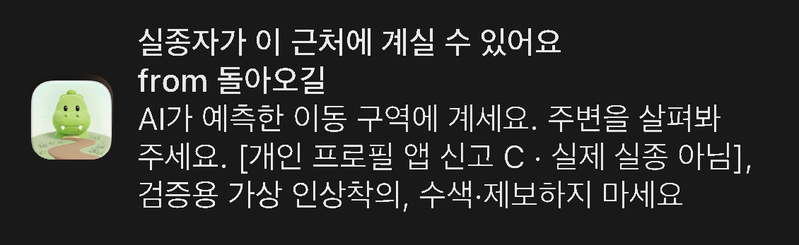
15:50 제공된 캡처에서 돌아오길 알림 카드만 잘라 배경을 가렸습니다.
</td><td>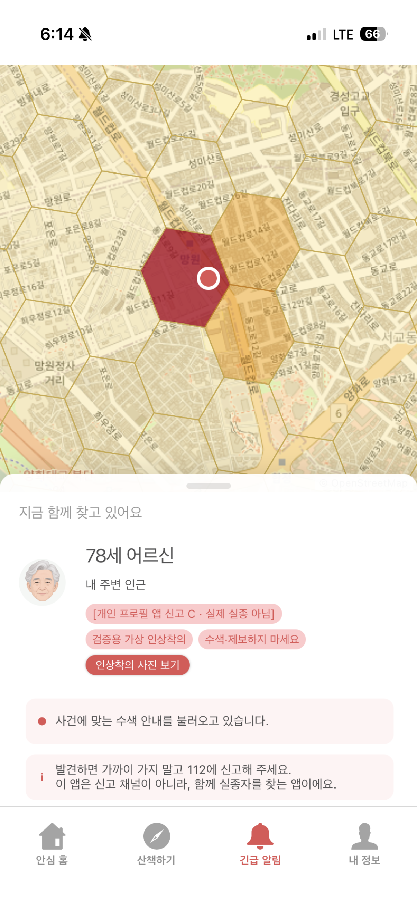
18:14 사용자가 직접 촬영한 같은 사건의 지도입니다.
</td></tr>
</table>

사진 두 장의 촬영 시각은 다릅니다. 별도로 **17:59:17(KST) 현재 대상 구역에 대응하는 구역 진입 푸시의 서버 전송 기록**을 확인했고, 사용자는 18:14경 휴대폰 OS 수신을 확인했습니다. 이 후속 알림의 새 OS 캡처는 확보하지 않았습니다. 서버 전송 시각을 휴대폰 도착 시각이나 지연 시간으로 환산하지 않습니다.

<table>
<tr><th>긴급 알림 목록</th><th>사건 정보</th><th>미러링으로 확인한 지도</th></tr>
<tr><td>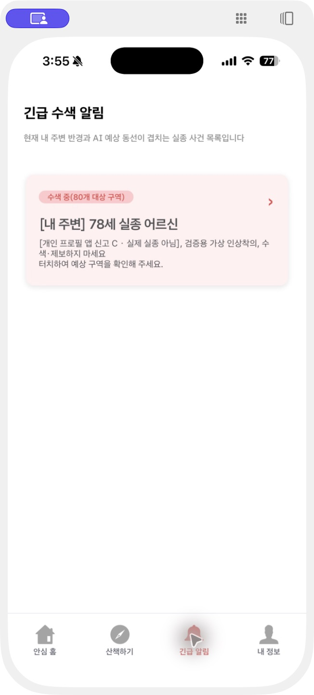</td><td>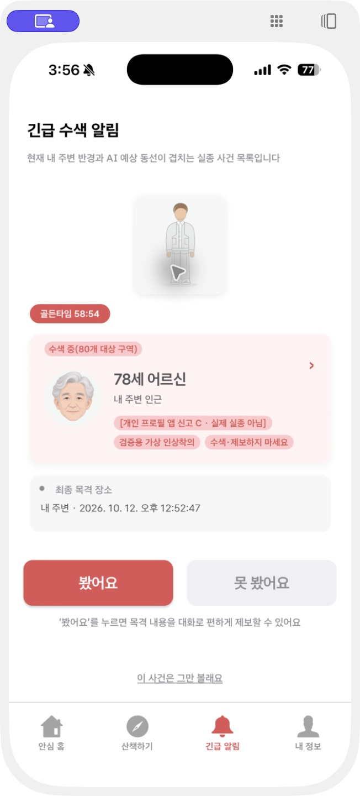</td><td>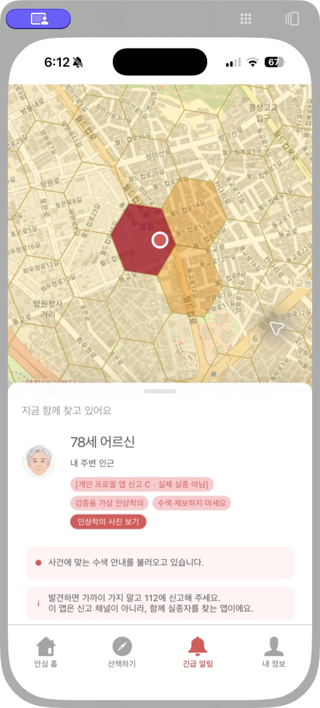</td></tr>
</table>

### 지도와 알림을 읽는 방법

- 지도 색상은 앱에 표시된 예상 위치 확률입니다. 색칠된 모든 셀이 곧 푸시 발송 대상이라는 뜻은 아닙니다. 발송 대상은 별도의 면적 상한 정책과 사용자 위치, 구독 등 수신 조건으로 결정됩니다.
- 지도에 표시된 원형 표시는 해당 화면의 사건 위치 표시입니다. 실제 실종자의 발견 위치를 확인한 화면이 아닙니다.
- 이 화면 하단에는 ‘사건에 맞는 수색 안내를 불러오고 있습니다’가 남아 있습니다. 지도 표시와 OS 수신은 확인했지만, 안내 문구 로딩 완료까지 확인한 사진은 아닙니다.
- 사건 C의 저장 지도는 **17:06 계산된 기존 결과**입니다. 당시 `roadnet_used=false`, `engine=legacy`가 기록돼 있어 새 도로망 수정의 종단간 검증으로 사용하지 않습니다. 이후 배포한 망원 도로망은 [별도의 캐시 및 계산 검증](verification/regional-road-cache-20261026/README.md)에서 확인합니다.

[사건, 지도, 대상 구역의 해시 및 촬영 기록](assets/service-screens-20261026/evidence.json)

## 보호자: 등록과 신고 화면

<table>
<tr><th>보호자 홈</th><th>대화형 사전 등록</th><th>실종 신고 입력</th></tr>
<tr><td>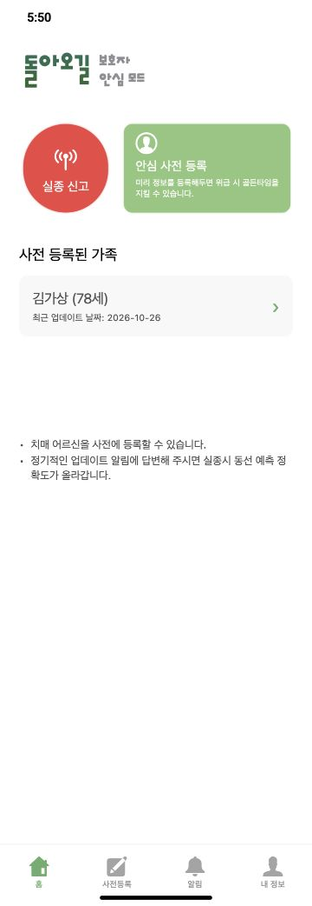</td><td>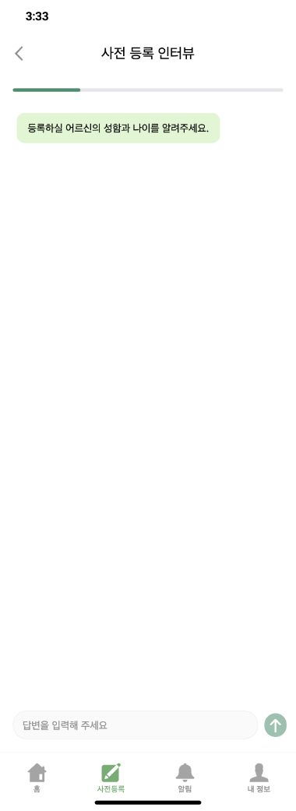</td><td>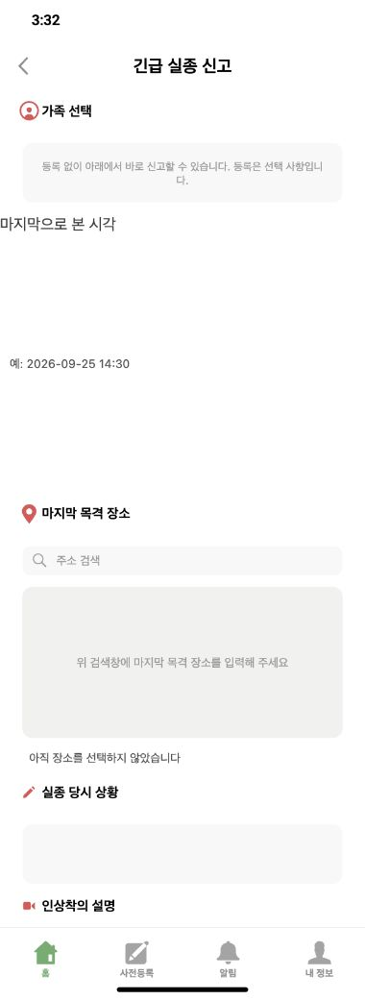</td></tr>
</table>

보호자 홈은 가족 목록 조회 수정 후 17:50 화면입니다. 인터뷰와 신고 폼은 15:32–15:33에 촬영한 시작 상태이며, 신고 폼에는 아직 가족이나 목격 위치가 선택되지 않았습니다. 세 사진 전체를 한 번의 신고 완료 과정으로 해석하지 않습니다.

### 등록된 개인 특성 확인

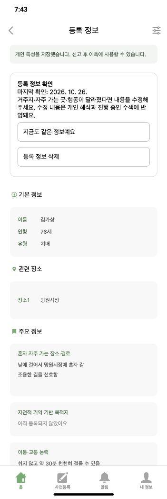

19:43 운영 앱에서 다시 촬영한 합성 프로필입니다. 누락됐던 망원시장을 복구하고 초기 개인화와 마음 규칙 준비를 완료해, 화면에 “신고 후 예측에 사용할 수 있습니다”와 망원시장이 표시됩니다. 검증 오류로 제외된 규칙은 2개에서 0개가 됐습니다. 망원시장 습관·경로·물가 회피는 초기 개인화 값에, 30분 보행 후 10분 휴식은 마음 규칙에 연결됩니다. [실제 모델·실행 검사 및 한계](verification/registered-goal-recovery-20261026/README.md). 이 프로필은 위 사건 C와 별도이며 새 신고나 새 경보는 만들지 않았습니다.

## 시민: 평상시 산책과 상태 안내

<table>
<tr><th>시민 홈</th><th>산책 시작 전</th><th>위치 확인이 필요한 상태</th></tr>
<tr><td>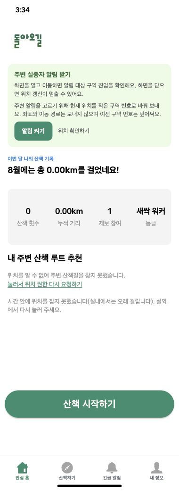</td><td>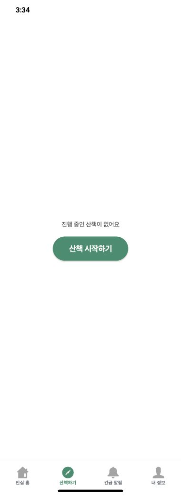</td><td>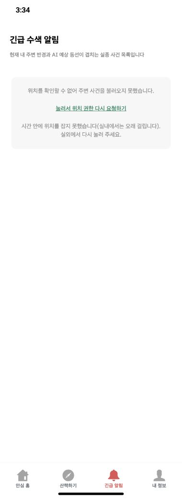</td></tr>
</table>

이 브라우저 캡처에서는 위치를 확인하지 못했으므로 주변 산책 추천과 위치 기반 알림을 표시하지 못했습니다. 산책 경로 기록 완료나 추천 성공을 보여 주는 화면은 아닙니다. 위치가 확인된 iPhone의 사건 화면은 위에 따로 제시했습니다.

추가 상태 화면: 보호자 제보 목록과 일반 시험 알림

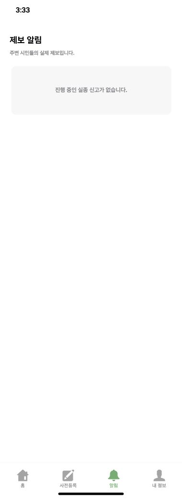

진행 중인 신고가 없을 때의 보호자 제보 목록입니다. 제보 분석 성공 화면과 구분합니다.

일반 시험 알림은 알림 연결 확인용입니다. 구역 선정에 따른 실제 사건 경보의 증빙은 위의 사건 C 알림입니다.

## 촬영 시점의 배포와 확인 범위

| 항목 | 확인 기록 |
|---|---|
| 웹 배포 | #301 가족/지도 읽기 복구, #302 알림 설정 읽기 복구. 18:09경 배포 후 공개 빌드 메타데이터에서 `f5199eee4c1e3ad0c11981d70e8602baa80d2a4d` 확인 |
| 웹 전송 | Supabase, mock=false |
| 서버 도로망 | #300, `cbh-cloud-worker:20261026-road-bundles`, 망원 사전 저장 캐시 |
| 기기 확인 | iPhone 사건 목록, 상세, 확률 지도 표시 및 사용자 OS 수신 확인 |
| 새 합성 프로필 | 19:41 목적지 누락·규칙 검토 수정 배포. 초기·마음 준비 ready, 검증 오류 제외 0개. 19:43 앱의 준비 완료와 망원시장 표시 확인. 새 신고 E2E는 미수행 |
| 기록 보호 | 실제 가족 정보와 다른 앱 알림, 잠금 화면 배경 사진 제외. 알림 카드 배경 가림에 사용자 동의 확보 |

시각은 모두 2026-10-26 한국 표준시(KST)입니다. 화면 증빙과 합성 성능 평가, 신규 도로망 검증은 각각의 범위로 읽어야 합니다.

### 촬영 이후 복구 기록

18:45(KST) 사용량 원장 검사의 메모리 사용을 제한한 수정본을 배포했습니다. 2.27GB 원장을 통째로 올리던 경로를 한 줄씩 검사하도록 바꿨으며, 원장과 호출 상한을 유지했습니다. [원인, 검사와 배포 기록](verification/usage-ledger-memory-20261026/README.md). 위 스크린샷은 이 수정 이후 다시 계산한 지도로 교체한 것이 아닙니다.

19:41(KST) 등록 목적지 보존과 원문 재검토 수정을 배포했고, 위 개인 특성 화면을 19:43 촬영본으로 갱신했습니다. 마음 규칙 1개와 초기 개인화 값의 실제 적용을 검사했으며, 모든 보호자 발화가 실행 규칙으로 변환된다는 주장은 하지 않습니다.
