# 서비스 화면과 촬영 출처

보호자 등록 → 실종 신고 → 시민 수색 지도 → 목격 제보 → 상황 종료의 화면입니다. 제공된 [화면 보드](https://claude.ai/artifact/AMPZrMvYoz4Y4pMwnRju7B)와 보존된 원본 캡처를 대조했습니다. 이미지를 누르면 원본 크기로 볼 수 있습니다.

## 캡처 범위

- 대상 앱: `https://doraogil.pages.dev/`, headless Chromium, 390×844, 한국어·Asia/Seoul, KINTEX 고정 위치.
- 보호자 등록·홈: 2026-10-29 15회차, 웹 빌드 `15fbf65`.
- 신고·지도·제보: 2026-10-28 14회차, 웹 빌드 `7f457d3`.
- 발견·감사 안내: 2026-10-28 발견 분기 13회차, 웹 빌드 `472c93a`.
- `박가상` 등 합성 인물·사건을 사용한 배포 웹앱 캡처입니다. 원본 PNG를 편집하지 않고 복사했습니다. 서로 다른 회차를 하나의 동일 사건·연속 실측으로 해석하지 않습니다.
- 이번 11월 1일 작업은 기존 캡처를 정리한 문서 작업입니다. 최신 main이나 현재 운영 화면을 새로 실행해 촬영했다는 뜻은 아닙니다. 이후 추가된 부스 전용 기능과 시각 처리 수정은 [아키텍처 문서](ARCHITECTURE_20261101.md)에 구분했습니다.

## 화면

<table align="center">
<tr><th align="center">보호자 등록 대화 시작</th><th align="center">보호자 등록 정보 확인</th><th align="center">보호자 홈</th></tr>
<tr>
<td align="center"><a href="assets/service-flow-20261101/registration-chat.png">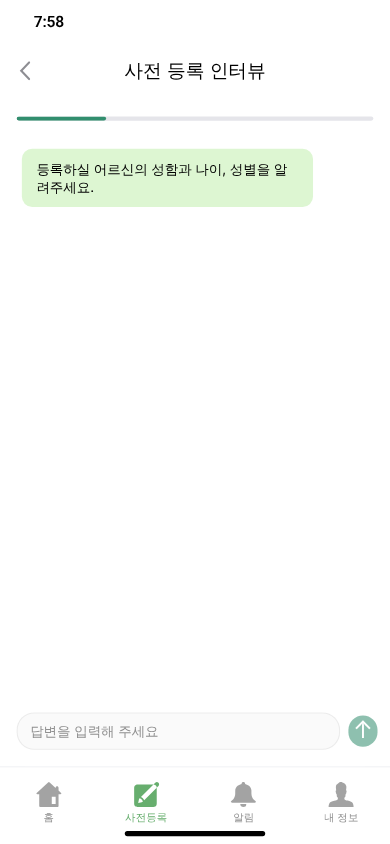</a></td>
<td align="center"><a href="assets/service-flow-20261101/registration-summary.png">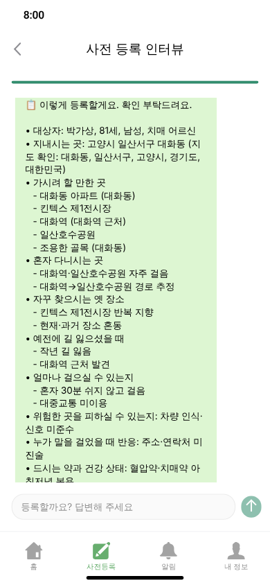</a></td>
<td align="center"><a href="assets/service-flow-20261101/guardian-home.png">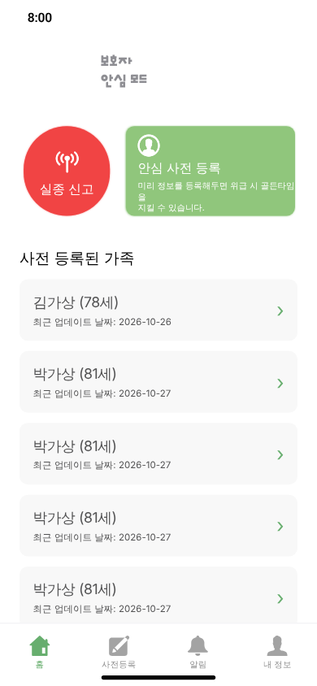</a></td>
</tr>
</table>

<table align="center">
<tr><th align="center">실종 신고</th><th align="center">시민 수색 지도</th><th align="center">긴급 수색 경보 상세</th></tr>
<tr>
<td align="center"><a href="assets/service-flow-20261101/missing-report.png">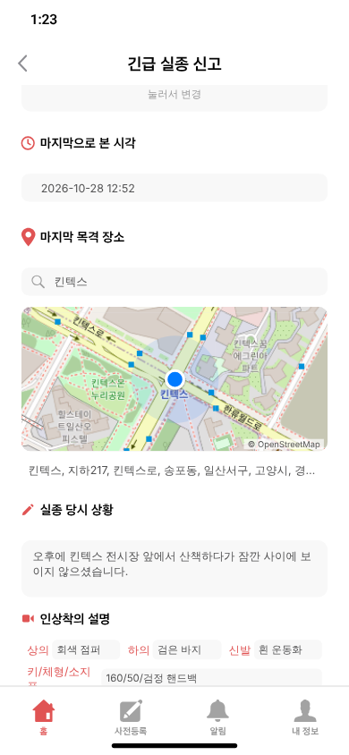</a></td>
<td align="center"><a href="assets/service-flow-20261101/search-map.png">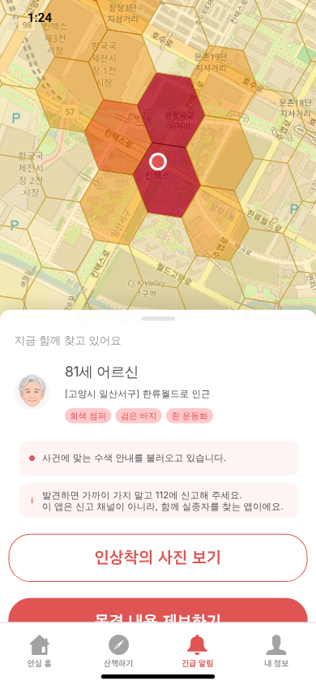</a></td>
<td align="center"><a href="assets/service-flow-20261101/alert-detail.png">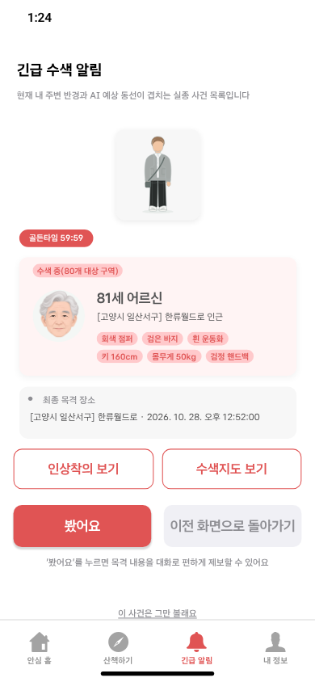</a></td>
</tr>
</table>

<table align="center">
<tr><th align="center">제보 주의사항</th><th align="center">목격 내용 자유 입력</th><th align="center">제보 접수 완료</th></tr>
<tr>
<td align="center"><a href="assets/service-flow-20261101/tip-warning.png">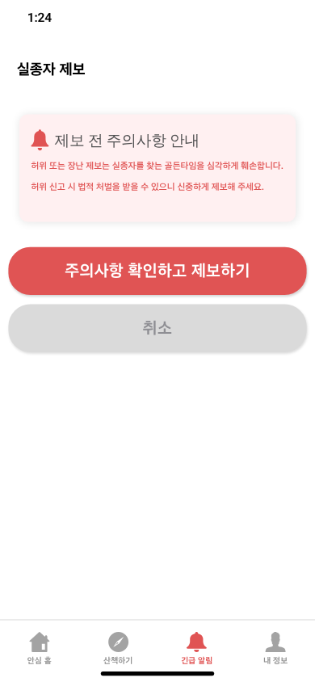</a></td>
<td align="center"><a href="assets/service-flow-20261101/tip-input.png">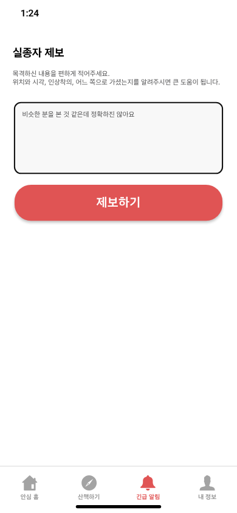</a></td>
<td align="center"><a href="assets/service-flow-20261101/tip-receipt.png">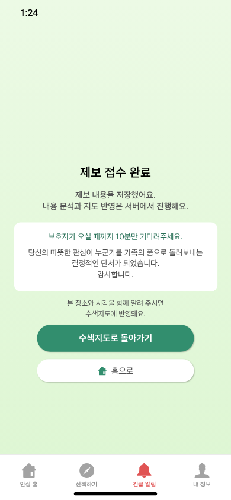</a></td>
</tr>
</table>

<table align="center">
<tr><th align="center">제보 이후 조회한 지도</th><th align="center">상황 종료 카드</th><th align="center">가족 발견·감사 안내</th></tr>
<tr>
<td align="center"><a href="assets/service-flow-20261101/map-after-tip.png">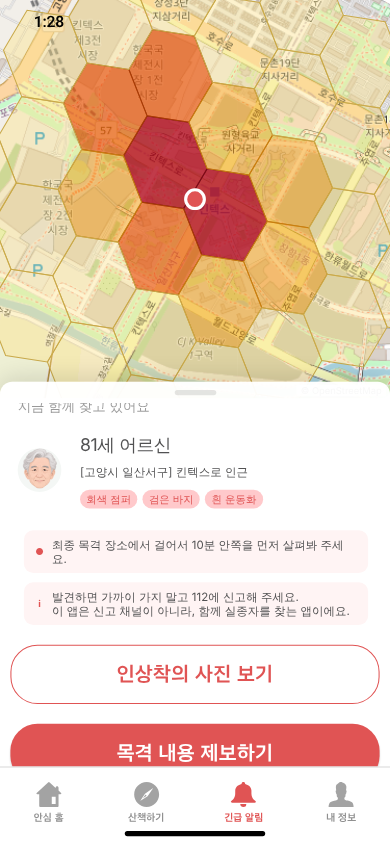</a></td>
<td align="center"><a href="assets/service-flow-20261101/resolved-card.png">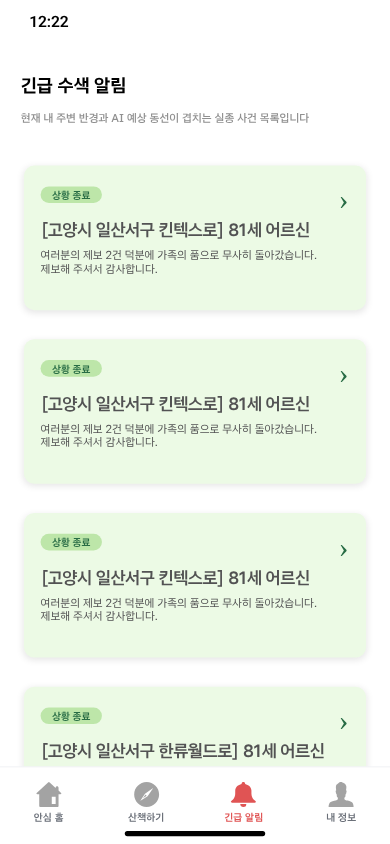</a></td>
<td align="center"><a href="assets/service-flow-20261101/resolved-detail.png">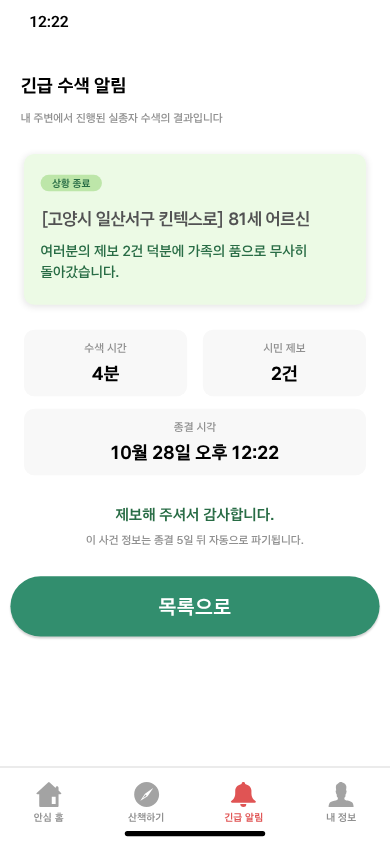</a></td>
</tr>
</table>

접수 완료는 저장 확인입니다. 분석과 지도 반영은 서버에서 이어지며, 이후 지도 캡처만으로 개별 제보의 기여량이나 지도의 정확도를 계산할 수 없습니다. 발견 화면의 ‘4분·제보 2건’과 가족의 품으로 돌아갔다는 문구는 합성 시연 사건의 표시입니다. 실제 환자 구조 실적·발견율·정확도 증거로 사용하지 않습니다. 발견(`found`)과 신고 철회(`withdrawn`)는 다른 종결 사유입니다.

## 원본 위치와 무결성

출처 브랜치: `docs/user-flow-timing-20261027`  
원본 보존 커밋: `148f3eb92a2543a22e06d6b99c61ac19a7260d46`

| 이 문서의 파일 | 보존된 원본 경로 |
|---|---|
| `registration-chat.png` | `docs/user-flow/runs/20261029/screens/A2.png` |
| `registration-summary.png` | `docs/user-flow/runs/20261029/screens/A3-summary.png` |
| `guardian-home.png` | `docs/user-flow/runs/20261029/screens/A4-home.png` |
| `missing-report.png` | `docs/user-flow/runs/20261028d/screens/B2.png` |
| `search-map.png` | `docs/user-flow/runs/20261028d/screens/C3.png` |
| `alert-detail.png` | `docs/user-flow/runs/20261028d/screens/C3-detail.png` |
| `tip-warning.png` | `docs/user-flow/runs/20261028d/screens/C4-warn.png` |
| `tip-input.png` | `docs/user-flow/runs/20261028d/screens/C4-open.png` |
| `tip-receipt.png` | `docs/user-flow/runs/20261028d/screens/C4-done.png` |
| `map-after-tip.png` | `docs/user-flow/runs/20261028d/screens/C5-map-after.png` |
| `resolved-card.png` | `docs/user-flow/runs/20261028c/screens-found/F2.png` |
| `resolved-detail.png` | `docs/user-flow/runs/20261028c/screens-found/F3.png` |

각 파일의 SHA-256과 원본 크기는 [manifest.json](assets/service-flow-20261101/manifest.json)에 기록했습니다. 원본 회차의 전체 계정·요청 데이터는 이 화면 묶음에 포함하지 않았습니다.

README 상단 표지는 사용자가 2026-11-01 제공한 `KakaoTalk_Photo_2026-11-01-21-02-32.png` 원본입니다. [저장된 표지](assets/cover-20261101.png).

OS 푸시 수신은 이 웹앱 캡처와 별도의 [10월 26일 iPhone 검증](SERVICE_SCREENS_20261026.md)을 참고합니다.
