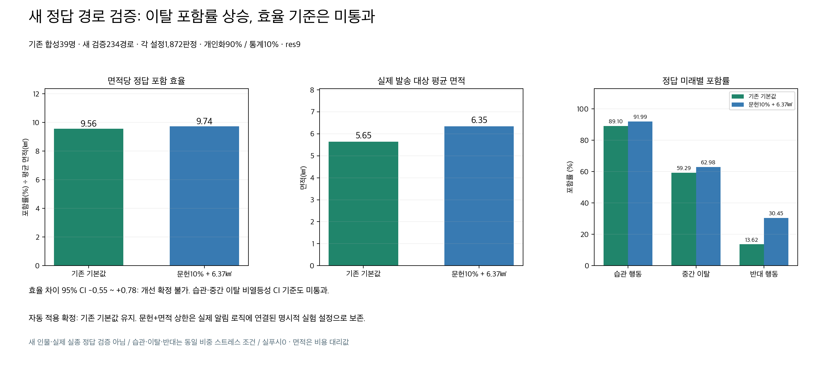
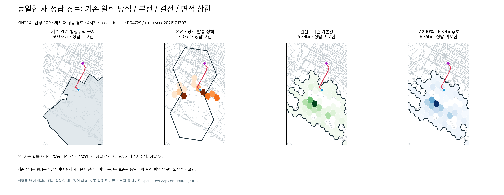

# 예측 알림 면적 상한 연결과 새 경로 검증 — 2026-10-12

면적 상한은 설명용 계산을 넘어 실제 예측 알림의 셀 선택에 연결했다. 문헌 거리 통계 10% + 개인 마음 보행 90%를 예측·시간별 미리보기에 연결하고, 앱 조회·웹 진입·푸시 대상 선정이 같은 선택기를 사용한다. 단, 아래 사전 기준 미통과에 따라 **최종 자동 적용 설정은 기존 기본값 유지**로 확정했다. 새 기능은 명시적 실험 설정으로 보존한다. 운영 배포와 실제 알림 발송은 수행하지 않았다.

## 최종 결정과 수치

최종 기본값: `onboarded_population_prior`, 개인화 90% / 통계 10%, `coverage`, res9, 누적 확률 목표 95%, 500셀 상한. 95%는 모델 지도상의 선택 목표이며 정답 발견률 보장이 아니다.

개발 후보: 같은 입력·가중치·res9에서 문헌 거리 통계와 발송 면적 상한 **5.281216032677167㎢ / 6.368199998062131㎢**. 후보 값은 기존 연구에서 고정한 비용 기준이며 이번 정답을 보고 만든 수치가 아니다. 개발 경로에서 5.28㎢는 습관 행동 포함률 하락으로 제외, 6.37㎢를 고정했다. 검증 경로에서 재조정하지 않았다.

| 새 검증 지표 | 기존 기본값 | 문헌10% + 6.37㎢ 후보 |
|---|---:|---:|
| 전체 정답 위치 포함률 | 54.01% (1011/1872) | 61.81% (1157/1872) |
| 습관 행동 포함률 | 89.10% | 91.99% |
| 중간 이탈 포함률 | 59.29% | 62.98% |
| 처음부터 반대 행동 포함률 | 13.62% | 30.45% |
| 발송 대상 평균 면적 | 5.65㎢ | 6.35㎢ |
| 면적당 포함 효율 | 9.56 | 9.74 |

면적당 효율 = `100 × 정답 포함 건수 / 판정별 발송 구역 면적의 합` (= 포함률% / 평균 면적㎢). 이는 **정답 위치 포함률·면적 비용 대리값**이며 수신자별 precision, 실제 요금, 발견 성공률이 아니다.

| 사전 고정 검증 기준 | 후보−기존 차이의 사람 단위 95% CI | 결과 |
|---|---|---|
| 면적당 효율 개선: 하한 > 0 | -0.553 ~ +0.781 %p/㎢ | 미통과 |
| 전체 포함률 비열등: 하한 ≥ 0 | +4.22 ~ +11.81 %p | 통과 |
| 습관 포함률 비열등: 하한 ≥ 0 | -0.48 ~ +6.89 %p | 미통과 |
| 중간 이탈 비열등: 하한 ≥ 0 | -0.80 ~ +8.65 %p | 미통과 |
| 반대 행동 개선: 하한 > 0 | +11.70 ~ +22.12 %p | 통과 |
| 실제 발송 대상 면적 상한 위반 0건 | 0건 | 통과 |

비열등 미통과는 점수가 하락했다는 뜻이 아니라, **하락 가능성을 배제하지 못했다**는 뜻이다. 후보의 모든 포함률 점추정은 개선됐으나 면적도 0.70㎢ 늘었다. 효율 개선·기존 행동 보존을 함께 확정할 근거가 부족하다. 기본값 유지가 최종 결정이며, 후보를 전체 기준 통과/배포 완료로 표현하지 않는다.

두 번째 그림은 기존 설명 인물 E09와 첫 검증 seed의 반대 행동을 고정한 **실패 사례도 포함한 설명용 한 사례**다. 본선은 보존된 동일 입력·당시 발송 정책, 행정구역은 관련 구역 근사이며 실제 재난문자 실적이 아니다. 색은 예측 확률, 검정 경계가 실제 대상 구역이다. 화면 밖 구역도 면적 수치에 포함한다. 개별 그림으로 전체 성능을 판단하지 않는다.

## 새 정답·독립성·입력 오류 수정

- 기존 합성 온보딩 39명(기존 독립 예측이 없는 E20 제외), 새로운 경로 가중치·속도·이탈 시점·머무름 시간·개인화와 다른 목적지를 생성했다. 신규 인물/실제 실종 관측 검증은 아니다.
- 개발 117경로(seed2026101201), 검증 234경로(seed2026101202/03). 습관/중간 이탈/처음부터 반대 행동을 동일 비중으로 평가한다. 비개인화 목적지의 직선 거리대는 근거리 0.5~1.5, 중거리 1.5~3, 원거리 3~5km를 균형 배치한다. 이 비중과 속도·시점은 가정이며 실제 환자 발생 분포가 아니다.
- 정답 생성기는 예측·알림 모듈과 예측 결과를 읽지 않는다. 같은 관찰상 목적지와 휴식 조건을 공유하므로 온보딩 패턴의 완전한 외부 검증은 아니다. 미리 고정한 78개 개인화/기존 통계 지도 및 156개 문헌 지도를 사용했다.
- 이동 속도 감사에서 이탈 시 최근접 도로 노드로 옮겨 붙이며 발생한 비현실적 점프 4건을 발견했다. 현재 도로 edge의 정확한 위치부터 끝점까지 이어 걷도록 생성기만 수정했다. 후보·비율·상한·seed와 선택된 6.37㎢는 그대로 유지했다. 수정 전 결과는 로컬 `results/input_audit_original`에 보존하며 본 표는 **수정 후 결과**다. 결과 확인 뒤의 기술적 입력 수정이라는 이력도 공개한다.
- 수정 후 25,272개 5분 경로 구간의 이동 속도 위반은 0건이다(좌표 투영 오차 허용3%, 최대 비율1.00234). 완전한 임상/행동 타당성 검증은 아니다.
- 동일 사람의 seed·시간·미래는 독립 표본으로 부풀리지 않는다. 사람 39명을 군집으로 paired bootstrap 10,000회, 고정 seed2026101204. 모든 기준은 [protocol.json](protocol.json), 입력 오류 수정은 [input_repair_protocol.json](input_repair_protocol.json), 최종 판정은 [final_decision.json](results/final_decision.json).

## 제품 연결과 검증 범위

1. `phase2/literature_distance.py`: 기존 ISRID Urban lognormal 근사 μ=.095, σ=1.48을 AEQD/WGS84 면적 적분으로 res9 지도화한다. 개인 원문·조건부 마음 규칙·목적지·모델을 읽지 않는다. 출발 좌표와 시간은 사용한다. 문헌 발견 거리 분포가 시간별 위치 분포는 아니다. 방향 등방성, 거리/속도 상한과 0시간500m 바닥, 조건부 정규화라는 추가 가정이 있다. 제외 꼬리는 품질 정보로 공개하고, 검증 지도 밖 범위는 조용히 잘라 정규화하지 않는다. 근거와 수치 적분 검증은 [기존 문헌 실험](../sar-distance-safety-20261012/README.md)을 따른다.
2. `continuous_prediction.run_pair`와 실제/미리보기 파이프라인: K-EXAONE으로 미리 컴파일한 개인 마음 보행과 별도 문헌 지도를 결합한다. 보행 중 모델 호출0. 문헌에는 통계 보행 체크포인트를 재사용하지 않으며, 개인 체크포인트는 보존한다. 세 개 이상 제보 후에도 문헌 전용 셀이 log pooling으로 사라지지 않도록 이 모드의 초기 결합은 linear로 유지한다. 제보의 기존 후처리는 유지된다. 시간별 캐시 키에 채널 정의·문헌 버전·비율을 포함한다.
3. `phase3/area_budget.py`: 확률/셀 면적으로 순위를 정하되 **발송 해상도로 지리적으로 덮는 셀 합집합**의 타원체 면적을 상한에 청구한다. res8 확대 비용도 포함한다. 같은 구역은 중복 청구하지 않는다. 500셀·면적0·유한값 검사를 적용한다. 상한 안에서의 greedy 선택이며 글로벌 최적 집합 보장은 아니다.
4. 앱 알림 조회·웹 진입·푸시 대상 선정은 같은 선택기를 쓴다. POA/새 지역(D3)에 적용한다. 예측 전 골든타임 reflex의 기존 정책은 별도다. 면적 모드가 누적95%처럼 보이지 않도록 정책 응답은 `coverage=null`, `max_area_km2`를 명시한다. D3는 넓은 문헌 지도의 양수 support 차이가 아니라 실제 선택된 발송 구역의 차이를 계산한다. res8 경계 셀이 이미 발송했던 구역과 겹치면 그 구역을 발송·재시도 대상에서 제외한다.
5. 새 검증 정답 위치 × high/normal/low 참여도: **11,232개 수신자 대상 판정**, 앱 설명·웹 대상·발송 어댑터 결과 불일치0. 외부 vendor 대신 스텁 사용. 단말 실제 수신·발견률·실 사용자 밀도/요금은 미측정이다. 기존 소유권·위치 TTL·닫힌 사건·중복/피로도 제어의 회귀 검사도 유지된다.
6. 실제 `run_prediction` E09, 500 walkers, 1/2/4/6시간: 개인 결과 보존 오차 최대1.67e−16, 문헌 지도 오차0. 시간별 미리보기 부작용0, 외부 호출0. 전체39명의 모델을 새로 호출한 실험이 아니다.

실험 설정은 `STATISTICAL_CHANNEL_DEFINITION=literature_distance_prior`, `ALERT_SELECTION_POLICY=area_budget`, `MAX_ALERT_AREA_KM2=6.368199998062131`. 기본값에 활성화하지 않았다.

## 검사·자료·사용량

백엔드 전체 `pytest -q tests`: **1562 passed, 2 skipped**. 키 없는 카카오 외부 실호출2건이 제외됐고, KINTEX 광역 지도 검사는 수행됐다. 최종 D3 경계 재발송·제보 이후 통계 support 보존 검사 추가 후 관련 검사84 passed. 프런트 해상도 계약4 passed, TypeScript `tsc --noEmit` 통과. 경고는 기존 FastAPI TestClient 의존성 경고이며 테스트 실패가 아니다. 전체 검사의 skipped 원인은 로그와 테스트 조건을 확인한다.

지도는 기존 KINTEX 광역 OSMnx2.1.0 자료(2026-10-04 취득), SHA256 `953d2bca91fe7388011e9ca161dc576c3c79366c578ed314d7cc8deea677db92`, bbox 37.53945063550126/126.5894521104606~37.79097776449874/126.90719948953941. © OpenStreetMap contributors, ODbL. 신규 지도 취득0, 실시간 소음·실내 경로 자료 아님.

외부 모델/API/GPU 호출0, 실제 푸시0. 로컬 원래351경로 + 입력 수정351경로, 평가 재실행과 제품 검증을 사용량 원장에 기록했다. 비용/토큰 단가/실청구액은 **null·미확인**이며 무료로 기록하지 않았다. 공개 원장에는 원문·주소·토큰·키를 넣지 않았다.

공개 결과에는 합성 ID별 점수·면적·해시·조건만 보존한다. 온보딩 원문/준비된 내부 정책/정답 위치 전체는 로컬 연구 산출물로 보존한다. `scripts/`는 원본 연구 스크립트의 검토용 복사본이며 원래 `결선/실험/AREA_ALERT_FRESH_ROUTES_20261012` 경로와 이전 연구 자료를 요구한다. 공개 폴더만으로 재생성 가능한 데이터셋을 제공한다고 주장하지 않는다.

행 단위 점수와 선택 진단4파일은 원본 바이트를 유지하는 `.json.gz`로 공개했다. 압축 해제 후의 해시는 protocol/선택/결정 기록과 일치하며 [압축 증빙](results/compressed_evidence.json)에 두 해시를 기록했다. 전체 정답 좌표와 보호자 원문은 포함하지 않는다.
