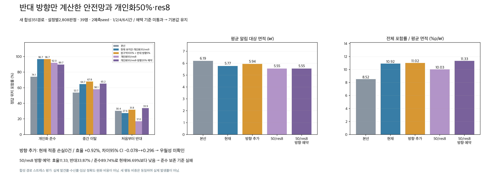
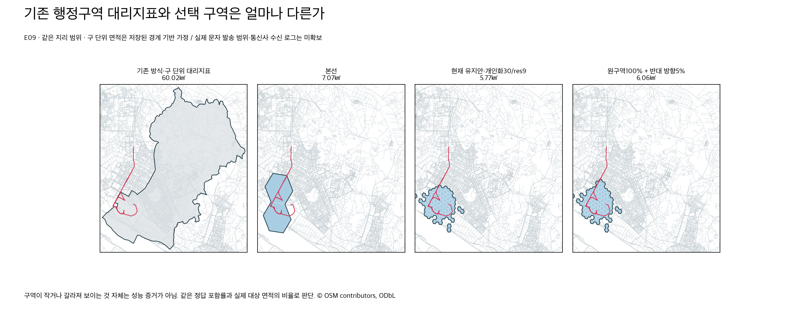
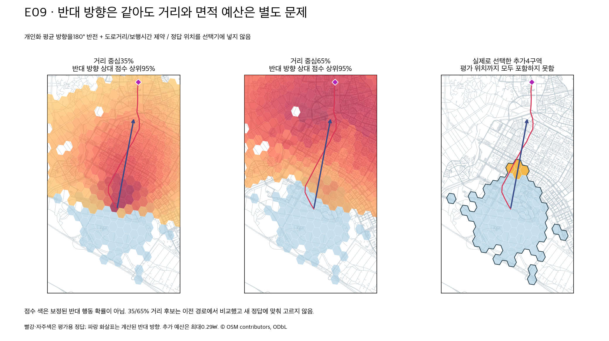
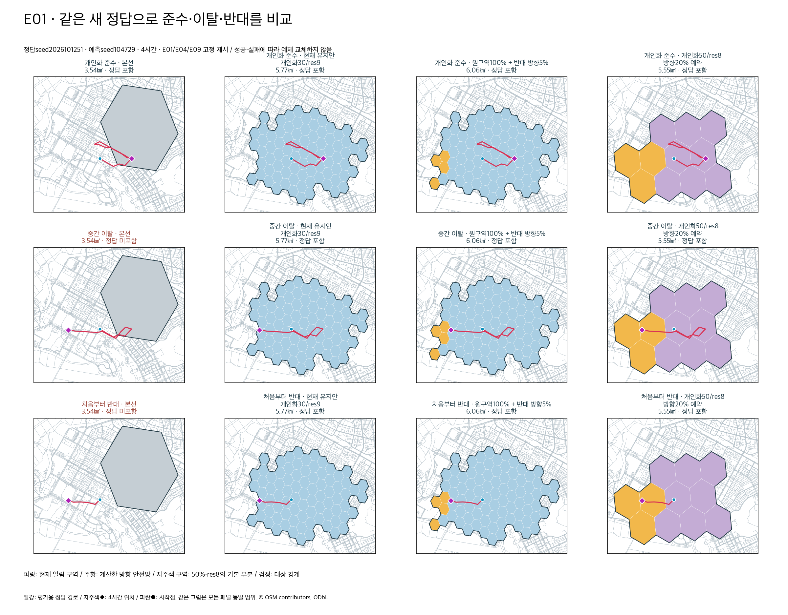
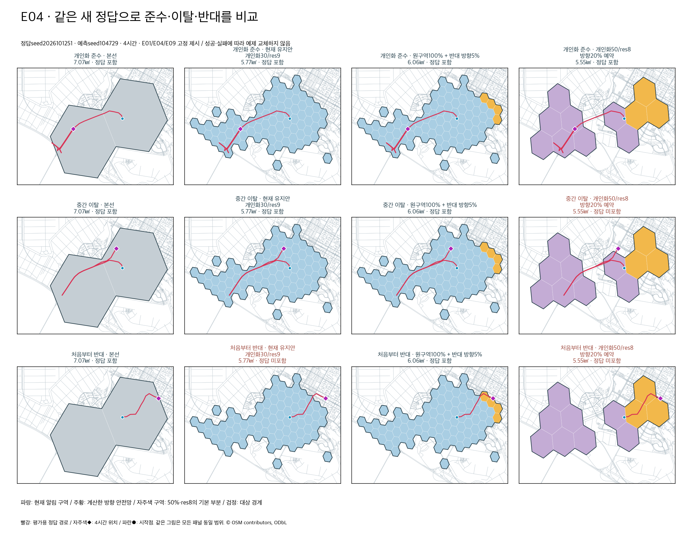
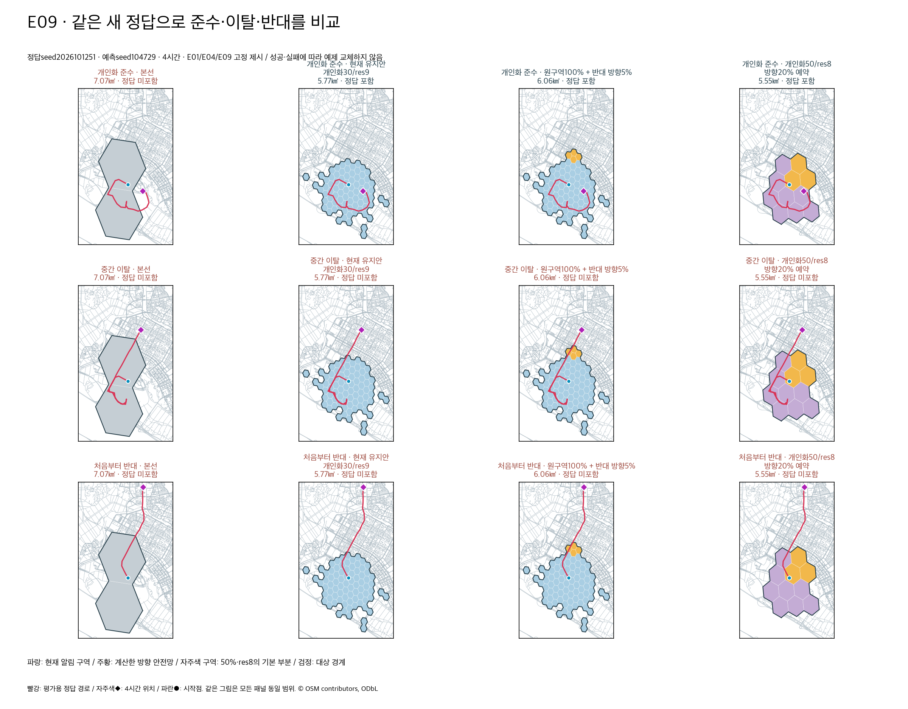
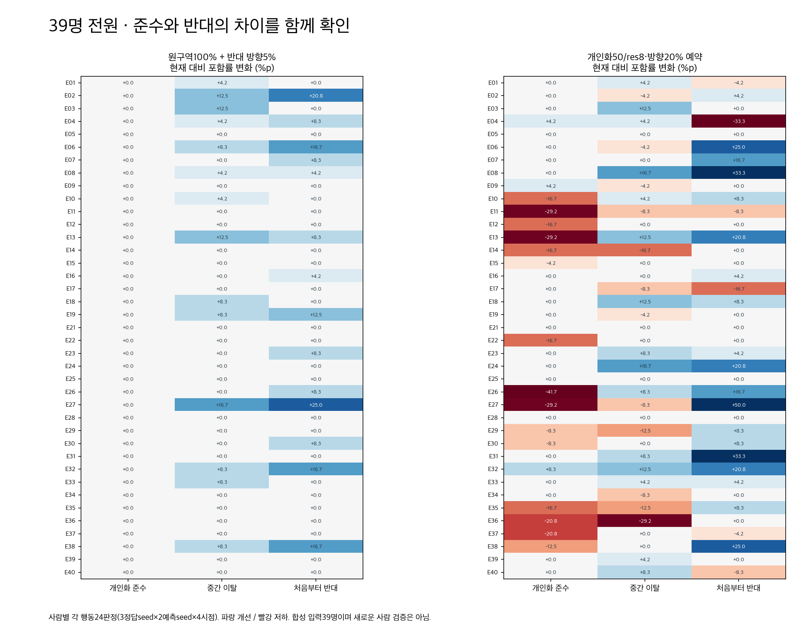

# 반대 방향 안전망 / 개인화 50% 이상·res8 비교

이번 방향 안전망은 **채택하지 않았다**. 현재 develop의 개인화30% + 문헌통계70%, 실제 알림res9, 면적 상한5.8㎢를 유지한다. 개인화50·70·90%/res8도 실행했지만 요청한 준수 성능 보존과 면적당 효율 조건을 함께 충족하지 못했다. 실험 코드와 결과를 보존하며 운영 설정과 발송 경로는 바꾸지 않는다.

## 같은 새 정답의 비교

정답seed2026101251/1252/1253: 39명 × 세 행동 × 3seed = **351개의 새 경로**. 두 예측seed와 1·2·4·6시간으로 설정별2,808판정(행동별936판정). 후보를 이전1231–1233 경로로 고른 뒤 고정하고 새 경로를 만들었다. 새 사람 검증은 아니다. E20은 기존 독립 개인화 예측이 없어 제외했다.

| 방식 | 준수 % | 이탈 % | 반대 % | 전체 % | 면적 ㎢ | 효율 %p/㎢ |
|---|---:|---:|---:|---:|---:|---:|
| 기존 방식·구 단위 대리지표 | 95.51 | 76.92 | 58.12 | 76.85 | 59.05 | 1.30 |
| 기존 방식·시 단위 대리지표 | 98.93 | 98.50 | 97.65 | 98.36 | 266.25 | 0.37 |
| 본선 | 74.15 | 53.74 | 30.45 | 52.78 | 6.19 | 8.52 |
| 현재 유지안·개인화30/res9 | 96.69 | 64.74 | 27.56 | 63.00 | 5.77 | 10.92 |
| 원구역100% + 반대 방향5% | 96.69 | 67.84 | 31.84 | 65.46 | 5.94 | 11.02 |
| 개인화50/res8 | 91.99 | 58.12 | 16.99 | 55.70 | 5.55 | 10.03 |
| 개인화70/res8 | 92.31 | 56.73 | 15.28 | 54.77 | 5.55 | 9.87 |
| 개인화90/res8 | 90.38 | 54.81 | 12.82 | 52.67 | 5.55 | 9.49 |
| 개인화50/res8·방향20% 예약 | 89.74 | 65.17 | 33.87 | 62.93 | 5.55 | 11.33 |
| 통계만·동일 면적 상한 | 75.64 | 59.40 | 34.51 | 56.52 | 5.91 | 9.56 |

효율 = **100×총 적중 판정 수 / 총 알림 대상 면적 합** = 전체 위치 포함률(%) / 평균 대상 면적(㎢). 겹친 H3 발송 구역은 한 번만 계산하고 실제 발송 해상도의 지리적 cover를 계산한다. 이는 실제 정답 위치가 대상 구역에 들어가는지의 효율이다. 구역에 있는 수신자 모두가 실종자를 발견한다는 ‘알림 정밀도’는 아니며, 사람 밀도·반복 발송·실제 수신·수신 후 행동·원화 비용은 아직 포함하지 않는다.

기존 방식의 구·시 단위 수치는 **행정경계 대리지표**다. 저장된 OSM 경계에 LKP/집이 포함되는 구의 합집합과 시 전체를 적용했다. 실제 실종경보문자 발송 범위나 통신사 수신 로그는 없다. 따라서 ‘기존 문자 실측 면적’으로 인용하지 않는다. 넓은 발송은 반대 행동을 많이 포함하지만 면적 비용이 크다는 가정의 비교다.

## 사용자께서 가리킨 반대편만 어떻게 계산했는가

둘레를 한 바퀴 칠하는 이전 외곽20% 후보는 철회했다. 새 방식은 원래 구역을100% 유지하면서, 개인화 예상 방향의 **반대편 도로 도달 가능 구역**에만 추가 점수를 준다. 별도 구역은 원래 구역과 떨어져 있어도 선택할 수 있다. 사용자가 동그라미 친 정답 좌표는 입력하지 않는다.

1. 개인화 보행 분포의 가중 이동 벡터로 방향을 구한다. 이동150m·방향 일관성 기준을 못 넘으면 온보딩에서 확인된 끌림 장소 방향으로 보완하고, 여전히 불명확하면 추가하지 않는다.
2. 검증된 KINTEX **방향 있는 보행 도로망**에서 LKP부터 Dijkstra 도로 거리를 계산한다. 해당 시간과 개인의 보행/휴식 지속시간으로 도달할 수 없는 노드는 제외한다. 연구에서는 기존 보행 모델의48m/분 기준을 명시적으로 전달했다.
3. 방향을180° 반전한 각도 점수(표준편차40°, 반대 방향에서90°를 넘으면 제외)와 도로 거리 점수(도달 예산의35% 또는65% 주변)를 곱한다. 약한 문헌 거리 밀도 보정도 적용한다. OSM 노드가 많은 곳에 부당하게 점수가 쌓이지 않도록 H3 셀 내 최대값을 쓴다.
4. 추가 대상은 점수/면적 순으로 고르고 **실제 발송 구역 합집합의 추가 면적**을 계산한다. 반대 점수의 대부분이 이미 원래 구역 안에 있으면 추가하지 않는 후보도 비교했다.

이 점수는 반대 행동의 **보정된 확률이 아니다**. 5%는 행동 발생 확률이나 개인화 가중치가 아니라 추가 면적 상한 비율이다. `current_poa`의 개인화/통계 결합 비율을 바꾸지 않는다.

최종 확인한 추가 후보: 기존30/res9 구역100% 유지 + 기본면적 상한의5%(최대0.29㎢), 총 상한6.09㎢. 거리 중심35%, 구역 밖 점수 비중50% 이상일 때만 추가. 평균 추가 면적0.17㎢, 전체 평균5.94㎢. E09의4시간 예시는 기존80개 res9 구역 + 반대편4개 구역이다. 먼 정답을 알고 그 주변을 칠한 것이 아니므로 먼 반대 경로를 놓치는 사례도 남는다.

## 통과와 미통과를 구분한 결정

| 기준 | 새 경로 결과 | 판단 |
|---|---|---|
| 기존 현재안 대상100% 보존 | 모든 예측/시점에서 집합 포함 확인 | 통과 |
| 현재안의 개별 적중 손실0 | 준수·이탈·반대 모두0건 | 통과 |
| 현재 대비 준수 보존 | 96.69%→96.69% | 통과 |
| 현재 대비 반대 개선 | +4.27%p, 사람 단위95% CI [+2.35,+6.52] | 통과 |
| 본선 대비 반대 개선 | +1.39%p, CI [-5.66,+8.65] | **미통과·우월성 미확인** |
| 현재 대비 전체 면적당 효율 개선 | 10.9207→11.0216, 상대+0.92%; 차이CI [-0.0777,+0.2959] | **미통과·우월성 미확인** |
| 본선 대비 전체 면적당 효율 개선 | +29.36%; 차이CI [+1.54,+3.39] | 통과 |
| 동일 면적 상한 통계만 대비 개인화 준수 효과 | +21.05%p, CI [+14.64,+27.78] | 통과 |
| 선택 구역과 일반 발송 fanout의 대상 일치 | 합성 수신자67,392판정, 불일치0 | 통과 |
| 앱 조회·웹 조회·시간 경과 갱신까지 새 선택기 연결 | 연결하지 않음 | **미수행·운영 적용 요건 미충족** |

CI는 같은 사람의 경로·시간·예측seed를 함께 재추출한39명 군집 부트스트랩10,000회다. 2,808판정을 독립된 사람 표본처럼 취급하지 않는다. 미통과를 성공으로 다시 이름 붙이지 않는다. 이 확인 경로를 다음 후보의 튜닝에 사용한다면 다음에는 별도의 새 확인 경로가 필요하다.

본선이 맞췄지만 현재안이 놓쳤던152판정 중32판정을 추가안으로 회복했다. 준수0/14, 이탈12/43, 반대20/95 회복이다. **본선만 맞춘120판정은 여전히 놓친다.** 반대는936판정 중638판정을 놓친다. ‘반대 행동도 놓치지 않는다’고 표현할 수 없다.

## 개인화 50% 이상·res8 요청 결과

개인화 가중치50/70/90%와 실제 알림res8을 모두 계산했다. 단순50/res8은 준수91.99%, 반대16.99%, 효율10.03이다. 방향20%를 같은5.8㎢ 상한 안에 **예약**한 가장 효율적인50/res8 후보는 반대33.87%, 효율11.33이지만 준수89.74%로 현재96.69%보다6.94%p 낮다. 추가안과 달리 기존 구역을 일부 교체하는 정책이라 ‘원래100% 유지’로 설명하지 않는다. 요청 조건을 시험한 결과이며 기본값으로 확정하지 않았다.

개인화50/res8에서 **원래 구역에 추가만 하는**5/10/20%도 이전 경로에서 비교했다. 아래는 후보 선택용1231–1233 결과로, 위 새 확인 표와 합치지 않는다. 각 행은 거리 중심35%이고 도달 가능한 온보딩 장소 보호를 포함한다.

| 50/res8 방향 추가 면적 상한 | 준수 % | 반대 % | 평균면적 ㎢ | 효율 %p/㎢ |
|---|---:|---:|---:|---:|
| +5% | 91.45 | 21.26 | 5.55 | 10.28 |
| +10% | 91.45 | 32.37 | 6.06 | 10.37 |
| +20% | 91.45 | 38.25 | 6.56 | 10.05 |

res8 한 대상 셀은 이 지역에서 약0.50㎢다. 추가5% 예산0.29㎢로는 새 res8 셀 하나도 살 수 없어 추가가0이다. 반대로10/20%는 더 많은 반대를 포함하지만 준수는 개선되지 않고 면적 비용이 커진다. 동일 상한으로 실제 발송 해상도를 낮춘 결과이며, 예전95% 커버리지로 더 넓게 보낸res8 비교와 조건이 다르다. 이번 선택기는 기존 fine-cell 밀도 순위 후 지리적 res8 cover 비용을 계산하는 정책이다. **res8 자체가 언제나 나쁘다는 결론은 아니다**. coarse 대상 구역의 확률 합을 먼저 최적화하는 별도 정책은 이번 범위에서 확인하지 않았다.

## 왜 하나의 덩어리로 보이나

문헌 통계 거리 prior는 초기 위치 주변으로 방향에 치우치지 않은 밀도를 만든다. 한정 면적에서 밀도순으로 선택하면 중심부가 연결되어 보일 수 있다. 개인화30%는 이 분포에 사람별 행동 방향과 장소 선호를 결합한다. 경계가 많이 갈라져 보이는 것 자체는 개인화 증거가 아니며, 같은 면적 상한의 통계만 대조군과 준수 포함률 차이로 평가한다. 추가 안전망은 도로·방향 조건이 맞으면 본체와 떨어진 셀을 선택하지만, 그 외관만으로 성능을 정당화하지 않는다.

## 성공·실패를 함께 보여 주는 고정 예제

첫 새seed1251, 예측seed104729, 4시간에서 E01/E04/E09를 고정해서 세 행동 모두 표시했다. 점수가 좋은 경로로 교체하지 않았다. 파랑은 현재구역, 주황은 추가/예약 안전망이며 색칠 면적은 개인화 혼합 가중치가 아니다. 검은 경계는 실제 알림 대상 cover이고 자주색◆는 **평가용** 위치다. 한 그림 안의 모든 패널은 같은 지리 범위다.

## 검증 범위와 재현 자료

- `confirmation_summary.json`, `per_person.json`, `figure_examples.json`, `example_data.json`, `preliminary_only_recovery.json`, `final_decision.json`에 표·그림·결정을 보존했다. 원본 판정28,080행과 전체 선택 구역은 로컬 `결선/실험/DIRECTIONAL_ALERT_SAFETY_20261012/results`에 보존한다.
- `reproduction/`은 실험 스크립트의 당시 사본이다. 원래 실행 위치는 워크스페이스의 `결선/실험/DIRECTIONAL_ALERT_SAFETY_20261012/scripts/`이며 상위 경로에 기존 캐시가 필요하다. Git의 사본 위치에서 곧바로 실행하는 구조는 아니다. 스크립트는 외부 소켓을 차단하고 기존 예측/지도/문헌 분포만 읽는다.
- 후보 선택3단계는 각88설정, 원래30/res9구역 보존 추가 비교는24설정이었다. 50% 이상/res8의 준수 보존 조건을 만족하는 후보가 없어 원래 최종 제약인30% 이상을 유지하는 추가안도 별도로 비교하고, 새 정답 전에 하나와50/res8 도전안을 고정했다. 첫104설정 구성은100상한 assertion에서 **계산 전** 중단 후88설정으로 고쳤다. 실패도 원장에 남겼다.
- 장소 보호에서 fine H3 셀 안에 도로 노드가 없으면 유효한 장소까지 빠지는 문제가 있었다.150m 이내 최근접 검증 도로에 붙이고 도로거리+접근거리를 확인한 뒤 **신고 장소와 도로 노드 양쪽**을 cover하도록 고쳤다. 고정 테스트가 이 경계 사례와 도달 불가 장소 배제를 검증한다. 현재 운영 선택기와 별개인 실험 helper다.
- 연구 모듈 `backend/app/phase3/directional_safety.py`는 운영에서 호출하지 않는다. 실제 API 조회·웹 조회·D3 갱신·persisted targets 연결은 수행하지 않았다. 일반 `alerts.send_alerts`에 연구 구역을 넣고 push를 stub으로 바꾼 대상 매칭 검증만 수행했다. 검증 직전 합성 기기 위치를 갱신했으며 제품 TTL/동의/종료 규칙은 약화하지 않았다.
- 관련 테스트53개 통과. 새 정답25,272이동구간의 물리 검증에서 투영오차 허용3% 초과0건(최대 비율1.002275). 합성 진실은 같은 온보딩 행동을 바탕으로 만든 독립 authored 경로이며 임상 정답이 아니다. 반대 방향 시나리오 자체도 명시적으로 구성한 스트레스 시험이므로 실제 개인화 이탈 발생률이나 전체 일반화 성능으로 해석하지 않는다.
- `protocol.json`은 새 정답 생성 전 동결 원본이며 해시를 위해 수정하지 않았다. 복사된 과거 `profiles.current`/`selection`/`validation_gates`, `directional_scores`의35m/분, 1251의development 이름 등 오래된 설명 필드가 남아 있다. 이번에 실제 적용한 내용은 `candidate_selection`, `personal50_res8_challenger`, `references`, `planning_speed_m_min=48`, `selection_truth_seeds=1231–1233`, `validation_rule` 및 실행 사본에 따른다.1251은 후보 선택에 쓰지 않았고 세 새seed 모두 동결 후 평가했다. 모호한 원본은 지우지 않고 이 정정 설명으로 보존한다.

지도: KINTEX 제1·2전시장 주변, OSMnx2.1.0, 취득2026-10-04, 노드78,502·간선226,318. graph SHA256 `953d2bca91fe7388011e9ca161dc576c3c79366c578ed314d7cc8deea677db92`. 원본·범위·취득 증빙은 기존 `MIND_completion_20261004/map_full_support`에 보존했다. © OpenStreetMap contributors, ODbL. POI 분류를 실시간 혼잡 관측으로 쓰지 않았다.

새 모델/API/GPU 호출0, 지도 재취득0, 실제 알림0. 로컬 CPU와 기존 캐시만 사용했다. 비용은null/미확인이고 무료로 기록하지 않았다. 공용/실험 원장에 시작·실패·추가 묶음·종료 이벤트를 남겼다. 원문·키·실제 사용자 주소는 이 보고서/비용 원장에 넣지 않는다.
