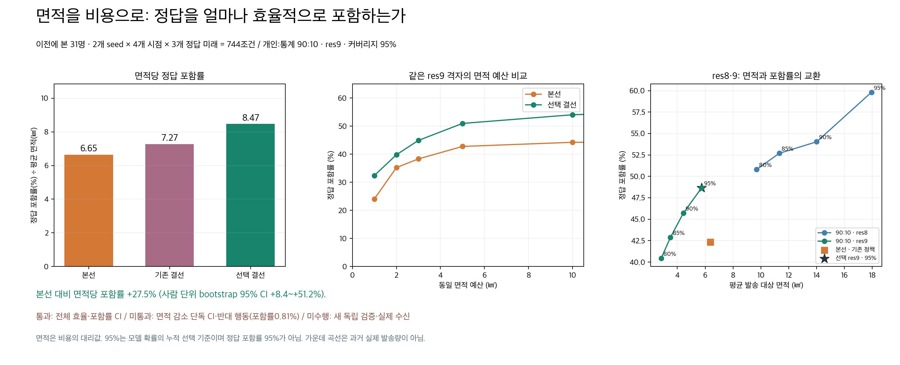
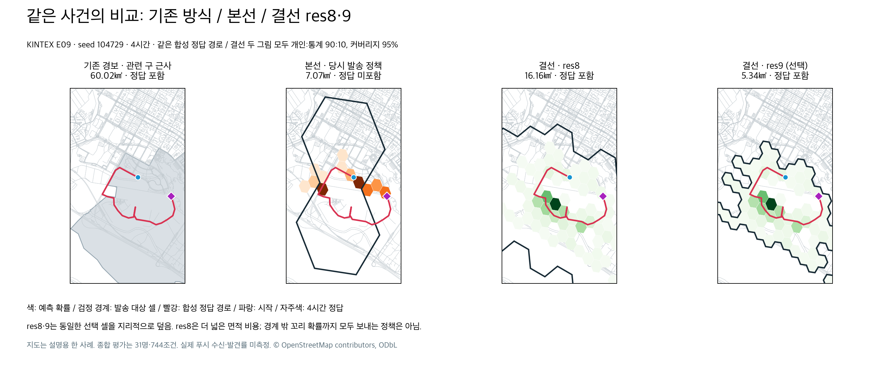

# 면적당 정답 포함률과 res8·9 최종 개발 설정

알림 대상 면적을 발송 비용의 대리값으로 사용하면, 포함률만 최대화해 넓게 보내는 방법보다 **같은 면적으로 얼마나 많은 정답 위치를 포함하는지**가 중요하다. 사용자 요청에 따라 평가 우선순위를 변경했다. 앞선 res7 합산 AUC 또는 native AUC 선택을 사전에 이 지표로 정했다고 바꾸어 쓰지 않는다.

## 개발 설정과 선택 기준

기본값은 **개인 마음:통계 prior = 90:10, 알림 res9, 누적 확률 커버리지 95%**다. K-EXAONE이 보호자 원문·기존 RAG 근거로 사전에 해석해 저장한 조건부 프로그램을 보행 중 코드로 실행한다. 보행 중 모델 호출은 하지 않는다. 본선의 마음 모델은 EXAONE Mind 파인튜닝 `exaone-mind-dem5`였다. 새 런타임 K-EXAONE 재해석 후보는 32건의 유효 시각 입력 검증에서도 사용 가능 23/25, 의미 적합 18/25, 치명적 실행 오류 1건으로 통과하지 못해 적용하지 않는다. 해당 유료/서버 실험의 사용량은 별도 원장에 남아 있으며 금액은 미확인이다.

E01–08 개발 8명, 개인 비율 0/30/50/60/70/80/90/100%, res8/9, 커버리지 80/85/90/95%의 64개 조합을 비교했다. `100 × mean(hit) / mean(area_km²)`를 최대화하되 **개발 포함률 ≥ 본선, 평균 면적 ≤ 본선**이라는 두 점 추정 조건을 모두 요구했다. 체크별 비율의 평균 대신 합계의 비율을 사용한다. 동점은 높은 포함률, 작은 면적, 이전 70% 비율과 거리, 낮은 해상도 순으로 결정한다.

개발 선택은 49.48% / 5.281km² = **9.37 %p/km²**, 본선은 같은 49.48% / 5.522km² = 8.96이다. 무조건 효율만 높이면 개인100%·res9·80%가 우세하지만 개발 포함률39.06%로 본선보다 낮아 제외된다. `selection.json` 해시 `3c837bb77a726faa7dc8d7ade17d7c4f27cc0f0e030adfb755c4f35a97f885c5`를 먼저 고정한 뒤 기존 31명 결과를 계산했다.

## 비교 결과

동일 KINTEX 제1·2전시장 OSMnx 지도, 31명 × seed 2개 × 시점1/2/4/6시간 × 미래3개 = 744조건이다. 744명의 독립 피험자가 아니며, 이 31명은 이미 검토했던 합성 사례다. E20은 과거 대응군과 대상을 맞추기 위해 제외했으며, 현재 실행 실패로 제외한 것이 아니다. 지도 그래프 SHA256은 `953d2bca91fe7388011e9ca161dc576c3c79366c578ed314d7cc8deea677db92`다. 신규 모델·지도·푸시 외부 호출은 0회다.

| 실제 정책의 대상 면적 기준 | 평균 면적 km² | 합성 정답 포함률 | 면적당 포함률 %p/km² |
|---|---:|---:|---:|
| 본선 기존 발송 정책 | 6.368 | 42.34% | 6.65 |
| 기존 결선 발송 정책 | 5.713 | 41.53% | 7.27 |
| 선택 결선 90:10 · res9 ·95% | 5.742 | 48.66% | 8.47 |



본선 대비 면적 효율 **+27.46%**. 사람 단위 paired bootstrap 10,000회 95% CI **+8.42~+51.22%**다. 효율 차이는 +1.826 %p/km² [0.640,2.973]. 포함률 차이 +6.32%p [0.27,12.90]로 비열등성은 통과한다. 면적 차이 −0.627km² [−1.479,+0.219]는 감소 단독 신뢰구간을 통과하지 못했다. 지표를 바꿔 이 실패를 성공으로 바꾸지 않는다.

동일 res9 격자와 동일 예산으로 두 예측 지도를 다시 평가하면 5km² 포함률은 본선42.74%→선택50.94%, 10km²는44.22%→54.03%다. 같은 res9의 AUC@10은38.45→46.09점, 차이 +7.64 [3.79,12.05]. 이는 과거 본선 클라이언트가 실제 res9 발송을 했다는 뜻이 아니다. 기존 res7 합산 기준 AUC@10도 별도로 보존한다:23.57→26.72점, 차이+3.15 [0.95,5.43]. 서로 다른 AUC 정의를 섞어 비교하지 않는다.

## 여러 정답 미래와 한계

| 합성 정답 미래 (각 248조건) | 본선 포함률 | 선택 결선 포함률 |
|---|---:|---:|
| 평소 행동 habitual | 77.42% | 94.35% |
| 중간 이탈 departure | 38.71% | 50.81% |
| 개인 특성과 반대 행동 contradictory | 10.89% | **0.81%** |

반대 행동은 중요한 취약점이다. 전체 3미래를 동일 가중한 효율이 우세하다는 결과를 ‘모든 상황에서 더 정확’하다고 해석할 수 없다. 사후 개발 진단에서도 각 미래 포함률을 모두 본선 이상으로 유지하면서 본선 면적 이하인 후보는 64개 중 0개다. 이 진단을 선택 전에 정한 조건처럼 쓰거나 이미 확인한 31명을 새 독립 검증으로 다시 쓰지 않는다. 기본값은 **측정한 전체 면적 효율이 가장 높은 개발 설정**이며, 모든 상황의 최종 성능·운영 배포 통과 판정은 아니다.

| 검증 항목 | 판정 |
|---|---|
| 개발 전체 포함률 하한·면적 상한 | 통과 (점 추정 기준) |
| 31명 전체 면적 효율 개선 CI | 통과 |
| 31명 전체 포함률 비열등성 CI | 통과 |
| 면적 감소 단독 CI | 미통과 |
| 모든 정답 미래 포함률 개선 | 미통과 (반대 행동) |
| 새 독립 holdout 검증 | 미수행 |
| 실제 수신자 수·발송 비용·푸시 수신·발견 정확도 | 미측정 |
| 운영 배포 자격 | 확정하지 않음 |

95%는 **모델 확률의 누적 선택 기준**이고 정답 포함률95%가 아니다. 대상 면적은 인구 밀도·구독자 수·중복 억제·발송 성공률을 반영하지 않으므로 실제 금액으로 환산하지 않는다. 포함률은 시민 수신·실제 발견에 대한 precision/recall이 아니다. 선형 혼합의 제보 없음 조건이며, 제보3건 이후 log-linear 혼합의 성능으로 확대하지 않는다. 최대 선택 셀500 상한과 모델 지도 밖 정답의 미포함을 유지한다.

## 동일 사건 그림과 실제 연결



E09 4시간 동일 경로·시각·지도 범위. 기존 관련 구 근사는60.02km², 본선7.07km², 결선 res8은16.16km², res9는5.34km²다. 두 결선 패널의 비율90:10·커버리지95%는 동일하다. 기존 방식은 실제 재난문자 전파 면적이 아닌 행정구역 근사이며 그림 밖 대상도 있다. 색은 예측 확률이고 검정 경계가 실제 대상 셀이다. 선택한 작은 셀을 지리적 교차 영역으로 덮고 발송 단계에서 참여도 확률 문턱으로 재삭제하지 않는다. 전체 꼬리 확률을 모두 보내지는 않는다.

서버 targeting-policy의 해상도로 등록·조회·구역 진입 위치 셀을 생성한다. 클라이언트는 기존 Supabase read lane인 `GET /phase3/webpush/public-key`에 함께 실린 정책을 읽어 모델 계산 큐 뒤에서 대기하지 않는다. `GET /phase3/targeting-policy`는 직접 API 진단 경로로도 제공한다. 서버에 res9를 설정하고 시민 위치가 res7에 고정되어 있던 계약을 고쳤다. `target_cell`에 유효한 res7/8/9를 보내고, 기존 `cell_res7` 필드는 정확한 res7만 허용한다. 잘못된 셀·충돌 필드는422, 정책을 읽지 못한 새 클라이언트는 위치 판정을 진행하지 않는다. 위치는 현재 셀만 덮어쓰고 이동 이력을 만들지 않는다. res9는 이전 res7보다 더 작은 위치 구역을 서버에 드러내므로 UI와 API 개인정보 설명도 바꿨다.

인증 웹 위치와 fine 셀은 관측 갱신5분 후 발송 대상에서 제외한다. 위치 값 자체를 자동 삭제하는 TTL은 아니다. 정지 상태도 실제 새 관측으로 갱신하며 지난 관측 시각을 새 시각으로 꾸미지 않는다. 웹 null은 지우고 native null은 이전 시각을 갱신하지 않는다. 기존 owner 없는 res7 기기의 동작은 유지하며 새 해상도와는 지리적 겹침 근사로 지원한다. 그 사람의 fine 위치를 복원하지 않으므로 res9 정확한 수신 면적을 기존 클라이언트 전체에 적용했다고 말할 수 없다.

계정 소유권·종결 사건 제외·중복 억제는 유지한다. 정상 알림 전체에 하루6건 제한을 추가한 변경은 아니다. 실제 Web Push/Expo 수신은 호출하지 않았다. native `/devices`의 Cloud 브리지 연결과 EAS 실기기 검증은 이번 오프라인 계약 검증의 범위 밖이다. develop 반영은 운영/main 배포를 뜻하지 않는다.

## 재현과 코드 검증

`validation.json`의 명령·환경·결과를 확인한다. 기존 회귀 검증은 res7·70:30·80%를 명시한 fixture로 보존하고, 전용 계약 테스트에서 실제 기본값과 res8/9 등록→조회→발송 및 웹 구역 진입을 검증한다. 네트워크·벤더·모델은 차단하거나 stub 처리한다. 프런트 wire 테스트도 서버7/8/9에 따라 현재 위치 셀·등록 body·조회 query·진입 판정이 일치하는지 확인한다.

`channel_executor_verification.json`은 #280의 실제 run_pair가 저장된 원본 두 채널과1/2/4/6시간 모두 최대 오차1.67e−16로 일치한 기록이다. 이 변경의 혼합/대상 코드 검증은 별도 `final_profile_verification.json`에 남긴다. 모델을 다시 불러 파라미터를 새로 만든 검증이 아니다.

공개 파일에는 숫자·합성 식별자·해시만 보존한다. 보호자 원문·개인 정답 원본·원장 키는 올리지 않는다. `scripts/verify_selection.py`는 공개 개발 grid에서 선택을 재현한다. 나머지 스크립트에는 원본 실험 자료 루트가 필요하다. 같은 데이터 폴더 구조와 원본 입력 해시를 사용하고 출력 폴더에 `selection.json`을 복사한 뒤 빈 별도 폴더에 실행한다. 출력 파일이 존재하면 덮어쓰지 않는다.

```sh
python docs/experiments/final-area-efficiency-20261011/scripts/verify_selection.py
python docs/experiments/final-area-efficiency-20261011/scripts/confirm_native.py /path/to/research-root /path/to/empty-output-with-selection
python docs/experiments/final-area-efficiency-20261011/scripts/calculate_efficiency.py /path/to/research-root /path/to/confirmed-output
```

`original_*_source.py`는 당시 결과의 source hash를 보존한 원본이며 경로·출력을 수정하지 않은 감사용이다. CLI용 복사본은 재현 경로를 분리했으므로 source hash가 다르다. input 해시·고정 선택 해시·점수·bootstrap seed를 비교한다.
