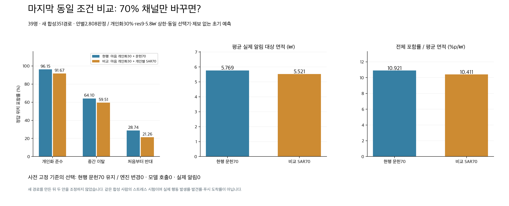
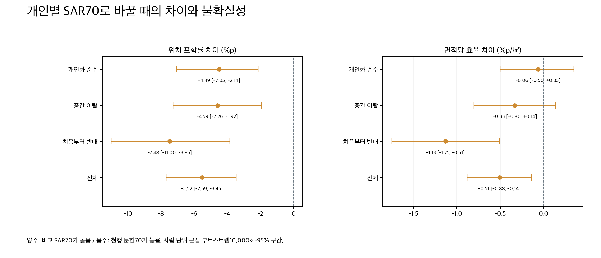
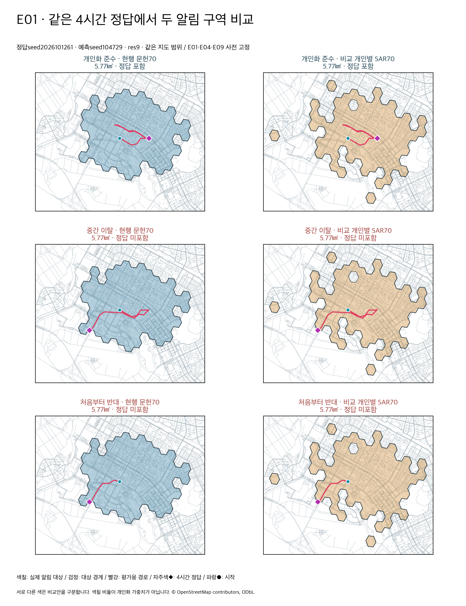
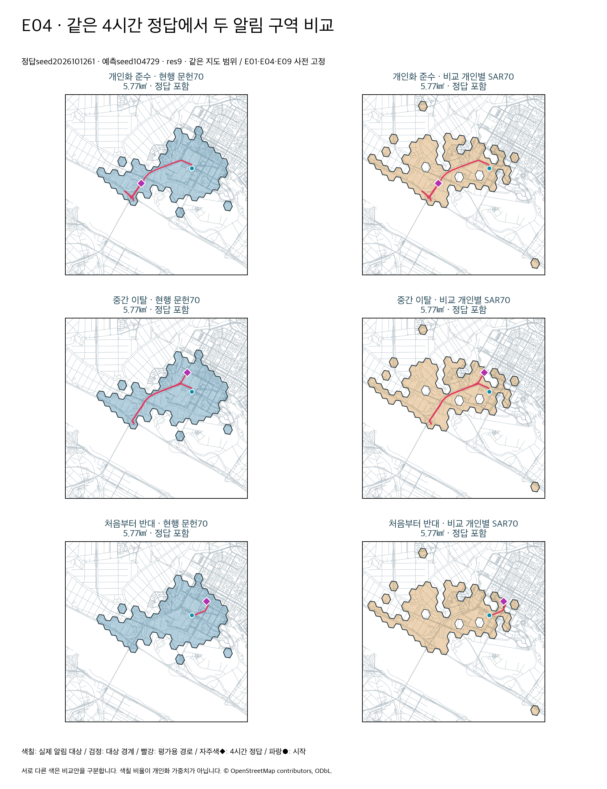
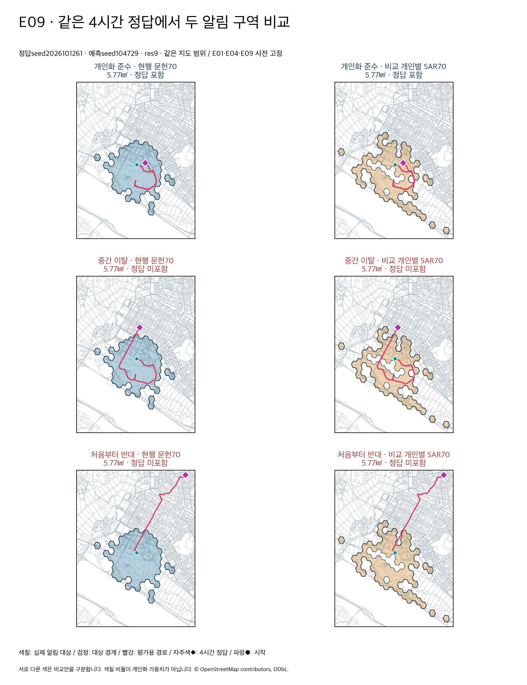

# 마지막 채널 비교와 최종 확정 — 엔진 변경 없음

**현재 배포된 개인 마음30% + 독립 문헌통계70%, res9·5.8㎢ 상한을 유지한다.** 개인별 SAR 수치를70%에 넣은 비교안은 새 경로에서 준수·이탈·반대 포함률과 전체 면적당 효율이 모두 낮았다. 이번 목표의 추가 후보 탐색과 엔진 변경을 종료한다. 설정 전환·모델 재호출·재배포는 수행하지 않았다.

## 두 안에서 정확히 다른 것

| 항목 | 현행 최종안 | 요청한 비교안 |
|---|---|---|
| 개인 마음30% | SAR 초기 수치 + 저장 K 초기 개인 해석 + 저장 K 마음·행동 규칙 보행 | **완전히 같은 개인 지도** |
| 통계70% | 문헌 거리분포 근사; 개인 파라미터·마음 규칙 미사용 | 온보딩 정보로 SAR가 생성한 **개인별 초기 숫자 prior**를 사용한 보행; 마음 규칙 없음 |
| 기존 설정 이름 | `literature_distance_prior` | `onboarded_population_prior` |
| SAR 숫자의 경계 | 개인30%에서 K 보정 후 사용 | 통계70%는 **K 보정 전 original SAR snapshot** 사용; K 초기 개인 해석/마음은30%에만 |
| 축 채점 | OFF | OFF |
| 개인 조건부 채널 가중치 | 30% | 30% |
| 알림 정책 | res9·area_budget·합집합 상한5.8㎢·최대500셀 | 동일 |
| 제보·결합 | 제보0·linear pool | 동일 |

통계70%도 개인별 SAR 수치를 쓰는 비교안이므로 정보 의미상 개인화 요소가 두 채널에 들어간다. 이것을 ‘개인화가30%뿐’으로 설명하지 않는다. 반대로 숫자30:70은 모델 기여도나 임상적으로 보정된 행동 발생률이 아니라 **계산된 지도 결합 가중치**다. 기존 엔진의 설정 모드만 로컬 격리 과정에서 선택했고 제품 코드·서비스 설정은 변경하지 않았다.

## 새 확인 경로의 비교

비교안을 두 개로 고정한 뒤 정답seed1261–1263의 **39명×세 행동×3seed = 351개 새 합성 경로**를 만들었다. 두 예측seed104729/130363과1·2·4·6시간으로 **안별2,808판정, 행동별936판정**이다. 예측은 기존 보존 결과를 재사용하며 동일500보행자·KINTEX 지도·원본 SAR/K 입력을 유지했다. 새로운 사람이나 실제 실종 발견 위치는 아니다.

| 방식 | 준수 % | 이탈 % | 반대 % | 전체 % | 평균 면적 ㎢ | 전체 효율 %p/㎢ |
|---|---:|---:|---:|---:|---:|---:|
| 현행: 개인 마음30 + 문헌통계70 | 96.15 | 64.10 | 28.74 | 63.00 | 5.769 | 10.921 |
| 비교: 개인 마음30 + 개인별 SAR70 | 91.67 | 59.51 | 21.26 | 57.48 | 5.521 | 10.411 |

효율 = **100×총 적중 수 / 총 실제 알림 면적 합** = 전체 포함률(%) / 평균 면적(㎢). H3 지리적 발송 구역의 겹친 면적은 한 번만 계산한다. **같은 면적 상한**이며 두 안의 실제 사용 면적을 강제로 같게 채우지는 않았다. SAR70 안은 특히1시간 일부 사례에서 양의 지도 지원이 좁아 상한보다 적은 면적을 선택했다. 적은 면적의 이익도 위 효율에 반영했다. 세 행동은 같은 비중의 스트레스 평가이며 실제 행동 발생 빈도를 뜻하지 않는다.

현행은 SAR70 대비 준수 **+4.49%p**, 이탈 **+4.59%p**, 반대 **+7.48%p**, 전체 **+5.52%p**, 전체 면적당 효율 **+4.89%**다. 평균 면적은 현행이0.248㎢ 더 크지만 포함률 증가가 그 비용 증가를 넘어섰다. 개별 수신자 밀도·중복 발송·실제 발견·원화 비용은 이 효율에 포함하지 않는다.

## 불확실성과 선택 기준

사람39명 단위로 경로·예측seed·시간을 함께 재추출한 paired bootstrap10,000회다. 2,808판정을 서로 독립된 사람처럼 취급하지 않았다. 아래는 **현행 − SAR70**의 차이다.

| 지표 | 차이 | 사람 단위95% 구간 |
|---|---:|---|
| 준수 포함률 | +4.49%p | [+2.14,+7.05] |
| 이탈 포함률 | +4.59%p | [+1.92,+7.26] |
| 반대 포함률 | +7.48%p | [+3.85,+11.00] |
| 전체 포함률 | +5.52%p | [+3.45,+7.69] |
| 전체 면적당 효율 | +0.509%p/㎢ | [+0.141,+0.882] |

사전 기준은 전체 면적당 효율 개선의 구간이 양수이며 세 행동 포함률의 점추정치가 모두 낮아지지 않을 때만 SAR70로 전환하는 것이었다. SAR70는 네 기준 모두 미통과여서 **현행 유지**다. 확인 경로를 읽고 비율·해상도·조건 규칙을 다시 튜닝하지 않았다.

모든 시간·개인·경로에서 현행이 더 좋다는 뜻은 아니다. **1시간만의 효율은 SAR70가16.34로 현행14.69보다 높다.** 전체1/2/4/6시간을 합산해 선택했다. 행동별 면적당 효율에서 준수·이탈 차이의95% 구간은0을 포함해 우월성이 확인되지 않았으며, 위 결론은 세 행동 **포함률**과 **전체 효율**에 대한 결과다.

현행이 놓친 판정을 SAR70가81건 회복했지만, 현행 적중236건을 잃어 전체155건이 감소했다. 준수는14건 회복/56건 손실, 이탈30/73, 반대37/107이다. 따라서 개별 경로를 모두 보존하거나 모든 누락을 해결했다고 표현하지 않는다. 현행도 새 반대 판정 **667/936건**을 놓친다.

## 기존 경로에서도 같은 조건으로 확인

1251–1253은 이전에 평가한 경로이므로 새 독립 확인으로 부르지 않는다. 두 안을 동일 res9·5.8㎢ 상한으로 다시 평가했다. 기존에 보여 준 현행의96.69/64.74/27.56은 이 경로의 수치다. 새 경로 표와 섞지 않는다.

| 방식 | 준수 % | 이탈 % | 반대 % | 전체 % | 평균 면적 ㎢ | 전체 효율 %p/㎢ |
|---|---:|---:|---:|---:|---:|---:|
| 현행: 개인 마음30 + 문헌통계70 | 96.69 | 64.74 | 27.56 | 63.00 | 5.769 | 10.921 |
| 비교: 개인 마음30 + 개인별 SAR70 | 91.13 | 59.94 | 21.05 | 57.37 | 5.521 | 10.392 |

## 고정 시각화 예제

E01·E04·E09, 새seed1261, 예측seed104729,4시간을 사전에 고정했다. 성공·실패에 따라 예제를 바꾸지 않았다. 각 그림은 준수·이탈·반대 세 경로와 두 안을 같은 지도 범위에서 보여준다. 색칠은 실제 알림 대상, 검정은 그 경계, 빨강은 평가용 경로, 자주색◆는4시간 정답이다. 색깔이나 칠한 구역 개수는 개인화 가중치가 아니다.

## 제품 연결·재현·사용량

- 현재 제품 `pipeline.run_prediction`으로 E09의 두 안×4시간 **8개 지도**를 재생했다. 원래 개인 지도·통계 지도와 최대 차이1.67e-16, 미해결 질량0, 마음 규칙은 통계에 들어가지 않았다. 미리보기는 사건 상태를 바꾸지 않았다. [파이프라인 증빙](product_pipeline_verification.json).
- 기존 경로와 새 경로 모두에서 실제 알림 선택기·앱 조회·웹 조회·stub fanout을 비교했다. **수신33,696판정·앱 조회11,232회, 불일치0·면적 초과0**. 로컬 메모리와 외부 소켓 차단 상태의 검사이며 실제 서비스 푸시가 아니다.
- 신규 정답351개 경로 모두 기존 경로와 다르다. 이동25,272구간의3% 투영 허용 초과0건이다. 기존 작성 도로 경로 생성기는 수정하지 않고 새seed만 입력했다. 예측 출력·선택 구역·보존된 다른 정답은 생성 입력에 넣지 않았다.
- 보존 SAR 입력39개는 모두 `source=exaone`이다. 축 점수는 없는 같은 개인들을 사용했으며 ON/OFF 비교가 아니다. E20은 기존 완전한 개인 예측이 없어 이전과 동일하게 제외했다.
- KINTEX OSM 도로망 SHA256 `953d2bca91fe7388011e9ca161dc576c3c79366c578ed314d7cc8deea677db92`, 기존 지도와 검색 자료를 재사용했다. © OpenStreetMap contributors, ODbL. OSM 장소를 실시간 혼잡 관측으로 간주하지 않는다.
- 새 모델 호출0·원격 호출0·지도 취득0·실제 푸시0, 비용null/미확인. 시작·종료·제품 검사·최종 결정을 공용 `usage_events.jsonl`에 보존했다. 로컬 CPU 연산이며 무료 API 실적으로 기록하지 않는다.
- [protocol.json](protocol.json)은 실행 전 조건·기준·입력 해시를 고정했고 [truth_manifest.json](truth_manifest.json), [summary.json](summary.json), [per_person.json](per_person.json)으로 수치와 사람 단위 검정을 재현할 수 있다. 원시 판정/선택/합성 경로는 로컬 `결선/실험/FINAL_SAR_VS_LITERATURE_20261012`에 보존하며 해시는 [raw_artifact_hashes.json](raw_artifact_hashes.json)에 있다.
- [reproduction/](reproduction/)은 당시 로컬 실행 사본이다. 원래 워크스페이스의 기존 캐시를 필요로 하며 Git의 사본 위치에서 곧바로 실행하는 구조는 아니다. 원래 생성기의 첫seed `development`라는 문자열은 레거시 표식이며 세 새seed 모두 두 안 고정 후 평가했다. 신규 후보 선택이나 튜닝에 쓰지 않았다.

현재 서비스는 [#291 배포 상태](../../releases/final-service-deploy-20261012.md)를 유지한다. `onboarded_population_prior`는 제보3개 이상에서 기존 log-linear 결합 경로가 있으므로 본 비교를 제보 후 모든 시나리오의 동등성으로 확장하지 않는다. 이번 비교는 제보 없는 동일 초기 예측이다. 임상 정확도·실제 발견률·푸시 도착률이나 실종자의 개인화 이탈 빈도는 별도 미검증이다. **이 결과로 현행 최종안을 유지하고 이번 목표의 추가 엔진 개선·후보 실험은 마무리한다.**
