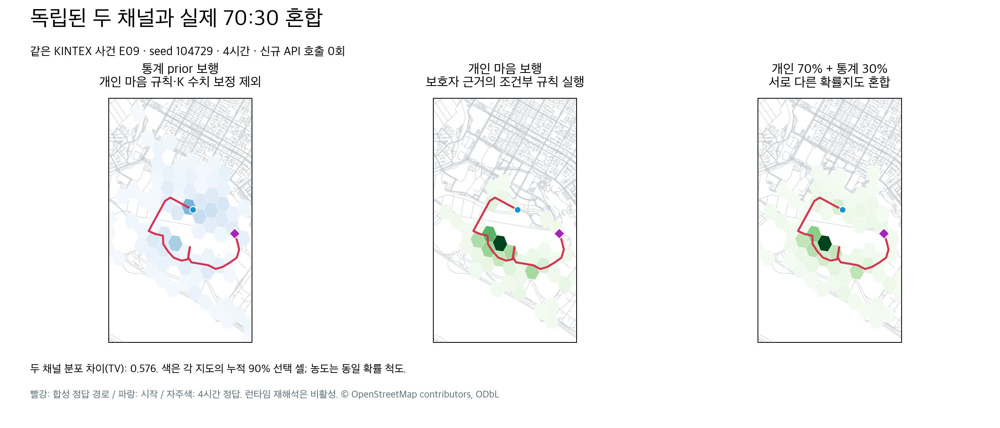
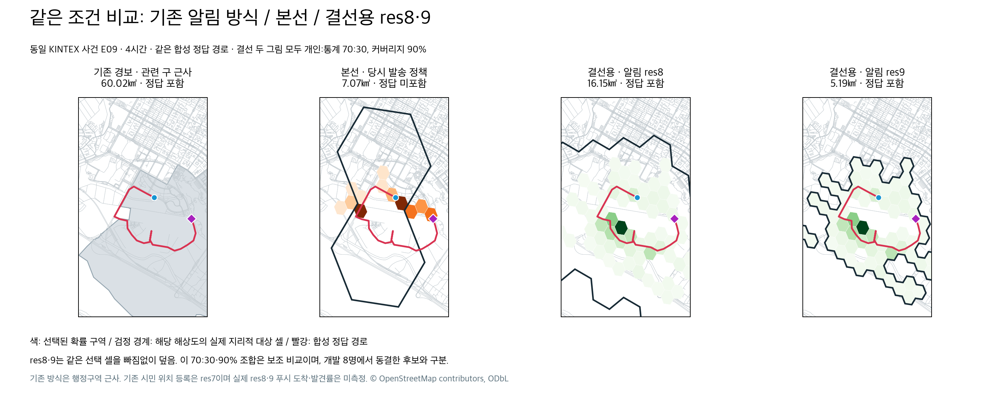
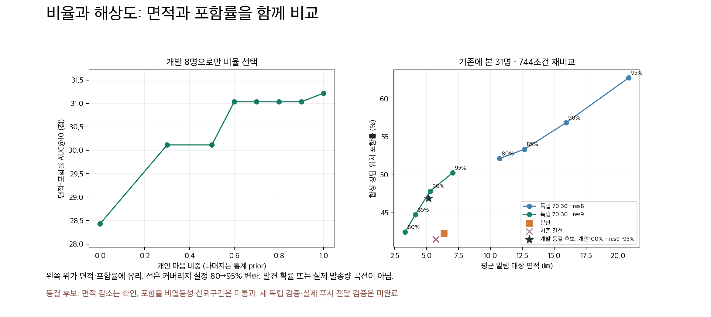

# 통계 prior·개인 마음 분리와 선택 구역 알림 누락 수정

> 후속 최종 개발 설정: [면적당 효율 비교](../final-area-efficiency-20261011/README.md)에서 사용자 요청의 비용 기준으로 90:10·res9·95%를 선택했다. 아래 70:30 유지 및 개인100% 후보 판정은 당시 기록이며 현재 선택으로 읽지 않는다.

두 채널에 같은 개인 조건부 정책과 K 보정 숫자를 넣어, 관측된 마음 갱신이 없으면 확률지도가 같았다. 이 상태에서는 비율을 바꿔도 지도와 성능이 같아진다. 사용자 확인에 따라 **통계는 온보딩 SAR numeric prior 보행**, **개인은 근거가 연결된 조건부 마음 규칙 보행**으로 분리했다. 등록 장소·도로·물리 관측은 공유하며, 통계에는 개인 마음 정책·K 숫자 보정·갱신된 마음 상태를 전달하지 않는다.

`pipeline._initial_prior`가 기존 SAR 호출 한 번의 숫자를 K 보정 전에 보존한다. 추가 SAR 호출을 새로 끼워 넣지 않는다. priors/checkpoints의 계약 키를 바꿔 이전 캐시를 재사용하지 않는다. 기존 사건에 원래 숫자 스냅샷이 없으면 시간 미리보기에서 독립 통계라고 계산·공개하지 않고 불완전 상태를 반환하며 저장 상태를 보존한다. 정상 예측 갱신에서는 새 prior 계약으로 재생성된다. 숫자 스냅샷에는 보호자 원문과 reasoning을 넣지 않는다.

선택된 작은 H3 셀이 논리적 res7 부모 밖으로 돌출하는 부분과 발송 단계의 두 번째 상대확률 문턱이 누락을 만들었다. **교차 면적이 있는 지리적 대상 셀을 모두 포함**하고, 이벤트 발송·구역 진입은 같은 선택 구역을 사용한다. 중복·위치 유효기간·닫힌 사건·거부 상태에 대한 기존 보호는 각 전달 경로에서 계속 적용된다. 참여도별 확률 문턱으로 구역을 재축소하지 않아 수신 대상이 늘 수 있고 실제 전달량은 미측정이다. 색 농도는 확률 순위이며 실제 푸시 도착을 뜻하지 않는다.

## 같은 지도로 채널 확인

같은 KINTEX 사건 E09, seed104729, 4시간. 두 분포의 TV=0.576. 기존에 본 31명 전체 248개 지도 평균 TV=0.4264. 차이를 만들기 위한 임의 잡음은 넣지 않았다. 개인 채널을 현재 코드로 다시 재생한 E09와 기존 개인 결과의 최대 차이 8.33e-17은 혼합 정규화의 부동소수점 오차 범위다.

## 사용자 요청 그림: 기존 방식 / 본선 / 결선 res8·9

두 결선 그림은 **개인:통계 70:30·커버리지 90%**로 조건이 같다. E09 4시간 정답은 본선에서 미포함, 수정안 res8·9 모두 포함한다. 한 예시를 전체 성능으로 해석하지 않는다. 기존 방식은 실제 재난문자 전파 범위가 아니라 관련 구 행정구역 근사이며, 넓은 대상 구역 일부는 그림 밖에 있다. 모든 패널에서 같은 경로·시각·범위를 쓴다.

## 비율·res·커버리지 재비교

- 개발용 E01–E08 8명에서 비율 0/30/50/60/70/80/90/100%, res8/9, 커버리지80/85/90/95%를 계산했다. 신규 모델·지도 호출은 0회.
- 원래 res7 지리적 합산·WGS84 면적의 AUC@10 정의로 비율을 선택했다. 셀 안 균일 분포 근사이며, AUC는 0–100점의 면적–포함률 점수로 정확도 %가 아니다.
- 개발 AUC@10 최고는 개인100% 31.2193점. 70%는 31.0352점으로 차이 0.1840점이다. 이 결과만으로 통계 채널을 제거하지 않으며 기본 70:30을 유지한다.
- 동결 후보는 개인100%·res9·95%였다. 개발 데이터에서도 본선 포함률49.48%보다 낮은46.88%여서 공동 통과 기준은 실패했다. `selection.json`을 먼저 저장·해시 고정하고 이미 본 E09–E40 중 완전한31명을 비교했다. 기존 31명 비교와 대상을 맞추기 위해 E20을 제외했다. 현재 E20은 완료되어 있으며 이번 수정의 실패로 해석하지 않는다.
- 31명 × 2seed × 4시각 × 3합성 미래=744조건이다. 744명의 독립 실험이 아니다. 31명은 이미 관찰한 데이터이며 새로운 독립 검증으로 부르지 않는다.

| 같은31명의 비교 | 평균 대상 면적㎢ | 합성 정답 위치 포함률 |
|---|---:|---:|
| 기존 경보·관련 구 근사 |63.64|69.09%|
| 본선 당시 정책 |6.37|42.34%|
| 기존 결선 당시 정책 |5.71|41.53%|
| 독립70:30·res8·80% |10.71|52.15%|
| 독립70:30·res9·80% |3.32|42.47%|
| 독립70:30·res8·90% |15.92|56.85%|
| 독립70:30·res9·90% |5.28|47.85%|
| 개발 동결 후보: 개인100%·res9·95% |5.14|46.91%|

70:30·90% 조합은 보조 탐색이며 개발에서 동결한 최종 후보가 아니다. res만 낮추거나 높이는 것으로 항상 포함률이 개선되지는 않는다. 구역을 더 덮으면 알림 면적도 커지는 교환관계가 있다.

| 동결 후보 대 본선·31명 사람 단위 paired bootstrap | 차이 |95% 구간|판정|
|---|---:|---|---|
| AUC@10 |+3.1002점|[+0.9424,+5.4416]|이번 탐색 비교에서 양수|
| 평균 면적 |−1.2251㎢|[−2.1204,−0.3296]|면적 감소 확인|
| 정답 포함률 |+4.5699%p|[−1.7473,+11.2903]|비열등성 미통과|
| AUC@30 |+0.1611점|[−1.5126,+1.8616]|차이 불확실|

**전체 성능 완료·배포 통과로 판정하지 않는다.** 새 독립 사례와 실제 전달 검증이 필요하다. 기존 F32 실험 성적을 이번 아키텍처의 성적으로 옮겨 쓰지 않는다.

## 해석과 적용 한계

- res8·9는 지리적 타겟 재계산이다. 현재 기기 등록은 res7만 전송한다. `PUSH_TARGET_RES`만 바꾸면 res8·9 전달이 작동한다는 뜻이 아니며 기본값7을 유지한다. 실제 도착한 푸시 수·시민 수·발견률·수색 비용은 미측정이다.
- 작은 선택 셀의 지리적 누락은 수정했지만, 누적 커버리지 밖의 셀은 의도된 미선택이다. 지도 전체의 모든 색을 발송 대상이라고 부르지 않는다. 그림의 검정선이 해당 정책의 대상이다.
- KINTEX OSM 장소 분류는 실시간 소음·혼잡·인지 관측이 아니다. 미관측 조건은 확정하지 않는다.
- 추가 K-EXAONE 런타임 재해석은 별도 격리 후보에서 시험한다. 이 수정 PR에는 불합격한 런타임 후보·비동기 알림 대기 코드를 포함하지 않는다. 개인 조건부 마음 보행은 기존에 검증한 컴파일 정책을 실행한다.
- 런타임 조건 시험의 1·2묶음은 한국 시각을 UTC 서버의 naive 시간으로 전달해9시간 오차가 발생했다. 해당 시간 조건의 결과는 유효한 통과/미통과 근거에서 제외한다. 시간대 고정과32/32 입력 시각 검증 후 같은32건 재실험을 수행한다. 실패 묶음 사용량도 삭제하지 않는다.
- 운영 배포와 실제 발송은 수행하지 않았다.

## 증빙

`selection.json`: 개발8명 비율·설정 동결, 입력 결과 해시. `seen31_summary.json`:744조건·사람 단위 부트스트랩·전체 보조 설정표. `figure_example.json`:같은 그림의 H3 대상·면적·정답 포함 여부. `core_product_verification.json`:제품 run_pair의 1/2/4/6시간 채널 재생 일치 증빙. 원시 합성 결과와 요청/응답·사용 원장은 로컬 연구 폴더에 보존하며 요약만 공개한다.

KINTEX 지도 SHA256: `953d2bca91fe7388011e9ca161dc576c3c79366c578ed314d7cc8deea677db92`. © OpenStreetMap contributors, ODbL. 기존 Upstage 검색 인덱스와 지도 원본을 유지했다. 비용·실청구액 미확인은0원으로 쓰지 않는다.

검증: develop 충돌을 해결한 최종 제품 코드에서 백엔드 **1531 통과·2 skip**, 프런트엔드 **13 통과**, TypeScript 검사와 웹 export 통과. 기존 연구 보존 검사는 7개 디렉터리별로 격리해 **195 통과·16 subtest 통과**했다. 과거 평가의 논리 부모·참여도 문턱을 명시적 역사 정책으로 보존하고, 현재 발송 검사는 지리적 커버리지 정책을 지정한다. bare pytest는 오래된 같은 이름 모듈이 충돌하므로 제품과 기록을 위 명령으로 각각 검사한다. 명령·로그 해시·검증 커밋은 `validation.json`에 기록했다.
