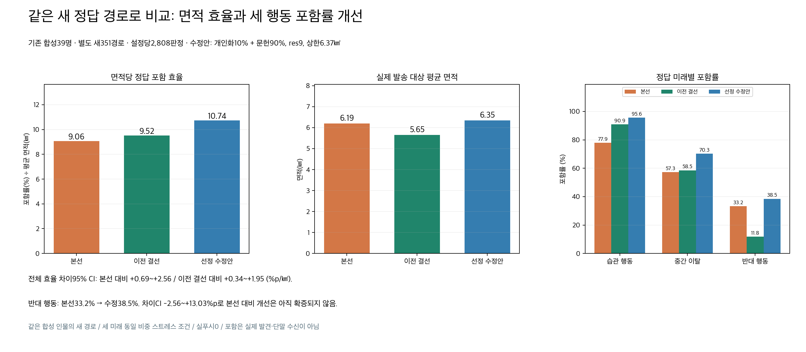
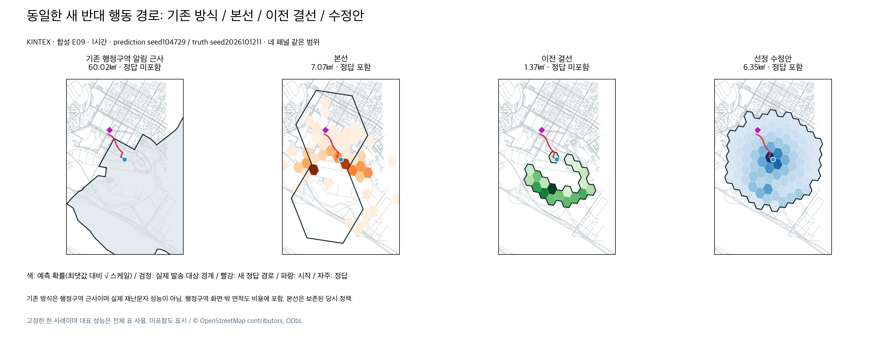
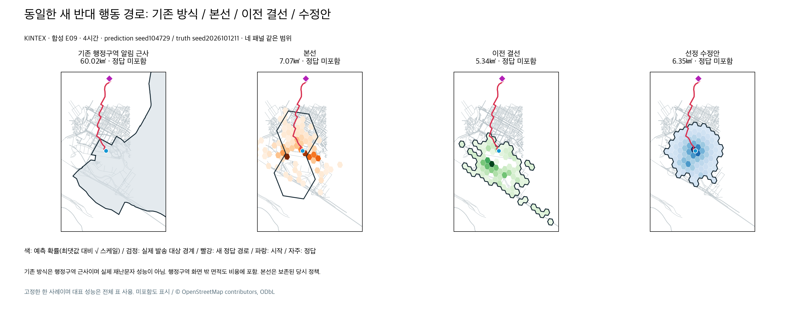

# 반대 행동 누락을 다시 연 최종 설정 검증

PR #283의 “기존 기본값 유지 = 최종” 판단을 철회한다. 그 실험은 이전 결선만 기준으로 삼았고 본선의 반대 행동 포함률을 같은 새 정답으로 비교하지 않았다. 이번에는 본선과 이전 결선 모두를 비교 조건에 넣었다.

선정 설정은 **개인 마음 보행10% + 독립 SAR 문헌 거리 지도90%, res9, 실제 발송 대상 면적 상한6.368199998062131㎢, 최대500셀**이다. 이는 이번 합성 스트레스 조건에서 가장 좋은 시험 설정이며 임상적 최적값·실제 실종 정확도 보장은 아니다. develop 기본값을 바꾸며 운영 배포·실제 알림 발송은 수행하지 않는다. 누적95%는 보존된 대체 `coverage` 정책의 값이고, 선정된 `area_budget` 정책의 보장이 아니다.

## 같은 새 정답으로 비교한 결과

기존 온보딩 합성39명(E20 제외), 새 정답351경로, 예측2seed, 1/2/4/6시간: 설정당2,808판정이다. 습관·중간 이탈·처음부터 반대 행동을 동일 비중으로 구성했다. 모델/API/GPU/지도 재취득/실푸시0. 같은 인물의 새 경로이며 새 인물·실제 실종 자료 검증이 아니다.

| 지표 | 본선·당시 실제 선택 정책 | 이전 결선·90:10 누적95% | 선정 수정안·10:90 면적 상한 |
|---|---:|---:|---:|
| 전체 정답 위치 포함률 | 56.13% | 53.74% | **68.13%** |
| 습관 행동 포함률 | 77.88% | 90.92% | **95.62%** |
| 중간 이탈 포함률 | 57.26% | 58.55% | **70.30%** |
| 처음부터 반대 행동 포함률 | 33.23% | 11.75% | **38.46%** |
| 실제 발송 대상 평균 면적 | 6.195㎢ | 5.647㎢ | **6.346㎢** |
| 면적당 정답 포함 효율 (%p/㎢) | 9.060 | 9.516 | **10.736** |

효율 = 전체 포함률(%) ÷ 평균 실제 발송 대상 면적(㎢), 즉 합산 적중 ÷ 합산 면적. 확률 밀도와 다른 평가 지표다. 면적은 비용 대리값으로 실제 수신 인원·요금·단말 전달·발견률은 측정하지 않았다. 본선 native res7과 수정안 native res9 모두 같은 정답 좌표를 각 해상도로 직접 변환해 판정하고 각 실제 발송 셀의 WGS84 타원체 면적을 합산했다. 본선에 새 선택기를 씌우지 않고 당시 저장된 `alert_cells`와 `complete=true` 결과를 그대로 사용했다.

본선 대비 전체 포함률 **+12.00%p**, 효율 **+18.49%**, 면적 **+0.151㎢(+2.44%)**. 이전 결선 대비 포함률 **+14.39%p**, 효율 **+12.82%**, 면적 **+0.699㎢(+12.37%)**. 면적을 줄였다는 주장이 아니다.

## 통과와 미통과를 분리한 판단

사람39명 단위 paired bootstrap10,000회, 동일 인물의 seed·시간·미래를 묶고 비열등 마진0. 예측 판정2,808개를 독립 표본으로 취급하지 않는다.

| 비교·지표 | 차이 | 95% CI | 판단 |
|---|---:|---:|---|
| 본선 대비 전체 포함률 | +12.00%p | +5.80~+18.38 | 개선 CI 통과 |
| 본선 대비 전체 면적 효율 | +1.675 %p/㎢ | +0.686~+2.564 | 개선 CI 통과 |
| 본선 대비 습관 포함률 | +17.74%p | +10.04~+25.96 | 비열등 CI 통과 |
| 본선 대비 중간 이탈 포함률 | +13.03%p | +6.73~+19.55 | 비열등 CI 통과 |
| 본선 대비 반대 행동 포함률 | +5.24%p | **-2.56~+13.03** | **점추정 개선, 비열등·우월 CI 미통과** |
| 이전 결선 대비 전체 면적 효율 | +1.220 %p/㎢ | +0.341~+1.952 | 개선 CI 통과 |
| 이전 결선 대비 전체 포함률 | +14.39%p | +11.89~+16.95 | 개선 CI 통과 |
| 이전 결선 대비 습관 포함률 | +4.70%p | +0.75~+8.34 | 비열등 CI 통과 |
| 이전 결선 대비 중간 이탈 포함률 | +11.75%p | +8.33~+15.49 | 비열등 CI 통과 |
| 이전 결선 대비 반대 행동 포함률 | +26.71%p | +22.86~+30.56 | 개선 CI 통과 |

이전 실험에서 고정한 결선 대비 효율·전체·습관·중간 이탈·반대 CI 기준은 모두 통과했다. 새로 요구한 본선 비교에서도 세 행동의 관측 포함률이 낮아지지 않고 효율이 개선되는 후보를 고르는 조건을 새 확인 경로 생성 전에 선언했다. 이 조건을 통과해 **실험 범위에서 최선인 설정으로 선정**했다. 본선 대비 반대 행동 CI 미통과를 “완전히 해결”로 바꾸지 않는다.

반대 행동은 **360/936판정 포함, 576/936 미포함(61.54%)**이다. 평균을 개선해도 이전에 포함한 개별 정답을 모두 보존하지는 않는다. 동일 판정의 포함→미포함 손실은 본선 기준 습관18·이탈38·반대59, 이전 결선 기준 습관27·이탈18·반대5다. subgroup별 면적 효율은 모든 항목에서 두 기준보다 높은 것이 아니며 원자료의 미래·시간·거리대별 표를 함께 확인해야 한다. 장거리·오프로드·실제 실종/신규 인물 검증은 남은 한계다.

## 후보 선택과 정답 분리

1. PR #283에서 이미 확인한 truth seed2026101201~1203의351경로만 후보 탐색에 재사용했다. 본선도 이 경로에서 다시 평가했으며 반대 포함률31.20%, 이전 결선12.18%였다.
2. 고정90:10의 면적5.28/6.37/7/8/9㎢, 개인화 구역 보존 후 통계 구역 추가, 시간별 면적 상한, 결합 비율0/10/20/30/40/50/60/70/80/85/90/100% 개인화의 면적 조합을 비교했다. 중복 설정을 제외하면 기준 포함57개 설정이다. 탐색 전 각 로컬 묶음 상한과 모델·원격·실푸시0, 비용 미확인을 원장에 기록했다.
3. 처음90:10·7㎢를 고정해 별도 seed2026101207~1209의351경로를 확인했다. 전체 효율 차이 CI와 본선 대비 반대 CI는 0을 포함했다. 그 결과를 다음 후보의 최적화 정답으로 사용하지 않고 보존했다(`rejected_90_10_confirmation.json`).
4. 결합 비율 후보는 계속 기존1201~1203 경로에서만 선택했다. 습관·중간 이탈·반대 모두 본선/이전 결선의 관측 포함률보다 낮지 않고 본선 대비 효율이 높은 후보 중 최고 효율은 **개인화10%·문헌90%·6.37㎢**였다(개발 전체67.77%, 효율10.680).
5. `frozen_selection.json`과 프로토콜을 고정하고 별도 seed2026101211~1213의 새351경로를 만들었다. 확인 정답을 보고 가중치/면적/보행을 다시 맞추지 않았다. 표는 이 마지막 확인 집합만의 결과다. 순수 개인화·순수 문헌은 이전 정답에서의 제거 비교이며 마지막 확인 집합에 대한 성능 주장이 아니다.

개인화10%라는 수치는 **정규화된 두 확률 지도의 결합 가중치**이고 개인화 구역 면적10%, 행동 빈도10%, 개인 정보를10%만 사용한다는 뜻이 아니다. 개인 지도는 특정 장소에 집중돼 있어서 낮은 가중치에서도 밀도가 높다. 이전 경로에서 같은6.37㎢의 순수 문헌 습관 포함률78.42% → 개인화10% 결합96.47%였다. 개인화를 빼고 좋은 성능을 냈다는 주장이 아니다. 마지막 확인312개 지도에서 선택된 개인 지도 확률 질량은 평균86.80%, 최소43.20%였으므로 개인 분포95% 보존도 보장하지 않는다. 반면 개인 지도에 없는 문헌 전용 셀은 총10,884개(지도당 평균34.88개), 모든312개 지도에서 적어도1개가 실제 대상에 포함됐다. 이 합성 스트레스 조건의 가중치를 실제 인구의 행동 비율이나 확률 보정값으로 해석할 수 없다.

## 실제 제품 연결과 그림

- K-EXAONE이 보호자 원문·기존 검색 근거로 미리 컴파일한 조건부 마음 규칙과 SAR 초기 수치를 쓰는 개인 보행을 보존한다. 보행 중 조건 충족은 코드로 실행하고 체크포인트를 이어간다. 이번 비교에서 개인 보행 자체를 다시 학습하거나 모델 호출하지 않았다.
- 통계 채널은 개인 원문·목적지·조건부 마음 규칙을 쓰지 않는 기존 SAR 문헌 거리 분포 근사다. 출발 좌표·시간, 등방성·시간별 도달 상한·조건부 정규화는 사용한다. 발견 거리 분포가 시간별 위치 실측은 아니다. 인용·문헌 가정은 앞선 [제품 연결 보고서](../area-alert-fresh-routes-20261012/README.md)에 보존했다. 도로/물/공원 밀도에 재가중하지 않았다.
- 코드의 독립 채널·linear 결합·문헌 support·실제 발송 면적 선택은 PR #283에서 구현한 경로를 활성화한다. 이번 제품 변경은 선정 기본값과 `.env.example`, 회귀 검증이다. 알림 조회/웹 진입/푸시 대상에 같은 선택기를 쓰고, 참여도 필터로 선정 구역을 다시 지우지 않는다.
- 확인 집합 **16,848 합성 수신자** 판정에서 앱 조회·웹 진입·발송 스텁 불일치0, 실제 발송 면적 상한 위반0. 누적 확률95%가 아니라 면적 상한을 쓰므로 정책 응답은 `coverage=null`이다. 예측 전 reflex 및 실제 전달/억제/재시도 가드는 보존된다.

같은 E09·첫 확인 seed·반대 행동의1시간과4시간을 고정해 그렸다. 1시간에는 본선/수정안 포함, 이전 결선 미포함이다. 4시간에는 **모두 미포함**이다. 성공 사례만으로 반대 행동 안전망의 한계를 가리지 않는다. 검정 경계가 실제 발송 대상이며 본선의 색은 원본 예측 확률, 이전 결선/수정안의 색은 선택 구역의 확률이다. 기존 방식은 관련 행정구역 근사로 실제 재난문자 발송 성능이 아니다.

## 입력 검증·재현·검사

정답 생성기는 예측/알림 코드나 결과 지도를 읽지 않는다. 신규 목적지·노이즈가 있는 도로 경로·출발 후 휴식/이탈/체류 시간을 구성한다. 앞서 고친 정확한 edge 이어 걷기를 사용하고 확인351경로25,272구간에서 허용 이동량 대비3% 초과 점프 위반0, 최대 비율1.002373이다. 실측 속도·환자 경로는 아니다.

KINTEX OSMnx2.1.0 지도 원본·해시·취득일·범위·출처는 `provenance.json`에 기록했다. 지도 재취득0, OSM 장소는 실시간 소음/혼잡 관측이 아니다. 원본 예측/문헌 지도 해시는 프로토콜, 본선78개 파일 해시는 provenance, 합성 정답은 로컬 연구 폴더에 보존하고 공개 보고서에는 manifest 해시를 둔다. 압축 판정/선택 증빙은 원본 JSON과 바이트가 같음을 확인했다.

- 백엔드 전체 **1,565 passed, 2 skipped**(카카오 외부 실호출 키 없음). 최종10:90 설정 변경 후 관련34 passed. 전체 검사는 먼저90:10·7㎢ 활성화 설정에서 수행했고 최종 설정은 설정/실알림/독립 채널34건과 아래 실제 파이프라인으로 다시 확인했다. 전체 검사 결과를 최종 설정에서 재수행한 것처럼 쓰지 않는다.
- 실제 `run_prediction` E09, 500 walkers,1/2/4/6h: 개인 지도 최대 차이1.67e-16, 문헌 차이0, 최종 가중치 미리보기 차이 허용1e-12 이내, 상태 변경0. 면적 상한 준수, 문헌 전용 선택 구역을 확인했다.
- 새 회귀 테스트는 개인 지도의 질량이0인 통계 전용 셀이 낮은 참여도에서도 앱 조회·웹 진입·실제 notify 발송 스텁에 포함되는지 확인한다. 실제 기본값은 역사적 회귀용 res7/70:30/누적80% fixture와 분리해 검사한다.
- 로컬 첫 확인 결과 저장 중 NumPy bool JSON 직렬화 오류를 수정했다. 이미 완료된 판정·선택 결과를 그대로 다시 집계했고 가중치·경로·채점은 바꾸지 않았다. 사용 원장에 오류/수정과 비용 미확인을 기록했다.

`scripts/`는 실제 실행한 연구용 소스 사본이다. 기존 연구 폴더의 캐시 예측/합성 온보딩/검증된 지도 파일을 참조하므로 이 문서 폴더만 복사하면 독립 실행되지 않는다. `confirmation_rows.json.gz`·`confirmation_selections.json.gz`·`confirmation_summary.json`으로 공개 숫자와 대상 면적/개별 손실은 재집계할 수 있다. 실행 재현에는 원본 연구 폴더와 소스에 지정된 개발 checkout이 필요하다.
