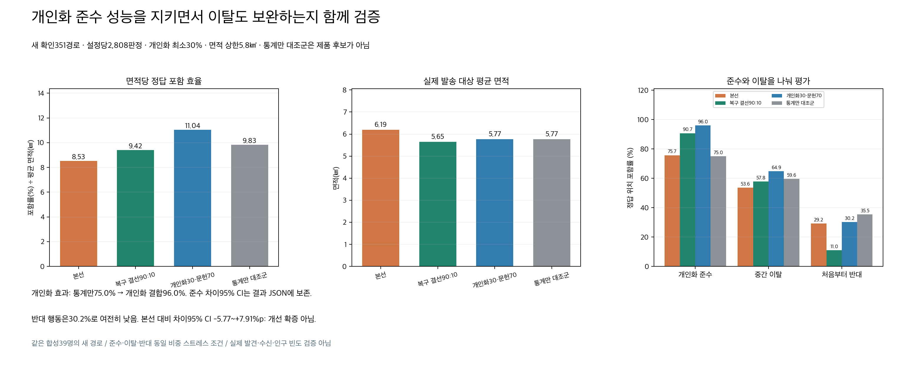
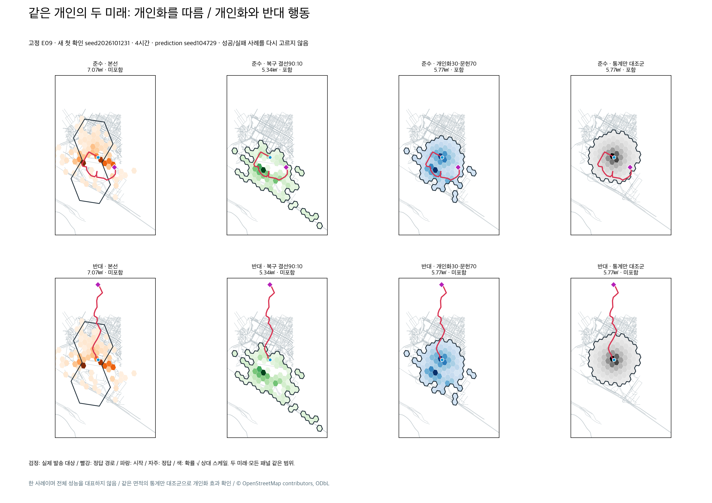

# 개인화 준수와 이탈을 함께 검증한 면적 상한 알림

#284의 개인화10·통계90 선정은 철회하고 #285로 먼저 복구했다. 이번에는 **개인화 최소30%, 개인화 준수 포함률 보존, 같은 면적의 개인화 제거 대조군 대비 명확한 개선**을 필수 조건으로 고정했다. 반대 행동만 잘 맞추는 후보는 선정하지 않는다.

그 조건을 만족한 측정 후보 중 개발 자료의 면적당 포함 효율이 가장 높았던 **개인화30% + 문헌 거리분포70%, res9, 실제 발송 대상 면적 상한5.8㎢**가 새 확인 경로에서 선언한 조건을 모두 통과했다. 가중치는 두 확률지도의 혼합 비율이며 개인화 적중률이나 규칙 실행 비율이 아니다. 개인화 보행·문헌 지도를 독립 계산해 결합한다.

**본선 대비 개선 폭·유형별 면적 효율·전체39명·여러 경로·최종 시간 지도:** [확장 비교 시각화](visualizations/README.md).

## 비교 결과

| 지표 | 보존된 본선 | 복구 결선: 개인화90·온보딩SAR10 | 선정: 개인화30·문헌70 | 통계만 대조군 |
|---|---:|---:|---:|---:|
| 개인화를 따름 | 75.75% | 90.71% | **96.05%** | 75.00% |
| 중간에 개인화에서 이탈 | 53.63% | 57.80% | **64.85%** | 59.62% |
| 처음부터 개인화와 반대 | 29.17% | 11.00% | **30.24%** | 35.47% |
| 전체 포함률 | 52.85% | 53.17% | **63.71%** | 56.70% |
| 실제 발송 대상 평균 면적 | 6.1945㎢ | 5.6471㎢ | **5.7688㎢** | 5.7690㎢ |
| 전체 포함률 / 평균 면적 | 8.5316 | 9.4153 | **11.0441** | 9.8276 |

각 행동은 설정별936판정, 전체2,808판정이다. 시점별 정답 위치가 실제 발송 대상 지리적 영역에 들어가는지를 센다. 세 행동의 동일 비중은 스트레스 평가이며 인구 빈도가 아니다. 발견 성공률·발송 수신률·양성예측도(precision)는 측정하지 않았다. 참여 인구·실제 발송 건수 비용도 미측정이다. 면적 효율은 전체 포함률(%) / 실제 발송 대상 평균 면적(㎢)이다. 상한은 원본 셀 수가 아닌 발송 해상도 H3 지리적 합집합으로 검사한다.

## 개인화 효과 확인

동일 문헌 지도·동일5.8㎢ 상한에서 개인화를 제거하면 준수 포함률75.00%, 개인화30%를 결합하면96.05%다. **+21.05%p, 개인별 묶음 재표집95% CI 14.74~27.88%p**다. 전체도 +7.02%p(CI3.70~10.54) 개선된다. 통계만 대조군은 진단용이며 제품 후보가 아니다.

| 개인화 준수 유형 | 복구 결선 | 선정 후보 | 통계만 |
|---|---:|---:|---:|
| 회피 | 89.35% | 92.59% | 74.07% |
| 목표 추구 | 97.50% | 98.75% | 90.00% |
| 휴식 | 86.25% | 94.17% | 66.67% |
| 대기 | 89.58% | 98.33% | 69.17% |

네 유형의 준수 점추정도 모두 보존됐다. 유형별9~10명의 사후 진단이며 유형별 CI까지 통과했다고 주장하지 않는다. 복구 결선 대비 준수 +5.34%p(CI2.67~8.23), 이탈 +7.05%p(CI3.63~10.68), 반대 +19.23%p(CI15.38~22.97)다. 전체 면적 효율은 **+17.30%**, 효율 차이 CI0.95~2.17이다. 평균 면적은 복구 결선보다 약2.15% 늘었으므로 면적 절감으로 설명하지 않는다.

## 선정·확인 자료 분리

이미 본351경로(seed2026101201~1203)로 개인화30/40/50%와 상한5.6/5.8/6.0/6.2㎢를 비교했다. 세 행동 포함률이 본선·복구 결선보다 낮지 않은 후보만 남겨 면적 효율로 선정했다. 5.6㎢는 효율은 더 높지만 본선 반대 포함률 기준을 놓쳐 제외했다. 개발 비교 전체는 cost_exploration_summary.json과 압축 원자료에 있다.

선정과 기준을 frozen_selection.json·protocol.json에 고정한 뒤 새 seed2026101231~1233의351경로를 생성했다. 생성기는 예측 지도를 읽지 않는다. 앞서 실패한1221~1223 확인 자료를 재선정에 사용하지 않았다. protocol.json의 이전 템플릿 명칭 truth_seed_development는 첫 새 seed를 가리키지만 세 새 seed 모두 확인에 사용하며 후보 선정 자료가 아니다.

기존 합성 온보딩39명×3행동×3정답 seed, 예측 seed104729/130363, 1/2/4/6시간에서 설정별2,808판정했다. E20은 이전 독립 개인화 예측 미확보로 제외한다. 새 사람의 일반화 검증이 아니다. CI는 대응되는39명 묶음으로10,000회 재표집한다.

본선은 보존된 실제 원래 res7 알림 셀을 쓴다. 복구 결선·후보·대조군은 실제 알림 선택·지리적 발송 영역·앱 조회·웹 진입·모든 참여 수준의 스텁 수신자를 확인했다. **25,272 수신자 확인에서 불일치0, 면적 상한 위반0**이다.

## 통과·미확증·미달

| 확인 조건 | 판정 |
|---|---|
| 개인화 최소30%, 설정이30% 미만 거부 | 통과 |
| 세 행동 포함률 점추정이 본선·복구 결선 이상 | 통과 |
| 복구 결선 대비 전체·준수·이탈 포함률 차이 CI 하한≥0 | 통과 |
| 복구 결선 대비 반대 포함률 차이 CI 하한>0 | 통과 |
| 본선·복구 결선 대비 전체 면적 효율 차이 CI 하한>0 | 통과 |
| 같은 면적 통계만 대비 준수·전체 개선 CI 하한>0 | 통과 |
| 실제 면적 상한·조회/웹/발송 일치 | 통과 |
| 본선 대비 반대 행동 비열등을 CI로 입증 | **미확증**: −5.77~+7.91%p |
| 반대 행동 누락 없음 | **미달**: 283/936 포함, 653/936 누락 |
| 모든 기존 적중 사례 보존 | **미달**: 복구 결선 적중 중 준수12·이탈27·반대20판정이 후보에서 빠짐 |

미확증 항목을 필수 통과 조건에 사후로 섞어 통과 처리하지 않았다. 본선 대비 반대 포함률은 점추정+1.07%p이나 개선/비열등 확증은 없다. 통계만은 반대35.47%로 더 높지만 준수75.00%로 낮아 사용자 목적을 충족하지 않는다. 반대 하나를 최대화하지 않았다. “모든 반대 행동도 높은 점수”라고 주장하지 않는다.

앞선 개인화30·상한6.3682㎢ 후보는 준수는 높았으나 복구 결선 대비 전체 면적 효율 CI−0.24~+1.24로 채택하지 않았다. 당시 실패·판단을 earlier_failed_confirmation/에 보존한다.

## 같은 사람의 두 미래와 실제 보행 연결

E09·첫 새 seed2026101231·4시간·예측 seed104729를 결과를 보고 바꾸지 않고 고정했다. 위는 준수, 아래는 반대다. 검정은 실제 발송 영역, 빨강은 정답 경로, 파랑은 시작, 자주는 시점별 정답이다. 본선 색은 원래 예측 확률, 나머지는 선택 영역 확률이며 농도는 패널별 상대 스케일이다. 모든 패널의 지리 범위는 같다. 위에서는 통계만도 맞추므로 이 사례 하나로 개인화 효과를 주장하지 않는다. 아래는 모두 실패하며 한계를 그대로 보인다. 개인화 효과는 전체 제거 대조군으로 판단한다.

E09 실제500워커 파이프라인의 개인화 지도는 기존 개인화와 최대1.67e−16 차이, 문헌 지도는 캐시와 차이0이다. 통계만 질량이 있는 셀도 시간별58/58/29/18개 실제 대상에 포함됐다. 체크포인트 저장·부작용 없는 시각 미리보기도 확인했다. K-EXAONE이 컴파일한 개인 조건 규칙은 개인화 채널에만 적용하며 문헌 지도는 개인 원문·목표·회피 규칙을 읽지 않는다. 보행 중 추가 모델 호출은0이다.

KINTEX OSMnx2.1.0 지도(취득2026-10-04, SHA256953d2bca91fe7388011e9ca161dc576c3c79366c578ed314d7cc8deea677db92)를 사용했다. 25,272 경로 구간에서3% 이동 예산 허용 오차 위반0, 최대 비율1.00234다. 지리·이동 제약을 적용한 합성 정답이며 임상 정답은 아니다.

문헌 채널은 ISRID 도시권 거리분포의 로그정규 근사(μ0.095·σ1.48), 등방 방향·시간별 최대 이동거리 가정을 쓴다. 관측된 시간별 발견 위치·실시간 혼잡이 아니다. 현실 분포가 가정과 같다는 검증은 없다.

## 증빙·사용량

confirmation_summary.json은 CI·시간/거리별 결과·기존 적중 손실, confirmation_rows.json.gz·confirmation_selections.json.gz는 모든 판정·선택 셀이다. truth_manifest.json은 정답·생성기·프로토콜 해시다. 원본 정답·온보딩·예측 캐시·지도는 로컬 연구 폴더에 보존하며 재현에 필요하다. scripts/는 실행 당시 스냅샷이다. 저장소만으로 외부 자료를 취득하는 독립 실행 패키지가 아니다.

로컬 CPU·기존 캐시만 사용했다. 새 모델/API/원격 GPU/지도 취득/실제 푸시 모두0회, 공용 원장·usage_events.jsonl에 시작·종료 기록, 비용미확인(null)이다. develop 선정이며 운영 배포가 아니다. 환경변수로 이전 설정을 고정한 서버는 코드 기본값만 바꿔도 새 설정으로 전환되지 않는다.

검증한 코드에서 관련34개 및 백엔드 전체1,565개 테스트 통과,2개 건너뜀. 외부 푸시 수신과 운영 배포는 이 테스트의 대상이 아니다.
