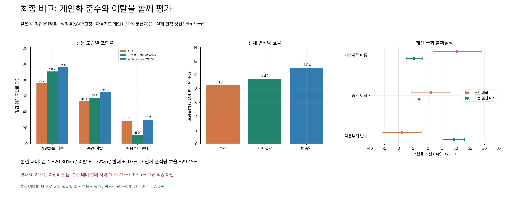
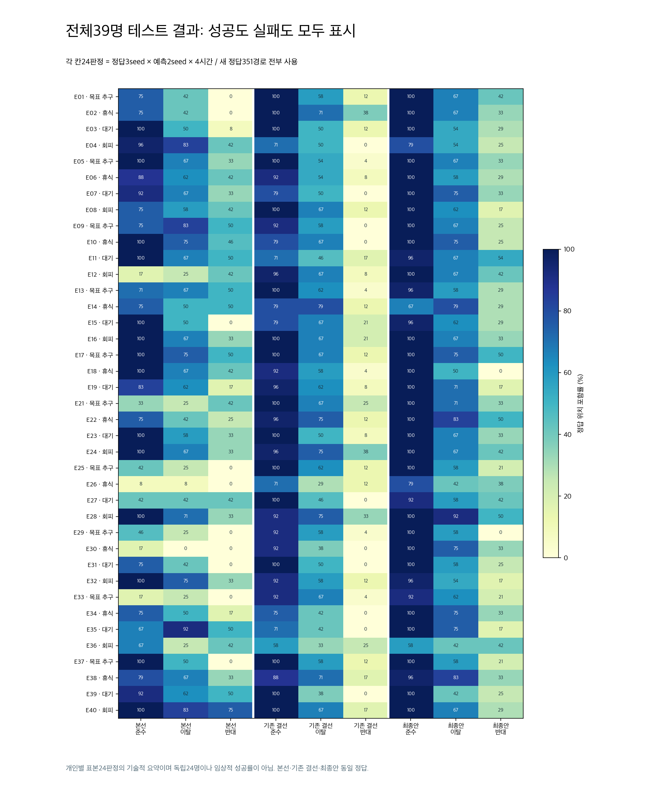
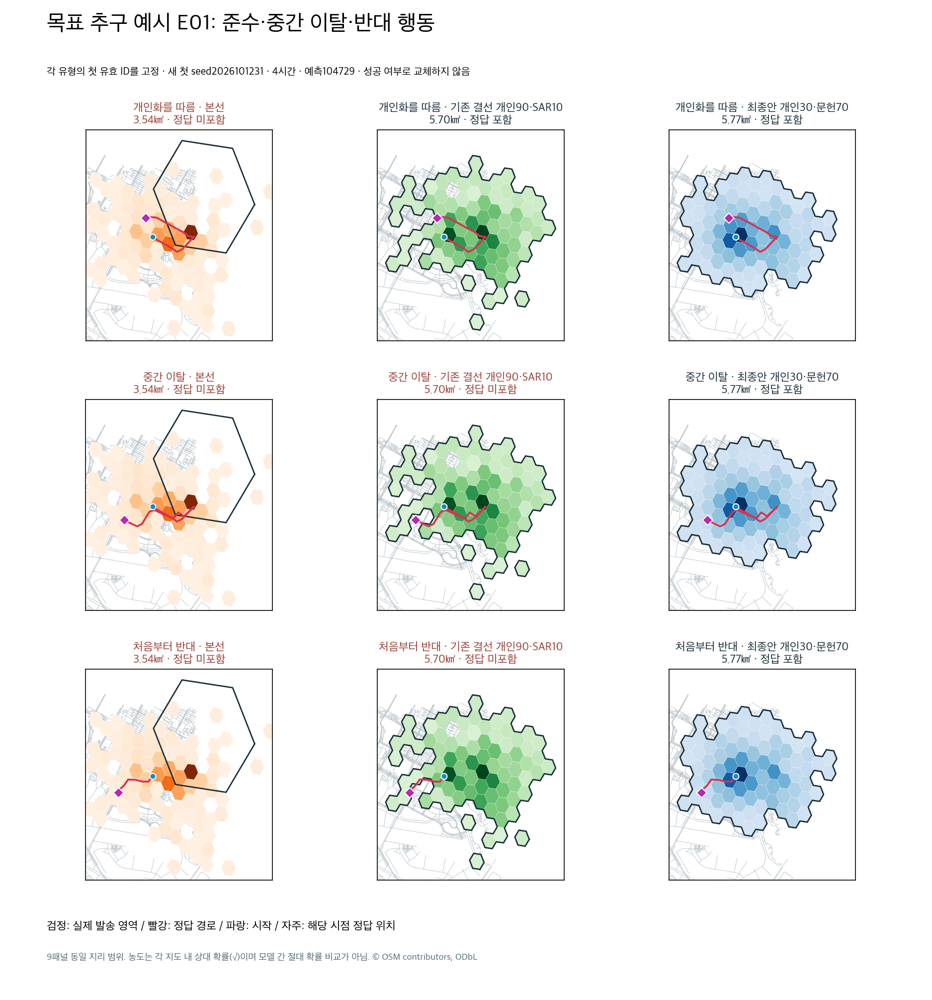
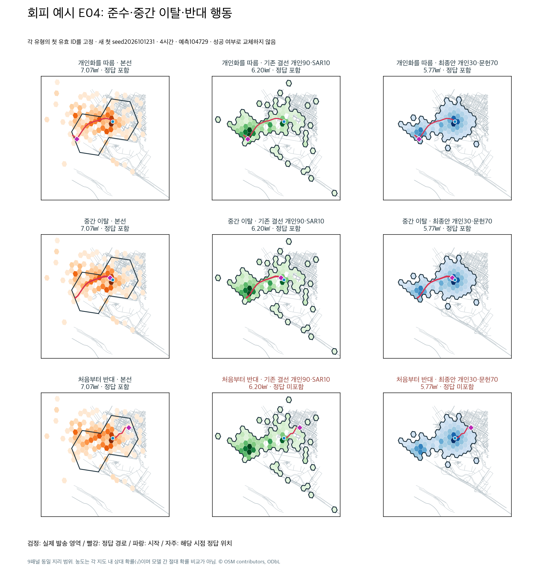
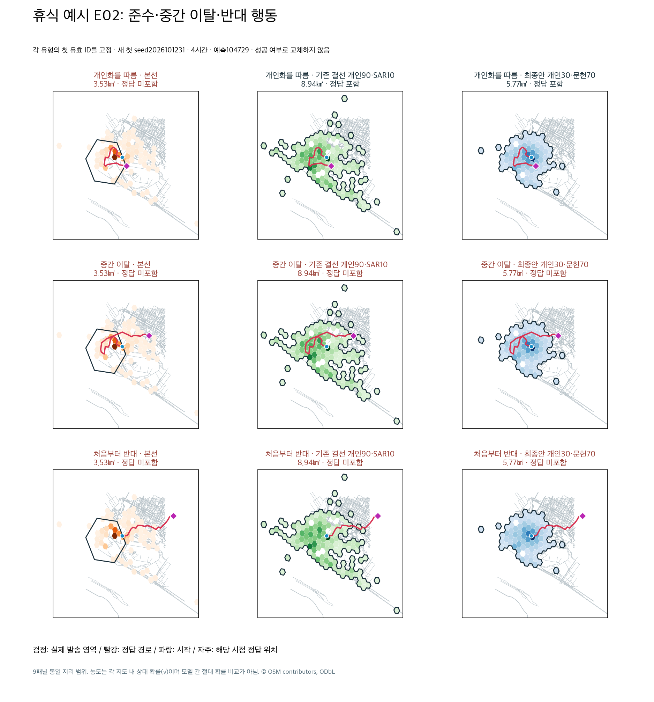
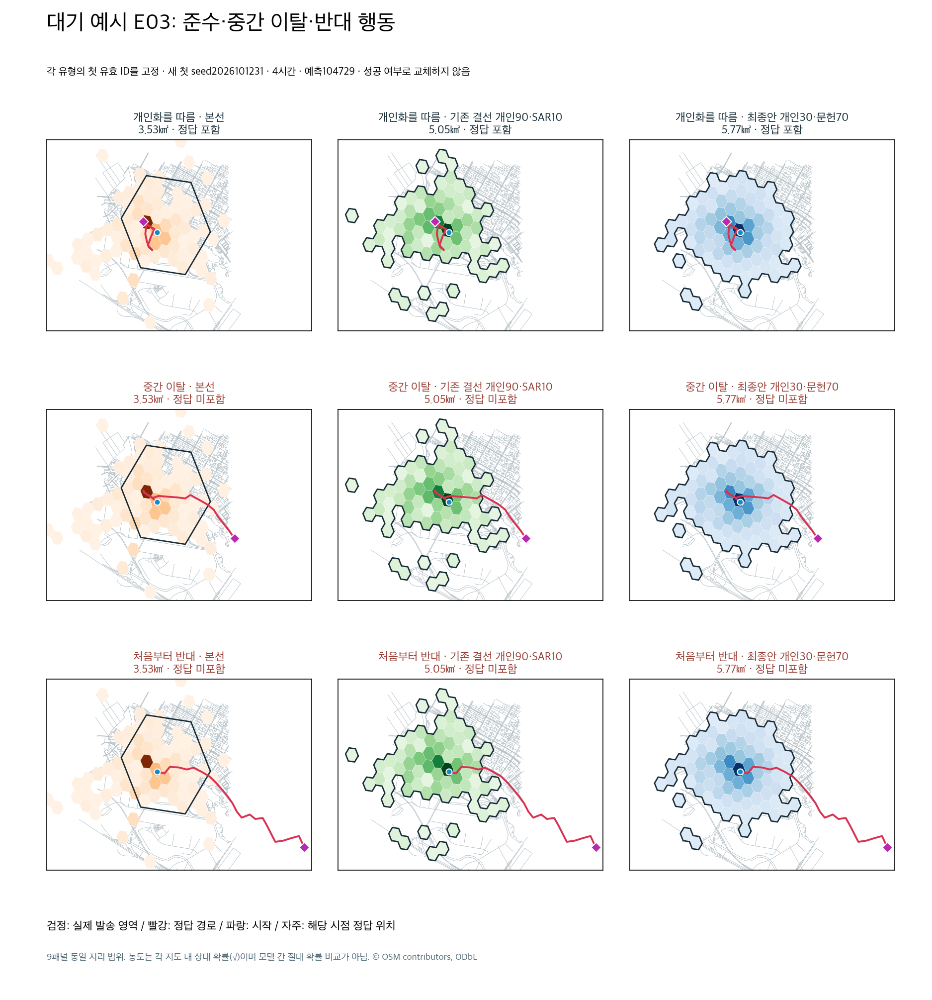
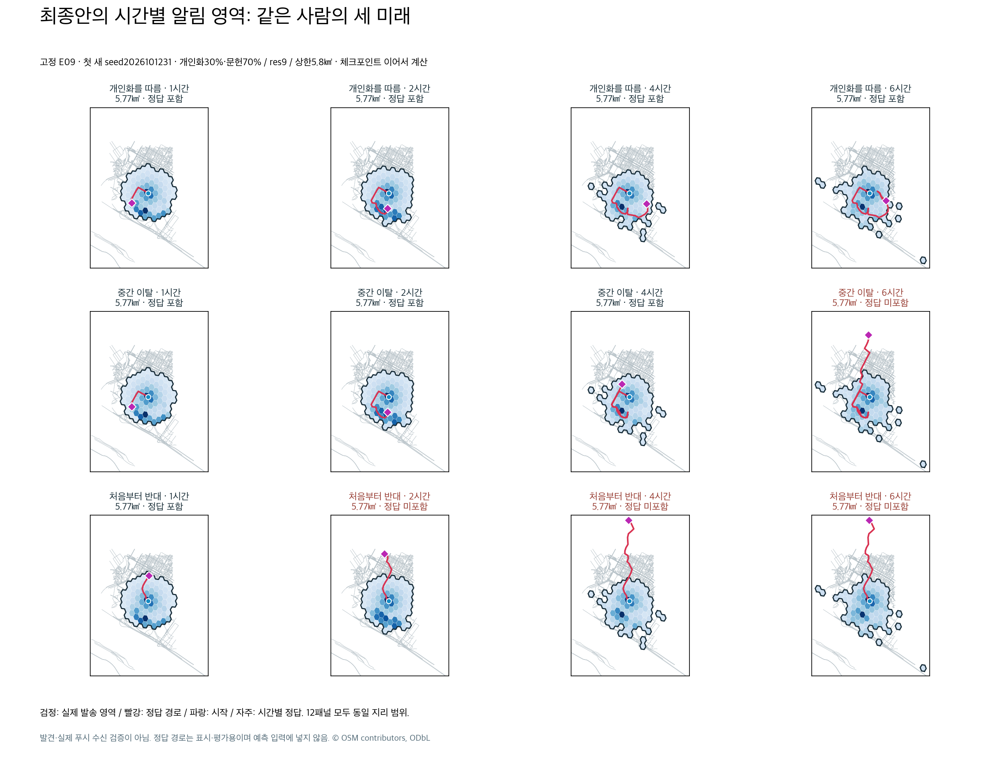

# 본선·기존 결선·최종안: 같은 정답으로 비교

최종안은 개인화30%·독립 문헌통계70%, res9, 실제 발송 면적 상한5.8㎢다. 기존 결선은 복구한 개인화90%·온보딩SAR10%, res9, 누적95%다. 본선은 보존된 실제 res7 알림 셀이다. 같은 새 합성351경로, 각 설정2,808판정이며 개인화를 따름·중간 이탈·처음부터 반대 각각936판정이다. 인구 빈도·발견률·수신률 검증이 아니다.

| 조건·지표 | 본선 | 기존 결선 | 최종안 | 본선 대비 | 기존 결선 대비 |
|---|---:|---:|---:|---:|---:|
| 개인화를 따름 포함률 | 75.75% | 90.71% | 96.05% | +20.30%p | +5.34%p |
| 중간 이탈 포함률 | 53.63% | 57.80% | 64.85% | +11.22%p | +7.05%p |
| 처음부터 반대 포함률 | 29.17% | 11.00% | 30.24% | +1.07%p | +19.23%p |
| 전체 포함률 | 52.85% | 53.17% | 63.71% | +10.86%p | +10.54%p |
| 개인화를 따름 면적당 효율 | 12.23 | 16.06 | 16.65 | +36.16% | +3.66% |
| 중간 이탈 면적당 효율 | 8.66 | 10.24 | 11.24 | +29.84% | +9.83% |
| 처음부터 반대 면적당 효율 | 4.71 | 1.95 | 5.24 | +11.31% | +168.96% |
| 전체 면적당 효율 | 8.53 | 9.42 | 11.04 | +29.45% | +17.30% |
| 실제 평균 면적(㎢) | 6.1945 | 5.6471 | 5.7688 | −6.87% | +2.15% |

면적당 효율 = 해당 조건의 정답 위치 포함률(%) / 실제 발송 대상 평균 면적(㎢). 포함률 차이는 **%p**, 효율 상대 개선은 **%**다. 표의 효율 개선은 점추정이며 모든 행의 CI가 통과했다는 뜻이 아니다.

본선 대비 준수 포함률 차이95% CI11.97~29.06%p, 이탈4.38~18.27%p는 양수다. 반대 −5.77~+7.91%p는0을 포함해 개선을 확증하지 못한다. 반대 면적 효율 차이 CI도 −0.42~+1.47로 미확증이다. 전체 효율 차이 CI는 본선 대비1.46~3.51, 기존 결선 대비0.95~2.17로 양수다. 기존 결선 대비 준수 **면적 효율** CI는 −0.99~+1.86으로 미확증이지만 준수 **포함률** CI는2.67~8.23%p로 양수다.

## 모든 테스트 결과

39명 각각의 준수·이탈·반대 결과를 모두 표시한다. 각 칸은 정답3seed×예측2seed×4시간의24판정 포함률이다. 색의 수치는 반올림했으며 원자료는 comparison_table.json 및 상위 confirmation_rows.json.gz에 보존한다. 개인별 결과가 모두 좋아진다는 의미가 아니다. 예를 들어 E14 준수는 기존 결선79.17%→최종66.67%, E18 이탈은58.33%→50.00%이며 전체 평균 개선에도 개별 손실이 남는다.

## 여러 고정 예시

각 행동 유형에서 **첫 유효 ID**를 택한다(회피E04·목표E01·휴식E02·대기E03). 첫 새 정답seed2026101231·예측seed104729·4시간을 고정했다. 성공 여부를 보고 교체하지 않았다. 각 그림의 행은 준수/이탈/반대, 열은 본선/기존 결선/최종안이다. 9패널의 지리 범위는 같고 해당 시점 포함 여부는 원래 판정 자료와 모두 대조했다.

검정은 **실제 발송 대상 영역**, 빨강은 평가 정답 경로, 파랑은 시작, 자주는 시점별 정답 위치다. 본선의 색은 원래 예측 지도이고 다른 설정은 선택된 영역의 확률이다. 농도는 각 지도 내 상대 스케일(제곱근)이라 모델 간 절대 확률 비교가 아니다. 경계 안의 H3셀 질량·해상도 판단으로 포함 여부를 센다. 도로 배경은 보존된 KINTEX 표시 자료이며 빈 배경을 도로 없음으로 해석하지 않는다.

### 목표 추구 E01

### 회피 E04

### 휴식 E02

### 대기 E03

E01의 중간 이탈은 최종안만 포함한다. E04의 반대 행동은 본선이 포함하지만 최종안이 놓친다. E02·E03의 이탈/반대는 셋 모두 놓치는 경우도 보인다. 전체 개선을 모든 개인·모든 시점의 개선으로 확대하지 않는다. 4명12경로의36패널은 전체351경로를 대신하지 않으며 위 전체39명 그림과 함께 해석한다.

## 최종안의 시간별 시각화

앞서 고정한 E09의 세 미래를1/2/4/6시간에 표시했다. 12패널 모두 같은 범위다. 같은 개인·예측seed에서는 미래 정답이 달라도 예측 지도는 같아야 한다. 정답 경로는 평가·표시용이며 예측 입력에 넣지 않았다. 준수는 네 시점 모두 포함하고, 중간 이탈은6시간에 누락, 반대는2/4/6시간에 누락한다. 체크포인트·개인화 채널·독립 문헌 지도 연결은 상위 product_pipeline_verification.json의 실제 파이프라인 검증으로 확인됐다.

## 제작·검증 범위

새 실험이나 재선정 없이 기존 확인 자료만 후처리했다.7개 PNG, 48개 경로 패널의 포함 여부를 원자료와 대조하고 전체39명×9칸도 모든 확인 판정으로 생성했다. 비교 표·본문·그림 수치는 원자료에서 계산한다. 생성 스크립트는 상위 scripts/extended_visuals.py이며 기존 로컬 연구 폴더가 필요하다. 모든 그림을 눈으로 확인했고 지도 취득·모델/API·원격 GPU·실제 푸시는0회다. 별도 시각화 시작/종료 원장에 비용미확인(null)으로 기록했다. 제품 코드·설정은 변경하지 않는다.
