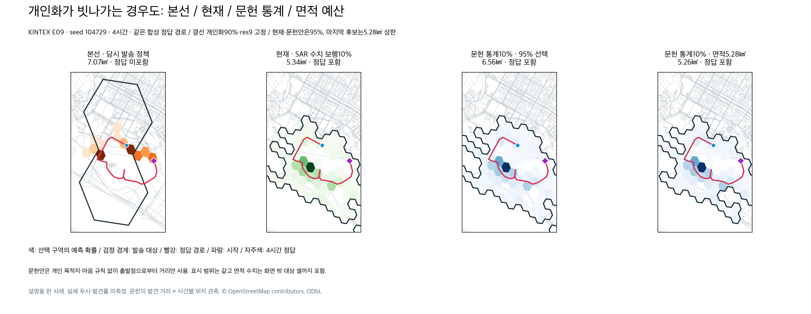
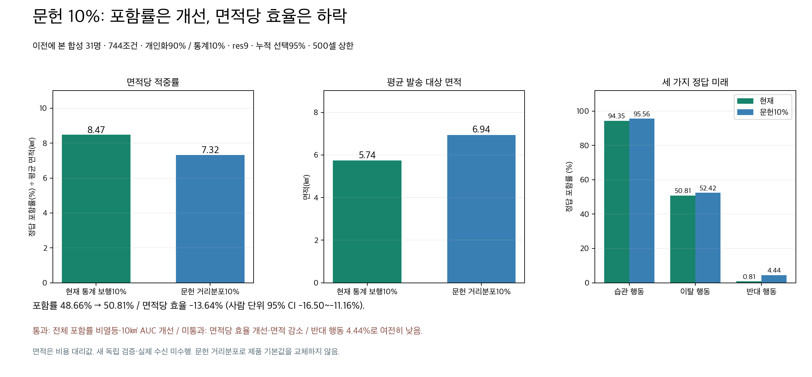
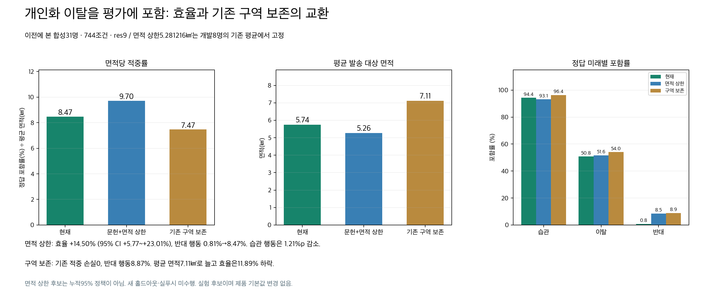

# 개인화 이탈을 위한 SAR 문헌 통계 안전망 비교

개인화대로 움직이지 않는 미래도 평가에 포함했다. 독립 문헌 통계 10%는 반대 행동 포함률을 개선하지만, 확률 10%만 주어서는 알림 구역의 10%가 확보되지 않는다. 면적당 효율을 높인 후보와 기존 알림 구역을 유지하는 후보의 교환관계를 아래에 공개한다. **제품 기본값은 이 실험으로 변경하지 않았다.**

현재 develop은 개인화90% + 온보딩 SAR 원수치 보행10%, res9, 누적 모델 확률95%다. 이 문서의 문헌 거리분포와 새로운 면적 선택 정책은 오프라인 실험이다. K-EXAONE·SAR 모델 추가 호출, 운영 배포, 실제 푸시는 모두 0회다.

| 정책 | 전체 정답 포함률 | 평균 대상 면적 | 면적당 포함률 (%p/㎢) | 반대 행동 포함률 |
|---|---:|---:|---:|---:|
| 본선 당시 발송 정책 | 42.34% | 6.37㎢ | 6.65 | 10.89% |
| 현재 결선 | 48.66% | 5.74㎢ | 8.47 | 0.81% |
| 문헌 통계10%, 누적95% | 50.81% | 6.94㎢ | 7.32 | 4.44% |
| 문헌 통계10%, 개발 평균 면적 상한 | 51.08% | 5.26㎢ | 9.70 | 8.47% |
| 현재 구역 ∪ 위 면적 상한 후보 | 53.09% | 7.11㎢ | 7.47 | 8.87% |

같은 KINTEX E09·seed104729·4시간 예시다. 지도 시야를 고정했으며 면적은 화면 밖 대상까지 포함한다. 색은 확률, 검정 경계는 대상 셀, 빨강은 합성 정답 경로, 파랑은 시작, 자주색은 시점 정답이다. 마지막 그림은 95% 정책이 아니라 면적 상한 정책이다.

## 통계 채널과 실제 알림 가능성

기존 통계 보행은 SAR 초기 수치와 신체·공간 입력으로 별도 보행을 계산한다. 개인 마음의 조건부 규칙은 제거됐지만, 순수한 문헌 거리 지도와는 다르다. 새 지도는 치매·도시 유형의 기존 저장소 ISRID 근사 파라미터 μ=0.095, σ=1.48만 사용한다. 개인 목적지·끌림·조건부 규칙·보호자 원문·보행 전략은 사용하지 않는다. LKP와 경과 시간은 위치 중심 및 도달거리 상한에 필요하다. 모든 실험 대상의 신고 유형은 dementia였다. 다른 실종 유형까지 검증한 결과가 아니다.

[Koester의 원서](https://www.scribd.com/document/1005035709/Lost-Person-Behavior)는 IPP/LKP에서 발견 지점까지의 직선거리 통계를 설명한다. [원서 출판사](https://www.dbs-sar.com/LPB/lpb.htm), [Laing의 ISRID 표 재인용](https://blog.oplopanax.ca/wp-content/uploads/2013/06/AnalysisofMissingDementia.pdf)을 함께 확인했다. 재인용 표는 원자료를 새로 확보한 증거가 아니다. 이번에는 저장소 근사치를 재사용했으며 문헌 분위수 전체를 정확히 다시 피팅했다고 주장하지 않는다.

방향을 균등하게 가정한다. 거리밀도 f_R(r)를 셀마다 그대로 넣으면 큰 고리의 셀 수 때문에 먼 거리 질량이 과장된다. 공간밀도는 f_R(r)/(2πr)이며, 구현은 WGS84 AEQD 투영에서 동등 CDF 질량의 64개 고리를 만든 뒤 셀과 겹치는 면적에 질량을 배분한다. 지도 원본은 기존 KINTEX OSMnx2.1.0 지도를 재사용했다. 반경 전체가 기록된 bbox 안에 들어가는지 확인했고 지도 밖을 잘라 몰래 재정규화하지 않는다. 도로·수역·건물 접근성은 이 등방성 지도에 가중하지 않는다. 실제 길을 걷는 시뮬레이션과 다르다.

반경은 기존 제한 min(exp(μ+1.645σ), max(0.5,4.32×시간))㎞다. 1/2/4/6시간에서 문헌 분포의 17.76/8.18/5.00/5.00%를 제외한 조건부 지도로 재정규화한다. 시간 상한은 실험의 물리 가정이며, 문헌 자체가 시간별 위치를 관측했다는 뜻이 아니다. 누적95%도 실종자 정답95%나 원문헌의 무조건부95%를 보장하지 않는다.

문헌 통계가 선택 구역 밖에 작은 질량을 주더라도 상위 누적 셀 선택에서는 알림 대상이 될 수 없다. 따라서 모델 혼합 비율과 실제 대상 선택을 구분해 다음 안전망 정책까지 비교했다.

| 추가 정책 | 반대 행동 포함률 | 전체 포함률 | 평균 면적 | 해석 |
|---|---:|---:|---:|---|
| 같은 사건 면적의 개인90% + 개인 구역 밖 문헌10% | 0.00% | 48.39% | 5.67㎢ | 가까운 통계 셀에 집중, 안전망 개선 실패 |
| 기존 구역 유지 + 문헌 고밀도 셀 추가 | 0.81% | 49.33% | 6.28㎢ | 기존 적중은 유지하지만 반대 행동 개선 없음 |
| 기존 구역 유지 + 문헌 확률에 따른 순환 표본 | 1.21% | 49.33% | 6.27㎢ | 2개 고정 seed의 실제 합성 포함률, 실푸시 아님 |
| 같은 사건 면적으로 새 혼합 지도 순위 선택 | 0.00% | 48.25% | 5.73㎢ | 사건별 면적 고정만으로 문제 해결 실패 |

순환 표본은 기존 대상 밖 양의 문헌 질량을 가진 모든 셀에 0보다 큰 선택 확률을 준다. 한 셀의 외부 조건부 확률이 π, 추출 횟수가 K이면 한 회차 포함 확률은 1−(1−π)^K다. 중복 셀은 합친다. 246개 기존 미포함 반대 행동 조건 모두 양의 가능성을 얻었지만, 반대 행동의 분석적 기대 포함률은 **1.29%**로 작았다. 이를 실측 정확도로 바꾸어 쓰지 않는다. 문헌 반경 밖에는 이 보장이 없다.

추가 예산은 max(기존 면적10%, 후보 셀 하나의 최대 면적)이다. 최소 한 셀 때문에 작은 사건은 추가 면적 비율이 최대33.33%까지 올라갔다. 평균 약9% 증가를 사건별10% 상한이라고 표현하면 안 된다. 실제 순환 트리거·중복 수신·TTL·반복 회차 예산은 제품에 연결하거나 검증하지 않았다.

## 가장 유망한 면적 상한 후보와 미통과 항목

개발8명의 기존 평균 면적 **5.281216㎢**를 고정 상한으로 삼고, 개인90%+문헌10% 혼합 확률을 셀 면적으로 나눈 값으로 순위를 정했다. 상한과 500셀 이내에서 양의 셀을 선택한다. 비교31명 정답으로 면적 값을 최적화하지 않았다. 다만 안전망 후속 정책을 설계할 때 이미 이 데이터를 여러 번 본 탐색 실험이므로 새 홀드아웃이라고 주장하지 않는다.

| 미래 | 현재 | 면적 상한 후보 | 기존 구역을 합집합으로 유지 |
|---|---:|---:|---:|
| 습관 행동 | 94.35% | 93.15% | 96.37% |
| 이탈 행동 | 50.81% | 51.61% | 54.03% |
| 반대 행동 | 0.81% | 8.47% | 8.87% |

면적 상한 후보의 효율은 현재 대비 **+14.50%**, 사람 단위 paired bootstrap95% CI **[+5.77,+23.01]%**다. 반대 행동은 **+7.66%p**, CI **[+3.63,+11.69]%p**로 개선했다. 전체 포함률 +2.42%p의 CI는 **[−0.13,+5.38]%p**여서 엄격한 비열등 기준은 통과하지 않았다. 평균 면적 감소 CI도 **[−1.05,+0.11]㎢**로 단독 감소를 확정하지 못한다. 습관 행동은 점추정이1.21%p 내려갔으며 CI[−4.44,+2.42]%p다. 반대 행동8.47%는 본선10.89%보다도 낮아 모든 미래에서 본선보다 좋다고 할 수 없다.

면적 상한은 각 사건에 동일하게 적용한다. 기존에는 좁았던 사건의 면적이 커질 수 있어 ‘모든 사건의 면적을 줄였다’는 뜻이 아니다. 후보의 선택 질량은 최소61.07%, 평균88.68%, 최대96.60%다. 기존 누적95% 정책과 동일한 정책으로 설명하지 않는다.

기존 구역을 합집합으로 보존하면 기존 적중 손실은0이며 전체 포함률 CI는 개선하지만, 면적당 효율은 **−11.89%**, CI[−15.18,−8.77]%로 낮아진다. 추가 면적 상한이 없는 별도 비교안이다. 평균 효율을 우선하는 면적 상한 후보와 기존 구역을 절대 줄이지 않는 보존안은 서로 다른 선택이다.

## 검증 범위와 재현

개발8명·192조건, 기존 비교31명·744조건이다. 2seed×1/2/4/6시간×습관/이탈/반대의 합성 정답3개를 같은 비중으로 평가한다. E20 제외는 기존 본선 비교 구성과 맞춘 것이며 새 후보 점수로 제외한 것이 아니다. 각 미래의 실제 발생률을 추정하지 않았다. 면적은 발송 비용의 대리값이며 실제 수신자 수·금액·발견률은 미측정이다.

현재 기준 결과는 보존된 기존 점수와 적중·면적 모두 재현했다. 오프라인 수학·경계·입력 검증6개가 통과했다. 128고리 수치 검증에서도 누적95%와 면적 상한 후보 각각744조건의 적중 여부가 바뀌지 않았다. 최대 통계 지도 TV 차이는0.00477이었다. 숫자·파라미터·지도 출처·해시는 JSON에 저장했고 외부 연결은 검사와 실행에서 차단했다. 새 모델·원격GPU·지도 요청·실푸시는0회, 비용은 미확인(null)이다.

공개 파일에는 보호자 원문, 준비 입력, 정답 좌표, 모든 원본 확률 지도, 비용 원장 원문을 넣지 않았다. 소스는 `scripts/`에 있으며 재실행에는 원래 통제된 실험 스냅샷과 backend 의존성이 필요하다. 공개 소스는 원래 `결선/실험/SAR_DISTANCE_ONLY_20261012` 작업 구조의 검토용 사본이다. 재실행 시 그 구조에 원본 프로토콜과 비공개 입력을 함께 두어야 한다. `protocol.json`은 개인 좌표를 삭제한 공개 사본이다. 원본 프로토콜 해시를 별도로 남겼다. H3 4.5.0, Shapely2.1.2, pyproj3.7.2로 계산했다. `tests/test_distance_prior.py`는 입력·수치 수렴·범위 오류를 오프라인으로 검증한다.

**결정:** 문헌 통계와 면적 상한을 함께 사용하는 안을 후속 검증 후보로 남긴다. 단순95% 문헌 교체, 고정10% 면적 분리, 고밀도 추가만으로 해결됐다고 하지 않는다. 현재 제품은 이 후보로 변경하지 않으며, 이미 배포된 기능과 연구 결과를 구분한다. 새 독립 검증과 실제 알림 경로 검증은 미수행이다.
