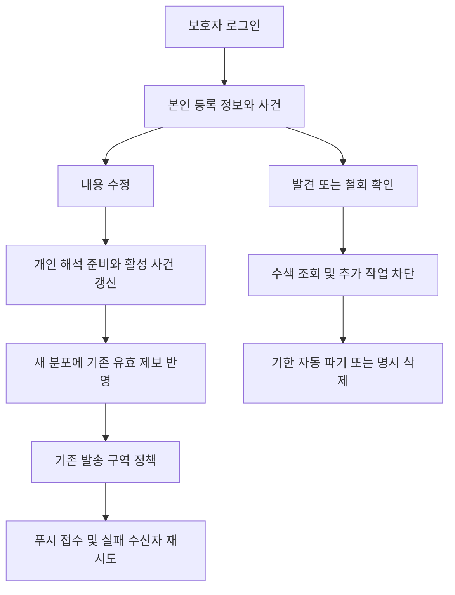

# 공개 앱 연결 결함 수정 (2026-10-09)

## 변경 이유

Cloudflare Pages → Supabase 인증·작업 큐 → 비공개 GPU worker 배포에서 기능 사이의 연결을 검사했다. 보호자가 종결·삭제할 경로가 없고, 종결한 사건의 지도는 계속 열렸으며, 알림 전송 실패를 성공처럼 기록했다. 시간별 재예측은 기존 제보의 위치 가중치를 지웠다. 계정 전환 시 보호자 조회 캐시도 공유됐다.

## 수정 내용

- 보호자 본인 사건 목록·종결·삭제와 등록 정보 삭제를 앱 화면까지 연결. 클라우드에서 인증된 소유자를 주입하고 다른 계정의 요청은 거부.
- 종결 즉시 지도·안내·제보 차단, 5일 뒤 파기 작업 예약. 예약 작업은 30초 간격으로 확인하며 방치 인터뷰는 5분 간격으로 탐색. 재시작 후 만료 작업 복구.
- 삭제된 사건의 이전 복사본·늦은 알림 응답이 사건을 다시 저장하지 못하게 차단.
- 최초·시간별·개인 정보 수정·제보 후 예측에 같은 알림 정책 적용. 예측 셀 선택·발송 구역 변환·참여도 문턱·새 지역 판정은 유지.
- 실패 수신자만 제한 재시도(최대 5번, 2/4/8/16분 간격, 실제 실행은 5분 검사 주기에 맞춰짐). 재시작해도 실패 상태 보존. 푸시 사업자 접수와 실제 휴대폰 수신은 구분.
- 매 재예측의 새 분포 위에 유효 제보 재적용. 분포를 반복 누적하지 않음.
- 계정마다 별도 조회 캐시 사용. 로그아웃·계정 변경 시 보호자 선택 상태 제거. 사건 목록은 로그인 계정의 서버 기록에서 복구.
- 보호자가 등록 내용을 재확인한 날짜 기록. 확인만으로 AI를 다시 호출하지 않음. 실제 내용 변경 시 기존 개인 해석·활성 사건 갱신 경로 사용. 임의의 의학적 갱신 주기는 도입하지 않음.

## main 병합 범위

main은 2026-08-13 상태여서 현 배포본보다 뒤처져 있었다. 이 PR은 현재 배포 중인 제품 경로(app/frontend/배포 설정)를 main으로 동기화하고 위 결함을 수정한다. 대규모 실험 원응답·중간 후보 자료는 옮기지 않는다. 기존 실험 PR의 과학적 성능 판정을 일괄 승인하거나 모델을 새로 학습하는 변경이 아니다.

## 검증과 한계

관련 백엔드 186건 통과 후 전체 1,364항목을 검사했다. 1,360건 통과·2건 공간 fixture 미설정 스킵·2건 과거 알림 계약을 가정한 테스트 실패였으며, 두 테스트를 실제 발송 접수와 확장 인자 계약에 맞춰 수정하고 재검사했다. 프론트 13건·TypeScript·웹 빌드 통과. 새 컨테이너의 네트워크 차단·임시 SQLite 조건에서 소유권/종결/삭제/재시작 복구 12개 항목 모두 통과했다. 최종 공개 배포 결과는 후속 기록에 기입한다. 실제 훅·TanStack Query로 계정 캐시 격리 확인. 합성 자료이며 실제 실종 사건 예측 정확도의 근거가 아니다.

실제 아이폰 잠금 화면 푸시 수신은 사용자의 기기에서 별도 확인해야 한다. 앱 종료 후 위치를 계속 추적하는 기능은 웹앱 범위에 포함되지 않는다. 서버의 사건 파기 검증이 외부 AI 제공업체·별도 백업 전체의 파기를 증명하지 않는다.

## 배포와 롤백

`deploy/supabase/005_lifecycle_read_lane.sql`은 인증·소유권 정책을 바꾸지 않고 가벼운 종결·삭제·목록 조회 요청의 큐만 분리한다. GPU worker를 단일 인스턴스로 교체하고 Cloudflare Pages 정적 파일을 배포한다. DB 새 테이블이나 파괴적 마이그레이션은 없으며 추가 필드에는 기본값이 있다. 이전 worker 이미지와 Cloudflare 배포로 복구 가능. 롤백해도 이미 실행된 사용자의 삭제는 되돌리지 않는다.

## 별도 의존성 점검

`npm audit --omit=dev`는 기존 Expo/React Native 의존성 트리에서 high 31·moderate 11개를 보고했다. 자동 권고에 Expo/React Native의 큰 버전 이동이 포함돼 이번 연결 수정과 함께 강제 적용하지 않았다. 이 숫자는 웹 번들에서 악용 가능한 결함 수와 같지 않으며, build 도구·native 경로도 포함한다. 의존성 갱신은 별도 작업으로 남긴다.
