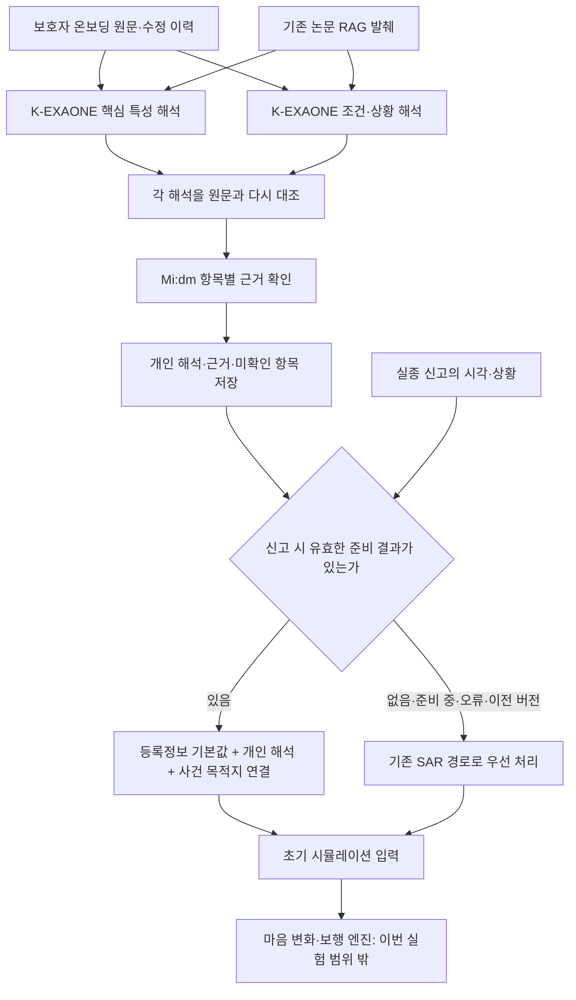

# 초기 개인 해석에서 SAR의 추가 효과와 근거 보존 검증

**결정: 준비된 K 개인 해석을 정상 경로로 적용하고, SAR는 준비 결과가 없을 때의 기존 대체 경로로 남긴다.** 정상 경로에서 사건마다 SAR를 추가하는 근거는 이번 비교에서 확보되지 않았다. 개인 의미를 보존하는 확인 절차는 강화했다.

최종 수정 코드는 8개 저장 K 결과에 대한 16회 재검사에서 지정한 특성·조건·근거 연결 기준을 충족했다. **8개의 새로운 K 생성을 두 번 더 수행한 결과가 아니다.** 원래 요청 네 개의 내용 일치를 확인해 K 응답을 재사용했고, 새로 필요한 원문 판독만 Mi:dm에 호출했다. 운영 맥미니 배포는 이번 실험에서 변경하지 않았다.

## 왜 이 실험을 했는가

「돌아오길」의 앞단은 보호자가 남긴 대화에서 그 사람의 목적지, 길 경험, 길을 잃었을 때의 대처, 보행 제약과 환경 반응을 구분해 저장하고, 실종 신고가 접수되면 시뮬레이션의 초기 입력으로 변환하는 부분이다. 목표는 유효한 JSON을 만드는 데 그치지 않고, 같은 치매 유형 안에서도 다른 개인의 특징을 보존하는 것이다.

이전 구현은 K-EXAONE으로 온보딩 해석을 준비한 뒤에도 사건이 발생할 때마다 SAR-EXAONE이 별도의 수치 기준값을 만들었다. 그러나 두 모델을 함께 호출한다는 사실만으로 해석이 더 정확해지거나 운영이 안정적이라고 말할 수 없다. 같은 사람의 정보를 넣어 SAR가 실제로 어떤 특성을 추가로 살리는지, 이미 보존한 특성을 훼손하지 않는지 확인하기 위해 이번 비교를 설계했다.

여기서 SAR-EXAONE은 EXAONE 3.5 7.8B Instruct에 수색·구조(Search and Rescue) 영역의 Low-Rank Adaptation(LoRA) 어댑터를 적용한 기존 서버 경로를 뜻한다. 이번 서버가 반환한 모델 별칭은 `exaone-sar`다. 이번 실행에서 새 어댑터를 학습하거나 배포 어댑터의 가중치 동일성을 다시 증명한 것은 아니다. K-EXAONE은 FriendliAI의 기존 배포를 사용했으며, 좁은 근거 판독에는 KT Mi:dm을 사용했다.

## 무엇을 공정하게 비교했는가

| 구성 | 온보딩 준비 | 사건 시 초기 입력 | 확인하려는 차이 |
|---|---|---|---|
| A: K 중심 | 보호자 원문 + 동일 논문 발췌 → K 해석·재검토 → Mi:dm 근거 확인 | 유형·등록정보 기반 기본값에 저장된 개인 해석 적용 | SAR 없이 개인 특성을 보존하는가 |
| B: 사건 시 SAR 추가 | A에서 만든 바로 그 준비 결과 재사용 | SAR의 사건 기준값 위에 같은 개인 해석 적용 | SAR 수치 기준값의 추가 효과 |
| C: SAR를 K의 참고로 제공 | 원문 + 동일 발췌 → SAR 참고 해석 → K 해석·재검토 → Mi:dm 확인 | A와 같은 기본값에 개인 해석 적용 | 도메인 참고가 K의 누락·오해를 줄이는가 |

A와 B는 동일한 K 출력이므로 개인 해석 항목이 같다는 사실만으로 K가 SAR보다 낫다고 평가하지 않는다. 둘의 차이는 그 해석을 초기 입력으로 바꾸는 수치 기준값이다. A와 C는 별도의 K 생성이므로 반복 간 변동까지 함께 본다.

합성 사례는 세 쌍이다. 첫 쌍은 보행 제약과 공원 의도가 같지만 길을 잃으면 기다리는 사람과 계속 이동하는 사람이다. 둘째 쌍은 과거 시장 상인이었지만 이제 가지 않는 사람과 지금도 혼자 반복 방문하는 사람이다. 셋째 쌍은 특정 시장에서 혼잡과 소음이 **동시에** 있을 때만 피하는 사람과, 여러 시장에서 두 조건 중 **하나만** 있어도 피하는 사람이다. 각 사례를 두 번 실행했다.

SAR의 기존 입력 경로도 보호자 질문·답변 전체를 읽도록 동일 원문을 행동 기록에 제공했다. SAR 쪽에 요약이나 빈 입력만 주는 비교를 피했다. C의 SAR 응답은 개인 관찰이 아닌 미검증 참고로 명시했다. 사건 전 준비에 미래 사건 정보는 넣지 않았다.

## RAG와 평가 범위

Retrieval-Augmented Generation(RAG)은 기존 Upstage 기반 검색 경로에서 보관한 동일 발췌를 재사용했다. 이번 고정 스냅샷의 네 레코드 중 실제 개인 해석에 사용된 것은 「가족 돌봄 제공자의 치매노인 배회관리 경험」 발췌 한 건(926자)이며, QA 세 건은 개인 관찰과 섞이지 않도록 제외했다. 새 검색·임베딩이나 전체 논문 코퍼스의 품질 비교는 실행하지 않았다. 따라서 이번 결과는 RAG 자체의 추가 효과를 입증하는 실험도 아니다.

허용 답, 입력, 코드 해시, 요청 상한을 첫 호출 전에 고정했다. 원문에 없는 의도나 방향을 만들지 않는지, 조건의 AND/OR와 적용 범위가 유지되는지, 저장 후 재로딩해도 초기 입력에 남는지를 검사했다. 이후 원문을 다시 읽으며 발견한 보조 특성 오류는 사전 필수 검사와 별도로 공개한다. 결과를 본 뒤 허용 답을 넓혀 통과시키지 않았다.

이 평가는 합성 기록의 의미 보존과 코드 연결에 대한 개발 검증이다. 독립 임상 평가, 실제 실종 경로 정답과의 비교, 사람의 행동 확률이나 발견율 검증은 아니다. 마음 모델과 보행 경로는 실행하지 않았다. 초기 입력에 저장된 특성이 실제 이동 중 어떻게 발현되는지는 해당 소비 코드의 범위로 따로 표시한다.

## 수정 전 기본 비교 결과

| 구성 | 준비 완료 | 모든 사전 필수 항목 통과 | 통과한 검사 항목 |
|---|---:|---:|---:|
| A: K 중심 | 12/12 | 9/12 | 129/132 |
| B: 같은 K에 사건 시 SAR 추가 | 12/12 | 9/12 | 129/132 |
| C: 온보딩 SAR 참고 후 K | 12/12 | 9/12 | 123/132 |

준비 완료는 저장 가능한 결과가 생겼다는 뜻이며, 의미가 모두 맞았다는 뜻이 아니다. 검사 항목 수는 합성 기록을 반복 확인한 분모이며 환자 수나 실제 수색 정확도가 아니다.

A와 B의 개인 해석은 12쌍 모두 같다. B는 모든 쌍에서 전략 가중치를 바꾸었지만, 원문 해석에서 빠진 과거 경로 경험이나 잘못된 목적지 관계를 고치지 못했다. 수치가 달라졌다는 것만으로 더 적절한 값이라고 판정하지 않는다.

C는 과거 시장 경로 경험을 한 반복에서 살렸고, A가 후보 장소를 과거 목적지로 잘못 읽은 한 실행에서도 목적지 미확인을 유지했다. 이 긍정 사례는 남긴다. 그러나 다른 실행에서는 특정 시장의 조건부 회피를 시장 전체로 확대했고, 또 다른 실행에서는 명시된 보행 능력과 조건부 회피 정보가 사라졌다. 따라서 SAR 참고의 안정적인 추가 이득은 이 비교에서 확인되지 않았다. SAR에 유용한 지식이 전혀 없다는 결론도 아니다.

사전 검사 밖 보조 특성을 원문과 대조하면 A 7/12, B 7/12, C 9/12 기록에서 추가 검토 항목이 있었다. 여기에는 원문에 없는 도움 요청, 누락된 과거 역할, 행동만으로 추정한 정서, 의미를 특정하지 않은 `other` 태그가 포함된다. B는 A를 재사용하므로 독립 오류 7건을 더 발견했다는 뜻이 아니다. `other`가 있다는 사실도 곧바로 잘못된 행동을 주입했다는 뜻이 아니라, 그 태그만으로 의미 검증을 완료할 수 없다는 뜻이다.

K 요청 96회 중 6회는 토큰 한도를 소진해 최종 응답을 정상 완료하지 못했다. 예정된 다른 단계가 일부를 복구했지만, C의 한 실행에서는 실제 정보 누락이 남았다. 형식 복구와 의미 보존을 따로 평가해야 하는 이유다.

## 기본 비교에서 발견한 문제와 수정 이유

1. 가족을 기다린다는 기록이 실제 도움을 요청했다는 `help_seeking`, 또는 가족을 찾아 이동한다는 `person_seeking`으로 확대됐다. 같은 치매 관련 행동처럼 보이더라도 서로 다른 개인 관찰이다.
2. 과거에 혼자 반복해서 걸어 다녔다는 사실이 현재 방문을 중단했다는 이유로 경로 경험 미확인으로 바뀌었다. 과거 경험과 현재의 길찾기 능력을 구분해야 한다.
3. 과거 직장·역할이 목적지의 과거 이용 이력과 중복이라는 이유로 누락됐다. 목적지 관계만으로 그 사람의 역할 정보를 모두 표현하지 못한다.
4. 비교용 후보 장소가 과거에 이용한 목적지로 바뀐 실행이 있었다. 후보 목록은 현재나 과거의 목적지 근거가 아니다.

수정은 보호자 단어를 코드로 분류하는 방식이 아니다. K가 원문을 해석하고 근거 ID를 붙인다. Mi:dm에는 그 항목이 뜻하는 짧은 명제와 인용된 원문을 주어 확인한다. 확인되지 않은 추가 행동은 제거하며, 검토에서 빠진 특성도 초안에 있었다는 이유만으로 복구하지 않는다. 원문 확인이 있어야 복구한다. 판독 실패와 명시적인 부정은 따로 기록한다.

과거 경로 경험을 복구한 경우에도 현재 혼자 길을 찾을 수 있다고 확정하지 않는다. 엔진의 친숙도 계수는 기존 잠정 변환 규약이며 실제 능력에 대해 보정된 확률이 아니다.

## 증빙 읽는 순서

- `cases.json`: 기본 비교 원문과 실행 전 허용 답.
- `base_final_responses.json`: 모델이 최종 응답으로 반환한 본문. 내부 추론 텍스트는 제외.
- `base_evidence.json`: 저장된 개인 해석이 실제 초기 입력으로 변환된 값과 검사 결과.
- `repair_evidence.json`: 같은 저장 출력에 보강한 원문 검사를 적용한 결과. 새 K 생성 결과와 구분.
- `fresh_cases.json`, `fresh_evidence.json`: 수정한 전체 준비 과정을 새로 호출한 입력과 결과.
- `usage_events.json`: 실패·중단을 포함한 호출 시작/종료와 제공자 사용량. 단가·청구액·지원 차수 미확인은 null.

## 연결 수정안의 역할 분담

준비된 K 해석을 적용한 경우의 출처는 `prepared_person`, 그때 사용한 수치 기본값은 `profile_baseline`으로 남긴다. SAR를 호출하지 않은 결과를 SAR 성공이나 AI 미설정 스텁으로 표시하지 않는다. SAR 대체 경로를 사용하면 준비 결과가 없었던 이유와 기존 모델 호출 결과를 함께 남긴다.

대체 경로는 기존 신고 처리를 이어 가기 위한 호환 경로다. **SAR가 이미 준비된 K 개인 해석의 정확도를 높였다는 근거와 동일하지 않다.** 신규 온보딩의 준비 완료 이후에는 같은 사건에 개인 해석을 반영할 수 있다. 이 과정에서 보호자 원문을 덮어쓰지 않는다.

조건부 반응은 두 질문으로 나눈다. 첫째는 “그 조건에서 그런 반응을 보였는가”, 둘째는 “그 반응을 한 장소에서만 관찰했는가, 유형 전체에 해당한다고 말했는가”이다. 조건이 사실이라는 확인만으로 모든 시장·공원에 같은 반응을 확장하지 않는다.

## 새 검증에서 실제로 무엇이 수정됐는가

프롬프트를 고쳤다고 K의 원출력이 항상 맞게 된 것은 아니다. 다음은 수정한 전체 파이프라인을 새로 실행했을 때의 실제 기록이다.

| 사례 | K의 초안·최종 검토에서 남은 문제 | 추가 원문 확인 후 저장된 결과 |
|---|---|---|
| W1: 가족을 기다리는 사람 | `help_seeking`을 추가 | Mi:dm이 인용 원문에서 요청 행동을 부정하여 제거. `wait_for_help`와 신체적 `rest_pattern`은 유지 |
| G1: 과거 시장 상인 | 최종 검토가 초안의 `past_role`을 누락 | 그 과거 역할을 원문에서 확인한 후 복구. 과거 목적지와 반복 독립 보행 경험을 따로 유지 |
| G2: 현재도 시장을 방문 | 최종 검토가 경로 습관 보조 태그를 누락 | 원문 확인 후 복구. 현재 방문 습관·길 경험·과거 역할을 함께 보존 |
| E1: 특정 시장의 복합 조건 회피 | 조건 자체는 맞지만 범위를 시장 유형 전체로 판단 | 장소 범위 질문에는 부정 판정. AND 조건을 유지한 채 특정 장소 관찰로 제한 |

이는 **K 단독 성능 향상이라고 부르지 않는다.** K의 해석·재검토, 근거 ID 보존, Mi:dm의 좁은 판독, 코드의 규약 변환이 함께 만든 개선이다. 추가 판독도 AI 판단이므로 전문가나 보호자의 검토를 대신한 임상 검증이라고 부르지 않는다.

## 보강 과정과 최종 결과

| 단계 | 모델 호출과 자료 | 결과와 해석 |
|---|---|---|
| 기본 A/B/C 비교 | 새 K 96회, SAR 24회, Mi:dm 52회 | 세 구성 모두 필수 기준 9/12 실행 통과. SAR의 안정적인 추가 이득 미확인 |
| 첫 원문 검사 보강 | 저장 K 재사용, 새 Mi:dm 61회 | A/B의 사전 필수 기준은 12/12. 보조 특성 누락·미확인까지 포함한 전체 완료로 선언하지 않음 |
| 프롬프트·검사 수정 후 새 준비 | 6개 개발 사례 + 2개 새 문장 표현, 새 K 32회·Mi:dm 33회 | K 32/32 정상 종료. 전체 기준 6/8. OR 조건 누락과 휴식 특성 누락이 남음 |
| 최종 원문 검사 보강 | 위 8개 K 응답 재사용, 새 Mi:dm 16회. 앞서 확인한 동일 원문·동일 질문의 답은 재사용 | 8개 결과 × 2회 = 16/16 통과. 새 질문이 필요했던 E2와 H_wait도 두 번 모두 같은 최종 결과 |

마지막 보강은 조건의 반대 의미를 자동으로 뒤집는 규칙이 아니다. 실제 원문을 대상으로 접근과 회피를 각각 확인하고, 혼잡만 있는 경우·소음만 있는 경우·둘 다 있는 경우·둘 다 없는 경우를 따로 확인한다. 확인된 조합만 코드로 AND/OR 표현식으로 정리한다. ‘피하지 않음’을 ‘다가감’으로 바꾸지 않는다. AND/OR 대조 문항 8개도 실제 Mi:dm 호출에서 모두 기대한 답을 반환했다.

같은 절차에서 휴식 필요를 신체 능력 등급만으로 추정하지 않고 원문을 다시 확인해 복구했다. 경로 값이 맞아도 엉뚱한 보행 능력 문장을 근거로 인용한 경우에는, 초안의 대체 근거가 실제로 그 경로 경험을 뒷받침하는지 확인했다. 장소 회피만으로 생성된 정서는 미확인으로 되돌렸다.

**수정 성공의 범위는 앞단의 지정된 개인 특성 보존과 초기 입력 연결이다.** 최종 게이트는 개발 중 발견한 오류를 고친 뒤 같은 자료로 다시 확인한 것이므로 독립된 일반화 성능이나 실제 치매 환자 행동 정확도라고 제시하지 않는다. 같은 질문의 기존 확인 결과를 재사용했으므로 16회 모두가 독립된 새 모델 판단도 아니다. K 자체의 우월성과 결합 파이프라인의 개선을 구분한다.

### 실행 도구의 오류도 기록

새 준비 검증의 첫 실행은 합성 입력의 `behavior_notes`를 목록이 아닌 문자열로 저장해 호출 전에 중단됐다. 모델 호출은 0회이며, 자료형을 바로잡은 뒤 원래 의미·허용 답을 유지하고 재개했다.

최종 재검사 도구의 첫 실행은 파일 이름 앞부분으로 찾다가 조건 초안과 조건 재검토 파일을 함께 선택했다. 이 때문에 실제 K 네 단계 중 한 단계만 재생된 결과가 생겼다. 그 16행은 모델 품질 비교에서 제외했다. 해당 실행의 Mi:dm 36회와 사용량은 비용 기록에서 빼지 않았다. 파일 역할을 정확히 구분하고, **8개 사례 모두 네 개의 원래 K 요청이 일치함을 유료 호출 전에 검증**한 수정 실행기로 최종 결과를 얻었다. 개별적으로 기록된 동일 원문·동일 명제의 판독은 재사용했으며, 이 또한 독립 재평가로 세지 않는다.

## 교체의 정당성과 남겨 둔 역할

1. **K 정상 경로 채택:** 목적지·경로 경험·대처·신체 능력·조건을 분리한 해석을 미리 저장하고, 실제로 인용한 근거까지 검사한 뒤 초기 입력으로 연결할 수 있다. 이번에 드러난 누락·반전·근거 연결 오류는 최종 게이트에서 수정됐다.
2. **정상 경로의 SAR 중복 호출 제거:** 동일 K 해석 위에 SAR 숫자를 더해도 누락된 개인 의미가 복구되지 않았다. SAR를 K의 참고로 주는 구성은 긍정 사례와 퇴행 사례가 함께 있었다. 따라서 이미 준비된 K에 SAR를 무조건 추가하는 비용·변동성을 채택하지 않는다. 새 프롬프트의 모든 가능한 SAR 조합까지 무효임을 증명했다는 뜻은 아니다.
3. **SAR 대체 경로 유지:** 온보딩이 없는 긴급 신고, 준비 중, 유효하지 않거나 이전 버전인 준비 결과에서는 기존 신고 처리 경로를 유지한다. 이는 운영 연속성을 위한 선택이며, SAR가 K보다 더 정확하다는 판정이 아니다. API와 앱에 새 개인 해석 미반영 상태를 표시한다.
4. **도메인 지식 유지:** 기존 논문 RAG와 이동 모형의 유형 기준값은 남아 있다. SAR를 정상 경로에서 호출하지 않는 것이 치매 행동 연구나 통계 기준을 없애는 것은 아니다. 마음 모델과 보행 소비 코드는 이번 변경의 비교 대상이 아니다.

특정 장소의 반응, 실제 기억한 경로, 휴식의 간격, 도움 요청 등 엔진이 직접 실행하지 못하는 항목은 별도 보존 표시를 유지한다. 잘 해석해 저장했다는 사실을 이미 모든 행동을 구현했다는 설명으로 바꾸지 않는다.

## 코드 검증 및 배포 상태

- 백엔드 전체: **1,072 passed, 2 skipped, 7 subtests passed**. 외부 모델·지도 호출을 차단한 검사.
- 프런트엔드 TypeScript 검사 통과.
- 준비 완료 시 SAR 추가 호출 없음, 준비 중·이전 버전·비정상 결과의 기존 대체 경로, 사건 목적지 연결을 별도 테스트.
- 최종 검증 스냅샷의 `backend/app` 모든 파일 해시가 PR 작업 코드와 일치함을 확인.
- 운영 프로필과 저장소는 읽거나 변경하지 않은 격리 합성 실험. 맥미니 운영 컨테이너의 서비스 코드는 교체하지 않음.
- 새 준비 버전은 `onboarding-person-v6-grounded-conditions`. 이전 준비 결과를 새 검사를 통과한 것처럼 쓰지 않는다. 운영 반영 시 기존 준비 결과의 갱신과 재시작 자동 호출은 별도 실행 범위로 관리해야 한다.

## 연구지원 사용량 — 이번 승인 범위의 추가분

| 차수 | 구분 | 활용자원 | 활용 규모 |
|---|---|---|---|
| 미확인 | 생성형 AI API(국내 모델) | K-EXAONE / FriendliAI 배포 `depmkuykpfon9lg` | 2026-09-27 사용, 128회, 1,410,990토큰 |
| 미확인 | 생성형 AI API(국내 모델) | KT Mi:dm / `midm-pro-fp8-kaic` | 2026-09-27 사용, 198회, 174,589토큰 |
| 미확인 | GPU 자원 | 기존 EXAONE 3.5 7.8B + SAR LoRA 서버, 별칭 `exaone-sar` | 24회 추론, 46,443토큰 기록. GPU 종류·할당 사용시간 미확인 |
| 미확인 | 기타 | Mac mini 격리 실행 환경 | CPU 세션 시작·종료와 경과시간 기록 |

총 요청은 K 128/128, SAR 24/32, Mi:dm 198/240으로 승인 상한 이내다. 350개 요청의 시작·종료가 모두 짝을 이루고, 자원 세션 기록을 포함한 712개 이벤트를 공용 원장에 중복 없이 동기화했다. 실패한 실행 도구에서 발생한 비용도 포함한다. 새 임베딩·지도·보행·마음 추론·LoRA 학습은 수행하지 않았다.

단가·실청구액·지원 차수는 확인되지 않아 null로 남겼다. SAR의 토큰 수를 유료 API 청구액으로 중복 환산하지 않았고, 호출 응답 대기 시간을 GPU 할당시간으로 쓰지도 않았다. 이 표는 전체 1·2차 지원 사용량이 아닌 이번 실험의 추가 기록이다.
