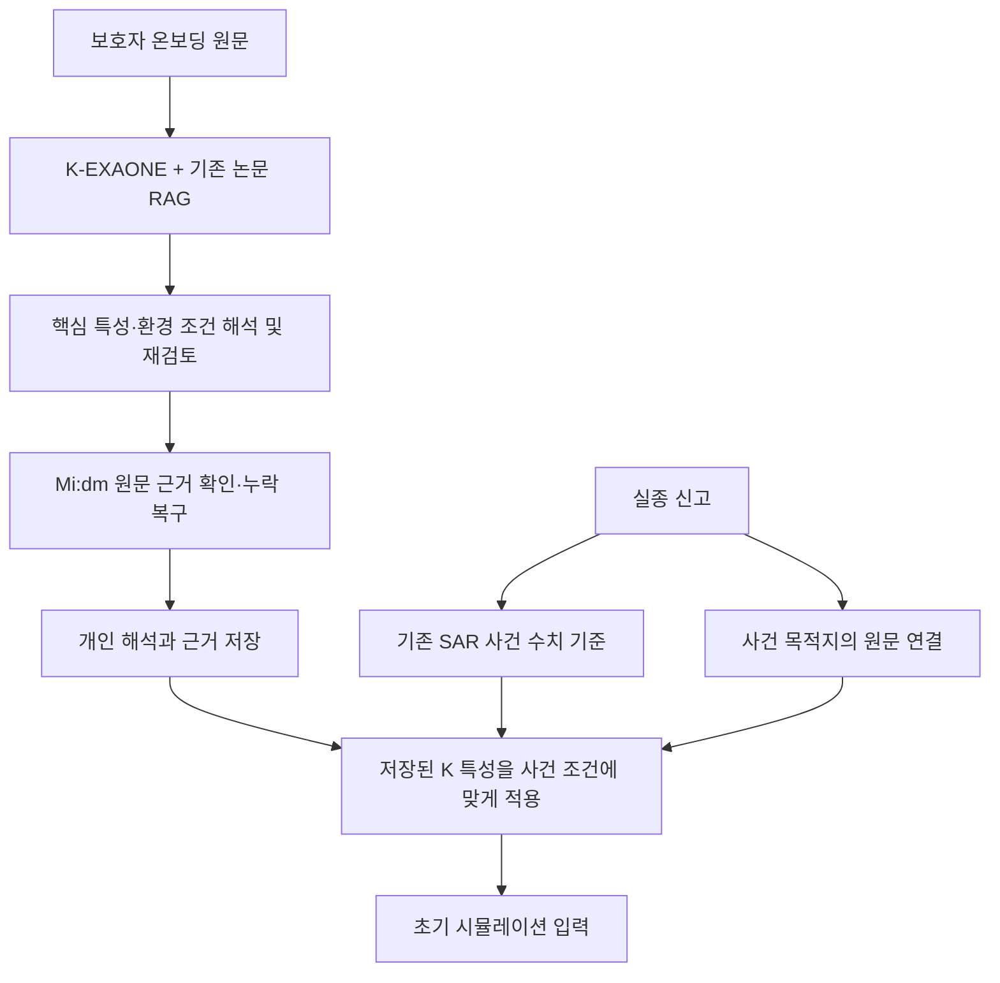
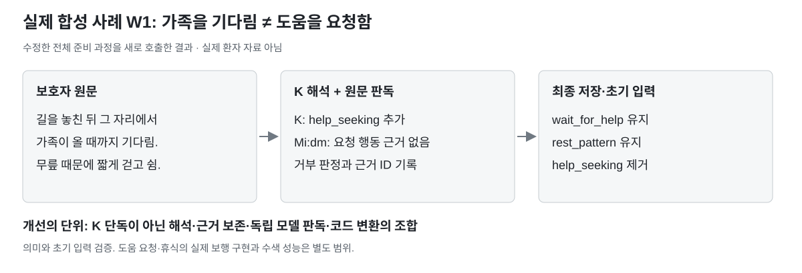

# K 개인 해석 보강과 SAR 수치 기준의 재검증

팀 공유용 역할 설명과 도입 범위: [앞단 도입 범위와 현재 구조](adoption-and-architecture.md).

**현재 결정: K의 원문 근거 확인·누락 복구는 유지한다. SAR 수치 기준을 임시 기본 비율로 교체하는 변경은 철회한다.**

최초 보고서는 개인 특성 검사 점수가 같다는 사실을 근거로 정상 경로에서 SAR를 제거한다고 결론 냈다. 이 점수는 SAR가 바꾸는 전략 비율의 행동 효과를 검증하지 못한다. 사용자의 지적 후 저장된 최종 K 해석을 고정하고 실제 OSM 도로망에서 추가 비교했다. **“SAR를 제거해도 성능이 유지됨을 입증했다”는 이전 설명은 정정한다.** SAR를 유지하는 이유도 우월성이 입증됐기 때문은 아니다. 대체 수치 기준의 타당성이 입증되기 전에 기존 수치 경로를 제거하지 않기 위한 결정이다.

## 무엇을 개선했고 무엇을 확정하지 않았는가

| 항목 | 판정 | 근거 |
|---|---|---|
| 보호자 원문과 다른 도움 요청·정서 추정 제거 | 앞단 보강 유지 | 원문 판독과 항목별 검사 |
| 과거 경로·역할·휴식 누락 복구 | 앞단 보강 유지 | 근거를 확인한 경우에만 복구 |
| 조건 AND/OR와 장소 범위 분리 | 앞단 보강 유지 | 혼잡·소음의 네 조합과 적용 범위를 따로 확인 |
| 정상 경로에서 SAR 제거 | 변경 철회 | 의미 점수만으로 수치 기준의 타당성을 판정할 수 없고, 행동 비교도 단일 우위를 보이지 않음 |
| SAR가 K보다 더 정확하다는 주장 | 하지 않음 | 실제 행동 정답과의 검증 아님 |
| 실제 환자 재현·발견율·운영 안정성 | 미측정 | 합성 자료와 격리 코드 검사 범위 |

처음부터의 목적은 온보딩에서 그 사람의 목적지, 경로 경험, 대처, 신체 제약, 환경 조건을 보존하고 초기 시뮬레이션 입력에 전달하는 것이다. JSON 통과율이나 모델 수가 목적이 아니다.

## SAR 제거 주장을 다시 검증한 방법

최종 원문 검사를 통과한 K 준비 결과를 사례별 하나로 고정했다. 동일 결과를 세 가지 수치 기준과 결합했다.

- A: K + 기존 코드의 프로파일 기본 비율.
- B1: 같은 K + 동일 사례의 저장 SAR 응답 1.
- B2: 같은 K + 동일 사례의 저장 SAR 응답 2.

6개 합성 사례 × 3구성 × 2장소 배치 × 2시간(1·4시간) × 5난수 시드 = **360회, 가상 보행자 180,000명**. 실제 저장 OSMnx 정릉 도로망을 사용했고, 합성 장소를 노드에 배치했다. 장소 배치 2는 같은 도로망 위에서 목적지 좌표를 순환 교체한 대조다. 실제 실종 사건이나 실제 장소 방문 기록은 아니다.

K·SAR·Mi:dm 새 호출은 **0회**. 마음 재해석은 끄고, 네트워크 접근은 차단했다. 모델 응답이 달라지는 효과와 수치 기준의 효과를 섞지 않았다. 실행 전 [비교 계획](behavior_audit/protocol.json)을 기록했으며 [실행기](behavior_audit/run.py), [수치 입력](behavior_audit/priors.json), [전체 결과](behavior_audit/results.json), [요약](behavior_audit/summary.json)을 첨부했다. 실행기의 분석 대상 코드는 `24650ad`이며, 아래 현재 PR은 이 결과를 보고 자동 SAR 제거를 철회한 후속 상태다.

## 실제 행동 결과

아래는 각 구성에서 같은 지도·시각·시드로 두 사람을 비교한 차이의 평균이다. **차이가 더 크다고 실제 행동 정확도가 높다는 뜻은 아니다.** 적절한 차이의 크기를 알려 주는 실측 정답이 없기 때문이다.

| 비교 | A: K + 기본 비율 | B1: K + SAR 1 | B2: K + SAR 2 |
|---|---:|---:|---:|
| 기다리는 사람이 계속 걷는 사람보다 출발점 100m 안에 남는 비율 차이 | +6.01%p | +3.49%p | +4.27%p |
| 계속 걷는 사람이 기다리는 사람보다 더 걸은 경로 길이 | +0.535km | +0.569km | +0.384km |
| 현재 시장을 방문하는 사람이 과거에만 방문한 사람보다 시장에 도착하는 비율 차이 | +7.22%p | +10.74%p | +12.33%p |

대기와 시장 방문 대비는 각 구성의 20개 설정 모두 기대한 방향이었다. 보행 거리 대비는 A와 B1에서 20/20, B2에서 19/20이었다. B2의 한 설정에서 -0.041km로 반전됐으나 전체 평균은 양수이며, 이 한 번의 난수 결과를 확정적 퇴행으로 판정하지 않는다. 20개 설정은 같은 합성 사례·같은 지도에서 반복한 조건이지 독립된 환자 20명이 아니다.

**이제 확인된 사실:** SAR가 바꾸는 숫자는 실제 경로 결과에 영향을 준다. 따라서 기존의 같은 의미 점수 9/12만으로 SAR가 무의미하다고 판단할 수 없다. 반면 현재 행동 비교에서 SAR가 모든 개인 특성을 더 잘 표현한다고도 말할 수 없다. 대기 대비와 시장 접근 대비는 서로 다른 방향의 차이를 보였다.

같은 원문의 SAR 응답 두 개만 교체해도 종착 셀 분포의 평균 총변동거리(TV)는 0.13075였다. 이는 두 시뮬레이션 분포 사이의 차이이며 오류율 13.1%가 아니다. 어느 분포가 실제 사람에 가까운지 판정하지 않는다. 고정 기본값의 반복 변동이 작다는 사실도 정확성의 근거가 아니다.

도로 밖으로 연결된 이동은 없었고 마음 호출도 없었다. 1시간과 4시간의 전체 경로 해시는 180쌍 모두 달랐다. 이 결과는 시간 입력의 영향이 있다는 확인이며, 올바른 시간별 확률지도라는 증거는 아니다. 최대 300스텝에 도달한 비율은 평균 0.76%였다. 작은 800m 도로망과 실제 군중·소음 관측 부재 때문에 전 지역 수색이나 E1/E2 환경 반응의 우열은 평가하지 않았다.

## 기존 설명의 핵심 오류

`backend/app/llm/exaone.py`의 `_STRATEGY_PRIORS` 주석은 기본 여섯 전략 비율을 **placeholder, 논문 값으로 교체 대상**이라고 명시한다. 전략 이름의 문헌 출처와 전략별 비율의 검증 여부는 다르다. 이를 검증된 통계 비율이라고 설명하면 안 된다.

거리 분포의 Koester 기준과 이 임시 전략 비율도 구분해야 한다. SAR를 뺀다고 모든 값이 무근거가 되는 것은 아니지만, 그 자리에 검증된 전략 확률이 들어가는 것도 아니다. 이번 여섯 사례는 명시된 신체 능력이 거리 입력을 덮어쓰므로, 여기서 SAR 거리 판단의 가치를 별도로 입증할 수도 없다.

또한 엔진의 `staying_put`은 즉시 정지가 아니라 표집 이탈거리를 줄이는 구현이다. ‘기다리는 특성을 추출했다’와 ‘그 사람처럼 기다리는 궤적을 구현했다’는 다르다. 이 문제를 K 해석 실패로 분류하거나 마음 모델 변경으로 덮지 않는다. 이번 PR은 보행 알고리즘을 수정하지 않는다.

## 현재 코드의 흐름

준비 결과가 유효하면 기존 SAR 수치 기준 위에 검증된 K 특성을 적용한다. 준비 중·오류·이전 버전이면 기존 SAR 경로로 우선 처리하고 앱에 개인 해석 미반영 상태를 표시한다. 준비된 경우에도 실제 수치 기준의 출처 `numeric_baseline_source`, `sar_source`와 호출 여부를 남긴다. 보호자 원문은 덮어쓰지 않는다. SAR 비활성화 토글을 새로 도입하지 않는다.

## 앞단 개선 수치의 정확한 의미

첫 비교에서 A/B는 필수 기준 9/12, 129/132항목, C(온보딩 SAR 참고 후 K)는 9/12, 123/132항목이었다. A/B가 같은 K 결과였다는 점 때문에 이 점수를 모델 간 독립 승부로 읽지 않는다.

수정 후 새 K 32회로 만든 8개 결과는 6/8 통과했다. 최종 원문 보강 후 그 8개 K 응답을 재사용한 16회 검사에서는 16/16 통과했다. 이는 개발 중 발견한 누락·반전을 수정한 확인이다. 독립된 새 생성 16건 또는 실제 환자 정확도 100%가 아니다. SAR 우월성이나 제거 가능성의 직접 근거로 쓰지 않는다.

원본 실험 방법·원응답·RAG 구성·실패·비용은 [최초 보고서 이력](initial_report_superseded.md)에 남겼다. 해당 이력의 SAR 제거 결정만 철회했으며 원자료는 수정하지 않았다. RAG는 기존 스냅샷 네 건 중 논문 「가족 돌봄 제공자의 치매노인 배회관리 경험」 926자 한 건을 사용했고 QA 세 건은 제외했다. RAG 전체 코퍼스 효과나 재튜닝을 시험한 것이 아니다.

## 어떤 근거가 있어야 수치 기준을 다시 교체할 수 있는가

제거를 정답으로 미리 정하고 성공할 때까지 평가 항목을 바꾸지 않는다. 아래 두 질문을 분리한다.

1. **개인 특성의 올바른 영향:** 같은 개인의 다른 정보는 고정하고 대기·진행, 현재·과거 목적지, 기존·새 경로 등 한 특성만 바꾼 경우 예상 방향의 행동 변화가 유지되는가. 이번 실험은 일부 대비를 확인했으며 방향 선택·긴급 등록·정보 부족 등은 별도 대비가 필요하다.
2. **변화 크기의 타당성:** 머무름 26%와 17% 중 어느 값이 타당한가. 임시 기본 비율, SAR 출력, 독립 전문가가 허용한 범위 또는 실제 사례의 행동 관찰을 같은 척도로 비교해야 한다. 값이 안정적이거나 확률이 집중됐다는 이유로 더 정확하다고 판정하지 않는다.

논문이 지지하는 현상·개인 관찰·코드의 잠정 계수를 각각 표시하고, 정답 또는 허용 범위를 결과를 보기 전에 고정해야 한다. 모델의 자기 평가나 구현과 같은 규칙으로 만든 정답은 독립 근거로 세지 않는다. 이 조건을 충족하지 않은 현재의 **SAR 자동 제거안은 채택 판정에서 제외**한다. 앞단 근거 보강과 수치 기준 교체를 한꺼번에 승인하지 않는다.

## 검증·배포·비용

- SAR 제거 철회 후 전체 회귀 검사 **1,072 passed, 2 skipped, 7 subtests passed**. 이후 추가한 SAR 실패 상태 보존 회귀를 포함해 해당 파일 **7개 테스트 통과**.
- 기존 1,072개 백엔드 테스트와 프런트엔드 타입 검사는 최초 후보에서 통과했으며, 후보 버전과 후속 코드 검증을 구분한다.
- 운영 맥미니 서비스 코드는 변경하지 않았다. 이번 추가 실험은 로컬 CPU 격리 실행이다.
- 추가 K·SAR·Mi:dm·지도·임베딩·마음 API 호출은 0회. 로컬 CPU 사용 시작·종료를 공용 원장에 기록했고 비용·지원 차수는 미확인으로 남겼다.
- 앞선 승인 실험의 K 128회, SAR 24회, Mi:dm 198회와 사용량 기록은 그대로 보존한다.
