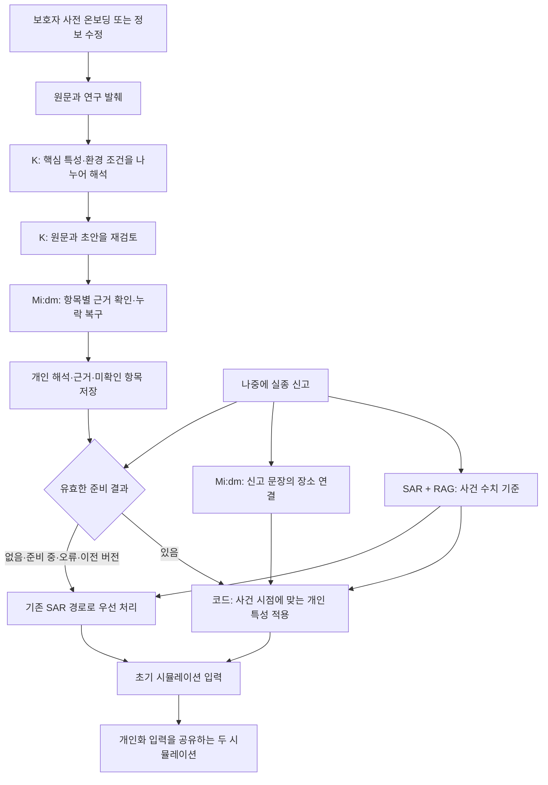

# 돌아오길 앞단 도입 범위와 현재 구조

기준: 2026-09-27, PR #258의 코드 `572dd44`. 이 문서는 현재 PR 후보를 설명하며, 운영 맥미니에 이미 배포된 구조라고 주장하지 않는다.

## 1. 최종적으로 무엇을 도입하는가

**K-EXAONE 기반의 개인 행동 해석·근거 확인·사전 저장을 보강하고, 이를 기존 SAR 사건 수치 기준과 연결하는 앞단 개선을 채택한다. SAR 전체를 K로 교체하는 변경은 채택하지 않는다.**

목적은 보호자가 온보딩에 남긴 치매 어르신의 특성을 목적지·대처·방향·경로 경험·신체 제약·환경 조건으로 구분해, 실종 신고 시 초기 시뮬레이션 입력으로 전달하는 것이다. 모델의 자유로운 설명을 그대로 행동 확률이나 경로로 간주하지 않는다.

| 판단 대상 | 현재 판정 | 근거와 경계 |
|---|---|---|
| K 개인 해석의 원문 확인·누락 복구 개선 | 코드 통합과 통제된 시연·추가 검증에 채택 가능 | 지정한 합성 사례의 누락·반전·잘못된 인용 수정, 저장과 초기 입력 연결 검사 |
| SAR 수치 기준 제거 | 채택하지 않음 | 행동에 실제 영향을 주며 대체 기본 비율의 동등성·우월성이 확인되지 않음 |
| 현재 PR의 운영 배포 완료 | 아님 | 운영 서비스 코드는 교체하지 않았음 |
| 바로 운영 배포해도 된다는 판정 | 이번 결과만으로 내리지 않음 | 기존 준비 결과의 버전 갱신, 실제 배포 설정·의존 모델 연결·신고 흐름 확인이 별도 필요 |
| 실제 환자 행동·발견 성능 검증 완료 | 아님 | 실제 이동 정답, 독립 임상 평가, 실수색 성능 평가 없음 |

코드 채택, 배포 완료, 실제 수색 성능 검증은 서로 다른 판정이다. 현재는 앞단 개선을 코드에 반영하고 격리 검증한 단계다.

## 2. 각 구성요소의 역할

| 구성요소 | 입력과 역할 | 하지 않는 일 |
|---|---|---|
| K-EXAONE | 보호자 원문과 기존 논문 RAG를 바탕으로 개인 특성과 조건을 해석·재검토 | 직접 좌표나 보행 경로를 생성하지 않음 |
| KT Mi:dm | 해석 항목이 원문에 근거하는지 좁은 질문으로 확인. 사건 신고 문장과 등록 장소의 연결도 확인 | 실제 사실의 진위를 보증하거나 전문가 평가를 대신하지 않음 |
| SAR-EXAONE | 프로젝트에서 부르는 기존 EXAONE 3.5 7.8B Instruct + Search and Rescue(SAR) LoRA 경로. 사건 정보·개인 프로필·RAG로 이동 전략 비율, 장소 끌림 등급, 반경 등급을 추정 | K가 저장한 개인 관찰을 임의로 새 사실로 바꾸는 역할 아님 |
| RAG | Retrieval-Augmented Generation. 기존 검색기와 인덱스에서 관련 연구 발췌를 제공 | 논문의 집단 경향을 해당 개인에게 관찰된 사실로 확정하지 않음 |
| 변환 코드 | 저장된 개인 해석과 사건 조건, SAR 기준을 정해진 규약으로 결합해 초기 입력 생성 | 모든 계수가 실제 행동으로 보정됐다는 뜻은 아님 |
| 보행·마음 모델 | 초기 입력을 받아 도로망 이동과 이동 중 변화를 처리 | 이번 앞단 개선의 효과와 자동으로 동일시하지 않음 |

SAR는 현재 **준비 결과가 없을 때만 호출하는 fallback 전용 모델이 아니다.** K 준비 결과가 있어도 사건 수치 기준을 제공한다. 준비 결과가 없으면 K 적용 없이 기존 SAR 경로로 우선 처리한다. SAR 자체의 호출 실패 시에는 별도의 기존 기본값 대체 경로가 있다.

## 3. 시간 순서에 따른 처리

온보딩과 신고는 별도 시점이다. 정상적인 사전등록에서는 신고 전에 K의 개인 해석을 준비해 저장한다. 신고가 들어올 때마다 이 K 해석을 처음부터 다시 생성하는 구조가 아니다. 원문이 바뀌면 새 준비가 필요하며, 이전 버전이나 맞지 않는 준비 결과를 새 검증을 통과한 결과처럼 사용하지 않는다.

온보딩이 없는 긴급 신고는 준비 완료를 기다리게 하지 않고, 확보한 정보로 기존 신고 경로를 사용한다. 이후 정보와 준비 결과가 추가되면 갱신 경로에서 반영할 수 있다. 실제 운영 배포에서 이 연결은 별도로 점검해야 한다.

중요한 구분은 **SAR 응답을 K에게 마지막으로 전달해 판단시키는 직렬 구조가 아니라는 것**이다. 현재 정상 경로에서 K는 온보딩 정보를 사전에 해석하고, 사건 시 SAR 결과와 저장된 K 해석을 코드가 결합한다. 과거에 비교했던 ‘온보딩 SAR → K’는 실험 구성 C였으며 현재 정상 경로와 다르다.

## 4. 누가 최종 값을 결정하는가

‘SAR가 숫자를 만들고 K가 모두 덮어쓴다’ 또는 ‘K가 최종 결정한다’고 설명하면 정확하지 않다. 항목별로 역할이 다르다.

| 초기 입력 | 현재 결합 방식 |
|---|---|
| 이동 전략 비율 | SAR 기준 비율에 K가 확인한 대기·지속 이동·방향·현재 목적지 특성에 따른 코드 배율을 적용하고 정규화 |
| 목적지 끌림 | K의 현재·과거·거부 관계와 근거 강도에 SAR 장소 등급의 제한된 조정을 결합 |
| 거리 분포·보행 능력 | K가 신체 능력 등급을 확인한 경우 기존 코드 규약으로 반영. 미확인일 때는 SAR의 가드레일 적용 결과 유지 |
| 경로 친숙도 | K가 구분한 경로 경험을 코드의 정해진 점수로 변환 |
| 환경 반응 | 확인된 반응·적용 범위·조건 중 엔진이 지원하는 표현만 입력 |
| 엔진이 아직 실행하지 못하는 특성 | 원문 근거와 함께 보존하고 미구현 항목으로 명시 |

일반적인 연구 경향, 보호자의 개인 관찰, 모델 추정, 코드의 잠정 계수를 구분해 기록한다. 특히 기본 여섯 전략 비율은 코드에 임시값이라고 명시돼 있다. Koester 거리 분포에 문헌 근거가 있다는 사실이 그 전략 비율까지 검증됐다는 뜻은 아니다.

## 5. 설명 예시

보호자가 ‘무릎 때문에 잠깐 걷고 쉬지만, 길을 잃으면 가족이 올 때까지 기다린다’고 기록했다고 하자.

- K는 신체적 휴식과 길을 잃었을 때의 대기를 별도 특성으로 해석한다.
- Mi:dm은 ‘도움을 요청했다’거나 ‘가족을 찾아 걸었다’는 추가 해석이 원문에 없는지 확인한다.
- 사건 시 변환 코드는 보행 능력과 대기 성향을 각각 초기 입력에 반영한다.
- ‘실제로 도움을 요청함’, ‘정확히 몇 분 쉬었다 다시 걷기’ 등 아직 직접 실행하는 기능이 없는 항목을 구현 완료로 설명하지 않는다.

이는 초기 개인 특성 보존의 개선이다. 기다린다는 해석이 맞았다고 해서 머무름 전략의 실제 확률이나 전체 보행 궤적까지 맞았다는 결론은 아니다.

## 6. 도입을 지지하는 근거의 범위

1. **앞단 오류 수정:** 새 K 32회로 만든 8개 결과 중 6개가 처음에 통과했다. 조건 반전·휴식 누락·인용 연결을 보강한 뒤 같은 8개 응답을 사용한 두 번의 검사, 총 16회가 모두 통과했다. 같은 자료로 수정 확인한 결과이며 독립된 새 사례 16개가 아니다.
2. **실제 행동 연결:** 최종 K 해석을 고정한 OSMnx 비교 360회에서 대기·계속 이동과 과거·현재 목적지의 개인 대비가 경로 결과에 반영됨을 확인했다. SAR 수치도 행동에 영향을 줬다. 어느 쪽이 실제 사람에게 더 정확한지는 판정하지 않았다.
3. **코드 회귀 확인:** SAR 수치 경로를 유지하도록 수정한 뒤 전체 1,072개 테스트가 통과했다. 이후 추가한 SAR 실패 상태 보존 검사까지 해당 파일 7개 테스트가 통과했다. 배포 환경에서의 가동률이나 장애율 측정은 아니다.

따라서 이번 도입 이유는 **‘K가 SAR보다 모든 면에서 우수해서 완전 교체’가 아니라, ‘기존 수치 경로를 유지하면서 개인 특성의 해석·근거 보존·초기 입력 연결을 보강’**하는 것이다. SAR 유지를 새 성능 향상으로 집계하지 않고, K 개선에 SAR 제거 성과를 섞지 않는다.

## 7. 팀에서 사용할 설명

돌아오길은 보호자 온보딩 원문에서 치매 어르신의 목적지, 경로 경험, 신체 제약과 상황별 행동을 K-EXAONE으로 해석하고, 원문 근거를 확인해 미리 저장한다. 실종 신고가 발생하면 기존 SAR 모델이 만든 사건 수치 기준에 저장된 개인 특성과 신고 상황을 적용해 초기 시뮬레이션 입력을 구성한다. 이번 고도화는 개인 특성의 누락·과도한 일반화·조건 반전을 줄이는 앞단 개선이며, SAR를 완전히 대체하거나 실제 환자의 행동 정확도를 입증한 결과는 아니다.

두 시뮬레이션은 개인화된 초기 입력을 공유하며, 차이는 이동 중 마음 재해석의 사용 여부다. 따라서 ‘개인화 모델 대 순수 통계 모델’이라고 설명하지 않는다.

## 근거와 운영 상태

- [현재 PR과 변경 내역](https://github.com/Donghaeng-AI-ROOKIE/Come-back-home/pull/258)
- [실험·판정 정정·전체 수치](https://github.com/Donghaeng-AI-ROOKIE/Come-back-home/blob/fix/front-grounding-and-sar-ablation/docs/reviews/front-sar-ablation-20260927/README.md)
- 현 문서 작성 중 새 모델 호출·실험·배포 없음. 문서의 ‘현재 구조’는 PR 후보이며 운영 서버 상태를 새로 확인한 결과가 아님.

## 2026-09-28 통합 보충

kmeenaa의 Mi:dm 2.5 및 주소 검증 변경(#254~#257)을 최신 develop에서 통합했다. [통합 범위와 검증](../pr-consolidation-20260928.md)을 참고한다. 위 9월 27일 실험 수치는 당시 기록된 모델 응답에 대한 결과이며, KT 2.5로 동일 실험을 다시 실행한 결과가 아니다.
