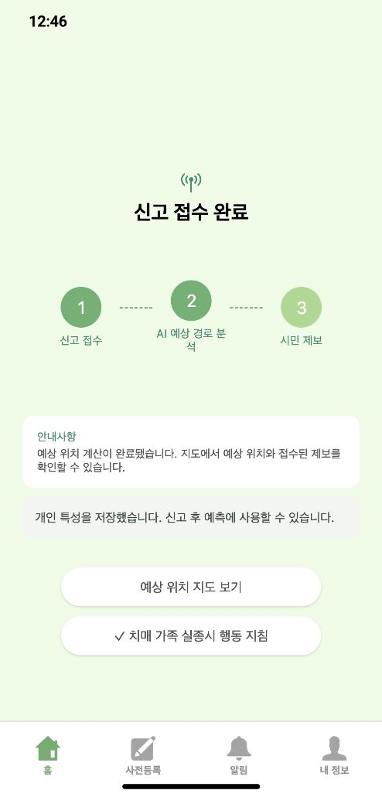
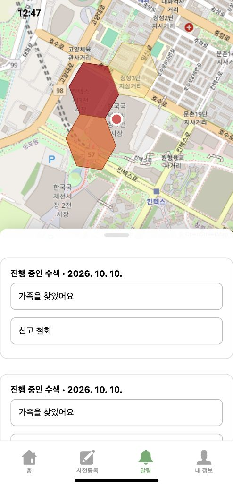

# 실제 앱 온보딩–신고–보행 연결 검증 (2026-10-10)

## 결론

공개 앱에서 합성 보호자 1명으로 사전등록을 마치고, 준비 전·후 두 시점에 신고한 결과를 확인했다. K의 개인 해석과 마음·행동 규칙은 실제로 저장·적용됐다. 다만 최초 검증에서는 KINTEX 건물 검색 좌표를 도로망 밖으로 오판해 기존 엔진으로 내려가는 연결 결함이 있었다. 해당 결함과 웹 연결 문제를 수정·배포한 뒤 동일 신고 및 새 신고 모두 새 연속 보행 엔진으로 계산되는 것을 확인했다.

이 결과는 **실제 앱 연결 검증**이다. 새로운 사람에 대한 행동 해석 정확도, 실종자 발견 정확도, 임상 검증을 입증한 결과가 아니다.

## 실제로 밟은 과정

1. 공개 앱에서 합성 보호자로 로그인했다. 실제 가입자와 구분된 서버 지정 계정이며 시민 알림을 차단했다.
2. 사전등록 챗봇에 답하고 요약을 확인했다. 동반 산책 장소를 자발적인 목적지로 간주하지 말라는 정정도 대화로 입력해 반영했다.
3. Mi:dm이 저장한 보호자 원문에서 K-EXAONE 초기 해석과 행동 규칙이 백그라운드로 준비됐다. 초기 해석 약 5분 44초, 마음 정책까지 전체 약 7분 44초가 걸렸다. 단일 사례 측정이며 일반 응답시간 보장은 아니다.
4. 준비 중 신고는 기존 초기값을 사용했고, 준비가 끝나자 같은 신고를 자동으로 다시 계산했다. 수정 전에는 지도 판정 오류로 새 보행 엔진에 진입하지 못했다.
5. 지도 연결 수정 후 같은 신고를 공개 Supabase 요청 경로로 재계산했다. agent 500명·statistical 500명 모두 새 엔진을 사용했다.
6. 준비가 끝난 뒤 공개 앱에서 두 번째 신고를 접수했다. 추가 온보딩이나 K 재해석 없이 저장된 결과를 사용해 예측을 끝냈다. 신고 완료 화면의 지도 버튼으로 보호자 확률지도를 열었다.

## 발견한 결함과 수정

| 지점 | 수정 전 | 수정 후 |
| --- | --- | --- |
| 오래 열린 웹 앱 | 이전 배포의 지연 로딩 `cloudTransport` 파일을 찾지 못해 API 사용 실패 | 통신 코드를 앱 본체에 포함. 오류 타입을 분리해 순환 의존 제거 |
| 장소 검색 → 도로망 | 킨텍스 제1전시장 중심에서 가장 가까운 도로 **노드**가 167.8m 떨어져 도로망 밖으로 판정 | 실제 보행로 **선분**에 약 121.2m로 연결. 기존 150m 허용 범위 유지 |
| 신고 → 지도 화면 | 계산이 끝나도 안내 문구가 계산 중으로 남고 지도 진입 버튼이 없음 | 완료 문구와 ‘예상 위치 지도 보기’ 버튼 연결 |
| 공개 앱 합성 검사 | 일반 시민에게 합성 신고가 노출·발송될 수 있음 | 서버 지정 합성 계정만 사건 표식 부여. 시민 목록·직접 접근·발송 경로에서 격리 |

도로 수정은 새 길을 만드는 방식이 아니다. 기존 OSM 보행로 안에 연결 노드 1개를 추가하고 같은 선분을 나눈다. 방향과 길이 합을 보존하며 교차하는 다른 도로와 임의로 연결하지 않는다. 원본 지도 파일과 취득 근거는 변경하지 않는다. 새 연결점에 소음·혼잡 관측을 만들어 넣지 않는다.

## 실제 원문 → 규칙 → 행동

합성 보호자 입력:

> 함께 산책할 때 6분쯤 걸으면 숨차다고 하시며 앉아서 5분 쉬신 뒤 다시 걸으세요.

저장된 K 규칙의 핵심:

```json
{
  "when": [[
    {"fact": "is_walking", "op": "eq", "value": true},
    {"fact": "continuous_walk_minutes", "op": "gte", "value": 6}
  ]],
  "action": "rest",
  "hold_minutes": 5
}
```

실제 사건 체크포인트에서 확인한 한 보행자의 기록:

| 시뮬레이션 시각 | 실행 |
| --- | --- |
| 6분 | 개인 규칙 `a_2`에 따라 휴식 시작 |
| 11분 | 휴식 종료 |
| 11분 이후 | 걷기 재개 |

첫 사건의 약 11.44분 체크포인트에서 채널당 338명은 5분 휴식을 마쳤고, 162명은 대기 중이었다. 이 비율은 관측되지 않은 상태를 나눈 시뮬레이션 결과이며, 실제 어르신에게 해당 행동이 나타날 확률이라는 뜻이 아니다. 대기 규칙도 원문과 연결돼 저장·실행됐지만, 모든 개인 특성을 재현했다는 의미는 아니다.

## 시간별 지도 확인

| API 미리보기 | 셀 수 | 확률 합 | 응답 |
| --- | ---: | ---: | --- |
| 1시간 | 50 | 1.000 | HTTP 200 |
| 2시간 | 84 | 1.000 | HTTP 200 |

두 분포의 총변동거리(TV)는 0.234였다. 지도가 복사된 동일 결과는 아니었다. 실제 경과시간 지도·체크포인트와 별도로 계산하는 **시간 미리보기 API** 검증이며, 두 시간 동안 실제 운영 스케줄러를 기다린 검사는 아니다. 기존 시간별 체크포인트 재사용 테스트도 통과했다.

두 공개 앱 신고 모두 `initial_interpretation.status=applied`, `roadnet_used=true`, `engine=continuous-person-v4`, `unresolved_mass=0`이었다.

## 이번에 확인한 모델 역할

```text
보호자 실제 앱 대화
  → Mi:dm 추출·원문 저장
  → K-EXAONE + 기존 RAG: 초기 개인 해석 준비
  → K-EXAONE: 조건별 마음·행동 규칙 준비·저장

실종 신고
  → SAR-EXAONE: 기존 사건 초기 수치 기준
  → 저장된 K 개인 해석 적용
  → 준비된 행동 규칙 + KINTEX OSM 도로망
  → agent 500 + statistical 500 연속 보행
  → 기존 0.7 : 0.3 결합 → 보호자 앱 지도
```

새 경로의 보행 중 K·dem5 실호출은 0회였다. dem5를 삭제한 것은 아니며 개인 정책이 준비되지 않았을 때의 기존 경로에 남아 있다. SAR-EXAONE도 사건 초기 수치 기준으로 유지된다. 이번 검증은 SAR 제거 또는 모델 자체 우열 판정이 아니다.

## 검사와 배포

- 백엔드 도로 연결·연속 보행·합성 격리 검사: 30개 통과.
- 앞서 합성 격리·웹푸시 경계·클라우드 요청 검사: 47개 통과. 위 30개와 일부 중복하므로 합산하지 않는다.
- 프런트 클라우드 전송 검사: 7개 통과.
- TypeScript 검사와 웹 빌드 통과.
- 사용 중 worker: `cbh-cloud-worker:20261010-42e9f31`.
- 최종 Pages 배포: `e243517a-b1ad-4a48-a4aa-0fd2b84b6ecf`.
- 원래 worker 복구 지점: `cbh-cloud-worker:20261009-046473d`.
- 원래 Pages 복구 지점: `bceef9cb-5383-40ec-871d-8f26f5b4150b`.

실험 러너의 최초 미리보기 요청은 허용 범위(상위 128셀)를 넘는 `top=5000`으로 보내 400 거절을 받았다. 제품 결함으로 세지 않았고, 거절 원본을 보존한 뒤 허용 범위로 검증했다.

## 사용량과 한계

실호출은 K-EXAONE 5회(초기 해석 4·마음 정책 1), Mi:dm 34회, Upstage 임베딩 52회, 자가호스팅 SAR-EXAONE 3회였다. dem5 0회, 새 학습 0회, OSM 도로망 추가 취득 0회다. 단가·청구액·지원 차수는 미확인으로 기록하고 API 이벤트를 공용 원장에 동기화했다. 자가호스팅 SAR 토큰을 API 청구액으로 중복 계산하지 않는다.

검증 범위는 합성 어르신 1명과 신고 시점 2가지다. 미관측 상태의 가정, 모든 개인 특성의 의미 해석 정확도, 실제 치매 어르신 행동의 재현 정확도는 별도 검증 대상이다. 아이폰 실기기 푸시 도착은 이번 검증에 포함하지 않았다. 합성 신고는 일반 시민에게 발송하지 않았다.

## 합성 자료 정리

시민 경보 목록에서 합성 신고 2건이 제외되는 것을 확인했다. 기존 API로 신고 철회·사건 삭제·페르소나 삭제를 진행해 모두 HTTP 200을 받았고, 연결 인터뷰도 삭제됐다. DB에서 해당 합성 계정의 사건·페르소나·인터뷰 잔여 건수는 각각 0이었다. 임시 인증 계정도 삭제하고 앱은 로그아웃 상태로 돌렸다. 검증 근거는 합성 자료만 로컬에 남겼다.

## 실제 화면





기계 판독 근거는 [results.json](results.json), 도로 연결 수치는 [map-connection.json](map-connection.json)에 있다. 원문·전체 응답·실패 요청·상세 사용량은 로컬 `결선/실험/APP_flow_live_20261010`에 보존했다.
