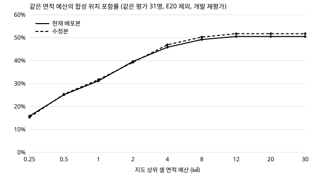
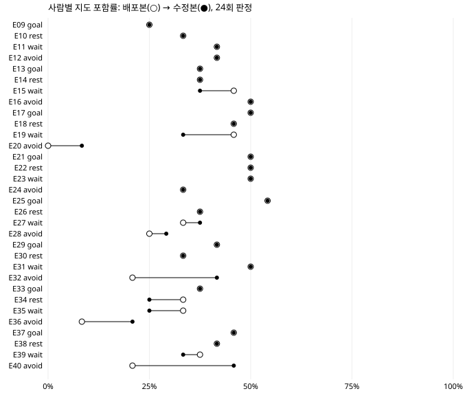

# 회피·대기 연결 오류 수정과 배포본 대비 효과 비교 — 2026-10-10

> **표기:** 모든 수치는 이미 결과를 본 합성 40명(E01–E08 개발, E09–E40 평가)의 **개발 재평가**다. 새로운 독립 평가, 실제 환자 경로, 임상 정확도가 아니다. 새 모델 호출 0회.

## 1. 무엇을 고쳤나

| 오류 | 원인 | 수정 |
|---|---|---|
| E20 장소 회피가 시장 전체로 확대 | K 재출력이 첫 출력의 장소 한정(가상 E20 시장)을 지움 | 재출력이 장소 한정만 지운 규칙은 첫 출력 한정 복원. 고정 규칙 제외, 모호하면 복원 않고 기록 |
| 위치 없는 회피로 보행자 정지·지도 미발행 | 배포 지도에 시장 레이어 없음 + 근처 여부 50% 가설 | 등록 장소·신고 관측·지도 레이어 근처에서만 판단. 없으면 "환경 정보 부족"으로 공개하고 지도 발행 |
| 쉼터·시장 이동 편향 | 장소 한정 없는 시장 소음 조건을 도로 노드마다 50% 재추첨 | 알려진 장소 1곳 단위로만 판단(정보 없으면 발동하지 않고 공개) |
| 대기 전 출발 | 같은 문답의 "대기"와 "그래도 가족이 없으면 출발"이 독립 규칙 | 같은 문답 쌍에만 "대기 중 우선" 추가(규칙 삭제 없음, 대기 뒤 이동은 원래 조건으로 계속 평가) |
| 열린 사건에서 "가족 동행" 가설 | 관측 없는 family_present를 50% 가설로 둠 | 사건이 열려 있으면 거짓. 재회 관측 시 더 걷지 않음(종결은 앱 수명주기) |

저장된 정책·`mind_policy.VERSION`은 바꾸지 않았다. 저장 K 응답으로 재준비하면 40명 중 E20만 바뀐다(장소 한정 복원).

## 2. 배포본 대비 서비스 효율 (평가 32명)

먼저 확인: 현재 배포본(PR #274, 도로 앵커 포함)으로 D를 다시 돌린 결과는 기존 실험과 **지도 320개(평가 256·개발 64) 모두 비트 단위로 같다.** 기존 수치가 곧 배포본 수치다.

| 방식 | 지도 포함률 | 지도 면적 ㎢ | 알림 포함률 | 알림 면적 ㎢ | 미완료 판정 |
|---|---:|---:|---:|---:|---:|
| 기존 경보 근사: 관련 구 | — | — | 69.3% | 62.94 | 0 |
| 기존 경보 근사: 고양시 | — | — | 95.3% | 266.25 | 0 |
| 본선 코드 재현 | 24.7% | 0.98 | 42.1% | 6.28 | 0 |
| **현재 배포본** | 37.2% | 2.58* | 40.6% | 5.97* | 24/768 |
| **수정본** | 38.3% | 2.57 | 41.3% | 5.67 | 0/768 |

\* 배포본 면적은 E20(미완료)을 뺀 31명 평균. 포함률은 실패를 포함한 32명. 경보 근사는 행정경계 가정이며 실제 송출 기록이 아니다.

**사람 단위 쌍 비교(수정본 − 배포본, 부트스트랩 95% 구간):**

- 지도 포함률 +1.04%p [-1.30, +3.78] · 알림 포함률 +0.65%p [-0.78, +2.99]
- 지도 면적 +0.02㎢ [-0.17, +0.24] · 알림 면적 -0.26㎢ [-0.51, -0.06] (면적은 양쪽 완료 31명)
- 해석: 포함률 변화는 구간이 0을 포함한다. 알림 면적은 줄었다. 가장 큰 변화는 E20의 지도 발행(0→24/24)이다.

## 3. 구성요소 비교 (수정 엔진 기준, 배포본 성능 수치 아님)

B/C는 같은 연속 엔진에 개인 행동 규칙을 비운 구성이다. 배포본에서 정책이 없는 사람은 기존 엔진(+dem5)을 쓰므로 이 표는 배포본 성능이 아니다.

| 구성 | 지도 포함률 | 지도 면적 ㎢ | 알림 포함률 | 알림 면적 ㎢ |
|---|---:|---:|---:|---:|
| B 공통 정보 | 27.7% | 5.29 | 23.8% | 3.68 |
| C + 초기 개인화 | 38.9% | 3.87 | 38.2% | 5.39 |
| D + 행동 규칙(수정본) | 38.3% | 2.57 | 41.3% | 5.67 |

- C−B: 지도 포함률 +11.20%p [+5.47, +16.93], 지도 면적 -1.41㎢ [-1.78, -1.05]
- D−C: 지도 포함률 -0.65%p [-3.12, +1.82], 지도 면적 -1.30㎢ [-1.57, -1.04], 알림 포함률 +3.12%p [-0.13, +6.51]

## 4. 대기 순서 (통제 검사: 길 잃음·가족 없음 고정, 사람당 500명)

| 사람 | 대기 | 대기 전 이동 배포본 → 수정본 | 원인 규칙(원문) | 원문 기준 분류(판정자 3명) |
|---|---:|---:|---|---|
| E03 | 10분 | 246 → 0 | — | — |
| E07 | 30분 | 251 → 140 | a_0 seek→가상 E07 공원 (N0) | 잘못된 선행 이동 3/3 |
| E11 | 40분 | 237 → 0 | — | — |
| E15 | 40분 | 244 → 0 | — | — |
| E19 | 40분 | 261 → 0 | — | — |
| E23 | 10분 | 237 → 120 | a_0 seek→가상 E23 공원 (N0) | 잘못된 선행 이동 3/3 |
| E27 | 20분 | 264 → 264 | a_2 seek→가상 E27 공원 (N2) | 해석 오류(같은 문답에서 길 잃음 조건 누락) |
| E31 | 40분 | 246 → 111 | a_0 seek→가상 E31 공원 (N0) | 잘못된 선행 이동 3/3 |
| E35 | 30분 | 250 → 250 | a_0 seek→가상 E35 공원 (N0) | 잘못된 선행 이동 3/3 |
| E39 | 40분 | 253 → 0 | — | — |
| **합계** | | **2489 → 885** / 5,000 | | |

- 남은 885건은 모두 원문 기준 **잘못된 선행 이동**이다. 원인은 다른 문답(N0)의 평소 외출 습관을 K가 조건 반응으로 바꾼 해석 오류다(E07·E23·E31: 관측 없는 "공원 알아봄" 가설, E35: "혼자 나가도 그곳으로"→"가족 없으면 공원"). 서로 다른 문답에 일괄 우선순위를 적용하지 않았다.
- **E27 해석 수정:** 원문 N2의 "길을 잃었다는 걸 알아차리면 … 그래도 가족이 없으면"에서 빠진 길 잃음 조건만 복원(수동, K 재호출 아님). 통제 검사 대기 전 이동 264 → 0. 결과는 수정 전후를 모두 보존.

| E27 | 지도 포함 | 알림 포함 | 지도 면적 | 알림 면적 |
|---|---:|---:|---:|---:|
| 배포본 | 8/24 | 9/24 | 2.50 | 6.62 |
| 수정본(저장 정책) | 9/24 | 8/24 | 1.82 | 4.42 |
| 수정본 + E27 해석 수정 | 8/24 | 9/24 | 2.32 | 6.62 |

- 대기 종료는 정해진 시간(완료 뒤 출발) 또는 대기 조건 해제로만 일어난다. 가족이 곁에 있다는 관측은 재회로 보고 더 걷지 않는다. 실험 입력에는 가족 관측이 없다.

## 5. E20: 지도 발행과 장소 회피를 분리

| 상황(500명, 15분) | 버전 | 지도 발행 | 회피 실행 | 쉼터 이동 | 15분 뒤 시장 60m 밖 | 판정 |
|---|---|---|---:|---:|---:|---|
| A 시끄러운 시장에서 출발 | 배포본 | 아니오 | 337 | 409 | 489 | 회피는 일어나나 지도 미발행 |
| A 시끄러운 시장에서 출발 | 수정본 | 예 | 370 | 500 | 489 | 회피 성공 |
| B 조용한 시장에서 출발 | 배포본 | 아니오 | 0 | 311 | 438 | 조용한데 쉼터 이동 편향 |
| B 조용한 시장에서 출발 | 수정본 | 예 | 0 | 0 | 444 | 회피 없음(원문대로) |
| C 시장 2km 밖, 정보 없음 | 배포본 | 아니오 | 0 | 351 | 500 | 지도 미발행 |
| C 시장 2km 밖, 정보 없음 | 수정본 | 예 | 0 | 0 | 500 | 검사 불가 — 성공으로 세지 않음 |

- "조용하면 시장에 들어가세요"는 K 정책에 표현되지 않았다(시장 이동 0). 계약 한계로 남긴다.
- 6시간 재생에서 E20 보행자는 대부분 시장(약 2km)에 접근하지 않아 회피 규칙 실행 시간이 거의 0이고, 쉼터 이동 규칙은 평균 약 317분이 "환경 정보 부족"으로 공개된다. 이 시간은 회피 성공으로 세지 않는다.

## 6. 사람별 보존 결과 (D, 6시간, 두 시드 평균)

평균 개선이 개인 손실을 가리지 않도록 40명을 모두 적는다. 규칙 실행 시간은 보행자 1명당 분.

| 사람 | 군 | 지도 포함 배포→수정 | 알림 포함 | 지도 동일 | 휴식 분 | 대기 분 | 회피·이동 규칙 실행 분 | 정보 부족 분 | 변화 사유 |
|---|---|---|---|---|---|---|---|---|---|
| E01 | goal | 50→50% | 42→42% | 8/8 | 112→112 | 15→15 | 변화 없음 | — | — |
| E02 | rest | 42→42% | 50→50% | 8/8 | 68→68 | 16→16 | 변화 없음 | — | — |
| E03 | wait | 50→50% | 58→58% | 0/8 | 152→153 | 48→48 | a_2 3→5 | — | 대기 우선, 가족 부재 기본값 |
| E04 | avoid | 33→33% | 46→46% | 8/8 | 134→134 | 17→17 | 변화 없음 | — | — |
| E05 | goal | 38→38% | 46→46% | 8/8 | 50→50 | 14→14 | 변화 없음 | — | — |
| E06 | rest | 33→33% | 58→58% | 8/8 | 89→89 | 6→6 | 변화 없음 | — | — |
| E07 | wait | 8→17% | 33→33% | 0/8 | 11→8 | 276→292 | a_1 250→269; a_2 10→7; a_3 12→13; a_4 5→11 | — | 대기 우선, 가족 부재 기본값, ⚠ 휴식 11→8 감소 |
| E08 | avoid | 38→50% | 42→58% | 0/8 | 97→103 | 21→22 | a_0 79→92; a_2 26→1 | a_2 260 | 근거 없는 발동 제거 |
| E09 | goal | 25→25% | 46→42% | 0/8 | 109→102 | 14→12 | a_0 35→68; a_1 103→95 | — | 가족 부재 기본값 |
| E10 | rest | 33→33% | 54→54% | 8/8 | 169→169 | 17→17 | 변화 없음 | — | — |
| E11 | wait | 42→42% | 42→42% | 0/8 | 156→154 | 35→34 | a_0 154→152; a_3 16→33 | — | 대기 우선, 가족 부재 기본값 |
| E12 | avoid | 42→42% | 33→33% | 8/8 | 133→133 | 18→18 | 변화 없음 | — | — |
| E13 | goal | 38→38% | 50→50% | 8/8 | 132→132 | 15→15 | 변화 없음 | — | — |
| E14 | rest | 38→38% | 42→42% | 8/8 | 128→128 | 15→15 | 변화 없음 | — | — |
| E15 | wait | 46→38% | 50→50% | 0/8 | 53→53 | 44→43 | a_2 13→26 | — | 대기 우선, 가족 부재 기본값 |
| E16 | avoid | 50→50% | 58→58% | 8/8 | 51→51 | 16→16 | 변화 없음 | — | — |
| E17 | goal | 50→50% | 50→50% | 8/8 | 173→173 | 9→9 | 변화 없음 | — | — |
| E18 | rest | 46→46% | 29→29% | 8/8 | 69→69 | 15→15 | 변화 없음 | — | — |
| E19 | wait | 46→33% | 42→42% | 0/8 | 88→88 | 60→58 | a_0 78→77; a_2 16→31 | — | 대기 우선, 가족 부재 기본값 |
| E20 | avoid | 0→8% | 0→33% | 0/8 | 미완료→50 | 미완료→19 | a_0 0→39; a_2 0→3 | a_2 317 | 장소 한정 복원 |
| E21 | goal | 50→50% | 50→50% | 8/8 | 50→50 | 19→19 | 변화 없음 | — | — |
| E22 | rest | 50→50% | 62→62% | 8/8 | 170→170 | 15→15 | 변화 없음 | — | — |
| E23 | wait | 50→50% | 50→50% | 0/8 | 45→45 | 45→47 | a_2 2→5; a_3 2→4 | — | 대기 우선, 가족 부재 기본값 |
| E24 | avoid | 33→33% | 50→50% | 8/8 | 106→106 | 22→22 | 변화 없음 | — | — |
| E25 | goal | 54→54% | 42→42% | 8/8 | 58→58 | 16→16 | 변화 없음 | — | — |
| E26 | rest | 38→38% | 38→38% | 8/8 | 120→120 | 9→9 | 변화 없음 | — | — |
| E27 | wait | 33→38% | 38→33% | 0/8 | 51→51 | 18→10 | a_0 26→18; a_1 9→8; a_2 128→252 | — | 가족 부재 기본값, ⚠ 대기 18→10 감소 |
| E28 | avoid | 25→29% | 50→50% | 0/8 | 145→150 | 13→13 | a_0 47→56; a_1 137→143; a_3 90→26 | a_3 180 | — |
| E29 | goal | 42→42% | 17→17% | 8/8 | 50→50 | 18→18 | 변화 없음 | — | — |
| E30 | rest | 33→33% | 46→46% | 8/8 | 89→89 | 16→16 | 변화 없음 | — | — |
| E31 | wait | 50→50% | 42→42% | 0/8 | 70→71 | 60→59 | a_3 3→7 | — | 대기 우선, 가족 부재 기본값 |
| E32 | avoid | 21→42% | 42→42% | 0/8 | 69→68 | 18→18 | a_0 59→62; a_2 35→1 | a_2 300 | 근거 없는 발동 제거 |
| E33 | goal | 38→38% | 42→42% | 8/8 | 115→115 | 14→14 | 변화 없음 | — | — |
| E34 | rest | 33→25% | 25→25% | 0/8 | 140→138 | 15→13 | a_0 21→42; a_1 137→135 | — | 가족 부재 기본값 |
| E35 | wait | 33→25% | 25→25% | 0/8 | 109→103 | 31→28 | a_0 36→71; a_1 98→89 | — | 대기 우선, 가족 부재 기본값 |
| E36 | avoid | 8→21% | 33→29% | 0/8 | 70→86 | 0→15 | a_0 50→82; a_1 161→7; a_2 129→0 | a_1 284, a_2 284 | 근거 없는 발동 제거 |
| E37 | goal | 46→46% | 25→25% | 8/8 | 51→51 | 16→16 | 변화 없음 | — | — |
| E38 | rest | 42→42% | 33→33% | 8/8 | 55→55 | 10→10 | 변화 없음 | — | — |
| E39 | wait | 38→33% | 50→50% | 0/8 | 73→73 | 63→62 | a_2 9→19 | — | 대기 우선, 가족 부재 기본값 |
| E40 | avoid | 21→46% | 46→46% | 0/8 | 85→86 | 19→19 | a_0 81→82; a_2 22→0 | a_2 286 | 근거 없는 발동 제거 |

**대기·휴식이 10% 이상 줄어든 사람:** E07 휴식 11→8분, E27 대기 18→10분. E07은 공원 도착 뒤 기간 미상 대기(a_1, N0 "거기서 한동안 머무르세요")가 250→269분으로 늘어 걷는 시간이 줄고 휴식 발동도 줄었다(원문에 머무는 시간이 없어 길이를 지어내지 않음). E27은 K가 같은 문답의 이동 규칙에서 "길 잃음" 조건을 빠뜨린 해석 오류 때문이다. 가족 부재 기본값으로 "가족 없으면 공원으로"(a_2)가 늘 켜지면서 대기와 경쟁했다. 원문 근거 해석 수정(4절)을 적용한 재생에서는 대기가 17.5분으로 회복된다(배포본 17.6분). 운영 정책의 수정은 K 재해석이 필요하다.

**포함률이 떨어진 사람:** E15 46→38%, E19 46→33%, E34 33→25%, E35 33→25%, E39 38→33%. 휴식·대기 실행 시간은 유지됐다. 가족 부재 기본값으로 원문 "그래도 가족이 없으면 공원 쪽으로"가 더 많이 실행되면서 지도가 공원 경로에 모였고, 합성 정답이 2시간 이후 귀가·이탈한 시점(24회 중 1~3회)을 놓쳤다. 같은 사람들의 지도 면적은 줄었다. 특성 손실이 아니라 집중도와 포함률의 교환이며, 평균에 묻지 않고 그대로 적는다.

**규칙 실행이 크게 준 사람:** E08(a_2), E32(a_2), E36(a_1, a_2), E40(a_2). 모두 장소 한정 없는 시장 소음 조건 규칙이며, 배포본은 시장에서 먼 곳에서도 가설만으로 발동했다(E08·E32·E40은 신고상 시장이 조용함). 수정본은 알려진 시장 근처에서만 발동하고 나머지는 정보 부족으로 공개한다. 근거 없는 발동 제거이며 이 사람들의 지도 포함률은 유지 또는 상승했다.

## 7. 하지 않은 것과 한계

- 실제 환자 경로·전문가 평가·새 독립 평가 없음. 수정에 E01–E40을 사용했으므로 다음 확인은 새 합성 평가가 필요하다.
- E07·E23·E31·E35의 습관→조건 반응 해석 오류는 분류만 했고 정책은 고치지 않았다(K 재해석 필요). E27만 원문 근거로 해석 수정 결과를 별도로 남겼다.
- 실제 KINTEX 시장·공원 위치 레이어는 기존 자료(도로 전용 OSM)에 없어 등록 장소만 사용한다. 유형 전체 회피의 실제 검증은 POI 레이어가 필요하다.
- "조용하면 시장에 들어간다" 같은 진입 반응은 현재 계약으로 표현되지 않는다.
- 운영 배포는 별도 단계다(GPU SSH 필요).

## 8. 재현

원본 보행 결과(사람·시드별 지도, 약 수백 MB)는 팀 로컬 실험 보관소 `결선/실험/EFFICIENCY_avoid_wait_fix_20261010/`에 있고, 이 폴더에는 요약(`data/`)과 재현 스크립트만 넣었다. 기준 실험 입력·정답은 `결선/실험/EFFICIENCY_KINTEX_v1_20261009/`.

`scripts/`의 reprepare.py(저장 K 응답 재준비), batch_replay.py(배포본/수정본 재생), controlled_*.py(통제 검사), analyze_final.py, make_report.py. 모두 네트워크 차단·모델 호출 0회.
